# The 22 unreachable built levels: evidence and suggested verdicts

Evidence for the TODO item **"[T5] Evaluate the 22 built levels no player can reach: keep and upgrade, or delete"** (Will, 2026‑11‑22), gathered 2026‑11‑27 so it can be decided in one pass. Nothing was deleted, rebuilt in place or changed; the verdicts below are suggestions only, and the **Decide** list at the end is for Will.

**How the evidence was gathered**

- **Screenshots:** each tracked `wflevels/<id>-standalone.iff` was run in `wf-linux-test:local` under Xvfb with Mesa llvmpipe, using a copy of today's Debug + ASan + `WF_DESIGNER_CHEATS` engine (`build-docker/wf-game-dev`, 07:23). The engine ran with `--frame-step-smoke=90 --cycles=1 -rate20 --no-fps --capture-frame=80`, so each picture is the frame at 4 s of simulated time. The engine exits on its own after frame 90, and that exit is the completion signal, so no sleep was used. Core dumps were off, memory was capped at 6 GB, and the VRAM switches come from `tests/fixtures/renderer/style-scene.json`. The frames were scaled to 400×300.
- **Builds:** `wftools/wf_blender/build_level_binary.sh <id>` was run in the same container on a dereferenced copy (`cp -rL`) of `wflevels/<id>/`, with `WF_LEVEL_DIR` and `WF_LEVEL_OUT_DIR` pointing at scratch, so no tracked file was written. Every level that has a folder built through all five steps.
- **References:** `git grep -w <id>` outside the level's own folder, excluding `docs/transcripts/`, the `docs/diagnostics/blender-normal-convention/*.json` inventories and the `reef-style-metal` sweep tables. Those three only list levels; they would not break. References marked **⚠ breaks** would fail or go stale if the level were deleted.
- **Size:** `wflevels/<id>/`, `wflevels/<id>.iff` and `wflevels/<id>-standalone.iff`. Symlinked files are not counted, since they belong to another level.

**What the verdicts mean**

| Verdict | Meaning |
|---|---|
| **keep as‑is** | in use as a fixture or tool. Do not recompile it: its bytes are what a test checks |
| **keep + upgrade** | worth keeping. The T1 recompile (`task build-level -- <id>`) gives it the default `LevelSettings` holder |
| **archive** | leave it frozen in the tree, with no upgrade and no further work (the Marble Madness rule) |
| **delete** | remove the files, together with every reference marked ⚠ |

## Surprises

1. **Not every one is unreachable.**
    - `seahorse_grid` **ships**: it is the only level of the *Seahorse Grid* screensaver app (`android/screensaver` flavor `seahorse`, `org.worldfoundry.seahorsegrid`, bundled by `scripts/build-aquarium-screensaver-levels.py`). It is missing from `SHIPPED_BY_APP` in `scripts/audit-level-settings.py`.
    - The web build preloads `moon_site01` (its default level), `marble-madness` and `pilot_demo` (`WF_WEB_LEVELS`, `CMakeLists.txt:1261`, for the worldfoundry.org /v2/play switcher).
2. **Two have already been upgraded.** `filesys` (rebuilt 2026‑11‑26, `541730ae5`) and `seahorse_grid` already carry Show framerate (`audit-level-settings.py --roster built`), so 20 are left, not 22.
3. **The textile failures did not come back.** `aquarium_idle` and all four `style_*` levels built cleanly in a scratch copy today. The style folders each hold 40 symlinks into the reef tanks. If the 2026‑11‑22 failure was an in‑tree run, the symlinks are the first suspect; this was not checked further.
4. **Seven Director scripts no longer compile on today's engine**, so those levels render without their scripted content:
    - `dome`, `filelight`, `filesys` and `treemap` stop at `zforth unknown token: \\`. The `.lev` Script string starts `"\\\\ wf\n…"`. The filesystem walk never runs, so `dome` is black and the other three show only the floor.
    - `moon_site01`, `pilot_demo` and `snowgoons-blender` stop at `zforth unknown token: wf` in the Director's camshot script, which they share through the snowgoons‑blender scaffold. The shipped `snowgoons` level, run the same way, has no compile errors.
5. **`mm_practice` must not be upgraded.** `tests/test_levelobj_fields.py` and the ctest `levelobj_short_record_mm_practice` use its committed `.lvl` as the *old‑format* level. Recompiling it would remove what those tests exist to check.
6. **`snowgoons-blender/` is the source folder of the shipped Snowgoons.** `task snowgoons-level` builds `wflevels/snowgoons*.iff` from `snowgoons-blender/snowgoons.lev`, and `snowgoons-blender.lev` is the wf_edit ctest and web‑editor fixture. Only the two `snowgoons-blender*.iff` outputs (about 0.2 MB) belong to the unreachable level.
7. **`pilot_demo.lev` is gitignored on purpose.** Its sources are the `.blend` and the generator, so a fresh clone needs a Blender step before `build-level`. The build here used the untracked local `.lev`.
8. **`condo_639_640_tour` is the source of the tour clip.** `task video-condo-639` records `wflevels/condo_639_640/tour-639.mp4` (640×480) from it.

## Summary

| id | group | what | last own change | referenced by (⚠ = breaks) | builds | size (tracked + untracked) | suggested |
|---|---|---|---|---|---|---|---|
| `condo_639_640_touch` | condo | condo built with the two‑button touch camera profile | 2026‑09‑30 | ⚠ Taskfile `condo-touch`, ⚠ `tests/verify_condo_camera_touch.py`, sweep VRAM entry | yes | 10.0 + 0.7 MB | **delete** |
| `condo_639_640_tour` | condo | self‑walking tour build that `video-condo-639` records | 2026‑09‑30 | ⚠ Taskfile `tour-condo-639`/`video-condo-639`, ⚠ `tests/record_condo_639_tour.py`, `test_backface_cull_invariant` | yes | 10.0 + 0.7 MB | **keep as‑is** |
| `marble-madness` | Marble Madness | ROM‑decoded MM path experiments (6 generators) | 2026‑09‑21 | ⚠ web build `WF_WEB_LEVELS`, ⚠ `marble-madness-2/gen_level1.py`, backface test | yes | 0.7 + 0.1 MB | **archive** |
| `marble-madness-2` | Marble Madness | physics/motion copy of MM with timer and goal | 2026‑09‑21 | backface test | yes | 0.3 + 0.1 MB | **archive** |
| `mm_practice` | mm_practice | hand‑made practice ramp; old‑format `.lvl` fixture | 2026‑09‑20 | ⚠ ctest `levelobj_short_record_mm_practice`, ⚠ `test_levelobj_fields.py`, ⚠ `test_editable_objects_export.py`, `test_global_level_settings.py` | yes | 0.4 MB | **keep as‑is** |
| `mm_practice_blender` | mm_practice | Blender‑authored copy (2026‑04 authoring comparison) | 2026‑09‑21 | backface test, `sweep_blender_levels.py` | yes | 0.2 + 0.1 MB | **delete** |
| `mm_practice_blender_rt` | mm_practice | Blender import→export round‑trip of the above | 2026‑09‑21 | backface test, `sweep_blender_levels.py` | yes | 0.1 + 0.1 MB | **delete** |
| `style_flat_anime` | style | untextured anime (S3) shading scene | 2026‑11‑09 | ⚠ `style-scene.json` → `test_style_shading_invariant.py` + Metal CI, ⚠ `build-style-flat-scene.py`, `test_global_level_settings.py` | yes | 4.5 + 8.4 MB | **keep as‑is** |
| `style_flat_realistic` | style | untextured realistic (S1) shading scene | 2026‑11‑09 | ⚠ `style-scene.json`, ⚠ `build-style-flat-scene.py` | yes | 4.8 + 8.7 MB | **keep as‑is** |
| `style_geom_anime` | style | reef shell and 3 hero rocks, anime (S3) | 2026‑11‑09 | ⚠ `style-scene.json`, ⚠ `build-style-geometry-scene.py` | yes | 4.4 + 8.4 MB | **keep as‑is** |
| `style_geom_realistic` | style | reef shell and 3 hero rocks, realistic (S1) | 2026‑11‑09 | ⚠ `style-scene.json`, ⚠ `build-style-geometry-scene.py` | yes | 4.7 + 8.7 MB | **keep as‑is** |
| `teleport_regression` | fixture | 4‑room cross‑room teleport fixture | 2026‑10‑09 | ⚠ ctest `cross_room_teleports` (+ `_mutation`), `generate_teleport_level.py` | n/a (generated) | 0.1 MB | **keep as‑is** |
| `unloaded_actor_regression` | fixture | teleport from an unloaded source room | 2026‑10‑09 | ⚠ ctest `unloaded_actor_teleports` | n/a (generated) | 0.1 MB | **keep as‑is** |
| `aquarium_idle` | single | clownfish idle‑rig spike, now the rig's regression level | 2026‑10‑01 | ⚠ `tests/test_aquarium_idle.py`, ⚠ `tests/test_wall_clock.py`, ⚠ Taskfile `aquarium-idle-*` | yes | 0.3 + 0.2 MB | **keep + upgrade** |
| `dome` | single (fs‑viz) | planetarium dome: Filelight sunburst on a hemisphere | 2026‑09‑21 | Taskfile `run-dome`, `sweep_blender_levels.py`, backface test | yes | 0.2 MB | **archive** |
| `filelight` | single (fs‑viz) | walkable radial disk‑usage sunburst | 2026‑09‑19 | Taskfile `run-filelight`, `sweep_blender_levels.py`, backface test | yes | 0.4 MB | **archive** |
| `filesys` | single (fs‑viz) | SGI FSN‑style filesystem browser | 2026‑11‑26 | ⚠ `tests/test_level_iff_carries_its_lvl.py`, ⚠ `scripts/check-filesys-rebuild.sh`, Taskfile `run-filesys` | yes (already upgraded) | 0.4 MB | **keep** (fix script) |
| `moon_site01` | single | Artemis III Site 01 lunar terrain with lander and rovers | 2026‑09‑19 | ⚠ web build (default level, `web/shell.html`), Taskfile run task, sweep, backface test | yes | 13.7 + 0.1 MB | **keep + upgrade** |
| `pilot_demo` | single | in‑level PILOT‑language script proof | 2026‑09‑20 | ⚠ web build, ⚠ `tests/pilot/in_level_demo.pilot`, sweep, backface test | yes (untracked `.lev`) | 0.2 + 2.2 MB | **keep + upgrade** |
| `seahorse_grid` | single | 24 animated seahorses: Seahorse Grid screensaver | 2026‑11‑24 | ⚠ **ships** in the seahorse screensaver flavor, ⚠ `build-seahorse-grid-level.py`, ⚠ `tests/test_seahorse_grid_level.py` | yes (already upgraded) | 2.3 + 0.5 MB | **keep** (ships) |
| `snowgoons-blender` | single | Blender scaffold of Snowgoons; its folder is shipped Snowgoons' source | 2026‑11‑14 | ⚠ shipped `snowgoons` build, ⚠ wf_edit ctests, ⚠ web editor (`CMakeLists.txt:2118`) | yes | 2.1 + 0.2 MB (level only ~0.2) | **keep + upgrade** |
| `treemap` | single (fs‑viz) | KDirStat squarified disk‑usage treemap | 2026‑09‑19 | Taskfile `run-treemap`, `sweep_blender_levels.py`, Forth words in `scripting_zforth.cc` | yes | 0.2 MB | **archive** |

"Last own change" skips the blanket sweeps (`25a57d734` normals on 2026‑10‑16, `23658e9a6`, `7ed6d60c5`), which touched almost every level. The sections below give both dates.

## Condo variants

### `condo_639_640_touch`

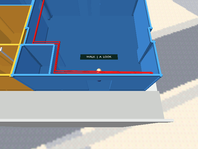

- **What:** the condo built with `CONDO_CAMERA_PROFILE=touch`, a Forth‑only two‑button touch camera (A cycles the modes). Generator `wflevels/condo_639_640/blender_create_condo.py`, built by `task condo-touch` from Will's `~/docs/aircon/units-639-640.blend`. Plan: [docs/plans/2026-09-25-condo-camera-controls.md](../../plans/2026-09-25-condo-camera-controls.md).
- **Commits:** first 2026‑09‑25 `00978ee7d` "Add condo walkthrough controls and shared Forth comment support"; last 2026‑10‑16 `25a57d734` (sweep); last own change 2026‑09‑30 `10836a514`.
- **References:** ⚠ `Taskfile.yml:1553` `condo-touch`; ⚠ `tests/verify_condo_camera_touch.py`; `tests/fixtures/renderer/style-scene.json:56` (sweep VRAM); `wflevels/condo_639_640/condo_639_640.md`.
- **Builds:** yes. **Runs:** yes; the frame shows the "WALK | A LOOK" touch hint.
- **Size:** 10.0 MB tracked (113 files: a full copy of the condo meshes) + 0.7 MB untracked.
- **Suggested: delete.** The shipped condo app builds the desktop profile, and no app or ctest uses this one. It is 10 MB of duplicated meshes and can be rebuilt with `task condo-touch` while the `.blend` exists. Keep it only if a touch build for phones is still planned.

### `condo_639_640_tour`

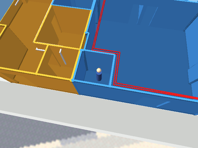

- **What:** the self‑walking tour of the 639 rooms (`CONDO_TOUR=wflevels/condo_639_640/tour-639.path.json`). `task video-condo-639` records it to `wflevels/condo_639_640/tour-639.mp4` at 640×480. Plan: [docs/plans/2026-09-19-condo-639-tour-video.md](../../plans/2026-09-19-condo-639-tour-video.md).
- **Commits:** first 2026‑09‑19 `e59fcf28e` "feat(condo): 30 s captioned room tour…"; last 2026‑10‑16 `25a57d734` (sweep); last own change 2026‑09‑30. 18 commits.
- **References:** ⚠ `Taskfile.yml:1567` `tour-condo-639`, ⚠ `:1588` `video-condo-639`; ⚠ `tests/record_condo_639_tour.py`; `tests/test_backface_cull_invariant.py:65,105`; `wfsource/source/gfx/glpipeline/backend_modern.cc:605` (comment); five condo plans.
- **Builds:** yes. **Runs:** yes; the player starts the walk.
- **Size:** 10.0 MB tracked + 0.7 MB untracked.
- **Suggested: keep as‑is.** It is the source of the condo tour clip. It is a recording rig, not a player level, so it does not need the settings holder.

## Marble Madness

### `marble-madness`

- **What:** the first Marble Madness level, plus the ROM decoder (`decode_levels.py`, `rom_to_blender.py`) and six Blender generators: aerial, fromscratch, intermediate, practice_rom, silly and ultimate. The sub‑levels `mm_fromscratch`, `mm_intermediate` and `mm_practice_rom` are built inside this folder. Docs: [docs/marble-madness/README.md](../../marble-madness/README.md), [docs/plans/2026-05-01-marble-madness-faithful.md](../../plans/2026-05-01-marble-madness-faithful.md). The shipped `marble-madness-3d-astra` is a separate hand‑authored IFF and does not depend on this folder.
- **Commits:** first 2026‑04‑28 `d4ed033fd` "Add marble-madness level directory — primary working level going forward"; last own change 2026‑09‑21 `f3e17612a`. 40 commits.
- **References:** ⚠ `CMakeLists.txt:1264` (web build preload); ⚠ `wflevels/marble-madness-2/gen_level1.py:265` reads its `.lev`; `tests/test_backface_cull_invariant.py:69`; many plans and docs.
- **Builds:** yes. **Runs:** yes: a green slab, the ball and an orange ramp.
- **Size:** 0.7 MB tracked + 0.1 MB untracked (without `-2` and astra).
- **Suggested: archive.** Marble Madness is low priority (archive rather than invest), and the web build still preloads it.

### `marble-madness-2`

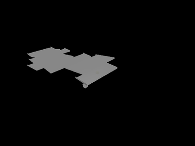

- **What:** a duplicate of MM for physics and motion work: a generated S‑curve trough (`gen_level1.py`), a 90‑second timer and goal detection. Plan: [docs/plans/2026-04-30-duplicate-marble-madness-level-for-physics-motion-co.md](../../plans/2026-04-30-duplicate-marble-madness-level-for-physics-motion-co.md).
- **Commits:** first 2026‑04‑30 `17b81fcce`; last own change 2026‑09‑21. 9 commits.
- **References:** `tests/test_backface_cull_invariant.py:70` only (plus `wf-status.md` and plans).
- **Builds:** yes. **Runs:** yes: a grey course floating in black.
- **Size:** 0.3 + 0.1 MB.
- **Suggested: archive** (same rule; costs nothing to leave).

## mm_practice

### `mm_practice`

- **What:** a hand‑crafted practice ramp (`gen_lev.py` from snowgoons.lev; `gen_ramp.py`). Its committed `.lvl` predates the LevelObj field change and is the *old level* in the field tests. Investigation: [docs/investigations/2026-04-28-mm-practice-authoring-comparison.md](../../investigations/2026-04-28-mm-practice-authoring-comparison.md).
- **Commits:** first 2026‑04‑28 `e3f77be48`; last 2026‑10‑17 `23658e9a6` (sweep); last own change 2026‑09‑20.
- **References:** ⚠ `CMakeLists.txt:1413` ctest `levelobj_short_record_mm_practice` (expects 568 bytes); ⚠ `tests/test_levelobj_fields.py:44,131,159`; ⚠ `tests/test_editable_objects_export.py`; ⚠ `tests/test_global_level_settings.py:146` (asserts it is *not* reachable); `scripts/blender_create_level.py`, `scripts/gen_lev.py` (copies); qbert plans.
- **Builds:** yes. **Runs:** yes: the orange trough with the SCORE/TIME/LIVES HUD.
- **Size:** 0.4 MB.
- **Suggested: keep as‑is, and do not upgrade.** A recompile would change the 568‑byte old‑format record the tests pin.

### `mm_practice_blender`

- **What:** the same ramp authored by driving Blender (`blender_create_mm_practice.py` writes `mm_practice/mm_practice_blender.lev`; this folder symlinks it). It is one arm of the 2026‑04‑28 authoring comparison.
- **Commits:** first 2026‑04‑28 `628d24af0`; last own change 2026‑09‑21 `e30efc802` (ramp winding). 5 commits.
- **References:** `tests/test_backface_cull_invariant.py:72`; `scripts/sweep_blender_levels.py:45` (through `_rt`); a comment in `backend_modern.cc:611` and in `qbert_practice/blender_create_qbert.py:909`.
- **Builds:** yes. **Runs:** yes, but almost black: a dim ground quad and nothing lit.
- **Size:** 0.2 + 0.1 MB.
- **Suggested: delete.** The comparison it served finished in April (see the investigation), and only the backface test and the sweep list still use it.

### `mm_practice_blender_rt`

- **What:** the import→export round trip of `mm_practice_blender` (`blender_roundtrip_mm_practice_blender.py`), the "Blender round‑trip milestone".
- **Commits:** first 2026‑04‑28 `b2df9c90c`; last own change 2026‑09‑21. 4 commits.
- **References:** `tests/test_backface_cull_invariant.py:73`; `scripts/sweep_blender_levels.py:45`.
- **Builds:** yes. **Runs:** yes; the frame is identical to `mm_practice_blender` (122 866 lit pixels each, so the round trip is lossless).
- **Size:** 0.1 + 0.1 MB.
- **Suggested: delete** together with `mm_practice_blender`. The milestone is recorded in git history, and only the backface test and the sweep list still name it.

## Style tests

All four are generated from the reef tanks by `scripts/build-style-geometry-scene.py` and `scripts/build-style-flat-scene.py` (Reef step 14, [docs/diagnostics/reef-style-metal-2026-11-09/README.md](../reef-style-metal-2026-11-09/README.md)). They are scenes of `tests/fixtures/renderer/style-scene.json`, which `tests/test_style_shading_invariant.py` (GL) and `scripts/macos/style-metal-ci.sh` (Metal) render and compare. Only the `.lev`, the wrappers and the standalone are tracked; 40 meshes in each folder are symlinks into the reef tanks.

| `style_flat_anime` | `style_flat_realistic` |
|---|---|
|  |  |
| `style_geom_anime` | `style_geom_realistic` |
| 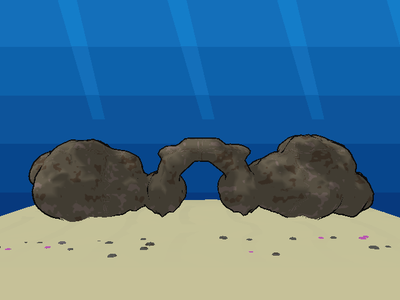 |  |

- **Commits:** flat: first 2026‑11‑09 `eb3340a74`, last `fc03e9d3f`; geom: one commit, 2026‑11‑09 `9f8bddd98`.
- **References:** ⚠ `style-scene.json:22‑25`; ⚠ their build scripts; `tests/test_global_level_settings.py:146` (`style_flat_anime` must stay unreachable).
- **Builds:** yes, all four, in a scratch copy. The 2026‑11‑22 textile failure did not reproduce. **Runs:** yes.
- **Size:** 4.4–4.8 MB tracked + 8.4–8.7 MB untracked each, about 53 MB in all.
- **Suggested: keep as‑is.** They are renderer regression fixtures, and an upgrade would change the bytes the GL/Metal comparison has been baselined on.

## Regression fixtures

| `teleport_regression` | `unloaded_actor_regression` |
|---|---|
| 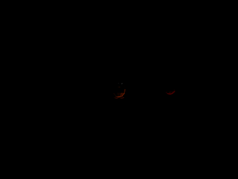 |  |

- **What:** generated by `tests/generate_teleport_level.py` (the second one with `--unloaded-actor`): four rooms at X=0/100/200/300, with the Player teleporting through position mailboxes. Docs: [docs/teleport-regression.md](../../teleport-regression.md), [docs/plans/2026-10-08-t4-cross-room-teleport-audit.md](../../plans/2026-10-08-t4-cross-room-teleport-audit.md).
- **Commits:** one each: 2026‑10‑09 `c92ca3537` and 2026‑10‑09 `280a1fb2d`.
- **References:** ⚠ ctest `cross_room_teleports`, `cross_room_teleports_mutation` (`CMakeLists.txt:1519‑1534`); ⚠ ctest `unloaded_actor_teleports` (`:1537`); `tests/test_global_level_settings.py:146`; receipts under `docs/diagnostics/unloaded-actor/` and `t4-teleport-audit/`.
- **Builds:** n/a. There is no `wflevels/<id>/` and no `.lev`; only the standalone is tracked, so `task build-level` cannot upgrade them. An upgrade would mean regenerating them with the generator. **Runs:** yes; the frames are near‑black (537 and 841 lit pixels), and the tests read them through the debug bridge, not by image.
- **Size:** 64 KB each.
- **Suggested: keep as‑is** (as the item already says).

## Single levels

### `aquarium_idle`

- **What:** the standalone spike for the clownfish idle animation (`blender_create_aquarium_idle.py`): the canonical fish from `wflevels/aquarium/clownfish.py` on a blue backdrop. It is now the regression level for the rig. Plan: [docs/plans/2026-09-30-clownfish-idle-animation.md](../../plans/2026-09-30-clownfish-idle-animation.md).
- **Commits:** first 2026‑09‑30 `2b64afc13`; last own change 2026‑10‑01 `0797aab28`; last 2026‑10‑16 (sweep).
- **References:** ⚠ `tests/test_aquarium_idle.py` ("Regression guard for the clownfish idle rig"); ⚠ `tests/test_wall_clock.py:34`; ⚠ `Taskfile.yml:1670‑1723` (`aquarium-idle-level`, probe, run).
- **Builds:** yes in a scratch copy; the 2026‑11‑22 textile failure did not reproduce. **Runs:** yes.
- **Size:** 0.3 + 0.2 MB.
- **Suggested: keep + upgrade.** It guards the fish every tank uses.

### `dome`

- **What:** a planetarium dome, the Filelight sunburst wrapped onto a hemisphere seen from inside (`blender_dome.py`). It is the 4th view of the filesystem‑viz family. Plan: [docs/plans/2026-06-13-planetarium-dome-view.md](../../plans/2026-06-13-planetarium-dome-view.md).
- **Commits:** first 2026‑06‑13 `7622e66ce`; last own change 2026‑09‑21 `ff4e6b866`. 6 commits.
- **References:** `Taskfile.yml:1008` `run-dome`; `scripts/sweep_blender_levels.py:44`; `tests/test_backface_cull_invariant.py:66`. The engine words (`fsn-*`) are shared with filesys.
- **Builds:** yes. **Runs:** the frame is **all black**. The Director fails 180 times with `zforth unknown token: \\` / `zforth compile error 7 (defs): \\ wf`.
- **Size:** 0.2 MB.
- **Suggested: archive.** It is broken until its script is fixed. Decide it together with the other fs‑viz levels; TODO still has an open "Filesystem‑viz family — remaining views" item.

### `filelight`

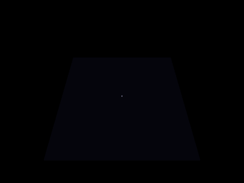

- **What:** a walkable radial disk‑usage sunburst (`blender_filelight.py`). Plan: [docs/plans/2026-06-13-filesystem-viz-on-a-flat-table-forth-policy-core-f.md](../../plans/2026-06-13-filesystem-viz-on-a-flat-table-forth-policy-core-f.md).
- **Commits:** first 2026‑06‑13 `b2f18cf64`; last own change 2026‑09‑19. 3 commits.
- **References:** `Taskfile.yml:978` `run-filelight`; `sweep_blender_levels.py:43`; backface test.
- **Builds:** yes. **Runs:** floor only, with the same `\\` compile error.
- **Size:** 0.4 MB.
- **Suggested: archive** (fs‑viz family).

### `filesys`

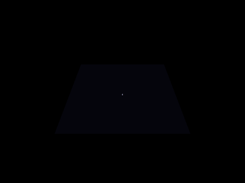

- **What:** an SGI FSN‑style filesystem browser (`blender_filesys.py`): directories as towers, files as boxes. Plan: [docs/plans/2026-06-12-filesys-browser-level.md](../../plans/2026-06-12-filesys-browser-level.md); [docs/howto/rebuild-filesys.md](../../howto/rebuild-filesys.md).
- **Commits:** first 2026‑06‑12 `94633af84`; last 2026‑11‑26 `541730ae5` "Make filesys level rebuild reproducible". 14 commits.
- **References:** ⚠ `tests/test_level_iff_carries_its_lvl.py:37`; ⚠ `scripts/check-filesys-rebuild.sh`; `Taskfile.yml:963`; `engine/stubs/scripting_zforth.cc` (the fsn words); `sweep_blender_levels.py:42`.
- **Builds:** yes, and it **already has Show framerate**. **Runs:** floor only, with the same `\\` compile error, so yesterday's rebuild did not bring the towers back.
- **Size:** 0.4 MB.
- **Suggested: keep,** and fix the Director script, which is a separate item for the four fs‑viz levels. It is the family's root and was worked on yesterday.

### `moon_site01`

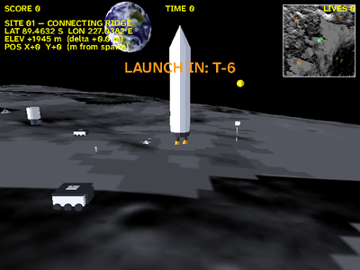

- **What:** the Artemis III candidate Site 01 (Connecting Ridge), built from LOLA DEM terrain and a NAC texture, with lunar gravity, a lander, rovers, Earth and a starfield sky (`blender_create_moon.py`, `dem_to_grid.py`). Plan: [docs/plans/2026-05-30-moon-surface-tier2.md](../../plans/2026-05-30-moon-surface-tier2.md) and about 15 follow‑ups.
- **Commits:** first 2026‑05‑30 `0bb26ef44`; last own change 2026‑09‑19; 75 commits, the most of any level here.
- **References:** ⚠ `CMakeLists.txt:1262` and `web/shell.html:190`, where it is **the web build's default level**; `Taskfile.yml:2043` run task; `sweep_blender_levels.py:34`; backface test; `style-scene.json:62`.
- **Builds:** yes. **Runs:** yes, with the HUD, a LAUNCH countdown and the minimap. The Director logs `zforth unknown token: wf` (camshot script).
- **Size:** 13.7 + 0.1 MB, the largest here.
- **Suggested: keep + upgrade.** The web demo uses it, and the shared Director script error is worth fixing.

### `pilot_demo`

- **What:** a minimal level whose Player Script is a PILOT program (the `R:pilot` sigil routes it to the PILOT engine). It is the in‑engine proof of the PILOT language. Generator `blender_create_pilot_demo.py`. Plan: [docs/plans/2026-05-30-pilot-for-world-foundry-in-engine-object-script-la.md](../../plans/2026-05-30-pilot-for-world-foundry-in-engine-object-script-la.md).
- **Commits:** first 2026‑05‑30 `713636fd2`; last own change 2026‑09‑20 `0bc588264`. 6 commits.
- **References:** ⚠ `CMakeLists.txt:1264` (web preload); ⚠ `tests/pilot/in_level_demo.pilot` (`R:@level pilot_demo-standalone.iff`); `scripts/add_ambient_light.py:138`; `sweep_blender_levels.py:40`; backface test.
- **Builds:** yes, but only from the **untracked** local `.lev`. The `.gitignore` keeps just the `.blend`, the generator and the wrapper, so a clean checkout must run Blender first. **Runs:** yes: a grey slab with a small pink actor. The Director logs `zforth unknown token: wf`.
- **Size:** 0.2 MB tracked + 2.2 MB untracked (the `.blend1` and generated files).
- **Suggested: keep + upgrade** (regenerate the `.lev` with Blender, then `build-level`). It is the only end‑to‑end PILOT level.

### `seahorse_grid`

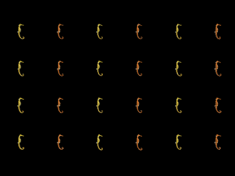

- **What:** 24 independently animated seahorses in a 6×4 grid, built from the planted tank's meshes by `scripts/build-seahorse-grid-level.py`. It is **the Seahorse Grid screensaver app** (`org.worldfoundry.seahorsegrid`, the Dream on cast1). Plan: [docs/plans/2026-10-19-seahorse-grid-animation-variety.md](../../plans/2026-10-19-seahorse-grid-animation-variety.md).
- **Commits:** first 2026‑10‑19 `0df0c0ada` "Add branded aquarium and seahorse screensavers"; last 2026‑11‑24 `7ed6d60c5`.
- **References:** ⚠ `scripts/build-aquarium-screensaver-levels.py:239` (bundles it into `seahorse-screensaver-cd.iff`); ⚠ `android/screensaver/src/seahorse/AndroidManifest.xml:33`, `ScreensaverPreviewActivity.java:10`; ⚠ `tests/test_seahorse_grid_level.py`, `test_screensaver_preview_metadata.py`; `scripts/capture-seahorse-grid.py`.
- **Builds:** yes, and it **already has Show framerate**. **Runs:** yes.
- **Size:** 2.3 + 0.5 MB.
- **Suggested: keep.** It ships, so it does not belong on this list. Add it to `SHIPPED_BY_APP` in `scripts/audit-level-settings.py` (T1).

### `snowgoons-blender`

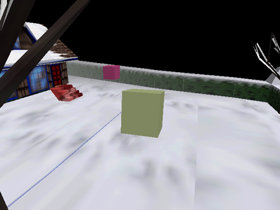

- **What:** the Blender‑scaffold version of Snowgoons (`snowgoons-blender.lev`), the template that `qbert_practice`, `mm_practice_blender` and `pilot_demo` were cloned from. The same folder holds `snowgoons.lev` and the yard and snowgoon generators (`make_yard.py`, `make_snowgoon.py`), from which `task snowgoons-level` builds the **shipped** Snowgoons. Plan (yard): [docs/plans/2026-11-13-snowgoons-one-acre-arena.md](../../plans/2026-11-13-snowgoons-one-acre-arena.md).
- **Commits:** first 2026‑04‑21 `61db316b6`; last 2026‑11‑14 `583111c1b` (yard); the last change to the scaffold level's own files was 2026‑10‑17.
- **References:** ⚠ the shipped Snowgoons build (`Taskfile.yml:1180‑1215`); ⚠ wf_edit ctests on `snowgoons-blender.lev` (`CMakeLists.txt:1998‑2024`); ⚠ the web editor preload (`:2118‑2204`); ⚠ `WF_TEST_SNOW_LEVEL` (`:1559`); `codemagic.yaml`; `levtree-rs`.
- **Builds:** yes. **Runs:** yes (house, hedge, box). The Director logs `zforth unknown token: wf`; the shipped `snowgoons` does not.
- **Size:** 2.1 MB tracked for the folder (shared with shipped Snowgoons) + 0.2 MB; the scaffold level's own outputs are about 0.2 MB.
- **Suggested: keep + upgrade.** The folder cannot go, and the `.lev` is the editor fixture.

### `treemap`

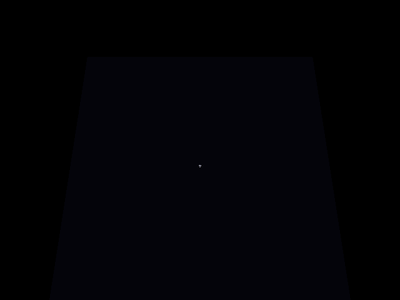

- **What:** a KDirStat/QDirStat squarified disk‑usage treemap (`blender_treemap.py`); the layout runs in C (`scripting_zforth.cc` sys words 160‑168). Plan: [docs/plans/2026-06-13-kdirstat-treemap-view.md](../../plans/2026-06-13-kdirstat-treemap-view.md).
- **Commits:** first 2026‑06‑13 `86e790e4b`; last own change 2026‑09‑19. 4 commits.
- **References:** `Taskfile.yml:993` `run-treemap`; `sweep_blender_levels.py:41`; the treemap words in `engine/stubs/scripting_zforth.cc:781,1819`, which would be dead code without the level.
- **Builds:** yes. **Runs:** floor only, with the same `\\` compile error.
- **Size:** 0.2 MB.
- **Suggested: archive** (fs‑viz family).

## Decide

Tick one option per id (or write another). Nothing changes until Will answers.

- [ ] `condo_639_640_touch`: delete (suggested) / keep + upgrade / archive
- [ ] `condo_639_640_tour`: keep as‑is (suggested) / keep + upgrade / delete
- [ ] `marble-madness`: archive (suggested) / delete (also drop it from `WF_WEB_LEVELS`)
- [ ] `marble-madness-2`: archive (suggested) / delete
- [ ] `mm_practice`: keep as‑is, never recompile (suggested) / other
- [ ] `mm_practice_blender`: delete (suggested) / archive
- [ ] `mm_practice_blender_rt`: delete (suggested) / archive
- [ ] `style_flat_anime`, `style_flat_realistic`, `style_geom_anime`, `style_geom_realistic`: keep as‑is (suggested) / keep + upgrade (re‑baseline the GL/Metal comparison)
- [ ] `teleport_regression`, `unloaded_actor_regression`: keep as‑is (suggested) / regenerate with the settings holder
- [ ] `aquarium_idle`: keep + upgrade (suggested) / keep as‑is / delete (with its two tests and Taskfile tasks)
- [ ] fs‑viz family (`filesys`, `filelight`, `treemap`, `dome`): fix the `\\` Director script for all four (new item) / keep `filesys`, archive the other three (suggested) / delete all four and their Forth words
- [ ] `moon_site01`: keep + upgrade (suggested) / archive
- [ ] `pilot_demo`: keep + upgrade (suggested) / archive / delete (also drop it from `WF_WEB_LEVELS` and `tests/pilot`)
- [ ] `seahorse_grid`: keep; add it to `SHIPPED_BY_APP` (suggested)
- [ ] `snowgoons-blender`: keep + upgrade (suggested) / keep as‑is
- [ ] Shared Director error `zforth unknown token: wf` (`moon_site01`, `pilot_demo`, `snowgoons-blender`): open an item to fix it (suggested) / ignore
