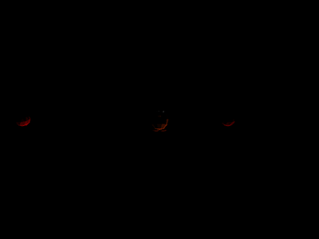
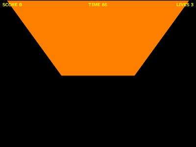
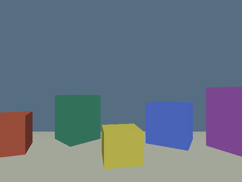
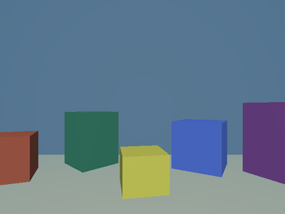
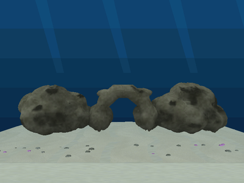
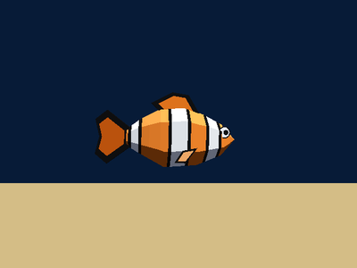
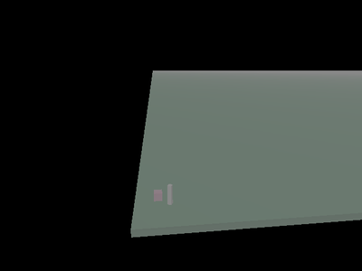
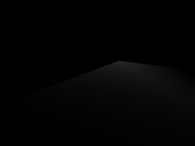
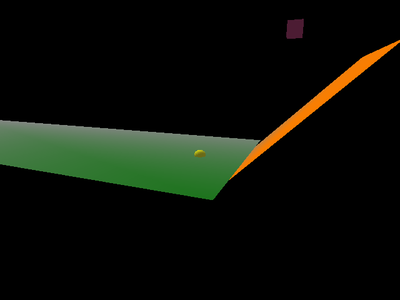

# The 22 unreachable built levels: tests, experiments and two real levels

> **Update 2026‑11‑28:** Will kept `moon_site01` (upgraded) and the four filesystem levels (fixed); see the Decide list. The four "script error" screenshots below predate the 2026‑11‑27 script fix.

This is the evidence for the TODO item **"[T5] Evaluate the 22 built levels no player can reach"**, gathered 2026‑11‑27. Will's framing (2026‑11‑27) is that "most of the things aren't real levels, they're just tests". So each id is classified first:

- **fixture:** a test or script still loads it.
- **experiment:** something was tried, and nothing but a list still names it.
- **real level:** content a person sees.

A fixture or experiment is judged only on two questions: is it still a useful test, and does its source still rebuild. Only a real level can get "keep + upgrade". Nothing has been deleted or changed; the verdicts are suggestions, and the **Decide** list at the end is for Will.

**Rebuilds:** `aquarium_idle` and the four `style_*` levels failed to rebuild on 2026‑11‑22, and `pilot_demo` has no tracked `.lev`. Diagnosed and fixed on 2026‑11‑27 ([plan](../../plans/2026-11-27-level-scripts-and-rebuilds.md)): the four `style_*` levels now build from a clean clone (their asset symlinks are committed; built today they differ from the committed outputs because the reef tiles were repainted on 2026‑11‑10, so the outputs were not replaced); `aquarium_idle` builds through `task aquarium-idle-level` (its meshes come from Blender by design); `pilot_demo` through `task pilot-demo-level`. The same plan fixed the seven Director scripts below that stopped at `zforth unknown token`. Every other id with a source folder rebuilt in a scratch copy in the container. The two regression fixtures have no folder: `tests/generate_teleport_level.py` generates them.

**Screenshots:** each tracked `-standalone.iff` was run headless in `wf-linux-test` (Xvfb with Mesa, today's Debug engine), and the frame shown is the one at 4 s of simulated time (`-rate20 --capture-frame=80`). The engine exits by itself after frame 90, so no sleep was used. "Script error" means the level's Forth Director no longer compiles on today's engine, so its scripted content is missing from the frame. "⚠" marks a test or script that breaks if the level is deleted.

## Classification

| id | kind | what it tests or tried | still used by | rebuilds | size | suggested |
|---|---|---|---|---|---|---|
| `teleport_regression` | fixture | cross‑room player teleports, camera jump | ⚠ ctest `cross_room_teleports` (+ `_mutation`) | generator | 64 KB | **keep** |
| `unloaded_actor_regression` | fixture | teleport out of an unloaded source room | ⚠ ctest `unloaded_actor_teleports` | generator | 64 KB | **keep** |
| `mm_practice` | fixture | an old‑format `.lvl` (pre‑LevelObj fields) | ⚠ ctest `levelobj_short_record_mm_practice`, ⚠ `test_levelobj_fields.py`, ⚠ `test_editable_objects_export.py` | yes, but **never recompile** (the test pins its 568‑byte record) | 0.4 MB | **keep as‑is** |
| `style_flat_anime` | fixture | GL = Metal for the untextured anime (S3) shading | ⚠ `style-scene.json` → `test_style_shading_invariant.py`, Metal CI | yes, clean clone | 13.0 MB | **keep** |
| `style_flat_realistic` | fixture | the same for realistic (S1) | ⚠ the same | yes, clean clone | 13.5 MB | **keep** |
| `style_geom_anime` | fixture | GL = Metal for the reef shell and rocks, S3 | ⚠ the same | yes, clean clone | 12.9 MB | **keep** |
| `style_geom_realistic` | fixture | the same for S1 | ⚠ the same | yes, clean clone | 13.4 MB | **keep** |
| `aquarium_idle` | fixture | clownfish idle‑rig regression (the fish in every tank) | ⚠ `test_aquarium_idle.py`, ⚠ `test_wall_clock.py`, Taskfile | yes, with Blender step | 0.5 MB | **keep** |
| `snowgoons-blender` | fixture | Blender‑scaffold level; editor round trip | ⚠ wf_edit ctests, ⚠ web editor; the folder is also the **source of the shipped Snowgoons** | yes (script error) | ~0.2 MB own | **keep** |
| `pilot_demo` | fixture | PILOT‑language script running in a level | ⚠ `tests/pilot/in_level_demo.pilot`, web‑build preload | yes, with Blender step | 2.4 MB | **keep** |
| `condo_639_640_tour` | fixture | self‑walking tour; checks every room is entered; records `tour-639.mp4` (640×480) | ⚠ `tests/record_condo_639_tour.py`, ⚠ Taskfile `tour-condo-639`/`video-condo-639` | yes (needs Will's condo `.blend`) | 10.7 MB | **keep** |
| `condo_639_640_touch` | experiment | two‑button touch camera profile for the condo | `tests/verify_condo_camera_touch.py` (manual), Taskfile `condo-touch`; no app ships the profile | yes (needs the `.blend`) | 10.7 MB | **retire** unless a phone build is planned |
| `filesys` | experiment | FSN filesystem browser (Forth Director, C layout) | ⚠ `test_level_iff_carries_its_lvl.py`, ⚠ `check-filesys-rebuild.sh` | yes (script error: no towers) | 0.4 MB | **keep and fix** (Will, 2026‑11‑28); scripts fixed 2026‑11‑27, Filelight/Dome scan fixed `94fb22fb9`, Level Settings `65d4ba3d3` |
| `filelight` | experiment | radial disk‑usage sunburst | lists only | yes (script error) | 0.4 MB | **keep and fix** (Will, 2026‑11‑28); scripts fixed 2026‑11‑27, Filelight/Dome scan fixed `94fb22fb9`, Level Settings `65d4ba3d3` |
| `treemap` | experiment | squarified disk‑usage treemap | lists only; Forth words in `scripting_zforth.cc` | yes (script error) | 0.2 MB | **keep and fix** (Will, 2026‑11‑28); scripts fixed 2026‑11‑27, Filelight/Dome scan fixed `94fb22fb9`, Level Settings `65d4ba3d3` |
| `dome` | experiment | the sunburst on a hemisphere | lists only | yes (script error: all black) | 0.3 MB | **keep and fix** (Will, 2026‑11‑28); scripts fixed 2026‑11‑27, Filelight/Dome scan fixed `94fb22fb9`, Level Settings `65d4ba3d3` |
| `mm_practice_blender` | experiment | Blender‑authored ramp, from the 2026‑04 authoring comparison | lists only | yes | 0.3 MB | **retire** |
| `mm_practice_blender_rt` | experiment | Blender import→export round trip of it (lossless: identical frame) | lists only | yes | 0.2 MB | **retire** |
| `marble-madness` | experiment | ROM‑decoded Marble Madness paths, six generators | web‑build preload; `marble-madness-2` reads its `.lev` | yes | 0.8 MB | **archive** (MM is low priority) |
| `marble-madness-2` | experiment | MM physics copy with timer and goal | lists only | yes | 0.4 MB | **archive** |
| `moon_site01` | real level | Artemis III Site 01 lunar terrain, lander, rovers | ⚠ the **web build's default level** | yes (script error) | 13.8 MB | **keep + upgrade** (Will, 2026‑11‑28); Level Settings `65d4ba3d3`, on the site in v0.1.23 |
| `seahorse_grid` | real level | 24 animated seahorses | ⚠ **ships** as the Seahorse Grid screensaver app | yes (already has the setting) | 2.8 MB | **keep** (Will, 2026‑11‑27); added to `SHIPPED_BY_APP` |

In this table, "Lists only" means the backface‑cull test's tolerance table, `scripts/sweep_blender_levels.py`, a `run-*` Taskfile task and old plans. None of them would fail if the level went; they would only need the entry removed. Size counts tracked plus untracked files and leaves out symlinks into other levels.

## What else turned up

- **Two are real levels, and both are reachable.** `seahorse_grid` ships in the Seahorse Grid screensaver app (`org.worldfoundry.seahorsegrid`), and is now listed in `SHIPPED_BY_APP` in `scripts/audit-level-settings.py` (Will, 2026‑11‑27: keep). The web build preloads `moon_site01` (as its default level), `marble-madness` and `pilot_demo` (`WF_WEB_LEVELS`, `CMakeLists.txt:1261`).
- **Seven Director scripts no longer compile.** `filesys`, `filelight`, `treemap` and `dome` stop at `zforth unknown token: \\` (each Script starts `"\\\\ wf\n"`). `moon_site01`, `pilot_demo` and `snowgoons-blender` stop at `zforth unknown token: wf` in a camshot script they share. The shipped `snowgoons` has no compile errors.
- `filesys` and `seahorse_grid` already carry Show framerate.

## Screenshots

| | | |
|---|---|---|
| `teleport_regression`  | `unloaded_actor_regression`  | `mm_practice`  |
| `style_flat_anime`  | `style_flat_realistic`  | `style_geom_anime`  |
| `style_geom_realistic`  | `aquarium_idle`  | `snowgoons-blender`  |
| `pilot_demo`  | `condo_639_640_tour`  | `condo_639_640_touch`  |
| `filesys` (script error)  | `filelight` (script error)  | `treemap` (script error)  |
| `dome` (script error)  | `mm_practice_blender`  | `mm_practice_blender_rt`  |
| `marble-madness`  | `marble-madness-2`  | `moon_site01`  |
| `seahorse_grid`  | | |

## Decide

- [ ] Fixtures (`teleport_regression`, `unloaded_actor_regression`, `mm_practice`, the four `style_*`, `aquarium_idle`, `snowgoons-blender`, `pilot_demo`, `condo_639_640_tour`): keep as useful tests (suggested), with `mm_practice` never recompiled / retire some (name them)
- [ ] `condo_639_640_touch`: retire it along with its verify script and Taskfile task (suggested) / keep for a phone build
- [x] fs‑viz (`filesys`, `filelight`, `treemap`, `dome`): **keep and fix all four** (Will, 2026‑11‑28: "filesys, filelight, treemap and dome: keep and fix")
- [ ] `mm_practice_blender`, `mm_practice_blender_rt`: retire (suggested) / keep
- [ ] `marble-madness`, `marble-madness-2`: archive, frozen (suggested) / retire (and drop MM from `WF_WEB_LEVELS`)
- [x] `moon_site01`: **keep + upgrade** (Will, 2026‑11‑28)
- [x] `seahorse_grid`: keep, and add it to `SHIPPED_BY_APP` (Will, 2026‑11‑27; done)
- [ ] The `wf`‑token Director error (`moon_site01`, `pilot_demo`, `snowgoons-blender`): open a fix item (suggested) / ignore
