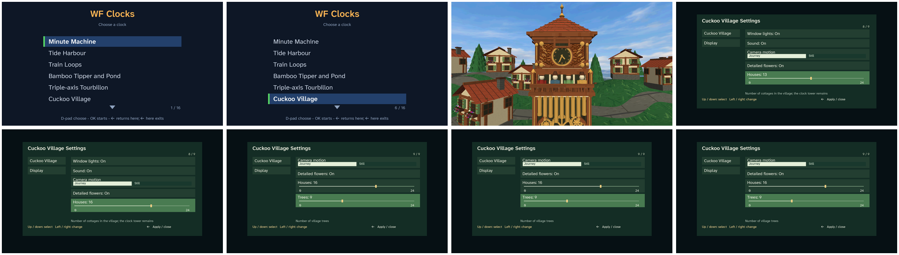

# Cuckoo Village Houses and Trees sliders on Cast1 (2026‑11‑28)

Job `J‑21b060ce0c7d` on `chromecast-test-01` (Chromecast HD), WF Clocks APK built at `d1aaa4ac0` (sha256 `b8173a78ab94…`), [recipe](recipe.json).

- Holding OK for 1.3 s opened **Cuckoo Village Settings**; Down ×7 reached **Houses: 13** (the default), drawn as a 0–24 slider.
- Right ×3: **Houses: 16**. PASS.
- Down, Left ×3: **Trees: 9** (default 12). PASS. The frame meant to show Trees at 12 was taken after the presses had landed, so the starting value is not in a frame.

Evidence (frames, `wf.log`, `logcat.txt`, video) is in `evidence/`; the video and logs are not committed.
