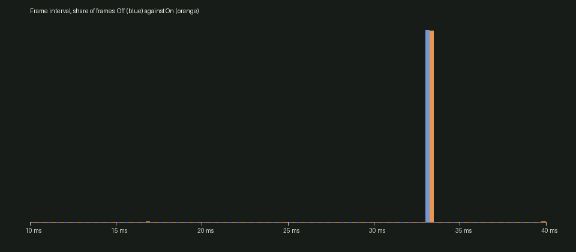

# Cuckoo Village window boxes: before and after, profiled on one APK

Generated 2026-11-22 18:33 by `scripts/flowers-profile-report.py`. Plan: [the window-box plan](../../plans/2026-11-22-cuckoo-village-flowers.md).

**Verdict: PASS**

- PASS: the two Off sets agree: p50 33.37 and 33.37 ms differ by 0.00 ms (at most 0.5)
- PASS: p50 with the flowers: 33.37 ms against 33.37 ms Off, difference +0.00 ms (at most +1.0)
- PASS: p95 with the flowers: 33.37 ms against 33.37 ms Off, difference +0.00 ms (at most +1.0)
- PASS: fps with the flowers 29.96 (at least 29.5)
- PASS: fps differs from Off by 0.01 (at most 0.5)
- PASS: missed refreshes 99.8 % against 100.0 % Off, difference -0.2 points (at most +2.0)

Statistics are recomputed from the per-frame present times with the first 85 s of every run dropped (the menu and the settings form).

## Build facts

- Level file now: 5,906,432 bytes (`wflevels/cuckoo_village-standalone.iff`).
- Level file at `33b6d3b8~1` (before the change): 4,982,784 bytes, so +923,648 bytes.
- Flowers: 17,180 triangles in 26 boxes, 10 flat materials, 8 double-sided; the removed blocks were 4,264 triangles (shown when the setting is Off).
- APK profiled: sha256 `e37c973b0a99f3b114fb9c7c4845e8f80f07f4468ce4a398880b8b4f58c7bebe`.

## Frame times (median over each set's runs)

| Set | runs | fps | p50 ms | p90 ms | p95 ms | p99 ms | worst ms | missed % | PSS MiB | thermal |
|---|---|---|---|---|---|---|---|---|---|---|
| Off | 1 | 29.97 | 33.37 | 33.37 | 33.37 | 33.37 | 33.37 | 100.0 | 139.6 | 0 |
| On | 1 | 29.96 | 33.37 | 33.37 | 33.37 | 33.37 | 50.05 | 99.8 | 134.2 | 0 |
| Off again | 1 | 29.97 | 33.37 | 33.37 | 33.37 | 33.37 | 33.37 | 100.0 | 158.5 | 0 |

### On minus the mean of the two Off sets

| Measure | Difference | Percent |
|---|---|---|
| fps | -0.011 | -0.0 % |
| p50_ms | +0.000 | +0.0 % |
| p90_ms | -0.000 | -0.0 % |
| p95_ms | +0.000 | +0.0 % |
| p99_ms | +0.000 | +0.0 % |
| worst_ms | +16.682 | +50.0 % |
| missed_refresh_percent | -0.216 | -0.2 % |

## Drift

The two Off sets: p50 33.37 and 33.37 ms, fps 29.97 and 29.97, thermal status at most 0 and 0.

## Frame-time histogram

