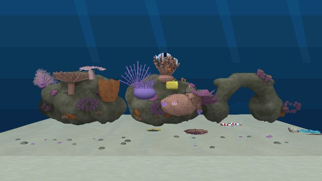
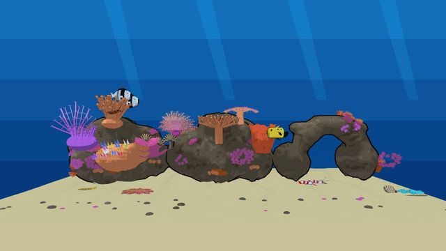
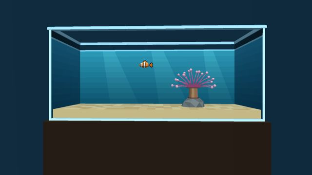
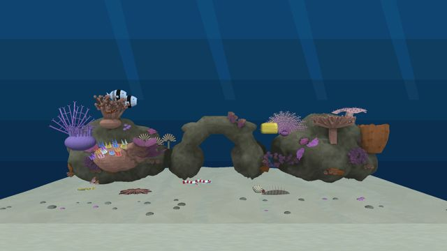
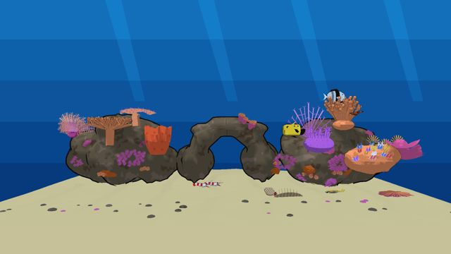
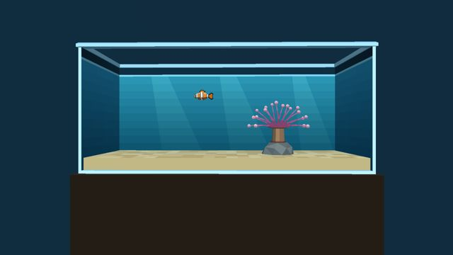
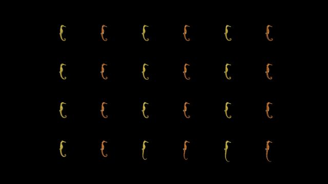
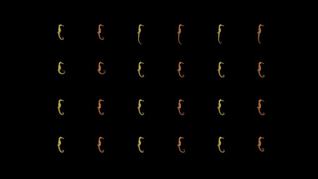
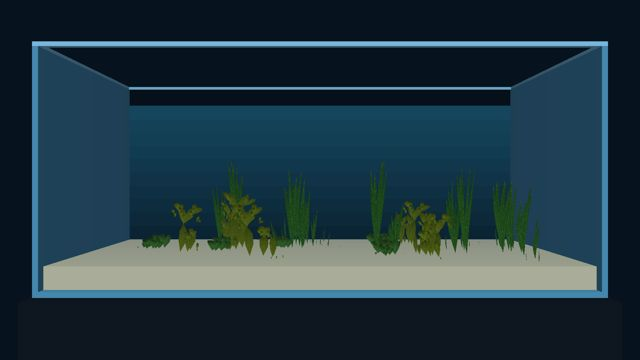
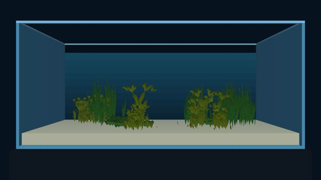

# Aquarium Dream: Debug against Release on cast1, 9 November 2026

This is the TODO item "Ship the Aquarium Dream as a Release build" (Will, 2026‑11‑09: "Investigate Release"). The [cast1 acceptance run](../reef-cast1-acceptance-2026-11-09/README.md#step-12-dream-with-each-reef) found the reef Dream running at about 3 FPS, because the screensaver APK was built as Debug.

**Result:** a Release build of the Aquarium Dream renders the reef about **7× faster** than Debug: 21.8 FPS against 2.98, which is about what the game app holds. Nothing broke. The Aquarium Dream now builds and ships as Release.

## Numbers

Device: cast1 (`chromecast-test-01`, Chromecast HD, Android 14, armeabi‑v7a). Every action went through the coordinator. Both APKs were built from the same HEAD Dream bundle. The tank was set through the Dream's own settings provider, and Layout is Random, the shipped default.

| Tank | Debug FPS (3 runs) | Release FPS (3 runs) | Debug frame p50 | Release frame p50 |
|---|---|---|---|---|
| Gulf of Thailand Reef | **2.98** (2.98, 2.98, 2.97) | **21.80** (21.54, 21.80, 22.13) | 333.7 ms | 50.1 ms |
| Gulf of Thailand Reef — Anime | **2.72** (2.74, 2.72, 2.68) | **19.98** (19.81, 20.12, 19.98) | 367.0 ms | 50.1 ms |
| Clownfish & Sea Anemone (non-reef) | **29.97** (44.31, 29.97, 29.97) | **59.45** (29.97, 59.45, 59.45) | 33.4 ms | 16.7 ms |

- **How it was measured:** the coordinator's `profile` workflow, run three times per cell (`task chromecast:profile`, `APP=screensaver`). It counts the frames SurfaceFlinger presents for the Dream app's own player, `AquariumActivity`, which is the same native `TankPlayer` as the Dream.
- **Why not the engine log:** the engine logs frame deltas only when a frame takes longer than 0.2 s (`delta too large`, in `gfx/gl/display.cc`). That shows the slow Debug frames, as the acceptance run read them, but says nothing about a Release build that never drops below 5 FPS.
- **Agreement with the acceptance run:** the Debug reef matches it: 2.98 FPS here, and a 0.338 s median delta there.
- **The Release Dream itself:** `screensaver-show` (J‑13f237b69178) ran the reef in the Dream's preview path for 75 s. `screensaver-status` (J‑d865fa46af7a) then found the preview running, the settings provider `ready` with `tank = aquarium_thai_reef`, and no assertion. One slow frame, 0.85 s, came at level load, and none followed ([status](release-dream-reef-status.json), [engine log tail](release-dream-reef-engine-log-tail.txt)).
- **Evidence:** the per-run numbers are in [`results.json`](results.json), with the job IDs. The screenshots show each tank as profiled:

| | Reef | Anime reef | Clownfish |
|---|---|---|---|
| Debug |  |  |  |
| Release |  |  |  |

## Why it was Debug

Nothing in the git log or the plans chose Debug on purpose. The screensaver's `release` build type had no `signingConfig`, so a release APK came out unsigned and could not be sideloaded. Every README, plan and task therefore used `assemble…Debug`, from the first live screensaver (`54f44b51`, 2026‑10‑18) and the flavor split (`d4b4070a`, 2026‑10‑23) onwards. Nothing that ships depends on Debug.

The coordinator's `simpleperf` workflow needs a profileable or debuggable APK. Anyone who wants to profile the Dream can still build the Debug variant.

## What changed

- `android/screensaver/build.gradle.kts` (`a39d33c8`): the `release` build type now matches the game app's release. It is signed with the debug keystore for sideload, `isDebuggable = false`, and passes `-DCMAKE_BUILD_TYPE=Release`, which gives `wfengine`, Jolt and zforth -O3 and thin LTO. `libwf_dream.so` for armeabi‑v7a shrinks from 5.9 MB to 3.2 MB.
- `Taskfile.yml`: a new `build-aquarium-screensaver-apk` task.
    - It builds the Dream levels and bundle in the Linux container, then runs `./gradlew :screensaver:assembleAquariumRelease --offline` on the host, as `task build-apk` does.
    - It has no `android-sdk-install` dependency, like `build-planted-apk`, because that step runs `sudo` for the SDK licences.
- `android/screensaver/README.md`: the Aquarium Dream ships as Release. The Seahorse Grid and Planted Tank Dreams still build as Debug; their Release builds work but have not been measured.
- `tests/test_screensaver_release_build.py` (new): the task must assemble the Release variant, and the release build type must stay signed, not debuggable, and CMake Release.

## cast1 afterwards

| | Before | After |
|---|---|---|
| Selected Dream | Seahorse Grid | Seahorse Grid (J‑14b6eec60eb4) |
| Aquarium Dream `tank` | `random` | `random` (J‑4449c311eee7) |
| Aquarium screensaver package | `5dfdba1f…` (the acceptance run's VRAM fix, a Debug build) | **the Release Dream `ecf5e860…`** (Will, 2026‑11‑09; J‑86a904b436e0 verified `installed_sha256` = `ecf5e860de06…`). The original `5dfdba1f…` was reinstalled first (J‑07dbc6b02d14), on a mistaken instruction to restore it |
| Game APK | `30554973…` | unchanged: no job here installed it; every installation recorded was `org.worldfoundry.screensaver` |
| Running | nothing | nothing (J‑aaef14afe56b at 14:45 UTC, 21:45 in Bangkok: Seahorse Grid selected, nothing running) |

The press job (Home) relaunches the foreground it found, so it brought the Aquarium preview back. A `sleep` job was needed to end the preview before the package could be reinstalled. cast1 was left asleep; it wakes on its remote.

## Seahorse Grid and Planted Tank, 10 November 2026

This is the TODO item "Seahorse Grid and Planted Dreams as Release builds". The method matches the Aquarium measurement above:

- **Bundles:** the Seahorse Grid bundle comes from `scripts/build-aquarium-screensaver-levels.py`, which runs `scripts/build-seahorse-grid-level.py`. The Planted bundle comes from `task build-planted-level` (Blender container). Both Debug and Release APKs of each flavor were built from the same bundles.
- **Measurement:** the coordinator `profile` workflow, run three times per cell. `APP=seahorse-screensaver` profiles `SeahorseGridActivity`, and `APP=planted-screensaver` profiles `PlantedTankActivity`. Each is the same native player as its Dream.

| Dream | Debug FPS (3 runs) | Release FPS (3 runs) | Debug frame p50 | Release frame p50 |
|---|---|---|---|---|
| Seahorse Grid | **4.18** (4.18, 4.16, 4.18), J‑28568ef14f13 | **29.64** (28.87, 29.85, 29.64), J‑23ac242afa30 | 233.6 ms | 33.4 ms |
| Planted Tank | **6.06** (5.81, 6.06, 6.22), J‑6d155064b9e3 | **39.99** (39.99, 36.06, 43.19), J‑69d51edc1ba5 | 166.8 ms | 16.7 ms |

Release is about 7× faster again.

- **APK hashes:** Seahorse Debug `ef94e758…`, Release `25dfeda6…`. Planted Debug `c4f5242a…`, Release `bccdf04b…`. All are in [`results-seahorse-planted.json`](results-seahorse-planted.json).
- **The real Dream path:** each Release Dream ran for 60 s through `screensaver-show`, and `screensaver-status` followed. Both previews were running, both settings providers were `ready`, and neither asserted.
    - Seahorse Grid: J‑d1a3151896ae, then J‑eb3eca851a51, orientation `landscape`.
    - Planted Tank: J‑d85d720c39c1, then J‑e51f074a05b3, with the eight fields unchanged: 1 `random`, 2 `random`, 3 `3`, 4 `0`, 5–7 `true`, 10 `120`.
    - The only frames over 0.2 s came one per level load, and none came after a load ([Seahorse status](release-dream-seahorse-status.json), [log tail](release-dream-seahorse-status-engine-log-tail.txt); [Planted status](release-dream-planted-status.json), [log tail](release-dream-planted-status-engine-log-tail.txt)).

| | Debug | Release |
|---|---|---|
| Seahorse Grid |  |  |
| Planted Tank |  |  |

**What changed:**

- `Taskfile.yml`: `build-planted-apk` now runs `assemblePlantedRelease`. A new `build-seahorse-screensaver-apk`, in the style of the Aquarium task, builds the bundles in the container, then runs `assembleSeahorseRelease`.
- `tests/test_screensaver_release_build.py`: covers all three tasks.
- `android/screensaver/README.md` and `docs/device-coordinator.md`: give the Release outputs.

**cast1 afterwards** (status J‑088e7887a7ff, 22:51 UTC, 05:51 in Bangkok):

| | Before (J‑9197100e3710) | After |
|---|---|---|
| Selected Dream | Seahorse Grid | Seahorse Grid (J‑30a014dccf45) |
| Seahorse Grid package | `71b5a1e5…` (Debug) | **Release `25dfeda6…`** (J‑9aa342f3bf87: `installed_sha256` = `25dfeda644d1…`) |
| Planted Tank package | `a04321b9…` (Debug) | **Release `bccdf04b…`** (J‑8863a9cc92ae: `installed_sha256` = `bccdf04bdd9d…`) |
| Aquarium package | Release `ecf5e860…` | unchanged |
| Settings | Seahorse orientation `landscape`; Planted fields as listed above | unchanged; no setting job ran |
| Game APK | `30554973…` | untouched |
| Running | nothing | nothing; cast1 was put to sleep (J‑ffc5cca976bf) to end the previews |
