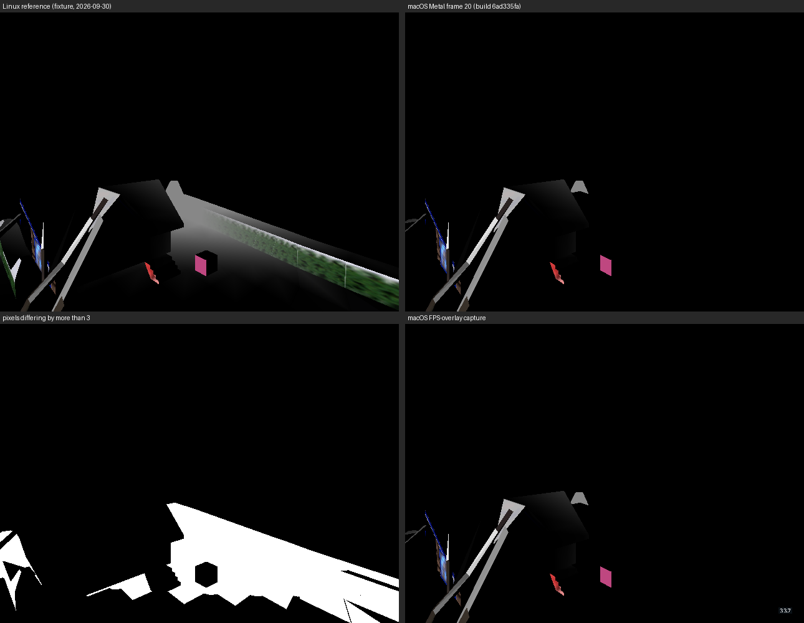

# Metal drops the snowgoons floor and house (2026‑10‑17)

The macOS gate **Compare deterministic capture with Linux reference** (`macos-desktop-debug` in `codemagic.yaml`) fails. It compares frame 20 of `snowgoons-standalone.iff` with `tests/fixtures/renderer/snowgoons-linux-frame20.png`. Metal draws the house roof and the cube, but not the floor, the hedge wall or parts of the house.

| Build | Commit | Result |
| --- | --- | --- |
| [6ad335fa](https://codemagic.io/app/6aafa6886ab3f21cf431a6cb/build/6ad335fa8bb9384ce9b5b395) | `d5f8ec16` (with the UI font) | FAIL, [comparison-d5f8ec16.txt](comparison-d5f8ec16.txt) |
| [6ad3384a](https://codemagic.io/app/6aafa6886ab3f21cf431a6cb/build/6ad3384a73904bb56b4f784b) | `20c9e080` (before the UI font) | FAIL, [comparison-20c9e080.txt](comparison-20c9e080.txt) |

The two comparisons are byte-identical: 259,570 of 307,200 pixels exact (84.5 %), 39,808 pixels over tolerance 3, and differences in rows 287–479 across the full width. So the UI font did not cause this. Every other step of both builds passed: compile, link, headless smoke, box colours, the raw FPS and the FPS-overlay capture. In the FPS-overlay capture, Atkinson draws "33.7" bottom right.

## What changed since the last green macOS run

The last green macOS run was the 3D picker's (`c6fc62c8`, 2026‑10‑16). It does not contain `25a57d73` ("Use Blender face normals throughout engine and assets", 2026‑10‑16 17:19 +07). That commit:

- rewrote the very payloads that vanish: `wflevels/snowgoons-blender/ground01.iff`, `house.iff` and `snowgoons-standalone.iff`, among others;
- says in its message that "Device and Metal rendering remain pending".

`69517e7d` (authored current-room render scope) also landed in between.

## Not established yet

- **Is the Linux reference still current?** Run `tests/test_renderer_references_fresh.py` against a current Linux build. If a fresh Linux capture also lacks the floor, the reference is stale and GL changed as well. If it matches, the fault is Metal-specific.
- **Why Metal would differ from GL at all.** Metal's software back-face cull (`backend_metal.mm`, `DrawTriangle`) mirrors `glpipeline/backend_modern.cc`, using the same normal, the same `_mv` and the same sign test.
