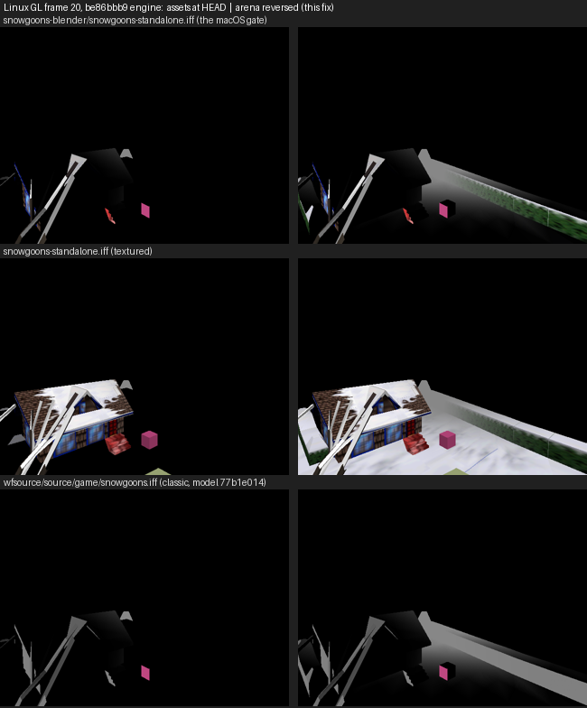

# The snowgoons floor vanished on Metal and GL (2026‑10‑17)

The macOS gate **Compare deterministic capture with Linux reference** (`macos-desktop-debug` in `codemagic.yaml`) fails. It compares frame 20 of `snowgoons-standalone.iff` with `tests/fixtures/renderer/snowgoons-linux-frame20.png`. Metal draws the house roof and the cube, but not the floor, the hedge wall or parts of the house.


| Build | Commit | Result |
| --- | --- | --- |
| [6ad335fa](https://codemagic.io/app/6aafa6886ab3f21cf431a6cb/build/6ad335fa8bb9384ce9b5b395) | `d5f8ec16` (with the UI font) | FAIL, [comparison-d5f8ec16.txt](comparison-d5f8ec16.txt) |
| [6ad3384a](https://codemagic.io/app/6aafa6886ab3f21cf431a6cb/build/6ad3384a73904bb56b4f784b) | `20c9e080` (before the UI font) | FAIL, [comparison-20c9e080.txt](comparison-20c9e080.txt) |

The two comparisons are byte-identical: 259,570 of 307,200 pixels exact (84.5 %), 39,808 pixels over tolerance 3, and differences in rows 287–479 across the full width. So the UI font did not cause this. Every other step of both builds passed: compile, link, headless smoke, box colours, the raw FPS and the FPS-overlay capture. In the FPS-overlay capture, Atkinson draws "33.7" bottom right.

## What changed since the last green macOS run

The last green macOS run was the 3D picker's (`c6fc62c8`, 2026‑10‑16). It does not contain `25a57d73` ("Use Blender face normals throughout engine and assets", 2026‑10‑16 17:19 +07). That commit:

- rewrote the very payloads that vanish: `wflevels/snowgoons-blender/ground01.iff`, `house.iff` and `snowgoons-standalone.iff`, among others;
- says in its message that "Device and Metal rendering remain pending".

`69517e7d` (authored current-room render scope) also landed in between.

## Result (investigated 2026‑10‑17)

**It was never a Metal bug.** GL renders the same broken frame. The cause is one migration decision in `25a57d73`: the snowgoons arena mesh was marked `keep` when it needed `reverse_all`. Both backends then culled its floor and hedges correctly, from normals that point the wrong way. The reference was right and the asset was wrong. The fixture is unchanged, and no engine change is needed.



### Measured

All Linux runs below used the `wf-linux-test` container (Mesa llvmpipe, Xvfb), `scripts/in-linux-container.sh`, and the gate's flags: `--frame-step-smoke=30 --cycles=1 -rate20 --no-fps --capture-frame=20`. The comparator is `tests/compare_renderer_frames.py --tolerance 3`, against `snowgoons-linux-frame20.png`.

| Engine and assets | Exact | Pixels over 3 | Difference bbox |
| --- | --- | --- | --- |
| Metal, `d5f8ec16` and `20c9e080` (Codemagic, above) | 84.495 % | 39,808 | 0,287–639,479 |
| GL, `be86bbb9` as committed | 84.101 % | 39,809 | 0,287–639,479 |
| GL, `be86bbb9`, `WF_CULL=0` | 93.050 % | 14,287 | 0,298–639,479 |
| GL, `be86bbb9`, arena reversed (this fix) | 97.872 % | 3 | 17,389–620,437 |
| GL, `c6fc62c8` (last green macOS run) | 97.873 % | 3 | 17,389–620,437 |

- A fresh Linux capture lacks the floor exactly as Metal does, with the same bbox, and 39,809 px against Metal's 39,808 px. So GL changed as well.
- The last green commit, built and captured in the same container, has the same 3 px over tolerance and the same bbox as the fixed build. Those 3 px (one seam pixel at 620,422, two edge pixels) are therefore container llvmpipe against the host GL that made the reference, not a defect. The fixed `be86bbb9` frame and the `c6fc62c8` frame differ in 6 px, all by 3 or less. The aquarium reference shows the same kind of noise, 2 px.
- The model is `quadpatch01` (original and current sha256 `2ce88ee4…`; 481 vertices, 445 faces). It is the arena: a ground sheet (material 5) and hedge walls with tops (materials 1 and 2), 30 × 35 m. Under the Blender cross product `(v1-v0) × (v2-v0)`, which the engine has used since `25a57d73`, all 283 horizontal faces point down: 176 of 176 floor faces and 107 of 107 hedge tops. Before `25a57d73` the engine used the opposite cross product, so the same bytes pointed up.
- The migration converted every model of `snowgoons-standalone.iff` except this one. The conversion record shows tree02, tree03, the player and the house reversed, and `quadpatch01` with `faces_reversed: 0`. A reversed model keeps its rendered normal: new cross product on swapped indices, which is bit-identical. A `keep` model flips it. That is why the house roof survived and the floor did not.
- The classic level `wfsource/source/game/snowgoons.iff` has the same geometry with other materials (`77b1e014…`). It was also kept, and loses its floor the same way (38,636 px).

### Inference: why the decision was wrong

The manifest entry read: "This open exterior patch has positive signed volume and an outward radial majority in Blender order". Those are exterior-shell clues. The plan, [`2026-10-16-blender-normal-convention-engine-wide.md`](../../plans/2026-10-16-blender-normal-convention-engine-wide.md), says they "are clues, not authority for an open sheet, a mixed mesh or a two-sided surface". It also requires "the intended visible side, supported by … level camera views and screenshots". The arena is an open sheet viewed from inside and above. The snowgoons levels were among the "two skipped dynamic levels" of the culling sweep, which the plan said to treat "as unverified rather than passing". No capture was compared, so nothing caught the flip.

### Why no Linux check caught it

- `tests/test_renderer_references_fresh.py`, written on 2026‑09‑30 for exactly this, runs in no CI. It is not in `.github/workflows/` or `codemagic.yaml`.
- It also skipped in the project's own Linux container. It required `xdpyinfo`, which `docker/Dockerfile.linux-test` does not install, so it reported "needs the X display" even with Xvfb running.
- It captured without `--no-fps`, while the gate uses `--no-fps`. Since the FPS overlay landed, it would have compared FPS digits.

## Fix (this branch)

- **The decision, at the source of truth.** `2ce88ee4` and `77b1e014` are now `reverse_all`, with corrected evidence, in both `docs/diagnostics/blender-normal-convention/model-decisions.json` and `integration-model-decisions.json`.
- **Replayed by the converter.** `scripts/convert_face_hand.py --only-hash` applies a corrected decision to the tracked copies that still carry the original hash. A kept model is byte-identical to its original, so its hash finds every copy. A whole-tree re-run would reverse every converted model a second time. Record: [quadpatch-correction.json](quadpatch-correction.json). It changed 13 IFFs:
    - the two source models, `wflevels/snowgoons-blender/quadpatch01.iff` and `wflevels/mm_practice/quadpatch01.iff`;
    - the level bundles `snowgoons-blender/snowgoons-standalone.iff`, `snowgoons-blender{,-standalone}.iff`, `snowgoons{,-standalone}.iff` and `wfsource/source/game/snowgoons.iff`;
    - the CD images `wflevels/cd.iff`, `snowgoons-cd.iff`, `wfsource/source/game/cd.iff`, `cd_full.iff` and `full_cd/L4.iff`.

    The Android snowgoons asset is a symlink to `wflevels/snowgoons-cd.iff`. A level rebuilt from the source models reproduces the fix.
- **Checked byte for byte.** `scripts/verify_face_hand.py --path` reproduces 11 of the 13 files exactly from the base revision plus the corrected manifest. The other two, `snowgoons-cd.iff` and `wfsource/source/game/cd.iff`, were repacked after the base by `2258fce5` (UI font). In each, the only bytes that differ from `be86bbb9` are 910 bytes inside the arena's `FACE` chunk.

## Regression guards (same commit)

- `tests/test_snowgoons_arena_faces_up.py` needs no engine and no display. It finds every tracked copy of the arena by its vertex positions and requires all 283 horizontal faces to point up under the engine's cross product. It fails on `be86bbb9`: "wflevels/cd.iff@149144: 283 of 283 horizontal arena faces point down". It passes after the fix.
- `tests/test_renderer_references_fresh.py` now runs in the container, without `xdpyinfo`, and uses `--no-fps` like the gate. It allows 8 isolated pixels over tolerance (new `--allow-pixels`, default 0) for llvmpipe against the host-GL reference. The measured noise is 3 px and 2 px, and the smallest real staleness seen was 35 px. The macOS gate keeps 0. It failed on `be86bbb9` with 39,809 px and passes after the fix. Command:

    ```sh
    scripts/in-linux-container.sh bash -c 'Xvfb :99 & export DISPLAY=:99; sleep 1; \
        python3 -m pytest tests/test_renderer_references_fresh.py -v'
    ```

## Audit of the other `keep` decisions

90 original hashes were kept. Kept models are byte-identical, so every one of them now renders with the opposite normal from before `25a57d73`. `scripts/audit_keep_renders.py` renders frame 20 of each loadable level that contains one twice, once as committed and once with every kept model reversed (their pre-migration look), and counts the differing pixels. "HEAD right" means the kept geometry is visibly the intended side at HEAD, for example a closed sphere lit on its outside, and the pre-migration look was the defect.

| Level | Keeps | Pixels over 3 | Verdict |
| --- | --- | --- | --- |
| `snowgoons-blender/snowgoons-standalone.iff` | 1 | 39,807 | **inverted**: arena, fixed |
| `snowgoons-standalone.iff` (textured) | 1 | 62,776 | **inverted**: arena, fixed |
| `wfsource/source/game/snowgoons.iff` | 1 | 38,636 | **inverted**: classic arena, fixed |
| `qbert_practice-standalone.iff` (both copies) | 19 and 17 | 2,392 and 2,429 | HEAD right: blue tops and two side shades; before, inside faces showed |
| `wfsource/source/game/smb_w1_1-standalone.iff` | 10 | 1,137 | HEAD right: a third yellow block is visible that was culled before |
| `marble-madness/mm_fromscratch`, `mm_intermediate`, `mm_practice_rom` | 4, 3, 3 | 659, 642, 621 | HEAD right: the ball is lit on its outside; before, a back-lit crescent |
| `marble-madness-2-standalone.iff` | 8 | 86 | HEAD right: the same ball |
| `teleport_regression`, `unloaded_actor_regression` (test fixtures) | 5, 6 | 748, 1,322 | HEAD right: closed spheres, outward normals |
| `mm_practice-standalone.iff` (both), `mm_practice_blender-standalone.iff`, `aquarium_arowana-standalone.iff` | 1 each | 0 | no visible change at frame 20 |
| `cyber/cyber.iff` | 5 | n/a | **unverified**: does not load (texture larger than its VRAM slot), with or without the keeps |

A frame-20 capture sees one camera view only. As a second check, a geometry scan of every tracked model flagged kept models whose horizontal faces point mostly down. It found the two arenas and four `cyber` models (`c12bea52`, `6f00cbf1`, `a4272183`, `0147c081`). Of those four, `c12bea52` has 95 % of its footprint in down-facing horizontal faces and none facing up. Whether those are ceilings or inverted floors cannot be told without rendering `cyber`, so they are reported and not changed. `wflevels/snowgoons-blender/ground01.iff` also faces down. It was reversed, which keeps the old engine's downward normal, and no level embeds it.

## Codemagic

None triggered. 0 Mac-minutes.

## Not verified

- No Metal capture of the fix. The Metal frame matched GL's broken frame to within 1 pixel, and the cull and lighting code in `backend_metal.mm` mirror GL's. So the next `macos-desktop-debug` run is expected to pass. That run is the confirmation.
- Chromecast and Android are untested. The Android snowgoons APK reads `wflevels/snowgoons-cd.iff`, which is fixed.
- `cyber` (see the audit).
