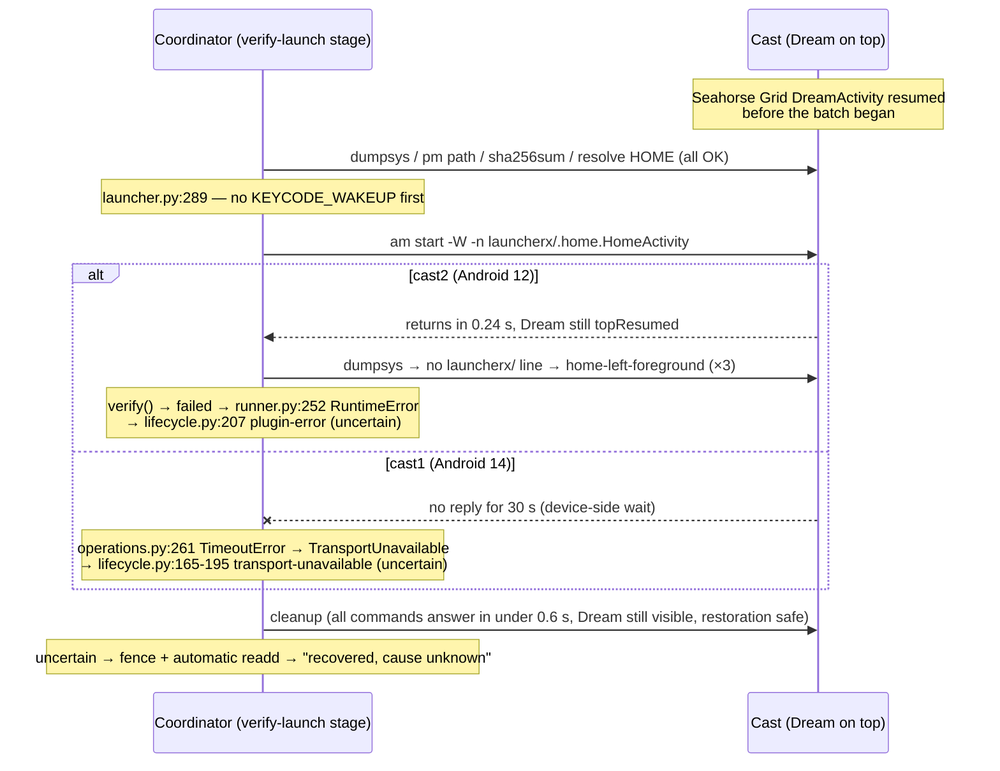

# Post-install `recovery-required` on both casts: analysis

Batch `B-94c7f0f5366e`, 2026‑10‑23 14:28–14:30 +07. Investigation only. No coordinator source changed, no
jobs submitted, no direct ADB. The only live queries were the read-only `task chromecast:devices` and
`JOB=… task chromecast:status`.

## Verdict

**Root cause.** Both casts were **already showing the Seahorse Grid Dream** when the batch started. The
install stage passes while a Dream is showing, because it is a background stage and only checks that the
foreground is unchanged. The launcher-verification stage then runs `am start -W -n <HOME>` **without waking the
device first**. The app-launch path does wake the device first (`operations.py:895`). With the Dream still on
top, HOME never becomes the foreground:

- **cast2 (Android 12):** `am start -W` returns at once, but the Dream stays on top. Each of the three attempts
  records `home-left-foreground`. `launcher.verify` returns `failed`. `runner.py:252` turns that into a
  `RuntimeError`, which `lifecycle.py:203-207` records as **`plugin-error`** with status `uncertain`.
- **cast1 (Android 14):** `am start -W` **blocks** until the default 30 s ADB deadline. `operations.py:260-261`
  converts every command timeout into `TransportUnavailable`, which the receipt records as
  **`transport-unavailable`**. The transport was healthy the whole time.

So the cause is a **coordinator gap on a normal device condition** (an idle Dream), plus two **misleading
classifications** that turn a definite verification failure into `recovery-required`. It is **not** the
multi-APK batch mechanism, and the single-APK path has already failed the same way on cast1 (2026‑10‑20).

**Confidence.** High for cast2: every link is in the code and the evidence. High that the Dream blocked
cast1's HOME start and that the transport was fine. Medium on *why* Android 14's `am start -W` blocks where
Android 12's returns, because the command's stdout and logcat were not captured (see [Evidence still missing](#evidence-still-missing)).

## Timeline (epoch seconds, +07 local)

| t | cast1 `J‑8299e24e2ca6` | cast2 `J‑fbcd84e9070a` |
|---|---|---|
| ≤ 531 (14:28:51) | foreground already `org.worldfoundry.seahorsegrid/android.service.dreams.DreamActivity` (record `143e7ca`, task `t2467`) | same Dream (record `550b3c6`, task `t1004`) |
| 535–542 | background install, sha256 verified, foreground unchanged (Dream) | background install, verified, foreground unchanged (Dream) |
| 541 / 543 | verify-launch stage granted | verify-launch stage granted |
| 548–552 | `dumpsys`, `pm path`, `sha256sum`, resolve HOME: all < 0.5 s | same, all < 0.5 s |
| 552.34 (14:29:12) | `am start -W -n …launcherx/.home.HomeActivity` | `am start -W` 0.24 s → `dumpsys`: HOME not foreground (attempt 1) |
| 552–560 | *(blocked)* | `return-to-home` ×2: `am start -W` 0.33 s / 0.40 s, HOME not foreground each time → `failed` |
| 559.8–561.4 | *(blocked)* | cleanup: force-stop, read the Dream setting, HOME, `dumpsys`; Dream still visible, restoration `safe` |
| 564.66 | the diagnosis records Cast as `up` **during the hang** | recovery `readd` J‑de7589298a1c 562–568, same boot ID |
| 582.47 (14:29:42) | `am start` times out (30.13 s, returncode `null`) → `TransportUnavailable`; incident `INC-0d74a6aa8d59b039` opened at this exact second | Baseline (item 2) 568.6–579.2: `install-refused` |
| 582.56–585.16 | cleanup: **6 ADB commands, all returncode 0, each 0.2–0.5 s**; HOME `am start -W` now 0.51 s; Dream still visible | — |
| 586–595 | recovery `readd` J‑3ee628c1f823 finds adb `connected`, same boot ID `2fe3d469…` | — |
| 595.2–606.6 | Baseline (item 2): `install-refused` | — |

## Q1. What ran after the install, and what raised each reason

Both jobs passed the install stage (`install-stage-receipt.json`: `status: succeeded`, `next_workflow:
verify-launch`, `installed_sha256` equal to the input). The coordinator then reissued the same job ID as
`workflow: verify-launch` (`batch.json` `request.workflow`). On the TV profile `launcher_artwork` is true, so
`runner.py:247-252` calls `launcher.verify()`.

`launcher.verify()` in `scripts/wf_device/plugins/android/launcher.py` runs these steps:

1. `pm path` + `installed_hash` (lines 235-239): passed (`commands.json` #1-3).
2. `apk_references` (aapt ×4): passed (`tool_diagnostics`).
3. Resolve HOME (lines 243-246): `com.google.android.apps.tv.launcherx/.home.HomeActivity`.
4. `foreground_checkpoint()` (line 248): journals the **DreamActivity** as the foreground to restore (receipt
   `journal[key=foreground].original.component`).
5. `am start -W -n <HOME>` (**line 289**), wait 3 s, then `foreground()` must contain `launcherx/` (lines 294-297),
   or the attempt is recorded as `home-left-foreground`.
6. Treating `home-left-foreground` as transient, `return-to-home` simply reruns step 5 (lines 266-271). There is
   no wake key anywhere in this path.

**cast2 `plugin-error`.** `launcher/result.json` shows `status: failed`, attempts 1-3 all `home-left-foreground`,
two `return-to-home` refreshes, and `error: "APK installed, but launcher artwork is stale or unverified after
bounded recovery…"`. `runner.py:251-252` raises `RuntimeError(result['error'])`. `lifecycle.py:203-207` catches
every non-transport exception as `RunResult("uncertain", "plugin-error")` and deliberately drops the text, so
no service log holds the message. The unit `wf-device-coordinator.service` writes only systemd lifecycle lines
to journald (`journalctl -u wf-device-coordinator.service` has no entries for 14:28–14:31). The message
survives in `launcher/result.json`. No traceback is needed: the exception is the coordinator's own deliberate
`raise`, not a crash. Because the run is `uncertain`, `lifecycle.py:249-267` fences the device and requests
cleanup recovery, which produces `recovery-required` even though cleanup reported `restoration: safe` and every
journal entry was `restored: 1`.

**cast1 `transport-unavailable`.** `commands.json` #5 is `am start -W -n …HomeActivity`, start 552.335, end
582.469, returncode `null`. `tool_diagnostics[20]` shows `timed_out: true`. The adb wrapper's default `timeout=30`
(`operations.py:232`) expired, and `operations.py:260-261` raised `TransportUnavailable("Private ADB command
exceeded its deadline")`. That runs through `lifecycle.py:165-195`, giving `uncertain` / `transport-unavailable`,
`transport_failure_phases: ["run"]`, and both a transport and a cleanup recovery request. `launcher/result.json`
stayed `unverified` with an empty `attempts` list, because no foreground check was reached.

**The transport was not lost on cast1.** The evidence:

- Cleanup began 90 ms after the timeout and completed 6 ADB commands, all returncode 0, each in 0.2–0.5 s
  (`cleanup-commands.json`). One of them was the same `am start -W HOME`, which took 0.51 s this time.
- The connection diagnosis of recovery job J‑3ee628c1f823 records Cast `up` at 564.66, inside the hang. It also
  records the same boot ID before and after, `coverage: empty-log`, and an evidence logcat whose hash
  `e3b0c442…` is the SHA‑256 of an empty file. The incident's `opened` time, 582.4700303, is the instant the
  `am start` command was killed.
- The host ADB server was healthy throughout: cast2's commands on the same server, 552–579, all returned in under
  0.5 s.

**The Dream was on top for the whole job, on both devices.** The same `ActivityRecord` (`143e7ca … t2467` on
cast1, `550b3c6 … t1004` on cast2) appears in three places: `background-install.json` before and after the
install, the verify-stage foreground checkpoint, and the cleanup observation (`original_dream_visible: true`).
A Dream that was dismissed and restarted would get a new record and a new task, so it was never dismissed.

## Q2. Device condition, coordinator bug, or batch mechanism?

I tested three hypotheses, within the cap.

| # | Hypothesis | Verdict | Evidence |
|---|---|---|---|
| H1 | Launcher verification cannot bring HOME forward over an active Dream, because it never wakes the device | **Confirmed** (cast2), **strongly supported** (cast1) | Dream resumed from before the install to after cleanup (same record). `launcher.py:289` has no wake. `launch()` does wake (`operations.py:895`). cast1 starts with the wake from a Dream returned normally: 0.9 s in `chromecast-coordinator/docs/diagnostics/cast1-scene-confirmation-20261018/commands.json` and 1.41 s in `…/tv-media-phase0-cast1-origin-J-7f87887b8e20/commands.json`, and both went on to run against the app |
| H2 | Multi-APK race: item 2 or a sibling touched the device during item 1's verify-launch | **Refuted** | Per device, item 2 started only after item 1 finished **and** its automatic `readd` completed: cast2 561.8 → readd 562.0–568.4 → item 2 at 568.6; cast1 585.9 → readd 586.1–595.0 → item 2 at 595.2. The device lease is exclusive. The only concurrency was cross-device, and cast2 stayed fast throughout |
| H3 | Wireless debugging or Cast dropped after the install broadcast, or the device rebooted | **Refuted** | Same boot IDs (`2fe3d469…`, `b590874d…`). The cast1 cleanup ran immediately and quickly. Cast was `up` mid-hang. No reconnect attempts (`connection-attempts.json` has one, at connect) |

So the cause is a **normal device condition**: the box idled into its selected screensaver. A **coordinator
gap** (no wake before HOME, and an unbounded `-W` wait) collides with it, and **two coordinator
classification defects** amplify the result:

- **D1, `plugin-error` for a definite verification failure.** `runner.py:252` raises instead of returning a
  failed result. The core cannot tell this from a crash, so it reports `uncertain`, fences the device, and runs a
  `readd`, even though cleanup was `safe` and nothing was left to restore. The earlier `plugin-error` launcher
  failures in `docs/diagnostics/apk-font-refresh-2026-10-19/`, `screensaver-install-*` and
  `screensaver-split-*` go through the same path.
- **D2, every command timeout is called `transport-unavailable`.** `operations.py:260-261` makes no liveness
  check, so a device-side blocking command opens a wireless-debugging incident. That is the "Device access was
  unavailable; the cause is unknown" diagnosis.

**The "cause unknown" diagnoses.** cast1's (`INC-0d74a6aa8d59b039`) is a consequence of D2: there was no access
loss to explain. cast2's current diagnosis in `task chromecast:devices` ("A changed boot ID confirms the device
restarted …") is **stale and unrelated**. It belongs to `INC-b1f5055de91eefec`, origin `J‑eebb4d946223`, opened
2026‑10‑22 08:37 and recovered 2026‑10‑23 13:49:47, about 40 min before this batch. cast2's recovery job for this
batch, J‑de7589298a1c, was a cleanup-only `readd` with the same boot ID.

## Q3. Would a single-APK Aquarium install have failed the same way?

**Yes, given a Dream on top.** The batch adds only queueing. Each child runs the same `install` →
`verify-launch` continuation through `runner.py` and `launcher.verify`.

The scalar path has already failed this way. `chromecast-coordinator/docs/diagnostics/tv-media-4k-cast1-install-J-fa26476a3f76/`
(2026‑10‑20, a single-APK install on cast1) shows the same pattern:

- the foreground before the install was Google's ambient Dream, `com.google.android.apps.tv.dreamx/android.service.dreams.DreamActivity`;
- `am start -W -n …launcherx/.home.HomeActivity` took 30.06 s and returned `null`, with `timed_out: true`;
- the receipt says `uncertain` / `transport-unavailable` / `transport_failure_phases: ["run"]`;
- `launcher/result.json` is `unverified` with `attempts: []`.

So the cast1 hang is not specific to Seahorse Grid either. Every earlier Aquarium and launcher verification I
surveyed (54 `launcher/result.json` files under both repos' `docs/diagnostics/`) began from HOME, YouTube or
Settings, never from a Dream. The two 2026‑10‑23 jobs and J‑fa26476a3f76 are the only ones that started from a
Dream, and all three failed. No earlier cast2 run started from a Dream, so cast2's behaviour rests on today's
evidence alone.

## Q4. Proposed fix, next experiment and regression tests (not implemented)

**Fix F1, wake before HOME** (`launcher.py`, before line 289 and on every `return-to-home` refresh).

1. If `foreground()` shows any `…/android.service.dreams.DreamActivity` (or always, on the TV profile), send
   `KEYCODE_WAKEUP`, the same as `launch()` at `operations.py:895`.
2. Poll briefly (≤ 5 s) for the DreamActivity to leave the foreground.
3. Only then start HOME.

Cleanup already handles a Dream checkpoint: `profiles.py:15-48` returns to verified HOME and records the
transient Dream ("idle will start the same Dream again"). So F1 changes nothing about restoration.

**Fix F2, never block on HOME.** Start HOME with plain `am start` (no `-W`), or with a short explicit
`timeout=`. The loop already confirms the outcome by polling `foreground()` after `adapter.wait(3)`, so `-W`
adds nothing except the hang. F2 closes the hang for any other occluding window too (Android 14 keyguard, an
overlay).

**Fix F3, classify a verification failure as a failure** (D1). `runner.py:251-252` should return
`RunResult(status='failed', reason='launcher-unverified', details=…)` instead of raising. Use a specific reason,
such as `launcher-home-occluded`, when every attempt was `home-left-foreground`. When cleanup is `safe`, the job
ends `failed` and the installation stays recorded. There is then no fence and no automatic `readd`, which is
what the multi-APK plan asks for ("A launcher failure must retain the successful installation result").

**Fix F4, check liveness before saying `transport-unavailable`** (D2). In `operations.adb`, after a
`TimeoutError`, run one cheap bounded probe (`getprop ro.serialno`, timeout ≤ 5 s). If it answers, raise a
device-local command-timeout reason (for example `device-command-timeout`), so no wireless-debugging incident
opens. Keep `TransportUnavailable` only when the probe also fails.

Rejected alternative: making `home-left-foreground` retries wait longer. The Dream does not end by itself while
the device is idle, so longer retries would only cost more time before the same failure.

**Next experiment** (needs Will's authorization and a free device; cast1 is in use by `J‑245631d9aa4c`).

1. With F2 and stdout capture of the HOME `am start` added, let cast1 idle into its Dream.
2. Submit a coordinator `verify-launch` for the installed Aquarium.
3. Record the `am start` output and `logcat -b events` (`wm_*` lines) to learn why Android 14 waits.
4. Then repeat with F1 and expect `verified`.

Without code changes, the cheapest confirming run is a scalar `task chromecast:submit WORKFLOW=install DEVICE=chromecast-test-02 -- aquarium.apk`
while cast2 is dreaming. The prediction is `home-left-foreground` ×3 → `plugin-error`. If the run instead
starts with the device awake on HOME, the prediction is `verified`.

**Regression tests**, beside `chromecast-coordinator/tests/device_coordinator/test_batches_launcher.py`, reusing
the `SimpleNamespace` fake adapter of `test_stale_launcher_reset_requires_authorization_and_identified_art`:

- **`test_launcher_verify_wakes_dream_before_home`.**
    - Setup: `foreground()` returns a `…/android.service.dreams.DreamActivity` line until the fake `key()`
      receives `KEYCODE_WAKEUP`, then `launcherx/.Home`. The fake `shell('am','start','-W',…)` raises
      `TimeoutError` while the Dream is "on".
    - Assert: `KEYCODE_WAKEUP` is sent before the first HOME `am start`, and `verify()` returns `verified`.
    - Today this test fails with `TransportUnavailable` or `home-left-foreground`.
- **`test_launcher_failure_is_failed_not_plugin_error`.**
    - Setup: run the lifecycle with a runner whose `verify-launch` returns three `home-left-foreground`
      attempts, and a cleanup of `safe`.
    - Assert: receipt `status == 'failed'`, reason `launcher-…`, `health == 'ready'`, no fence, and no
      recovery request.
- **`test_command_timeout_with_live_transport_is_not_transport_unavailable`.**
    - Setup: one `TimeoutError` followed by a successful probe.
    - Assert: the reason is device-local and no transport recovery is requested.

## Side findings (not causes)

- `batch.json` `progress` reads `installed: 0, launcher_verified: 0, install_total: 2`, although two installs
  were verified. The deployed `/opt/wf-device-coordinator/scripts/wf_device/store.py:616` counts only jobs whose request is still `workflow: install`, and both
  Aquarium jobs had become `verify-launch`. An uncommitted fix is already in `~/chromecast-coordinator`
  (`install_stage()` in `scripts/wf_device/store.py`, worked by another session), so I did not touch it.
- `before_sha256` equalled `installed_sha256` on both casts. That Aquarium build was already installed, and
  `explicit-install` reinstalled it. This is harmless here.

## Evidence still missing

- **The stdout of cast1's blocked `am start -W`** (and `logcat -b events` around 14:29:12–14:29:42). The adb
  wrapper keeps only args, timing and returncode for successful or timed-out commands, and the job captured no
  logcat. This would settle why Android 14 waits, for example a cold HOME relaunch waiting for a first draw
  that the Dream occludes, while the 0.51 s cleanup start was delivered to an existing top instance. Getting it
  needs the authorized experiment above. It is not recoverable from the saved evidence.
- **The raw `dumpsys` text of cast2's three foreground checks.** `foreground()` keeps it only in memory
  (`last_foreground_raw`). The unchanged DreamActivity record across the checkpoint and the cleanup is strong
  indirect evidence, but these were not saved.
