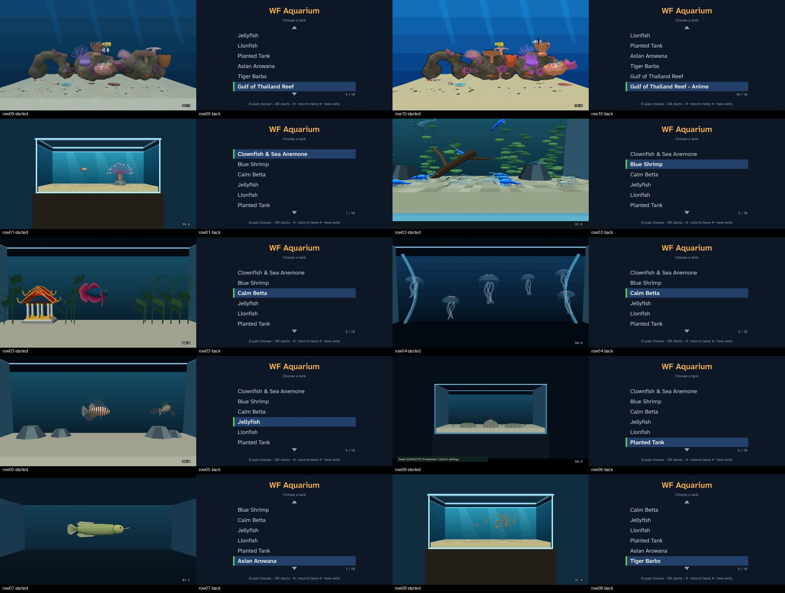
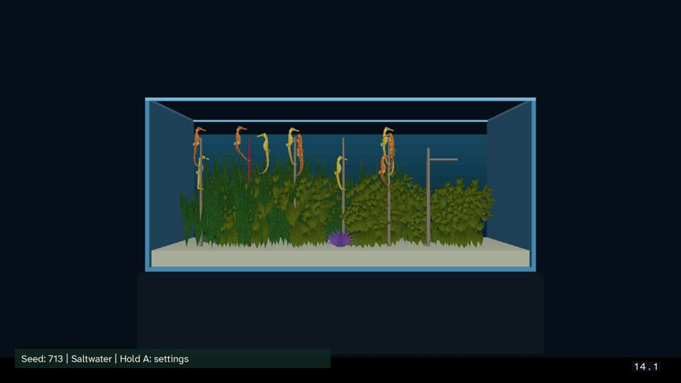
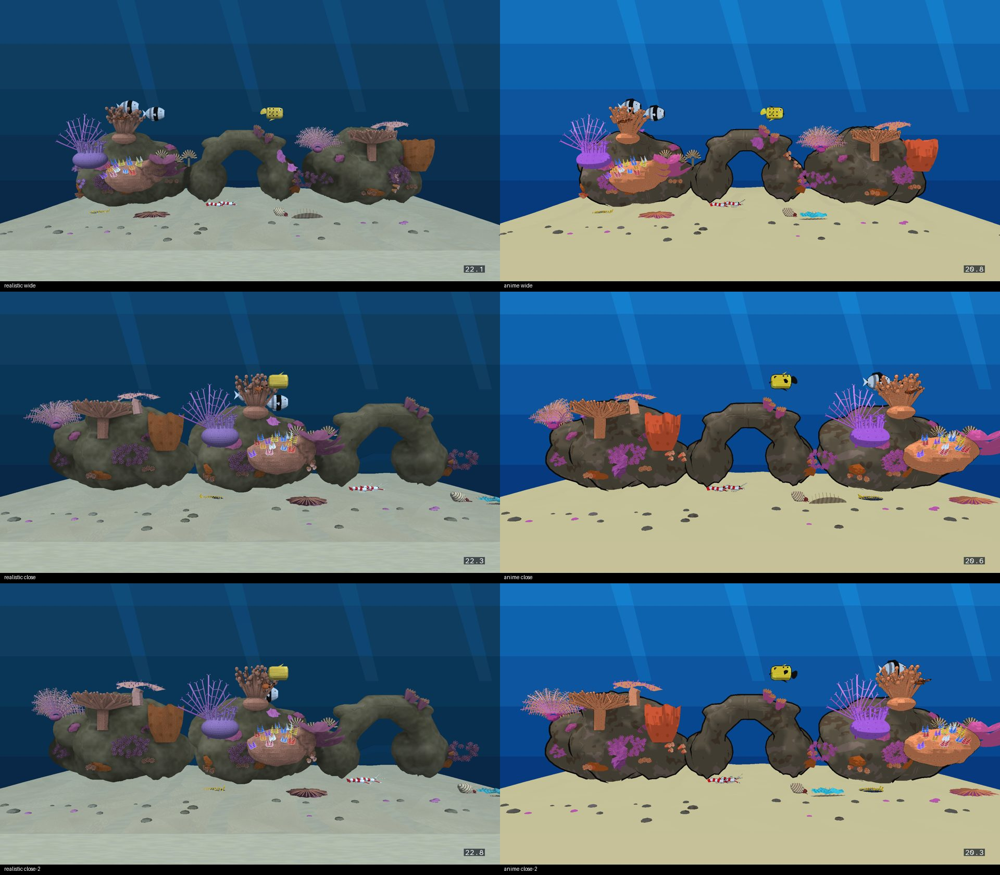

# Reef W4: cast1 acceptance, 2026‑11‑09

Plan: [W4 in the finishing plan](../../plans/2026-11-08-reef-tanks-finish.md#w4--the-rest-of-the-original-plan-t3-coordinator-for-devices), status rows 9–12 and 15. The step text comes from the [original plan](../../plans/2026-11-02-gulf-of-thailand-reef-tank.md) (verification steps 9–12).

Device: cast1 (`chromecast-test-01`, Chromecast HD, Android 14, armeabi‑v7a). Every device action went through the coordinator (`task chromecast:*`). Times are UTC (Bangkok is UTC+7).

| Step | What | Result |
|---|---|---|
| APK | Aquarium release APK built from today's tree (`b49e8851` plus the reef levels, which rebuild identical to HEAD) | sha256 `83efd2c67d994a58a1a38a7c5fc78dd51208fd026f444d51d2d7b4fc5b6e7ac3` |
| 9 | Rows 9 and 10 start their reef, Back returns, rows 1–8 still start | **PASS** |
| 10 | 120 s wide idle, 3 alternating runs per style, Layout = Random, gate ≥ 20 FPS | **PASS**: realistic **22.50**, anime **20.69** |
| 11 | E7.1: six-pair Planted Tank inside the 17 October range (69.09–69.28 ms) | **FAIL**: 71.25 ms (+2.0 ms, 14.04 FPS) |
| 11 | E7.2: merge bench reported | **PASS** (reported, below) |
| 12 | Dream with each reef for 5 min; selection restored | **Partial**: realistic ran for 5 min 23 s; anime started, then cast1 left the network before its 5‑minute check. **Not restored yet** |
| 15 | Matched captures, wide and close, for Will | Captured; **open until Will approves** |

## APK

`task build-cd-iff-aquarium-menu` (in the containers) built today's menu bundle. Then `./gradlew assembleAquariumRelease` built today's engine for both ABIs, including the rotation fix `4ca61197`. There is no Android build container, so gradle ran on the host the same way `task build-apk` runs it. This is a full build, not a `cd.iff` swap. The APK's `assets/cd.iff` is byte-identical to `wflevels/aquarium-menu-cd.iff`.

## Step 9: selector and Back

One `check` job (J‑2b832eb7b454) visited rows 9, 10, then 1–8. For each row it pressed UP ×10, DOWN ×(row − 1) and CENTER, took a capture, pressed BACK and took a second capture. The logcat has `level-menu: level N starts`, then `Back in level: returning to selector`, for all ten levels (indices 8, 9, 0–7).

[](step9-selector-sheet.jpg)

Close-ups: [row 9 started](step9-row09-started.jpg), [row 9 back](step9-row09-back.jpg), [row 10 started](step9-row10-started.jpg), [row 10 back](step9-row10-back.jpg).

## Step 10: wide-idle frame rate

These are `profile` jobs, alternating realistic and anime, with the shipping Layout = Random, so each entry is a different reef. Each value is the 120 s window starting 2 s after the selector release, from raw SurfaceFlinger presents (`profile-idle-window.py`).

| Run | Realistic FPS (job) | Anime FPS (job) |
|---|---|---|
| 1 | 22.58 (J‑2488cad03395) | 20.68 (J‑82f01a6daac8) |
| 2 | 22.50 (J‑37a554ba81c7) | 20.69 (J‑a6ce1851cb2f) |
| 3 | 22.47 (J‑bddc08918366) | 20.74 (J‑c282093d9f78) |
| **Median** | **22.50** | **20.69** |

Both styles pass the ≥ 20 FPS gate. Anime passes by 0.69 FPS. The R0 P0 run (Fixed layout, before W5) measured 22.95 and 21.19. The Random kit costs about 0.45 FPS realistic and 0.50 FPS anime, which is within the slowdown Will accepted for W5b. Each run's selected-reef capture: realistic [1](step10-realistic-run1.jpg) [2](step10-realistic-run2.jpg) [3](step10-realistic-run3.jpg), anime [1](step10-anime-run1.jpg) [2](step10-anime-run2.jpg) [3](step10-anime-run3.jpg).

## Step 11: E7.1 and E7.2

### E7.1: seahorse no-regression: FAIL

The fixture is the same as on 17 October ([comparison](../../plans/2026-10-16-saltwater-seahorses/comparison.md)): six pairs, seed 713, saltwater, age 150, growth paused, textures and sway on, random entry off. It was built with `scripts/build-planted-seahorse-variants.py --variants pair6` on the acceptance APK. One `profile` job (J‑89ec1db82bcc) ran three 60 s repeats. They were scored with `analyze-seahorse-population.py`'s `presentation()`. The `PLANTS …` fixture line was checked in each run's current log.

| Run | Mean frame ms | FPS | p95 ms |
|---|---|---|---|
| 1 | 71.25 | 14.04 | 83.42 |
| 2 | 71.25 | 14.04 | 83.42 |
| 3 | 71.66 | 13.95 | 83.42 |
| **Median** | **71.25** | **14.04** | 83.42 |
| 17 Oct | 69.26 (69.09–69.28) | 14.44 | 83.42 |

The median is 1.99 ms (2.9%) slower than on 17 October, and outside its run range. The p95 is unchanged. The reef work did not touch the Planted Tank's level. The engine has had several weeks of changes since `9f97f5dd`, including `4ca61197`. This run cannot say which change costs the 2 ms; that needs a bisect over engine revisions with the same pair6 APK recipe.



### E7.2: merge bench: reported

These are direct-launch bench APKs: the acceptance APK with only `cd.iff` (`shell.fth` plus `dfrm_bench_{single,merged}-standalone.iff`) and `wf_args.txt` changed (`scripts/build-dfrm-e7-bench-apks.py`). Each level has 180 triangles and the same flex: 15 one-curve actors against one 15-curve actor.

The first attempt (J‑5495571be13c) used the menu bundles with a `scene`, and failed at scene selection. The second attempt (J‑bb90e135891e) measured all six presentation runs and `single-cpu`, then ran out of its 900 s budget during `merged-cpu`. A third job (J‑3a36e95151d4) ran `merged-cpu` alone. The coordinator's automatic cleanup restored the acceptance APK each time.

| Variant | Presentation FPS (3 runs) | update ms | render ms | total ms | draws | uploads | upload bytes |
|---|---|---|---|---|---|---|---|
| single (15 actors) | 59.71, 59.64, 59.67 | 0.692 | 0.924 | 1.615 | 16 | 16 | 20,885 |
| merged (1 actor) | 59.67, 59.76, 59.66 | 0.441 | 0.185 | 0.625 | 2 | 2 | 20,885 |

Both variants run at the display's 60 Hz cap, so presentation cannot tell them apart. The CPU sections are frame-weighted means from 11 five-second `--frame-profile` windows each. They were taken inside each run's presentation span. Merging saves 0.99 ms per frame: render drops 0.74 ms and update 0.25 ms. Draws and uploads fall from 16 to 2, for the same triangles and upload bytes.

## Step 12: Dream with each reef

The original state, read by J‑18d08dd2b51f:
- Selected Dream: **Seahorse Grid** (`org.worldfoundry.seahorsegrid/…SeahorseGridDreamService`).
- Aquarium app tank preference: `random`.
- Installed Aquarium screensaver APK: `64c09d87…`.

Steps:

1. **Installed the Aquarium Dream APK from today's tree** (J‑bce21b2fc53a; the coordinator recorded the previous APK as `64c09d87…`). Then selected the Aquarium Dream (J‑fdbe99ce0d7b) and set `tank = aquarium_thai_reef` (J‑d0bbc37fd440, previous `random`).
2. **Idle trigger failed.** `screensaver-trigger` (J‑f650519de8c9) waited 12 min, and the Dream never started: `dream-not-observed`. The likely cause is that cast1's `stay_on_while_plugged_in` is `3`, which keeps the screen awake while it is powered. I did not change that setting.
3. **Bug: the reef crashed the Dream host.** `screensaver-show` runs the Dream's own player (`ScreensaverPreviewActivity` with the `DREAM` extra; Android allows only root to force a system Dream). It showed the home screen ([capture](step12-reef-before-fix-home.jpg)). The engine log [asserts](step12-dream-assert-before-fix.txt): `w = 1024, Display::VRAMWidth = 1024` in `gfx/rmuv.hpi`. `android/screensaver/src/main/cpp/dream_host.cc` passed no `--vram-width`, so it got the engine default of 1024. The reef tanks carry 1024‑wide textures, and the aquarium app runs them with `--vram-width=2048` (`android/app/src/aquarium/assets/wf_args.txt`). **Fix:** the host now passes `--vram-width=2048`, so its VRAM flags match the app's. `tests/test_dream_host_vram.py` keeps the two in step; it fails on the old host and passes on the new one. The fixed Dream APK is `5dfdba1f…` (J‑b0e6de41a159).
4. **Realistic reef: PASS.** Shown at 03:22:14 ([start](step12-reef-start.jpg)). It was still running at 03:27:41: J‑0b3b16e50d80 found the preview running, and the capture shows the boxfish moved ([5 min](step12-reef-5min.jpg)). That is 5 min 27 s with no assertion.
5. **Anime reef: started, not held.** Set `tank = aquarium_thai_reef_anime` (J‑02a7c5340dc3). The first show (J‑7142156468e8) timed out in `am start -S -W` after 30 s while it stopped the running reef; the coordinator cleaned up automatically. The retry (J‑2cf5e063303f) showed it at 03:30:04 ([start](step12-anime-start.jpg)). **At the 5‑minute check (03:35:25), cast1 had left the network:** J‑11d3b927e99c failed with `device-not-found-on-network`, and the coordinator reports that Wireless debugging is not advertising. I did not readd or recover it.

**Finding: the Dream runs the reef at about 3 FPS.** The engine log at 5 minutes shows `delta too large`, with frame deltas of 0.330–0.358 s (median 0.338 s over 60 frames; [log tail](step12-reef-5min-engine-log-tail.txt)). The screensaver APK is `assembleAquariumDebug`, so its native code is a Debug CMake build. The game APK is Release and holds 22 FPS. Whether to ship the Dream's native code as Release is a decision outside W4.

**Still to do once cast1 is back:**
- Rerun the anime 5‑minute hold.
- Set `tank` back to `random`.
- Select Seahorse Grid again.
- Restore the game APK to `30554973…`.

The Aquarium screensaver package is now `5dfdba1f…` (the VRAM fix), not the original `64c09d87…`. The coordinator pulled the original into J‑bce21b2fc53a's `pre-install-launcher.apk` (root-only store). It can be put back if wanted. Without the fix, the original asserts on either reef.

## Step 15: style review (open for Will)

The wide pair is from J‑560e77f85051 and J‑efc3d33a10d0. Random happened to draw the same layout in both, so it is an exact framing match.

The close pair is from J‑ad627a068c96 and J‑d0252a53e597. Each job holds RIGHT for 7 s, which takes the boxfish past the 5‑unit latch. Then it holds LEFT for 4.5 s, which brings the fish back inside 2.8 units of the focus, and the Director switches to `cs_close`. These two drew different layouts.

[](step15-style-sheet.jpg)

| | Realistic | Anime |
|---|---|---|
| Wide | [wide](step15-realistic-wide.jpg) | [wide](step15-anime-wide.jpg) |
| Close | [close](step15-realistic-close.jpg) | [close](step15-anime-close.jpg) |
| Close, 4 s later | [close-2](step15-realistic-close-2.jpg) | [close-2](step15-anime-close-2.jpg) |

## Reproduce

The working files are in `build-docker/acc/`, which is gitignored:
- APKs: `aquarium-acceptance.apk`, `bench-direct/`, `seahorse/pair6.apk` and `dream-aquarium-vram.apk`.
- Recipes: `recipe-step9.json`, `recipe-step15b-*.json` and `recipe-e72-*.json`.

```sh
task build-cd-iff-aquarium-menu
(cd android && ./gradlew assembleAquariumRelease)
python3 docs/diagnostics/reef-gameplay-verification-2026-11-05/profile-idle-window.py <evidence dir>
scripts/in-linux-container.sh python3 -m pytest -q tests/test_dream_host_vram.py
```
