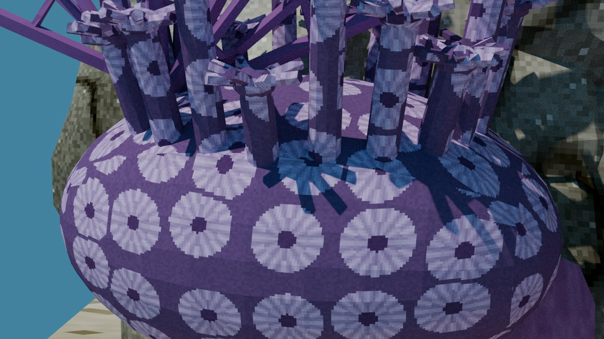
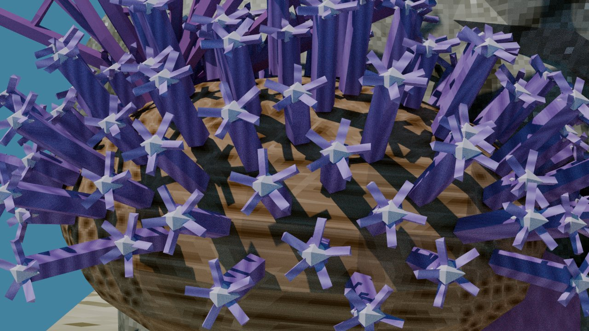
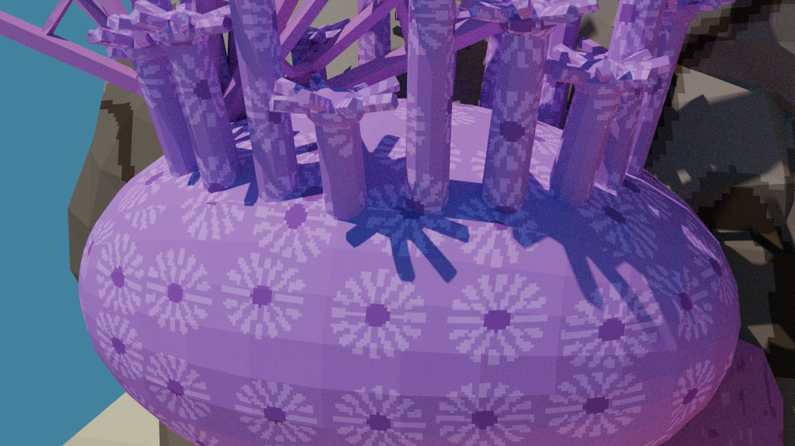
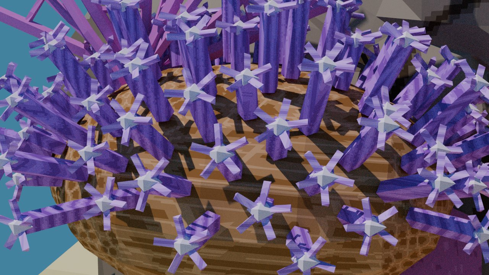
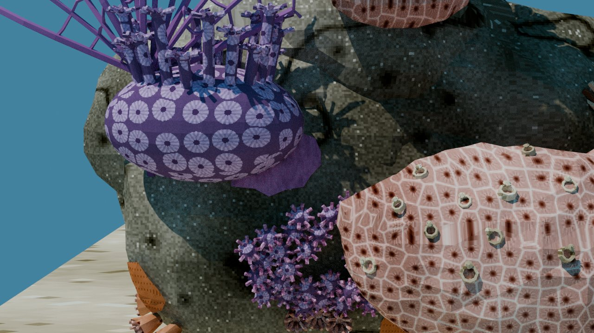
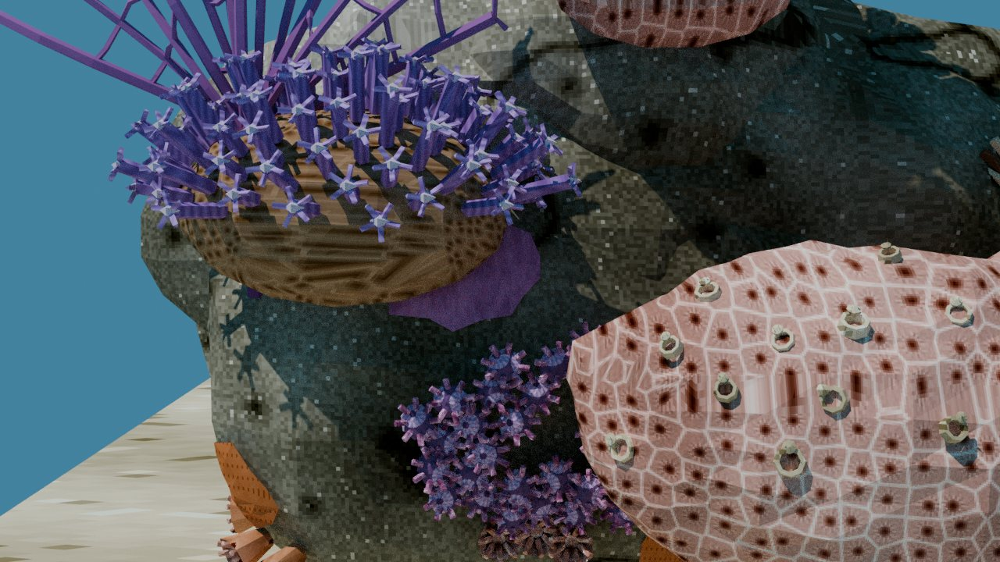
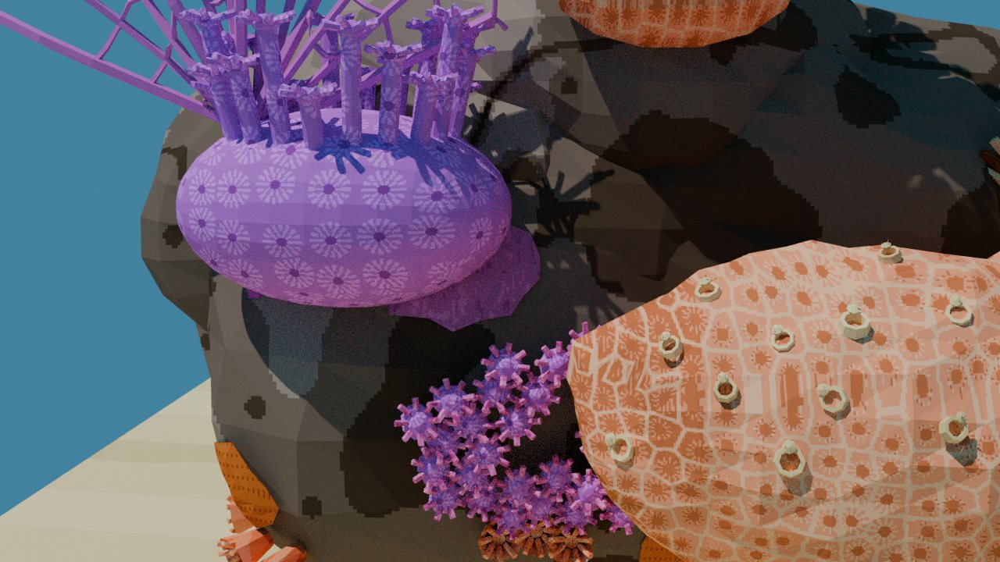
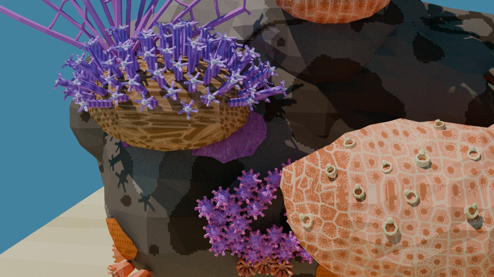
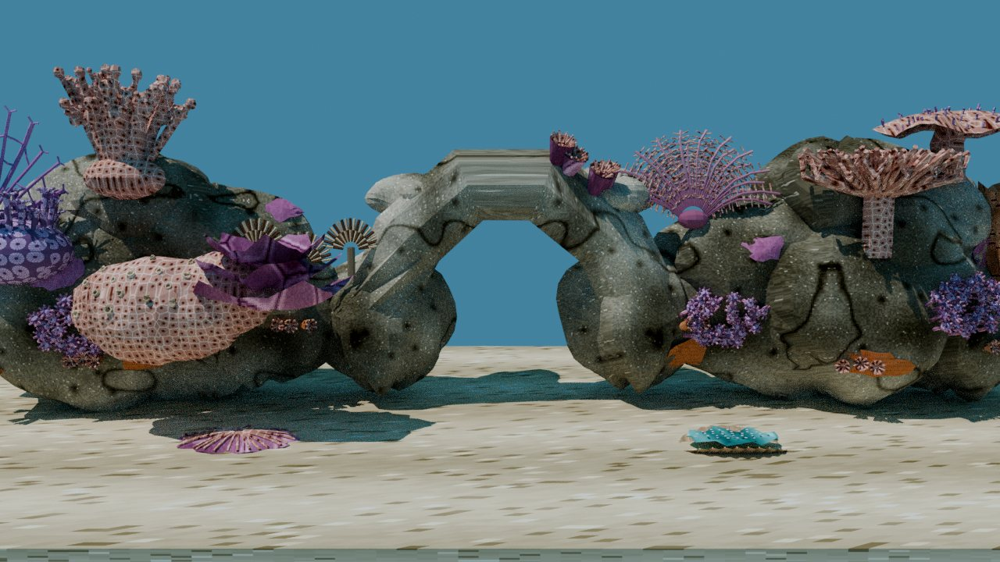
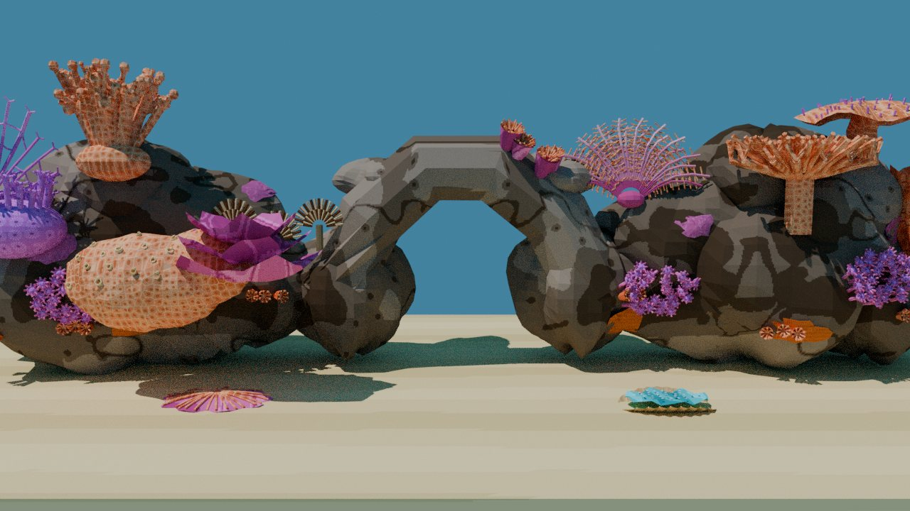

# Flowerpot coral as *Goniopora* (option 1): review, 10 November 2026

Will, 2026‑11‑10: "ok flowerpot now". He had said today's purple ball "looks like no texture". This change rebuilds the flowerpot coral from the prototype ([`render-flowerpot.py`](render-flowerpot.py): [front](flowerpot-front.png), [above](flowerpot-above.png)) and gives it its own texture. It is shown on top of the approved surface-tile repaint ([option 2](../reef-tiles-2026-11-10/README.md)). **Waiting for Will's review; nothing is rebuilt or committed.**

> [!NOTE]
> These are Blender renders (CPU Cycles, matte, the static bake's sun) of the generator's own meshes with each style's real atlas, made with [`render-flowerpot-scene.py`](render-flowerpot-scene.py). They are not engine captures and they leave out anime outlines. **Before** is today's flowerpot with option 2's tiles; **after** is the new *Goniopora*.

## Close-up

| | Before | After |
|---|---|---|
| Realistic |  |  |
| Anime |  |  |

## Left rock and wide view

| | Before | After |
|---|---|---|
| Realistic, left rock |  |  |
| Anime, left rock |  |  |
| Realistic, wide |  |  |
| Anime, wide |  |  |

## What changed

- **Geometry** (`reef/corals.py`, `flowerpot`), from the prototype's `proposed()`:
    - a 16 × 8 body;
    - 100 polyps on Fibonacci points over the dome down to about its equator, each standing along the surface normal;
    - each polyp is a 5-sided column, a small mouth and five tentacles.
- **Texture**: four new 64‑px regions in the free space of utility cell 15, each with its own SKINS entry at small-object density (`reef/atlas.py`, `reef/uvmap.py`). Anime posterises each to three tones.

    | Part | Region in cell 15 | Painted as | Density |
    |---|---|---|---|
    | `gon_body` | 64,192 | tan-brown skeleton, dark corallite pits, pale walls | 5 cycles/unit |
    | `gon_polyp` | 128,192 | purple column with fine stripes | 7 |
    | `gon_tentacle` | 192,192 | lighter purple with pale bands | 9 |
    | `gon_mouth` | 0,64 | pale cream-lilac disc | 9 |

    The polyps are one purple family, as today. The leather coral keeps the old `flowerpot_tip` key for its small polyps.
- **Rig** (`reef/flora_rig.py`): the flowerpot keeps its 12 sway curves, the count the tests expect. The polyps are now grouped into 12 azimuth sectors of the dome, between 5 and 11 polyps per sector. Each curve therefore sways a coherent patch about that patch's centre. Grouping by index would have scattered each curve's polyps over the whole dome, because the Fibonacci points interleave.
- The flowerpot has **no boxfish reaction**: it only sways, faster in the current. That behaviour is unchanged, so the reaction test is not affected.

## Triangles and budgets

| | Today | New |
|---|---|---|
| Flowerpot triangles | 6,640 | **6,824** (+184) |
| Polyps | 20 tall polyps with 8 tentacles each | 100 short polyps with 5 tentacles each |

- **Static budget:** the flowerpot is an animated actor (`FlowerpotCoral`), not a static piece. The realistic worst visible static set (71,729 of 72,000) does not change.
- **Anime outline budget:** the flowerpot has no anime outline hull, so the 23,594-of-24,000 hull budget does not change either.
- **Animated actors:** still 15.
- **`report_budget --cooked`:** it reads the cooked levels, so it runs after the rebuild that follows approval.

## Checks

- `texcov.py`: the flowerpot has 0 % flat swatch and 0 % under 3 texels; `--check` PASSES.
- The reef suites (linux-test container): 180 passed, 4 failed. All 4 are the known failures: the worm harness, two menu-Taskfile tests and one screensaver import.

## Reproduce

```sh
WF_CONTAINER_IMAGE=blender scripts/in-linux-container.sh blender --background \
  --python docs/diagnostics/reef-flowerpot-2026-11-10/render-flowerpot-scene.py -- build-docker/fp-render after
```

The "before" tree is the current reef package with `corals.py` and `flora_rig.py` taken from HEAD.
