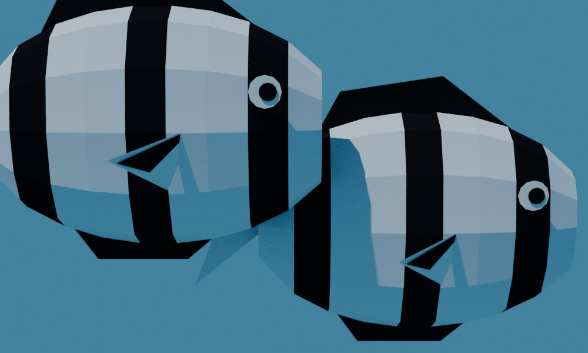
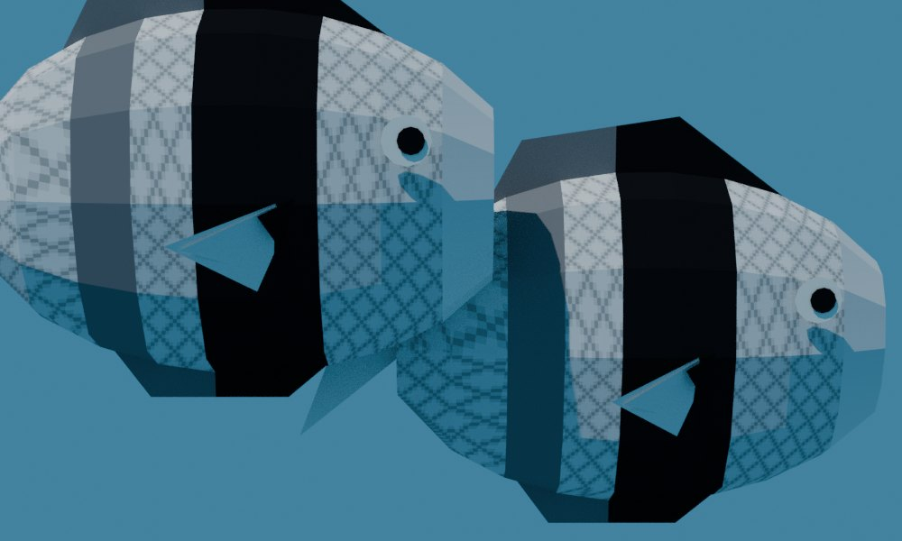
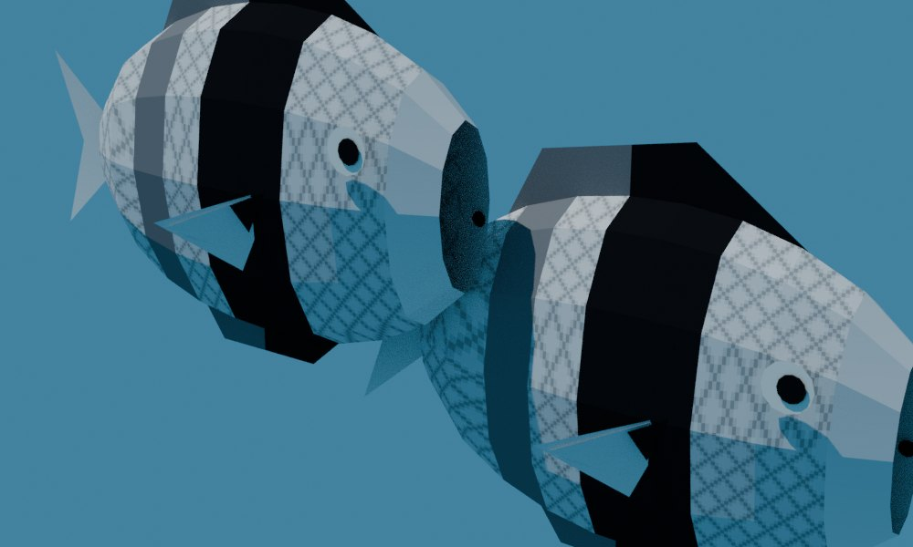
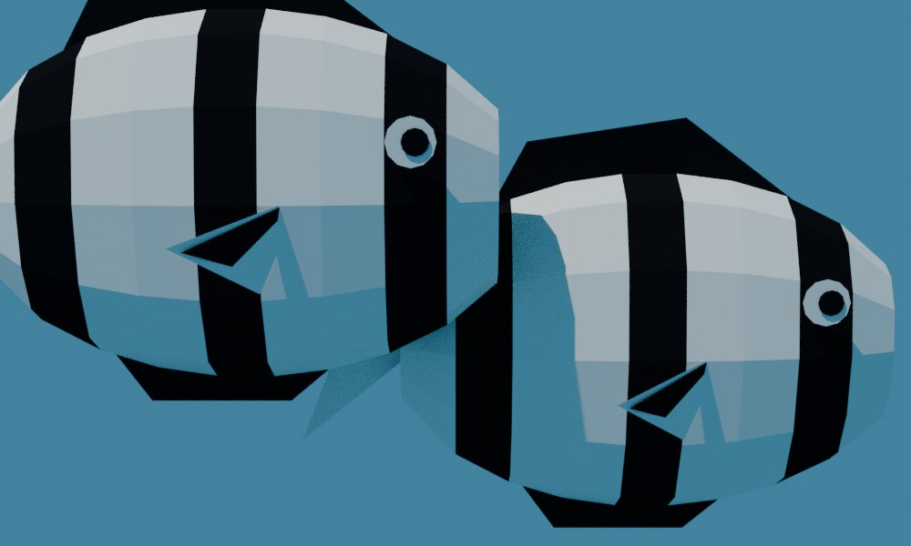
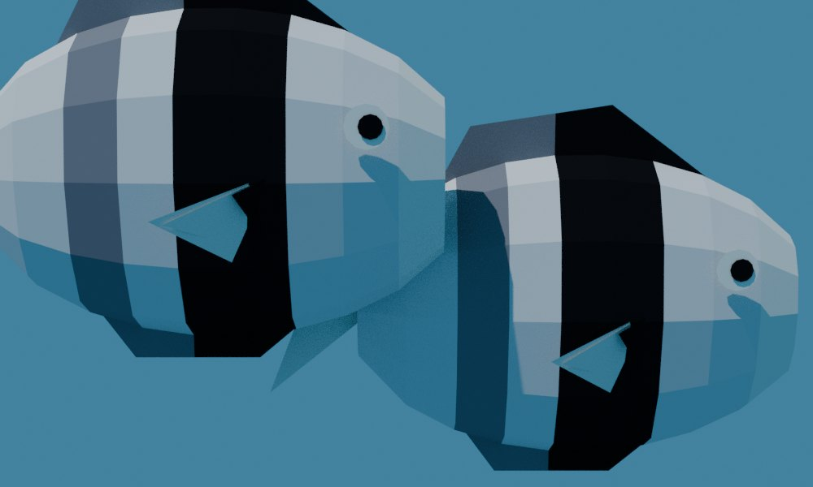
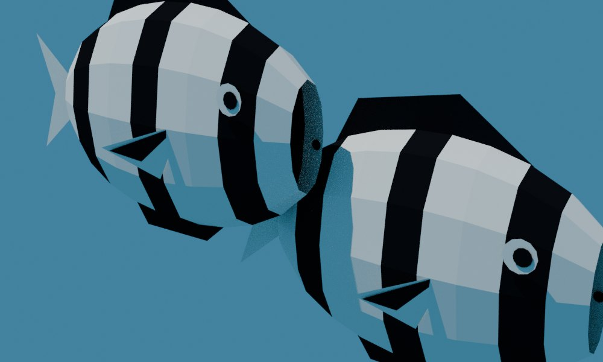
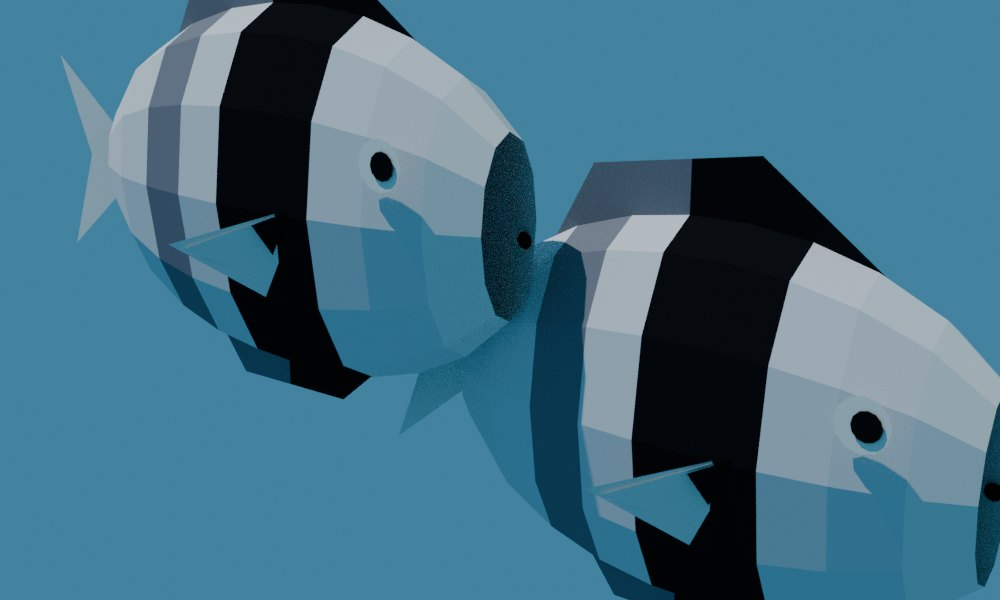
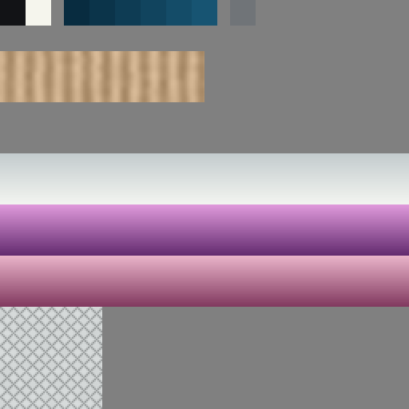
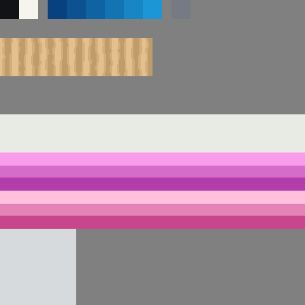

# Humbug swap to *Dascyllus reticulatus*: review, 9 November 2026

Decision D10 of the [reef finishing plan](../../plans/2026-11-08-reef-tanks-finish.md#decisions-for-will). Will, 2026‑11‑09: "swap the humbug for the reticulated dascyllus, *Dascyllus reticulatus*". Phase 0 found no citable Gulf of Thailand record for the humbug *D. aruanus*. *D. reticulatus* is recorded in the Gulf and lives in the same *Pocillopora* host; the sources are in the [research ledger](../../reference/thai-reef-research.md#d1-and-d2-searches).

> [!NOTE]
> These are **Blender renders** (CPU Cycles, the static bake's sun, matte) of the generator's own fish mesh with each style's real atlas and exported UVs. They use the same method as the [skins review](../reef-skins-2026-11-08/README.md), and they are not engine captures. **Before** is the reef package at `b090a8fd`; **after** is this change. Both renders show the pair as `generate.py` places it.

## The pair

| | Before (*D. aruanus*) | After (*D. reticulatus*) |
|---|---|---|
| Realistic, side |  |  |
| Realistic, three-quarter |  |  |
| Anime, side |  |  |
| Anime, three-quarter |  |  |

The dark disc at the snout in the three-quarter views is the open front of the body mesh, seen from inside. It was there before this change, and the change leaves it as it was.

## The skin

The colouring follows [FishBase](https://www.fishbase.se/summary/Dascyllus-reticulatus.html) ("body whitish … black bar on anterior and a fainter one on posterior part of the body; blackish scale margins; pelvic fins mostly black; pectorals transparent with a spot on its base") and [Reef Life Survey](https://reeflifesurvey.com/species/dascyllus-reticulatus/) ("black vertical bar behind head, continuing onto dorsal and pelvic fins. Second dark bar present on some individuals below rear dorsal fin").

| Part | Before | After |
|---|---|---|
| Body | white, faint sheen; three black bars | pale grey with a dark diamond scale-margin net (realistic only); one black bar behind the head (x −0.04 to 0.10) |
| Rear bar | black | faint grey (`fish_grey`, x −0.18 to −0.11) |
| Dorsal fin | all black | black at the front, where the bar meets it; grey at the rear |
| Anal and pelvic fins | all black | black at the front (pelvic); grey at the rear (anal) |
| Pectoral fin | white with a black inner layer | pale, both layers, with a small dark spot at its base |
| Snout | black bar through the eye | pale, unscaled |
| Tail | pale | pale (unchanged) |

Atlas cell 15 gained two things, after the water bands, which end at x = 136 inside the cell:

- a grey swatch at x 144–159, rows 0–15;
- the scale-net square at x 0–63, rows 192–255. It is square so that the projected UVs stay isotropic: four cycles per unit gives about 7 texels, or 0.03 units, per scale.

The anime style paints the square one flat grey, so it has three clean tones: black, grey and pale. The outline hull is unchanged (it uses the black swatch) and still reads. The fins' outline and the body shape are unchanged, so the silhouette is the same. The pair have 292 triangles each, up from 286.

| Cell 15 | Realistic | Anime |
|---|---|---|
| After |  |  |

## What did not change

- **Behaviour:** the `reef-shoal` Forth is unchanged. That covers the 1.2-unit detect radius, the 2.5 s hold, the 0.48 dive, both fishes' phases and offsets, and the hero-module offsets.
- **Internal names:** `humbug_pair`, `HumbugOne`/`HumbugTwo`, `reef_humbug.iff`, `fishes.humbug()`, `humbug_white` and the poster key `humbug` all stay. "Humbug" is still a correct common name: Reef Life Survey calls this species the "headband humbug damsel". `scene.py` and `fishes.py` carry the comment "humbug = Dascyllus reticulatus (headband humbug), D10".
- **Species string:** `scene.py` now says `'Dascyllus reticulatus'`. No other tank uses the species (`git grep`, 2026‑11‑09).

`reef/life.py`'s `_humbug()` was a three-bar silhouette with no callers (checked with `git grep`), so it is deleted.

## Reproduce

```sh
git archive b090a8fd wflevels/aquarium_thai_reef/reef | tar -x -C build-docker/reef-humbug-before
WF_CONTAINER_IMAGE=blender scripts/in-linux-container.sh blender --background \
  --python docs/diagnostics/reef-humbug-swap-2026-11-09/render-pair.py -- \
  build-docker/reef-humbug-render before build-docker/reef-humbug-before/wflevels/aquarium_thai_reef
WF_CONTAINER_IMAGE=blender scripts/in-linux-container.sh blender --background \
  --python docs/diagnostics/reef-humbug-swap-2026-11-09/render-pair.py -- build-docker/reef-humbug-render after
task --force aquarium-thai-reef-level && task --force aquarium-thai-reef-anime-level
python3 docs/plans/2026-11-08-reef-tanks-finish/texcov.py --check
```
