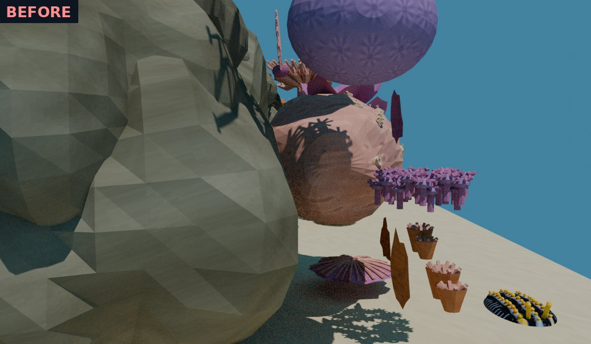
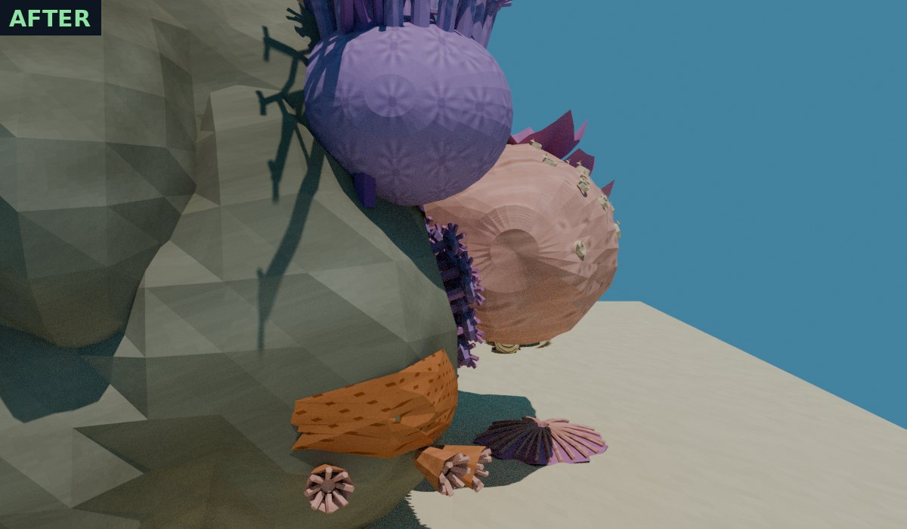
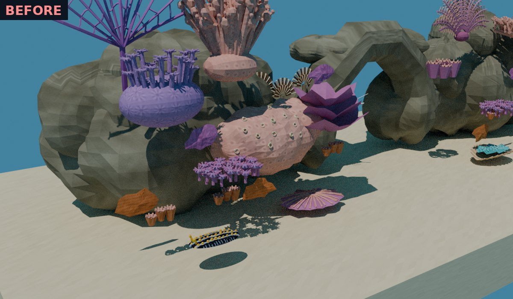
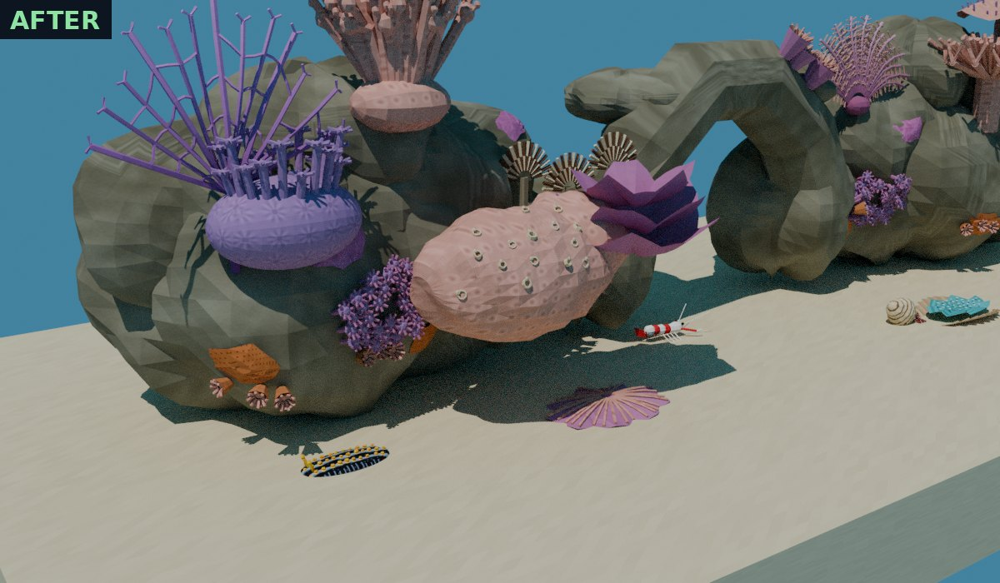
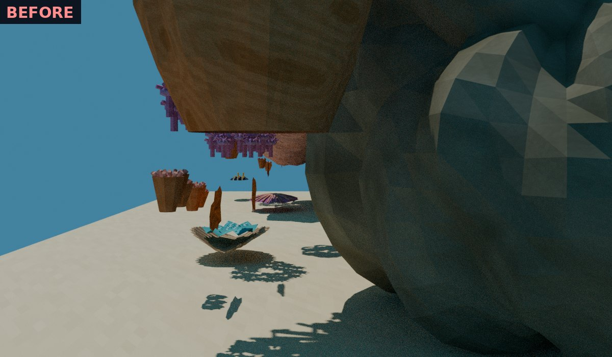
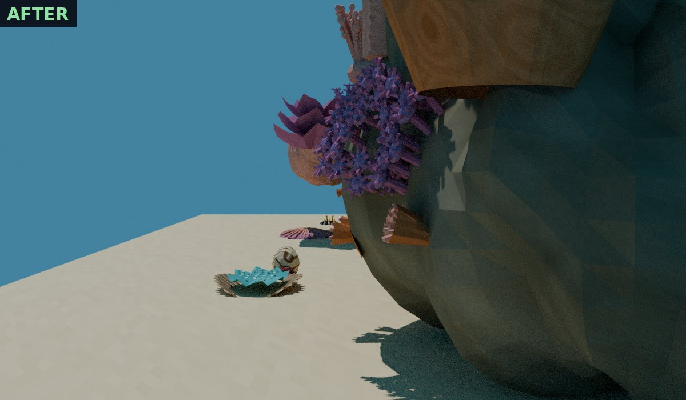

# Placement: nothing floats, everything attaches. Review, 8 November 2026

W3 of the [reef finishing plan](../../plans/2026-11-08-reef-tanks-finish.md), for Will's review. Will, 2026‑11‑08: "approved, go ahead with W3".

**Units.** Distances are world units: 1 unit = 1 m at the tank's ×10 scale = 10 cm real. "World cm" below means hundredths of a unit.

> [!NOTE]
> These are **Blender renders** (CPU Cycles, matte) of the generator's own meshes, not engine captures; the desktop engine cannot run in this machine's containers. The front game camera cannot show depth, which is how these floats went unnoticed, so the review uses **side elevations** (looking along the tank) and a three-quarter view. **Before** is the code at `5030e6cd` with the actor positions `generate.py` hard-coded; **after** is this change.

## What the audit found

Every attached thing was measured against its host: the analytic rock (the same seeded blobs the level exports; it matches the exported rock to about 1 world cm) or the sand at z = 0.72.

| Item | Before | After |
|---|---|---|
| Zoanthid carpets ×3 | 35–60+ world cm in front of the rock (polyps stood in a horizontal disc in open water) | each of 102 polyps on the rock face, growing along its local normal |
| Cup-coral clusters ×6 | 58–60+ world cm in front of the rock | each of 18 cups on the rock face, growing outward |
| Encrusting crusts ×8 | 41–60+ world cm in front of the rock | conformed onto the rock, at most 2 world cm proud; outlines pulled in where they would overhang water |
| Tubastraea cups on the arch | 38 world cm above the arch | on the arch top |
| Flowerpot, sea fan, leather coral, feather star | 20–60+ world cm off the rock | on upward-facing rock tops |
| Feather dusters | tubes 40 world cm inside the rock | tube bases on the rock top |
| Barrel sponge | 33 world cm off the rock | on the right rock top |
| Cauliflower coral head (the crab's host) | 42 world cm off the rock | on the rock top; the guard crab and humbug pair move with it by the same offset, so every crab and humbug distance is unchanged |
| Table coral | 26 world cm off the rock | on the rock top |
| Giant clam | 9 world cm above the sand (its rib tubes read as stilts) | valves buried to 40 % of their height |
| Hermit crab | **31 world cm under the sand** (never visible) | on the sand |
| Mushroom coral | 13 world cm above the sand | on the sand |
| Nudibranch | 33 world cm above the sand, bobbing up and down 7 world cm | on the sand at the foot of the left rock, crawling flat and turning to face its direction of travel |
| Cleaner shrimp ×2 | hanging in mid-air in the arch opening | waiting on the cave floor; cleaning still lifts them onto the fish's back |
| Christmas tree worms | (fixed in W1) | on the Porites boulder |

**Deviation from the plan.** The plan put the nudibranch on the rock. The left rock's upward-facing patches are at most 12 world cm wide and jump between heights of 2.1 and 2.9, so a slug crawling there would need the director to tilt it to the slope. It crawls on the sand at the rock's foot instead.

## Side elevation: left rock mass




## Three-quarter view




## Side elevation: right rock mass




## How

- `reef/surface.py`: the host surfaces (rock blobs with `rockscape.py`'s wobble, the arch lintel, the sand), ray casts and smooth normals.
- `reef/placement.py`: **one table** of everything attached, each with an authored hint and a host, resolved once at export. `anchor_map()` now reports the resolved positions, and `generate.py` reads every attached actor's position from it. Nothing scans for surfaces at run time.
- The life builders place each polyp and cup in its own local frame, then move it onto the surface along the normal. Explicit UVs travel with the faces.

## Tests

- `tests/test_thai_reef_placement.py`, the W3 part (26 tests):
    - crusts on the rock;
    - every zoanthid and cup cluster touching the rock;
    - each upright actor's lowest point on its host;
    - the clam sunk to 40 % and the hermit crab on the sand;
    - the nudibranch and shrimp resting on the sand;
    - the host corals on the rock, with their residents moving with them;
    - the built levels using the resolved positions, with no bob in the nudibranch's script.
- `tests/test_species_movement.py`: the cleaning and crab tests read the resolved station and host. The nudibranch test now requires a flat crawl; the old test required the bob.
- 132 reef tests pass; the texel audit passes; budgets are unchanged (realistic 64,390 static triangles; anime hull 22,462 of 24,000). The menu bundle was rebuilt with the other tanks from HEAD.

## Reproduce

```sh
task --force aquarium-thai-reef-level && task --force aquarium-thai-reef-anime-level
python3 -m pytest -q tests/test_thai_reef_placement.py tests/test_species_movement.py
# before tree: git show 5030e6cd:wflevels/aquarium_thai_reef/reef/<file>.py into build-docker/reef-before-w3/reef/
WF_CONTAINER_IMAGE=blender scripts/in-linux-container.sh blender --background \
  --python docs/diagnostics/reef-placement-2026-11-08/render-placement.py -- build-docker/reef-placement-render after
```
