# Reef reactions on the desktop engine, 9 November 2026

This is original reef-plan verification step 6, under W4 of the [finishing plan](../../plans/2026-11-08-reef-tanks-finish.md). [`scripts/check-thai-reef.py`](../../../scripts/check-thai-reef.py) runs the real engine (`wf_game`) on both reef levels. It drives the boxfish to each reactor over the debug bridge, holds it there, moves it away, and reads each reaction from the Director's own cells, frame by frame (0.05 s per frame at `-rate20`).

**Result: every reaction is inside its window in both styles.** There is one behaviour finding, for the shrimp, [below](#finding-the-shrimp-chase-a-fish-that-leaves-mid-clean).

## How it runs

- **Container.** The engine runs in `wf-linux-test:local`, under Xvfb with Mesa llvmpipe (about 12 FPS), and nothing runs on the host. [`scripts/build-wf-game-container.sh`](../../../scripts/build-wf-game-container.sh) builds `wf_game` inside that container from a copy of the sources, to `build-docker/wf-game/src/engine/wf_game`, so the host's own `engine/wf_game` is not touched.
- **Layout.** The run sets `--property=ReefSettings.Layout=0` (Fixed), because the shipped default is now Random. The script asserts that mailbox 860 reads 0. The shipped levels are unchanged.
- **Driving.** The boxfish is teleported over the bridge to each reactor: the Player's position mailboxes, velocity zeroed, joystick neutral. Before each visit it is parked away for 9 s, so every earlier reaction has reopened.
- **Measuring.** Radii, timers and cells come from [`generate.py`](../../../wflevels/aquarium_thai_reef/generate.py), and positions from `reef.scene`.
- **Columns in the table below:**
    - **Close** is the time from arrival until the reactor is fully closed.
    - **Reopen** is the time from the fish leaving until the reactor's timer reaches 0 and it starts to open.
    - **Open** is when it is fully open again.
    - Measured times run one frame (0.05 s) behind the timer, because the fish is seen gone on the first tick after it moves.

```sh
scripts/in-linux-container.sh scripts/build-wf-game-container.sh
scripts/in-linux-container.sh bash -c "xvfb-run -a -s '-screen 0 1280x720x24' python3 scripts/check-thai-reef.py --video; echo rc=\$?"
scripts/in-linux-container.sh python3 scripts/check-thai-reef.py --rejudge     # re-check the saved traces
```

Do not let `xvfb-run` be the container's PID 1 (run it inside `bash -c '…; echo'`): it never sees Xvfb's ready signal and hangs. The reef needs the large VRAM switches, and the level takes over a minute to load under llvmpipe.

## Results (Fixed layout; the realistic and anime styles give identical numbers)

| Reactor | Close s | Reopen s (timer) | Window | Open s | Verdict |
|---|---|---|---|---|---|
| Christmas tree worms ×15 | 0.15 each | 3.05–7.95; each = its timer 3 + 0.35·(7i mod 15) + 0.05 | 3–8 s | 4.50–9.40 | **PASS** all 15 |
| Feather duster 0 / 1 / 2 / 3 | 0.20 | 3.05 / 4.05 / 5.05 / 6.05 (3 / 4 / 5 / 6) | 3–8 s | 5.45–8.45 | **PASS** |
| Giant clam (valves to 35 %) | 0.35 | 4.05 (4) | 3–8 s | 5.00 | **PASS** |
| Guard crab (claws-up threat) | 0.05 | 2.05 (2) | 2 s | 2.05 | **PASS** |
| Dascyllus pair (dive into the coral head) | 0.50 | 2.55 (2.5) | 2.5 s | 3.50 | **PASS** |
| Cleaner shrimp | cleaning starts 2.05 s after arriving still | cleaning lasts 4.95 s | starts after 2 s; lasts 4–6 s | — | **PASS** |

The pair's dive is checked on the actor itself as well as on the cell: HumbugOne's engine z drops by 0.48 (from 3.85 to 3.37) and comes back. During the clean, ShrimpOne moves to the fish's x − 0.175, as the script intends.

Per-reaction traces are in [`frames/`](frames/), and the full table is in [`results-fixed.json`](results-fixed.json).

### Random layout (bonus)

`--random-seed 7` runs the realistic level with Layout = Random and Seed 7. The reactor positions are read from the hero-displacement cells 904–909. This seed moves the left hero, with its worms, pair and crab, about 7.1 units to the right side of the tank (the worms sit at x ≈ +4.3). It also moves the arch, with the clam and the cleaner station, by (−0.06, +0.08). **Every reaction passes there too, with the same times** ([`results-random-seed7.json`](results-random-seed7.json)). Under Random the script parks the fish at whichever candidate spot is furthest from every moved reactor. It also takes the leave time from the fish's own position, because the bridge can apply a position write a frame or two after the step is sent.

## Finding: the shrimp chase a fish that leaves mid-clean

If the boxfish leaves while the shrimp are cleaning it, they keep cleaning for the rest of their 5 s timer and follow it across the tank. In both styles, the fish left 1.5 s into the clean: the shrimp kept going for 3.45 s and reached 3.7 units from the cave mouth, x −0.875 to 2.8 within 0.45 s.

The cause, in `generate.py`: once cleaning timer 743 is set, nothing clears it when the fish leaves reach. Only the stillness accumulator 644 resets, and 743 counts down on its own.

The plan sets no window for this, so the script reports it as a finding, not a failure. The fix is to clear 743 when the fish leaves reach, with a regression test, and it is scheduled after the cast1 acceptance run (coordinator, 2026‑11‑09). Evidence: [`realistic-shrimp-leave.webp`](realistic-shrimp-leave.webp) and [`anime-shrimp-leave.webp`](anime-shrimp-leave.webp).

## Video and stills

Each reaction has an animated WebP: 10 frames per second of simulated time, at 640 px. Each also has three stills: calm, at the reactor, and after it reopens. The camera is the game's own; the wide shot stays on until the fish first moves away from the centre.

| Reactor | Realistic | Anime |
|---|---|---|
| Worms | [video](realistic-worms.webp) ·  | [video](anime-worms.webp) · 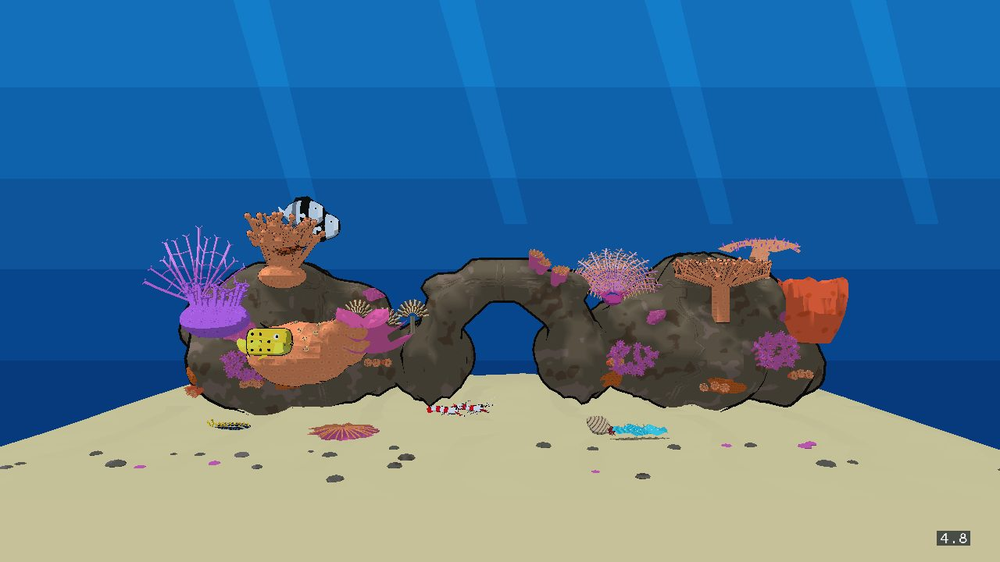 |
| Dusters | [video](realistic-dusters.webp) · 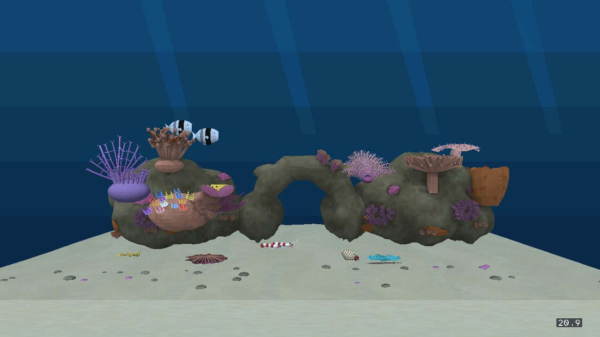 | [video](anime-dusters.webp) · 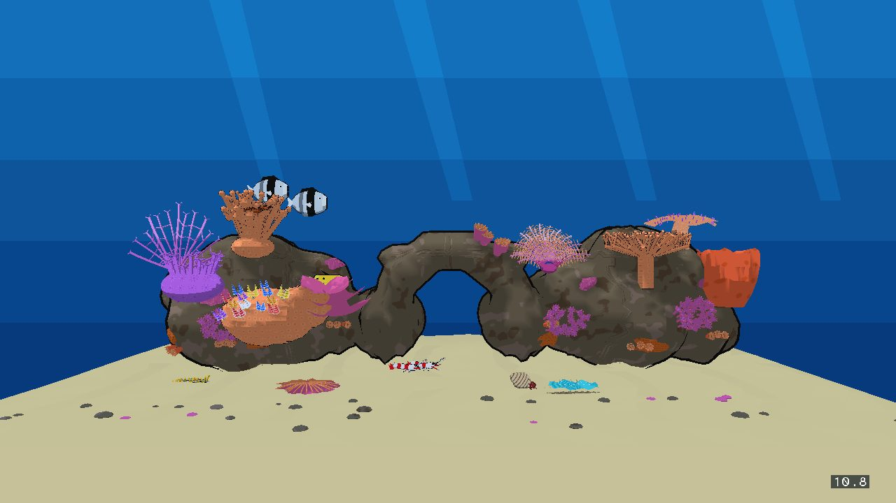 |
| Clam | [video](realistic-clam.webp) · 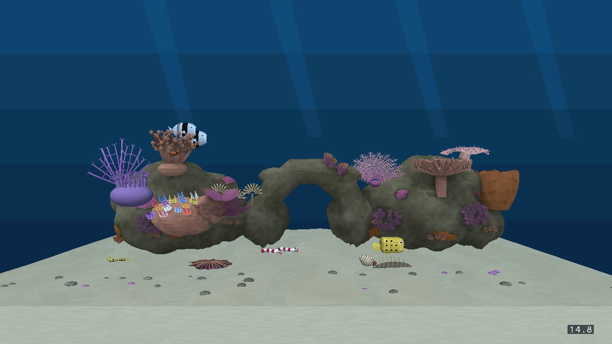 | [video](anime-clam.webp) · 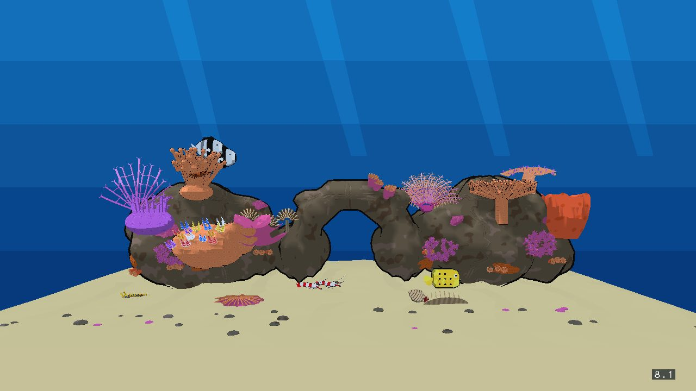 |
| Crab | [video](realistic-crab.webp) · 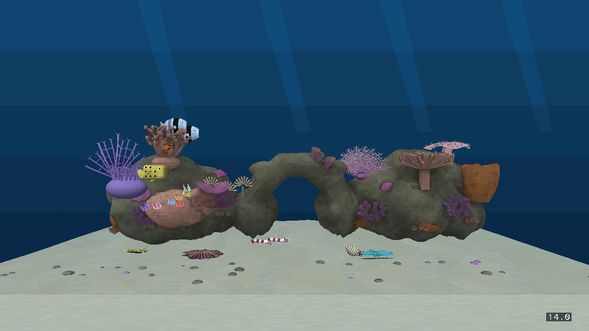 | [video](anime-crab.webp) · 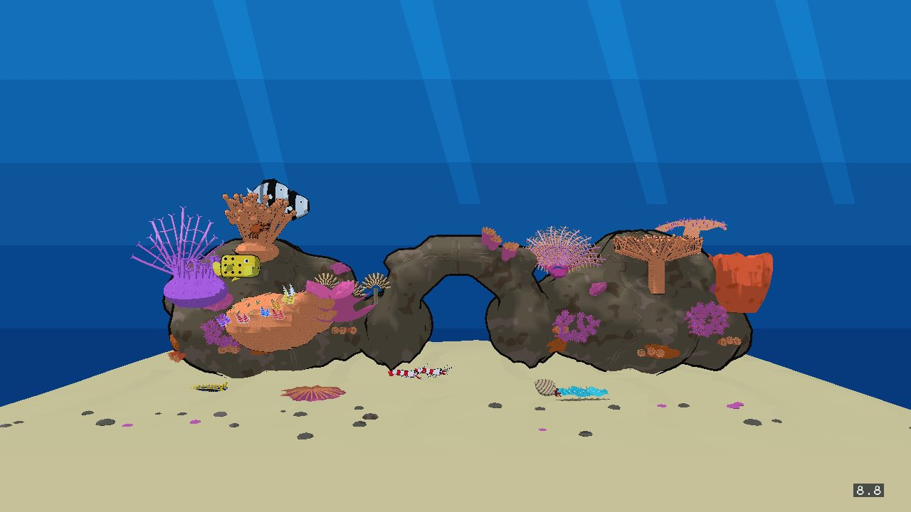 |
| Pair | [video](realistic-pair.webp) · 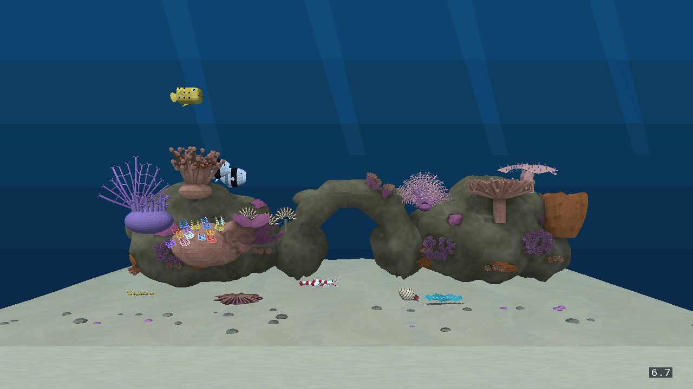 | [video](anime-pair.webp) · 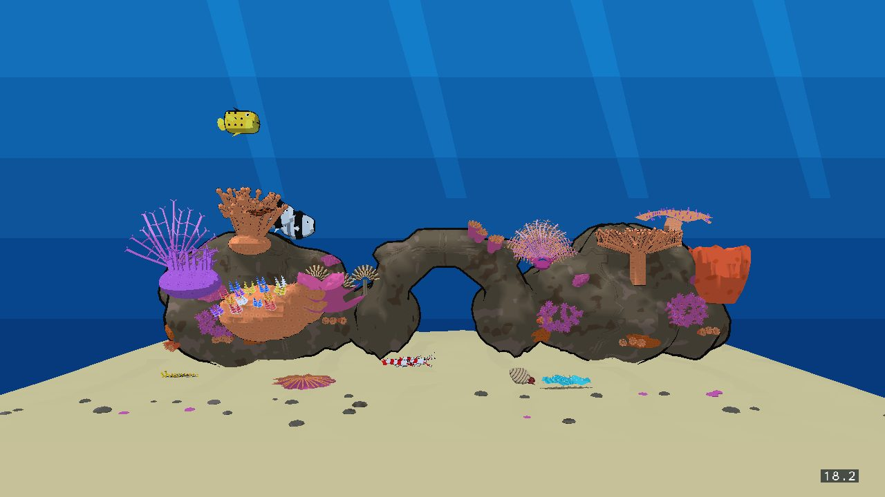 |
| Shrimp | [video](realistic-shrimp.webp) · 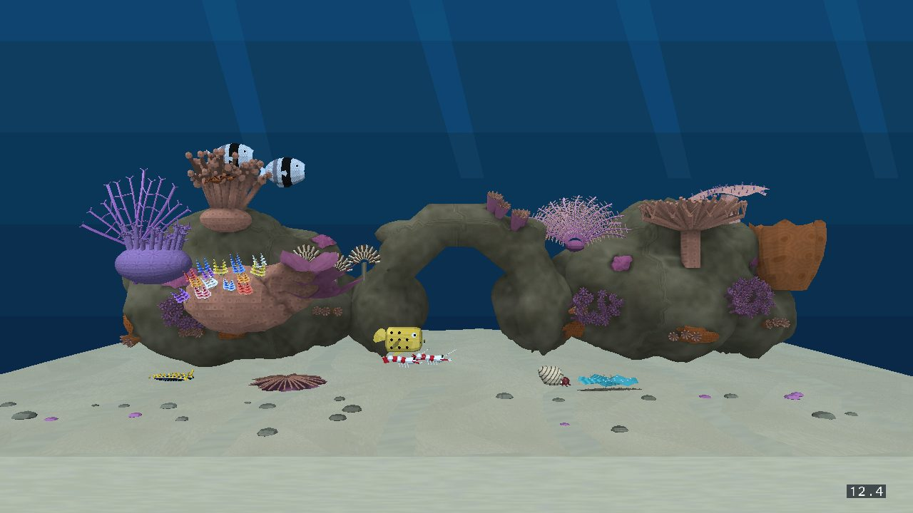 | [video](anime-shrimp.webp) · 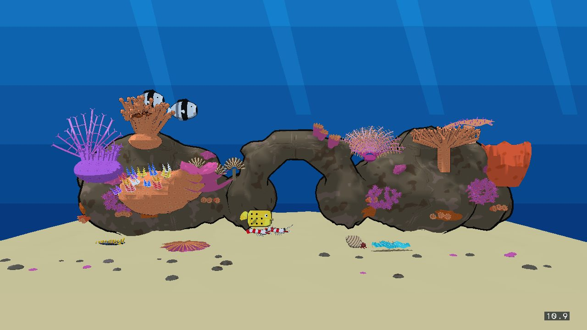 |
| Shrimp, fish leaves | [video](realistic-shrimp-leave.webp) · 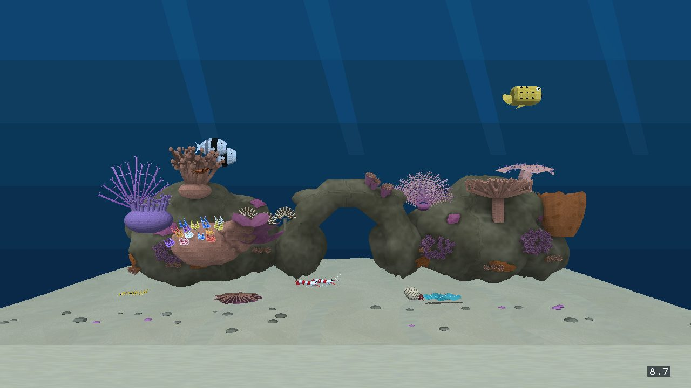 | [video](anime-shrimp-leave.webp) · 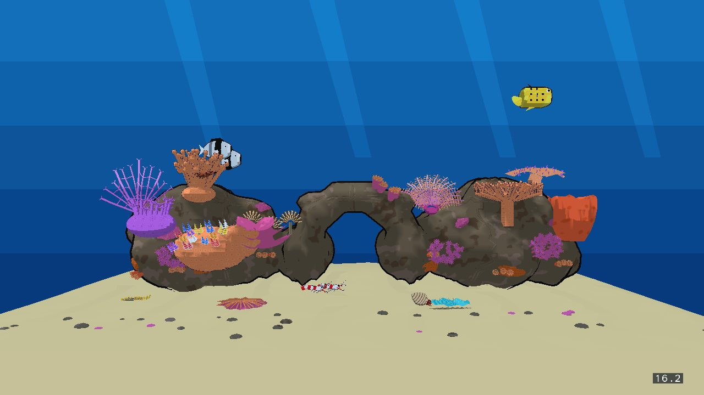 |
