# Creature skins: review, 8 November 2026

W2 of the [reef finishing plan](../../plans/2026-11-08-reef-tanks-finish.md). **Approved by Will, 2026‑11‑08**: every skin first ("everything except nudibranch is approved"), then the twice-rebuilt nudibranch ("approved, go ahead with W3"). Will, 2026‑11‑08: "go ahead with W2". Colours follow the sourced [skin colour references](../../reference/thai-reef-skin-colours.md) (W0).

> [!NOTE]
> These are **Blender renders** (CPU Cycles, the static bake's sun) of the generator's own meshes with each style's real atlas. They are not engine captures, for the same reason as the [worm review](../reef-worms-2026-11-08/README.md): the desktop engine cannot run in the containers on this machine. **Before** is the code at `b8831c71` with its UV rule; **after** is this change. Every image is labelled.

> [!NOTE]
> **2026‑11‑09: the humbug skin below is superseded.** Will swapped the humbug *Dascyllus aruanus* (no citable Gulf of Thailand record) for *Dascyllus reticulatus* (D10). Its new skin, one black bar behind the head, a faint grey rear bar and a scale-net body, is reviewed in [reef-humbug-swap-2026-11-09](../reef-humbug-swap-2026-11-09/README.md). The other skins here are unchanged.

## Mobile animals

Left to right: guard crab, banded shrimp, hermit crab, nudibranch, humbug.

| | Before | After |
|---|---|---|
| Realistic | 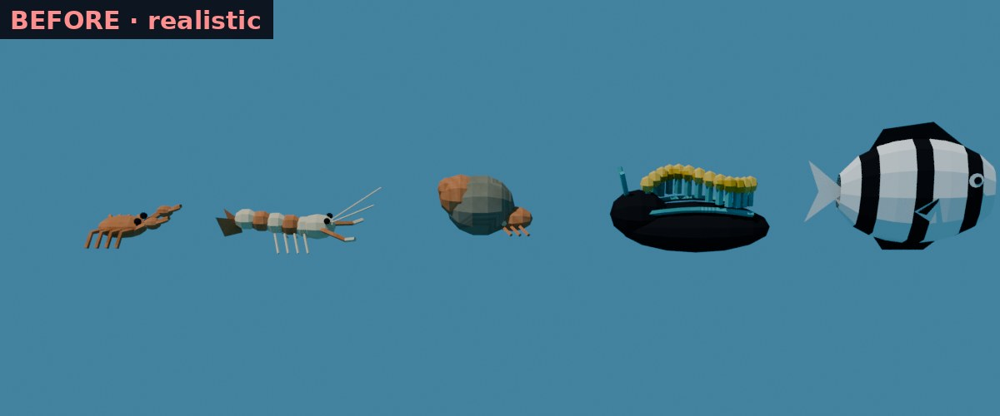 | 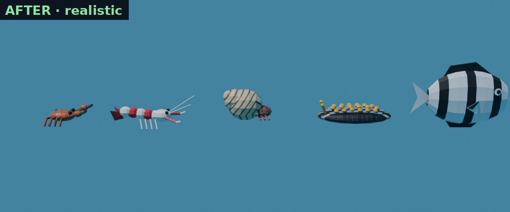 |
| Anime | 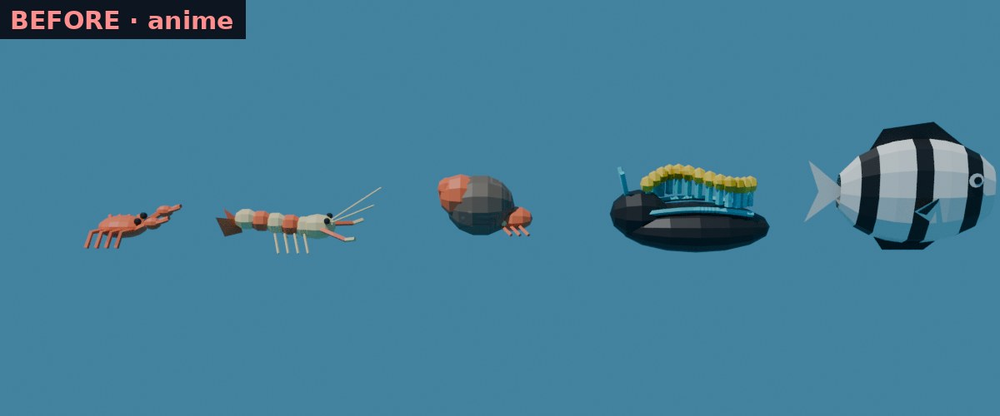 | 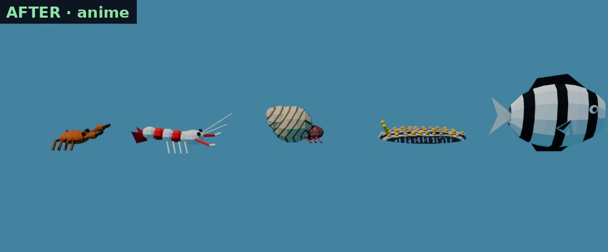 |

## Nudibranch, rebuilt again (approved by Will, 2026‑11‑08)

**First rebuild, not approved.** Will: "Nudibranch still not approved. don't you have any textures for it?" There are no photographic textures in this project; every reef skin is painted procedurally in `reef/atlas.py`. The first rebuild's skin was three flat stripes on black, and the camera, about 16° above the slug, saw mostly its steep side. Separate ridge rails and tubercle balls also hid the painted top and did not line up with it.

**Second rebuild.** One layout now drives both paint and shape:

- **Skin** (atlas cell 12, mantle 256 × 192 texels): faintly mottled black; three wavy blue-grey ridges, shaded to read as raised; about 36 yellow tubercles shaded as domes (deep yellow, orange rim, highlight); small grey tubercles between the ridges; short transverse ridges out to a grey rim. Anime posterises it to three brightness bands.
- **Shape:** the mantle is a low dome height field (36 × 14 samples) whose ridges rise exactly where the skin paints them. A 3D tubercle sits on every painted tubercle, and the rhinophores are yellow. The side wall is gone, so the camera sees the patterned top. 1,952 triangles.
- **Renders** are now matte. Cycles' default specular had been making dark surfaces look grey-white at grazing angles, which the engine never does. Before and after both use the matte material.

| Painted skin | Realistic | Anime |
|---|---|---|
| Atlas cell 12 | 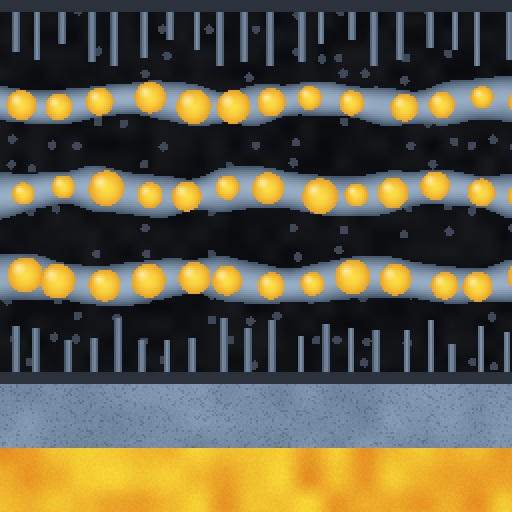 | 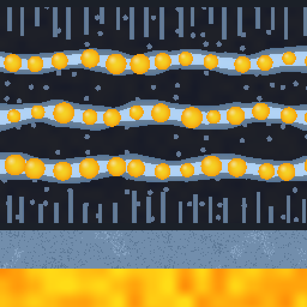 |

| | Before | After |
|---|---|---|
| Close, realistic | 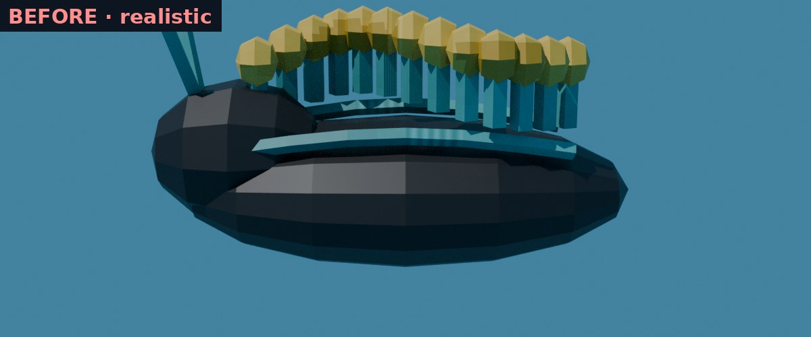 | 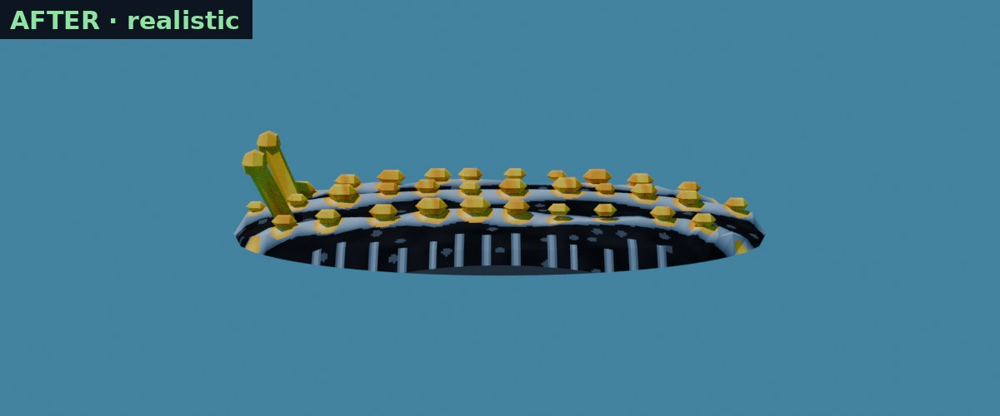 |
| Close, anime | 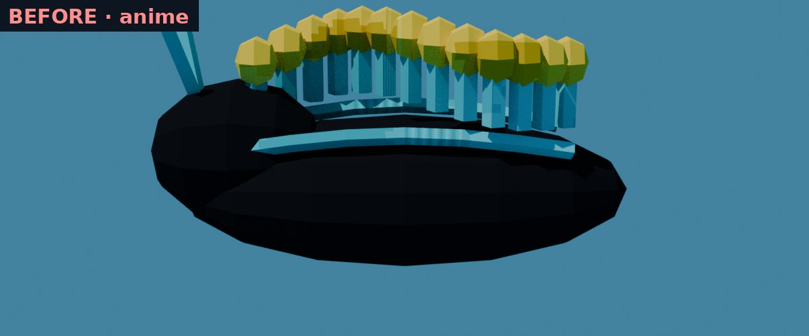 | 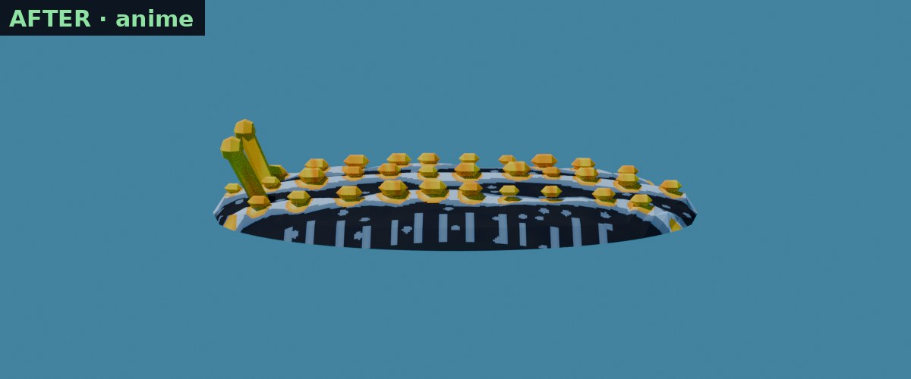 |
| From the game camera's angle, realistic | 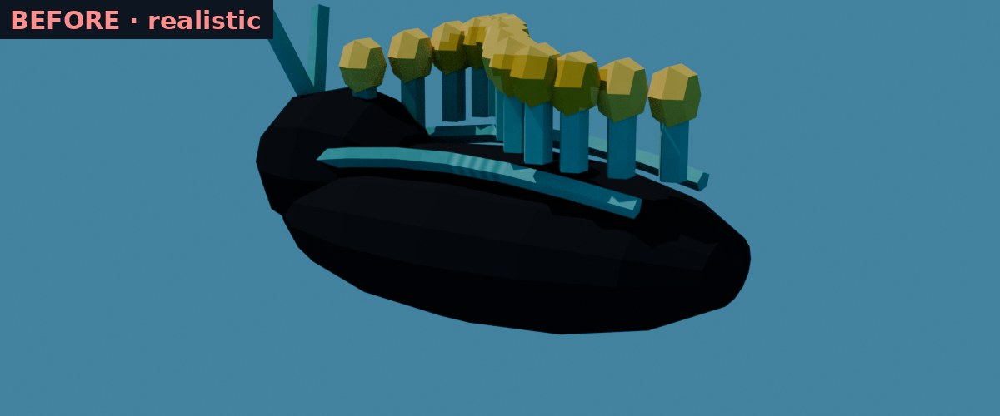 | 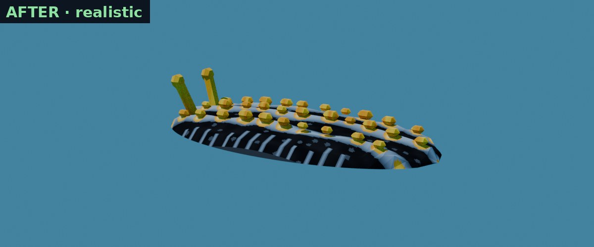 |
| From the game camera's angle, anime | 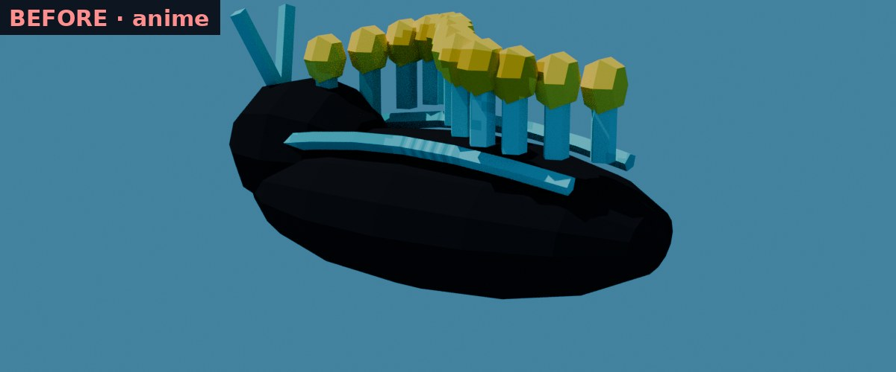 | 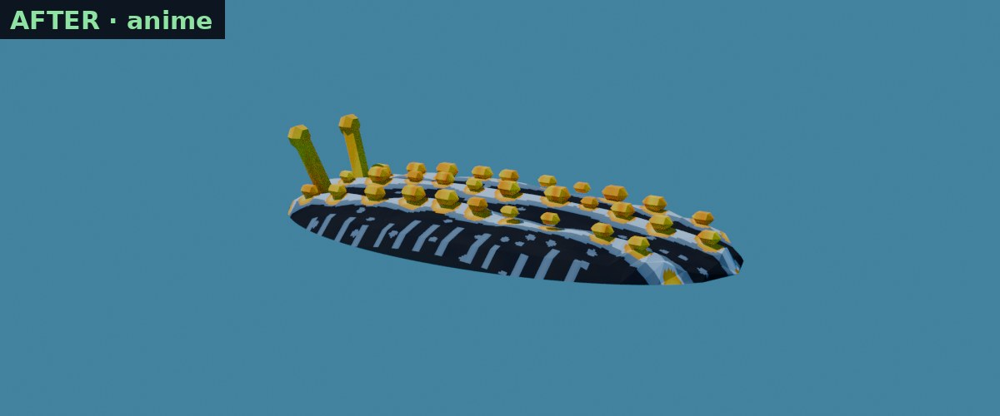 |

It still sits about 23 cm above the sand and bobs vertically; fixing that is W3.

## Sessile life

Left to right: feather dusters, zoanthid carpet, sea fan, feather star.

| | Before | After |
|---|---|---|
| Realistic | 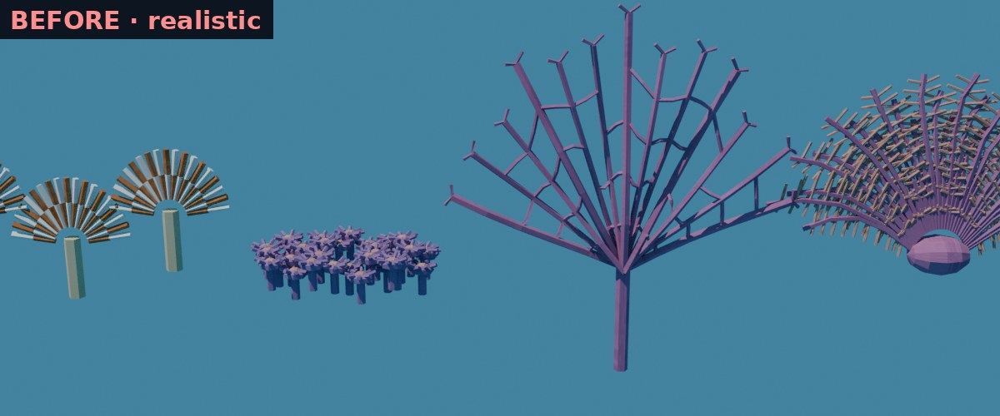 | 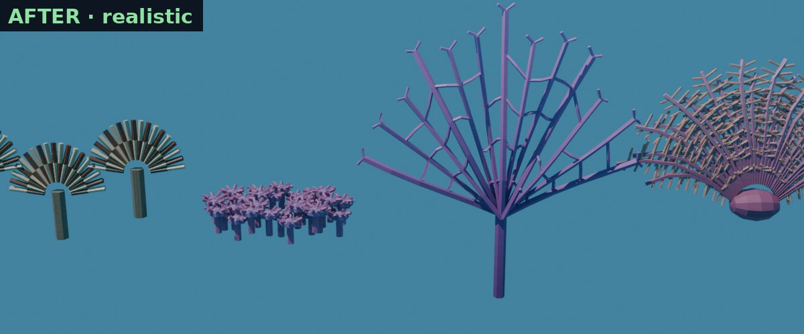 |
| Anime | 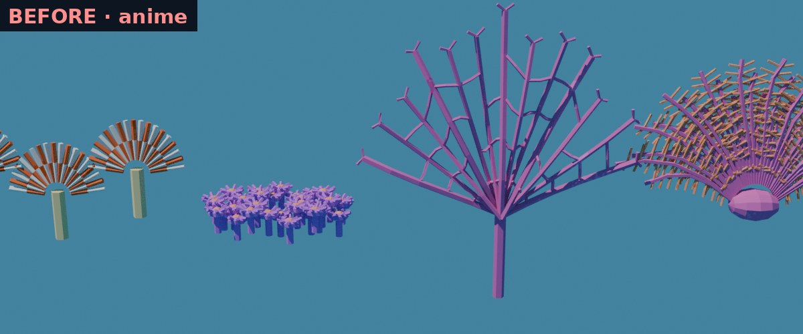 | 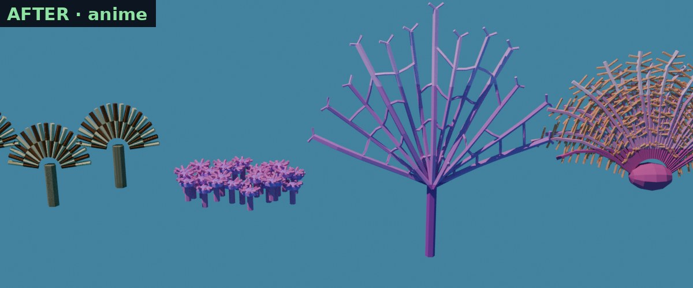 |

## What changed

| Actor | Before | After | Atlas |
|---|---|---|---|
| Guard crab | 97 % on the barrel-sponge pore tile, 86 % of its area in faces under 3 texels: flat orange | brown-orange polished carapace with sparse orange-red spots, banded legs, dark claw fingers | cell 10 |
| Banded shrimp ×2 | tan sand and orange sponge tiles | red and white bands, white antennae | cell 11 |
| Hermit crab | rock-grey shell and orange sponge | cream shell with brown spiral growth lines, pale lip, mottled maroon legs | cell 13 |
| Nudibranch | 62 % one flat black texel; teal clam-tile ridges; tall blob with a fence of stalked tubercles | rebuilt: see the section above | cell 12 |
| Feather dusters | flat white and sponge-pore bands; sand tube | buff and dark-brown banded radioles with barbs; muddy leathery tube | cell 9 |
| Zoanthid carpets | 66 % of area under 3 texels | each head and oral disc maps one flower-head motif; columns and tentacles get dense mottle | tile 5, tile 0 |
| Encrusting crusts | sponge and coralline tiles | finer pore and mottle crusts (they still stand off the rock: that is W3) | cell 14 |
| Humbugs | flat white | white with a faint belly-to-back sheen (realistic); flat white in anime | cell 15 |
| Sea fan | coralline tile | base-to-tip purple gradient (D3: no pattern) | cell 15 |
| Feather star | coralline arms, tan pinnules | gradient arms; the pinnules stay on the tan polyp tile, because a first render with gradient pinnules lost the two-tone feathery look | cell 15, tile 1 |

**How.** A new pure-Python module, `reef/uvmap.py`, now computes every face's UVs: the generator assigns them, and the texel audit and these renders measure them. Creature skin keys sample their own cell at a per-creature density (2.5–6 cycles per unit, mirrored so no face spans a wrap). Static surfaces keep their world projection.

**Audit.** `texcov.py --check` measures the exported UVs. Every creature W2 reskins is now at or under 20 % of its area flat or under 3 texels. The crab, shrimp, hermit crab, nudibranch, dusters and worms are at 0–3 %, and the zoanthid groups are under 20 %. The humbug's black bars, the sea fan and the feather star stay flat by design (D3).

## Tests

- `tests/test_thai_reef_skins.py` (new, 14 tests): each creature ≤ 20 % flat; its skin keys sample only its own cell and none of the borrowed tiles; zoanthid carpets ≤ 20 %; cells 9–14 painted in both styles; every reef key has a UV rule.
- 106 reef, placement, skins, movement, DFRM and exporter tests pass. Both levels and the menu bundle were rebuilt; the other eight tanks are untouched.

## Reproduce

```sh
task aquarium-thai-reef-level && task aquarium-thai-reef-anime-level
python3 docs/plans/2026-11-08-reef-tanks-finish/texcov.py --check
python3 -m pytest -q tests/test_thai_reef_skins.py
# before tree: git show b8831c71:wflevels/aquarium_thai_reef/reef/<file>.py into build-docker/reef-before/reef/
WF_CONTAINER_IMAGE=blender scripts/in-linux-container.sh blender --background \
  --python docs/diagnostics/reef-skins-2026-11-08/render-skins.py -- build-docker/reef-skin-render after
```
