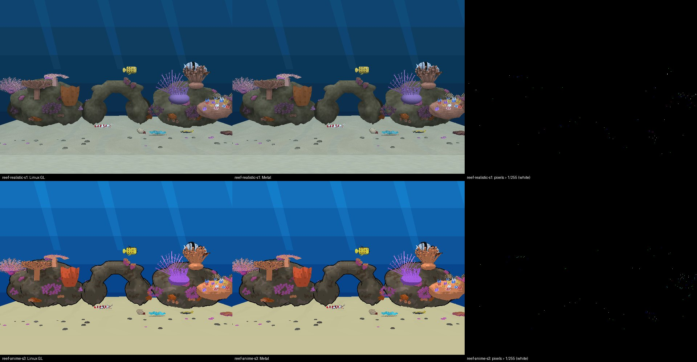
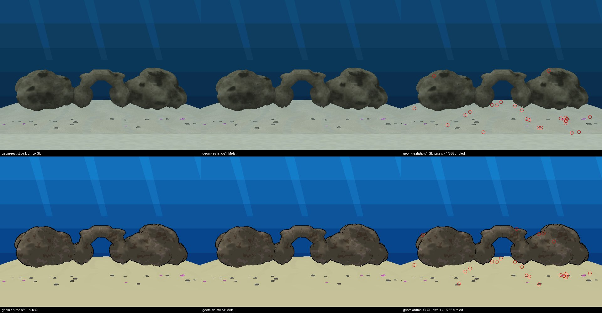
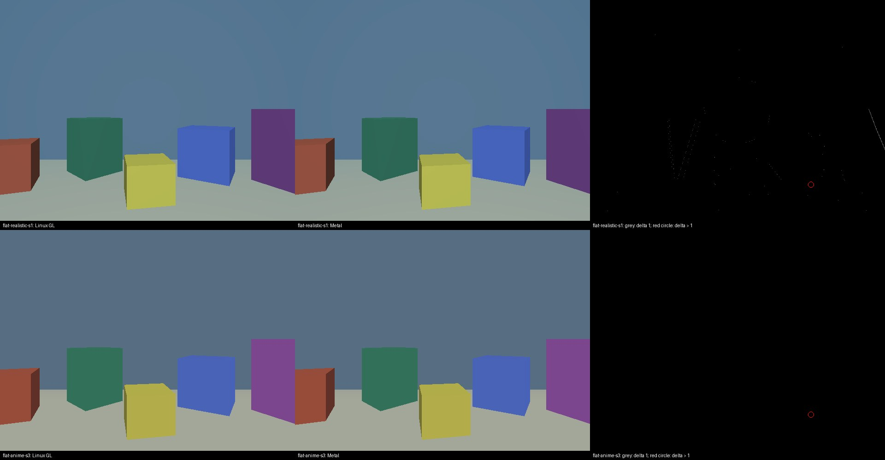

# Reef step 14: style-shading invariant on GL and Metal, 2026‑11‑09

The spec is original step 14 ([plan](../../plans/2026-11-02-gulf-of-thailand-reef-tank.md)). With every new Camera field at 0, a capture sweep of all levels must be pixel-identical to the pre-change captures, on GL and on Metal. The shared shader test scene must match across the two backends within 1/255 per channel.

This record covers both halves of row 14 in the [finishing plan](../../plans/2026-11-08-reef-tanks-finish.md). The directory keeps its first name, `reef-style-metal`, so existing links stay valid.

## Current verdict

| Gate | Result |
|---|---|
| **GL sweep:** `fd9349c8` against `b03f5cb5` and against HEAD `51bab0f5`, every style field 0 | **PASS (strict).** All 34 levels pixel-identical ([gl-sweep.tsv](gl-sweep.tsv)). See [GL sweep](#gl-sweep). |
| **Metal sweep:** `fd9349c8` against the style engine | **PASS (strict) after the fix** in `51bab0f5`. All 34 levels identical. See [Probe, fix and untextured scene](#probe-fix-and-untextured-scene-2026-11-09-after-wills-go-ahead). |
| **Shared scene GL against Metal, untextured** (`flat-*`, boxes lifted) | **PASS (strict).** S3 is byte-identical; S1 is within 1/255 on every pixel. See [Untextured scene](#untextured-scene-strict-pass-after-lifting-the-boxes). |
| Shared scene GL against Metal, textured (`reef-*`, `geom-*`) | Fails strictly, and only on bilinear texture sampling. **Marked expected-fail** (Will, 2026‑11‑09: "Mark expected-fail"): `pytest.mark.xfail(strict=True)`, so an unexpected pass is reported. The untextured `flat-*` scenes stay hard asserts. In the container run against run 6's artifacts: 2 passed, 4 xfailed. |
| `baseline` level | No capture from `fd9349c8` or `b03f5cb5` on either backend: both assert on a degenerate polygon. HEAD renders it. |

The sections below are in the order the work happened. The first run's numbers come first and the later sections supersede them.

**Run:** Codemagic `macos-style-metal`, build [6af14d475e8a84eec8dac383](https://codemagic.io/app/6aafa6886ab3f21cf431a6cb/build/6af14d475e8a84eec8dac383), checkout `1cb09178`. It took 12 Mac minutes. The month's total went from 147 to about 159 of the 400-minute cap. The first attempt ([6af14ba38b1b3718612224de](https://codemagic.io/app/6aafa6886ab3f21cf431a6cb/build/6af14ba38b1b3718612224de), about 3 min) stopped at the baseline configure: the worktree had no submodules. That is fixed in `1cb09178`.

| Part | Result |
|---|---|
| CI Metal can render it | **Yes.** Three Debug Metal engines built in about 75 s each, and every capture was written headless. |
| Sweep: baseline `fd9349c8` vs style `b03f5cb5`, 35 levels of the baseline tree | **32 identical, 2 differ by 1/255 on 1–2 pixels, 1 level asserts on both engines.** Strictly this fails "pixel-identical". Run 3 shows the difference is deterministic, not noise (see below). |
| Shared scene, GL vs Metal (checkout `1cb09178`) | **Shading matches; the strict per-pixel gate fails on raster edges.** 99.97% of pixels are within 1/255. 94 and 96 isolated pixels exceed it, and 82 and 86 of those lie on a geometry edge. |

## Metal sweep, first run

Both engines render every `*-standalone.iff` of the baseline tree (`fd9349c8`) with the same flags as the GL test: frame 20 of a 30-step, 1-cycle, `-rate20` run, using the VRAM table in `tests/fixtures/renderer/style-scene.json`. Then `tests/compare_renderer_frames.py` compares the pair at tolerance 0. The full per-level list is in [summary.tsv](summary.tsv).

| Level | Verdict | Detail |
|---|---|---|
| 32 others | identical | — |
| `aquarium_arowana` | differs | 1 pixel at (49, 264), channel delta 1 ([log](compare-aquarium_arowana.log)) |
| `snowgoons-blender` | differs | 2 pixels, channel delta 1 ([log](compare-snowgoons-blender.log)) |
| `baseline` | no capture | Both engines assert: `Probably have a polygon which is too small` in `math/vector3.hpi` ([excerpt](sweep-baseline-level-assert.txt)). This is not a style difference. |

The workflow renders each engine once, so it cannot tell whether those 3 pixels are run-to-run noise or a real 1-LSB shader rounding change. That would take a second Metal run of the same engine (about 12 minutes). The GL repeats of the scene below are byte-identical, so Linux GL at least is deterministic.

## Shared style scene, textured

The scene definition is `tests/fixtures/renderer/style-scene.json`:
- Realistic reef (S1 water absorption: `WaterAbsorb` 0.016 / 0.009 / 0.004).
- Anime reef (S3 toon bands: `ToonBands` 3).
- Both use `ReefSettings` Layout = Random with Seed 7, so layout and fish are deterministic, and both capture frame 20.

S2 caustics ship off and are not in the scene; they have their own cast1 gate. GL here is a Debug container build with `-DDESIGNER_CHEATS=1`; without that, `--capture-frame` writes nothing on Linux. Two GL renders of each scene are byte-identical.

| Scene | Exact | Δ = 1 | Δ > 1 | of which on a geometry edge | Max Δ |
|---|---|---|---|---|---|
| reef-realistic-s1 | 260,076 | 47,030 | 94 | 82 | 113 |
| reef-anime-s3 | 303,904 | 3,200 | 96 | 86 | 179 |

There are 307,200 pixels in each frame.

[](scene-gl-vs-metal.jpg)

The absorption and band math agree to 1/255 across both frames. The 47,030 Δ = 1 pixels in the realistic frame are the absorption blend rounding differently. The pixels beyond 1/255 are single pixels along silhouettes (fins, antennae, coral tips), where the two rasterizers decide coverage differently. The aquarium parity gate meets the same effect; it allows a per-pixel tolerance of 3, with a coverage IoU. The plan's "within 1/255 per channel" does not allow for coverage differences on edges, so as written it cannot pass on any textured scene with fine geometry.

## Decision: keep the strict gates and investigate

Will, 2026‑11‑09: **"Keep strict, investigate."** No gate was loosened. A third Metal run, [6af1a232](https://codemagic.io/app/6aafa6886ab3f21cf431a6cb/build/6af1a232be8402b33d6c2857) at checkout `9f8bddd9`, took 13 Mac minutes. The month now stands at 189 of 400; that total includes other sessions' iOS builds. It added two things:
- Every sweep level is rendered twice per engine, and every scene twice.
- Two geometry-only scenes from `scripts/build-style-geometry-scene.py` (`style_geom_realistic` and `style_geom_anime`). Each keeps only the reef shell and the three hero rocks, under the reef's own Camera, fog and lights, so there are no fins, antennae or coral tips. Per-level results: [summary-run3.tsv](summary-run3.tsv).

### What the strict gates show

**1. Metal is deterministic, so the sweep difference is a real 1-LSB change.** All 72 repeat pairs are byte-identical: 34 levels × 2 engines, plus the 4 scenes. The run-3 captures of both engines also match run 2 byte for byte. So `aquarium_arowana` and `snowgoons-blender` differ between the baseline and style engines for a fixed reason, every time:

| Level | Pixel | Baseline `fd9349c8` | Style `b03f5cb5`, every S field 0 |
|---|---|---|---|
| `aquarium_arowana` | (49, 264), open water | (24, 54, 75) | (24, 54, **76**) |
| `snowgoons-blender` | (2, 394) | (25, 34, 24) | (25, 34, **25**) |
| `snowgoons-blender` | (309, 398) | (182, 182, 191) | (182, 182, **190**) |

With every field at 0, the Metal fragment shader evaluates the same expressions as before:
- `v.color * style_lit` with `style_lit = v.lit`.
- `mix(u.fog_color, c.rgb, v.fog_factor)` on the `else` branch.

The vertex shader is what changed. `wf_vs` now also computes `eye = (u.mv * float4(v.pos, 1.0)).xyz`, the world normal and its length, and two more outputs, `absorb` and `caustic` (`backend_metal.mm`, the lines added after `o.fog_factor` in `b03f5cb5`). Metal compiles with fast-math, so the compiler can now share `u.mv * pos` with the existing position and fog-distance arithmetic and contract it into different FMAs. That would move one output by an ulp, and so one pixel by 1/255.

GL cannot show this effect. It compiles the style code only under `#ifdef WF_STYLE` (`backend_modern.cc` kVS/kFS), so a style-off level runs the old program text unchanged.

This is the leading hypothesis, but it is **not proven**. Proving it needs one Metal run of a candidate engine whose `wf_vs` leaves out the `eye`, `world_normal`, `caustic` and `absorb` lines. If that run is pixel-identical to the baseline, the vertex-shader change is the cause. That is an engine edit, which I have not made without permission. If it is confirmed, two fixes would satisfy the strict gate:
- Compile two Metal pipelines, with and without style, the way GL uses `WF_STYLE`.
- Use `[[clang::fp_contract(off)]]` / `precise` on the existing position and fog math.

**2. On the geometry-only scenes, every remaining pixel over 1/255 is texture sampling, not S1 or S3 math.**

| Scene | Exact | Δ = 1 | Δ > 1 | Max Δ |
|---|---|---|---|---|
| geom-realistic-s1 | 265,280 | 41,895 | 25 | 113 |
| geom-anime-s3 | 305,122 | 2,055 | 23 | 143 |

[](geom-gl-vs-metal.jpg)

Three things show this:
- **Same pixels in both scenes.** 16 of the over-1/255 pixels are at identical coordinates in both scenes, for example (317, 325), (289, 335), (362, 337) and (528, 380). Yet the two scenes run entirely different style math: absorption with no bands, against bands with linear fog. A difference in the S1 or S3 code cannot put the same error at the same pixels in both.
- **Sand and rock texture only.** Every circled pixel is on the sand or a rock face. Those surfaces sample the reef atlas with bilinear filtering and no mipmaps (`backend_modern.cc:811-812` `GL_LINEAR`; `backend_metal.mm:853-854` `MTLSamplerMinMagFilterLinear`, texture `mipmapped:NO` at `backend_metal.mm:635`). At this grazing angle the sand is minified many texels per pixel, so a sub-texel difference in where `texture(u_tex, v_uv)` / `tex.sample(smp, v.uv)` lands picks a different texel neighbourhood. Next to a pebble that means up to 113/255; (528, 380) is a pebble on Metal and sand on GL. The Linux reference is Mesa llvmpipe, which quantises bilinear weights and texel positions differently from the Apple GPU.
- **The style math matches to 1/255.** The Δ = 1 pixels follow the style math: 41,895 with S1 absorption against 2,055 with S3 bands alone. That is consistent with `exp(-u_absorb * length(eye))` (GL kVS) and `exp(-u.style_absorb.xyz * length(eye))` (Metal `wf_vs`) rounding 1 ulp apart. All of them are within 1/255.

So the strict scene gate fails because of texture sampling under heavy minification, which is an existing difference between the backends. An untextured scene would test the shading alone. The reef assets have no untextured large surfaces, so that would need a purpose-built flat-coloured level: planes and boxes with vertex colours, fog on, and the S1/S3 Camera fields set. That is about one hour of level work and one more Metal run of about 13 minutes.

**3. The `baseline` level asserts on both engines** (a degenerate polygon, `math/vector3.hpi:243`). This predates Phase S.

## Probe, fix and untextured scene (2026‑11‑09, after Will's go-ahead)

Will, 2026‑11‑09: **"Allow the probe"** and **"Build it"** (the untextured level). There were two more Metal runs; the month is at 221 of 400 minutes after them.

### Probe: confirmed

Run [6af1ade1](https://codemagic.io/app/6aafa6886ab3f21cf431a6cb/build/6af1ade1fd52964acfe0d851) (16 min) built a third engine from the scratch branch `scratch/metal-style-probe`. It is `b03f5cb5` with the style work removed from Metal `wf_vs`; the two style outputs are set to constants that the style-off fragment path never reads.

**All 34 levels are pixel-identical to `fd9349c8`**, including `aquarium_arowana` and `snowgoons-blender` ([summary](summary-run4-probe.tsv)). The style engine itself still differs as before.

So the cause is the unused style arithmetic in `wf_vs`:
- `eye`, `world_normal` and its length,
- the `caustic` and `absorb` outputs,

which change Metal's fast-math code generation for the existing position and fog math.

### Fix: two Metal programs, now on `2026-new-level`

Two candidates were considered:

| Option | Trade-off | Verdict |
|---|---|---|
| **Compile `kMSL` twice, with and without `WF_STYLE`** (GL already does this with `#ifdef WF_STYLE`), and bind the style pipelines only while style shading is active | It costs a second library compile and two more pipeline states at start-up. The style-off program is the pre-style text exactly, so it cannot drift. | **Chosen** |
| Turn off FP contraction (`fp_contract(off)` / `precise`) on the position and fog math | It changes the style-off code relative to the pre-style engine too, so it would *not* reproduce `fd9349c8`'s pixels; it is also slower and needs annotating by hand. | Rejected |

Changes in `wfsource/source/gfx/metal/backend_metal.mm`:
- **Shader:** every style addition in `kMSL` sits under `#ifdef WF_STYLE`: the `VertexOut` fields, the `wf_vs` work, and the fragment's `style_lit` and absorption branch. `WF_LIT` follows GL's macro.
- **Pipelines:** the host compiles a second library with `preprocessorMacros = { WF_STYLE: 1 }` and builds `_stylePipeline` and `_styleBlendPipeline` from it.
- **Selection:** the flush picks the pair by `RBStyleShadingActive(_style)`. `SetStyleShading` already flushes whenever activity changes.

**Proof:** run [6af1b29c](https://codemagic.io/app/6aafa6886ab3f21cf431a6cb/build/6af1b29c240003ac8a655bd7) (16 min).
- **Style-off:** `b03f5cb5` with the fix renders **all 34 levels pixel-identical to `fd9349c8`** ([summary](summary-run5-fix.tsv)).
- **Style-on:** the fixed head's style program renders all six style scenes byte-identical to run 4's unfixed head, so the style path is unchanged.

**Test:** `tests/test_metal_style_variants.py`.
- It preprocesses `kMSL` without `WF_STYLE` and checks that `VertexOut`, `wf_vs` and `wf_fs` match `fd9349c8`'s shader token for token (`tests/fixtures/renderer/metal-prestyle-functions.msl`).
- It also checks that the `WF_STYLE` program keeps the style math, and that the host builds and selects both pipeline pairs.
- It fails on the unfixed file and passes on the fix: 4 passed in the container together with the invariant test.

No `docs/BUGS.md` entry: the style code is from 2026, so that file's rule excludes it.

### Untextured scene, first version: one raster pixel

`scripts/build-style-flat-scene.py` writes `style_flat_realistic` (S1) and `style_flat_anime` (S3). Each is a subdivided floor and back wall plus five rotated boxes. Every face has a flat material colour and is dynamically lit, with nothing textured, under the reef Camera, fog and style fields.

| Scene | Exact | Δ = 1 | Δ > 1 |
|---|---|---|---|
| flat-realistic-s1 | 306,966 | 233 | **1** |
| flat-anime-s3 | **307,199** | 0 | **1** |

[](flat-gl-vs-metal.jpg)

- **S3 bands** match exactly on every pixel but one.
- **S1 absorption** is within 1/255 on every pixel but one. The 233 Δ = 1 pixels lie along triangle diagonals, where the per-vertex `exp(-absorb · length(eye))` is interpolated; that is the two backends rounding the exponential an ulp apart.
- **The pixel over 1/255 is the same pixel in both scenes:** (479, 401), the blue box's lower-right corner against the floor. GL (Mesa llvmpipe) gives it to the floor, (149, 163, 155), and Metal to the box, (69, 99, 187). That is a rasterizer coverage tie-break at a shared vertex on a silhouette, not shading.

So the strict scene gate failed on exactly one pixel of rasterization. No gate was loosened.

### Untextured scene: strict pass after lifting the boxes

Will, 2026‑11‑09: **"Fix the scene".** In the first version the boxes stood on the floor, so each box's bottom edge shared its depth with the floor. At (479, 401) the two backends broke that depth tie differently.

`scripts/build-style-flat-scene.py` now floats every box 0.12 above the floor (`LIFT`); every face is still large and flat. It was re-captured on GL (the Debug `DESIGNER_CHEATS` engine) and on Metal. The Metal capture came from the new scenes-only workflow, `macos-style-metal-scenes`, run [6af1bd90](https://codemagic.io/app/6aafa6886ab3f21cf431a6cb/build/6af1bd903fd588bf3e768a30): 6 Mac minutes at checkout `fc03e9d3`, which includes the Metal fix. The month is at 226 of 400.

| Scene | Exact | Δ = 1 | Δ > 1 |
|---|---|---|---|
| flat-realistic-s1 | 306,965 | 235 | **0** |
| flat-anime-s3 | **307,200** | 0 | **0** |

[](flat-gl-vs-metal.jpg)

The strict test `test_style_scene_gl_matches_metal[flat-realistic-s1]` and `[flat-anime-s3]` **PASSED** in the linux-test container, against these Metal artifacts.
- S3 bands are byte-identical across backends.
- S1 absorption is within 1/255 everywhere; the 235 Δ = 1 pixels are the interpolated `exp()` rounding.
- Metal repeats were byte-identical for all six scenes ([summary](summary-run6-scenes.tsv)).
- The textured `reef-*` and `geom-*` scenes still fail the same strict test, on texture sampling as described above.

## GL sweep

Will, 2026‑11‑09: **"Run it".** I built three Debug engines with `-DDESIGNER_CHEATS=1` in the linux-test container:
- `fd9349c8`, the pre-style baseline
- `b03f5cb5`, the style commit
- HEAD `51bab0f5`

Each was built from `git archive` sources plus the main checkout's submodules, which are at the same commits in all three revisions. Every `*-standalone.iff` of the `fd9349c8` tree was rendered with the Metal sweep's frame and flags: frame 20 of `--frame-step-smoke=30 --cycles=1 -rate20 --no-fps`, with the shared VRAM table. The baseline engine also rendered each level a second time.

| Comparison with `fd9349c8` | Identical | Differs | No capture |
|---|---|---|---|
| `fd9349c8` repeat | 34 | 0 | 1 (`baseline`) |
| `b03f5cb5` (style, fields 0) | **34** | 0 | 1 |
| HEAD `51bab0f5` | **34** | 0 | 1 |

The per-level table is [gl-sweep.tsv](gl-sweep.tsv). To reproduce, run `scripts/style-gl-sweep.sh`; it defaults to the style commit and HEAD. The committed script was then run once end to end with its defaults (2026‑11‑09; HEAD was `86816ad6`). It rebuilt all three engines in the container and reproduced the result: `b03f5cb5` and HEAD each **34/34 identical**, `baseline` missing as above, exit 0. It needed no fix. GL needed no fix: its style code compiles only under `#ifdef WF_STYLE`, so a style-off level runs the old program text. Even the engine changes made between 3 and 9 November leave every one of these levels pixel-identical on GL.

## Reproduce

```sh
# Metal: manual workflow (about 12 Mac minutes; check scripts/codemagic-budget.sh first)
python3 ~/.config/claude/will/skills/codemagic-build/codemagic.py build --workflow macos-style-metal --branch 2026-new-level
# GL comparison, with the artifacts' style-metal/ directory and a DESIGNER_CHEATS Debug engine
scripts/in-linux-container.sh bash -c 'Xvfb :9 & export DISPLAY=:9 WF_STYLE_METAL_DIR=<style-metal dir> WF_STYLE_GL_ENGINE=<engine>; python3 -m pytest -q tests/test_style_shading_invariant.py -k metal'
```
