# Reef surface tiles repainted (option 2): review, 10 November 2026

The reef's shared surface tiles (atlas tiles 0–6) were almost flat: a luminance standard deviation of 5–8 against 70 for the painted nudibranch. As a result, every static coral and rock read as a solid colour. Will spotted it on the flowerpot coral ("looks like no texture"). This is option 2 of the fix: repaint the shared tiles. **Waiting for Will's review. Nothing is rebuilt or committed.**

> [!NOTE]
> These are Blender renders (CPU Cycles, matte, the static bake's sun) of the generator's own Fixed-layout meshes, textured with each style's real atlas and exported UVs. They follow the [skins review](../reef-skins-2026-11-08/README.md). They are not engine captures, and they leave out the anime outline hulls. **Before** is the reef package at HEAD, last changed in `380337c3`; **after** is this change.

## Tiles

| Realistic | Anime |
|---|---|
| [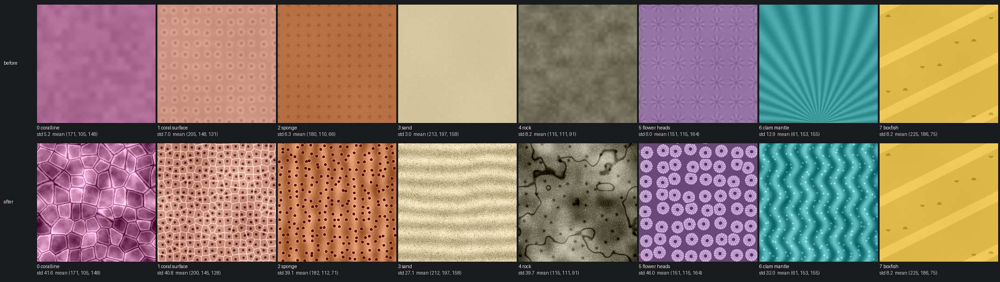](tile-sheet-realistic.png) | [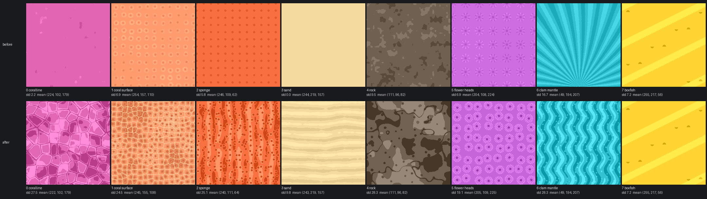](tile-sheet-anime.png) |

Luminance standard deviation, before → after. The mean colour of every tile stays within 5 of today's in each channel. The numbers are in [`tile-stats.json`](tile-stats.json).

| Tile | Painted as | Realistic | Anime |
|---|---|---|---|
| 0 coralline | mottled crust patches, pale growing margins, fine seams | 5.2 → 41.6 | 2.2 → 27.5 |
| 1 coral surface | corallite pits with septa, ridged walls | 7.0 → 40.8 | 6.9 → 24.5 |
| 2 sponge | pores with rims on a ridged, mottled surface | 6.3 → 39.1 | 5.8 → 25.1 |
| 3 sand | wind ripples, dark and pale grains | 3.0 → 27.1 | 0.0 → 9.8 |
| 4 rock | tonal mottling, crevices, pits, mineral flecks | 8.2 → 39.7 | 9.5 → 28.3 |
| 5 flower heads | dark mouths, striped oral discs, tentacle crowns | 6.0 → 46.0 | 6.9 → 19.1 |
| 6 clam mantle | wavy bands, iridescent spots | 12.9 → 32.0 | 16.7 → 28.3 |
| 7 boxfish | unchanged: the approved boxfish skin | 8.2 | 7.2 |

**How the tiles are painted** (`reef/atlas.py`, `_surface_texel` and `_surface_shades`):

- **Tileable:** each tile is built from tileable value noise and cellular (Voronoi) noise, so the repeat has no seams.
- **Same mean colour:** the offsets are shifted to a zero mean.
- **Contrast:** each tile is scaled to a target standard deviation: 42 for coralline and coral, 40 for sponge and rock, 46 for flower heads, 32 for the clam mantle, and 28 for sand, so the sand bed stays calm.
- **Anime:** the same shapes are posterised to three flat tones without the per-texel grain, so they read as clear blocks under the toon bands. The sand keeps only two quiet tones, because stronger ripples banded the whole floor in the wide view.

## Renders

Each pair is before and after. The wide view uses the game's wide camera. The close-ups are the left rock with the flowerpot, the arch, and the right rock.

| Realistic | Before | After |
|---|---|---|
| Wide | 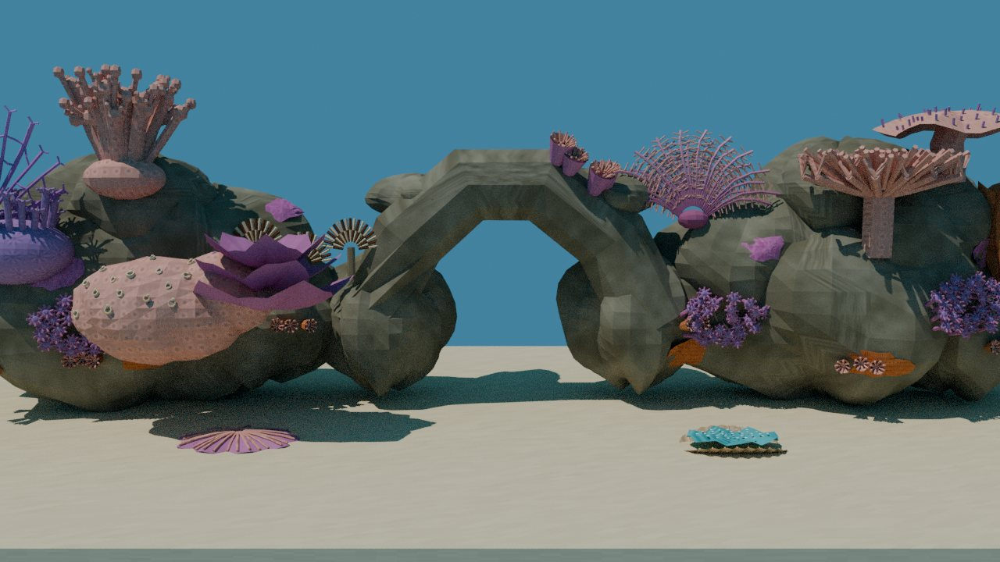 | 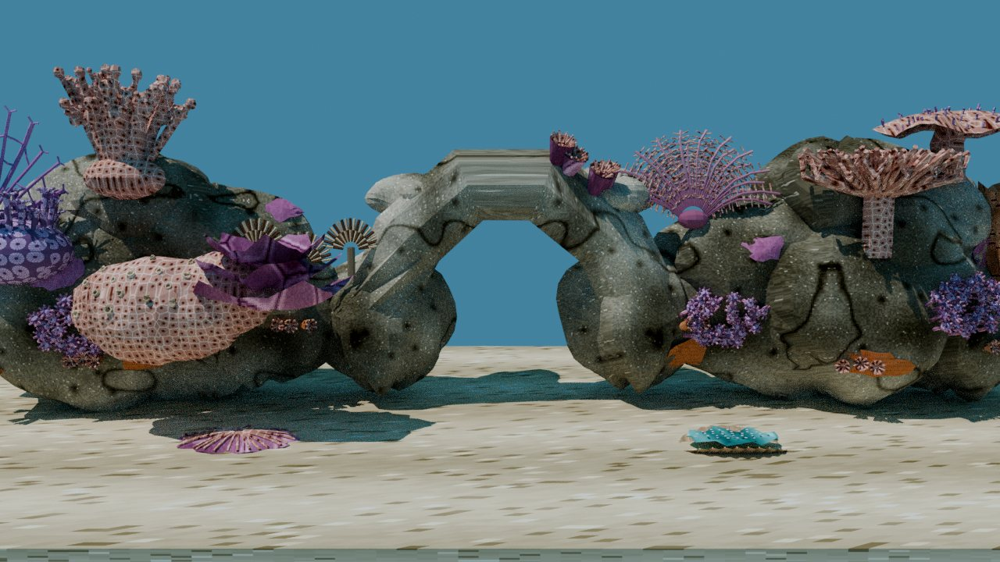 |
| Left rock and flowerpot | 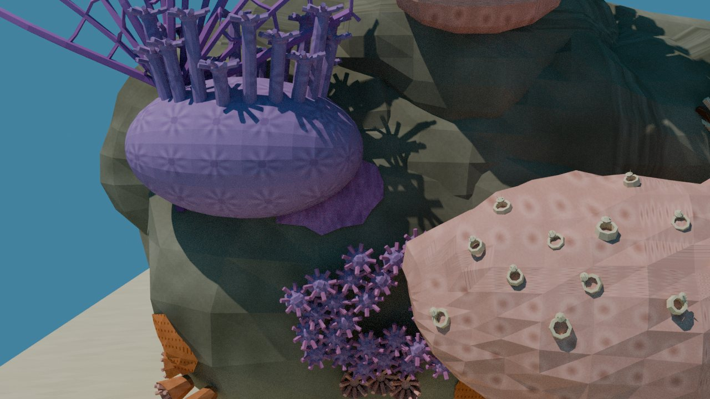 | 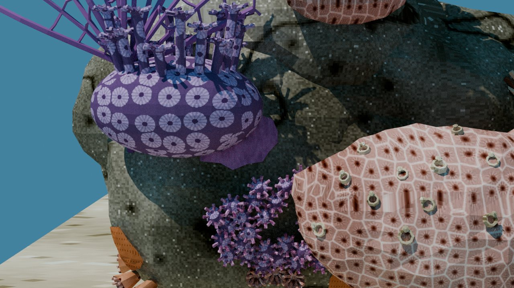 |
| Arch | 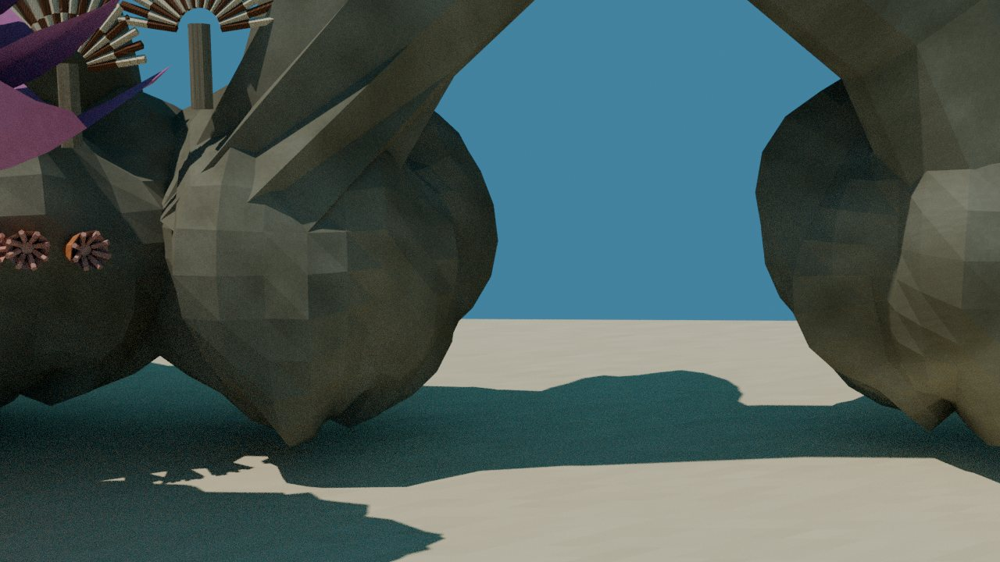 | 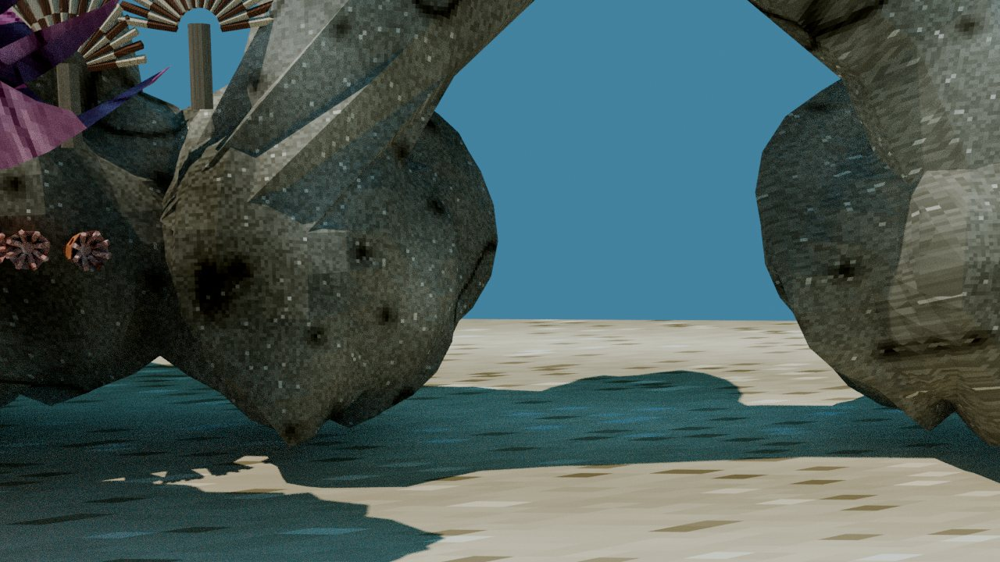 |
| Right rock | 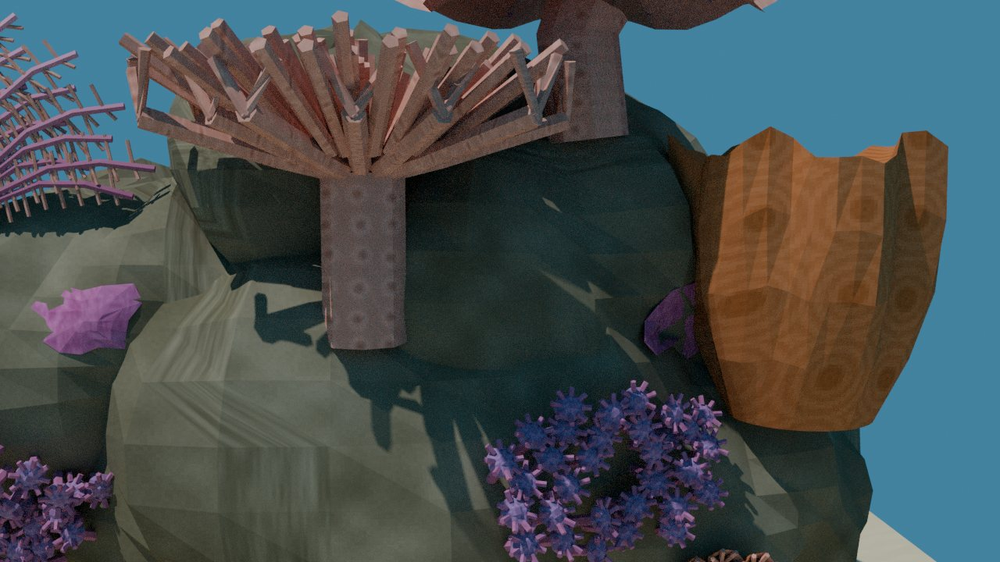 | 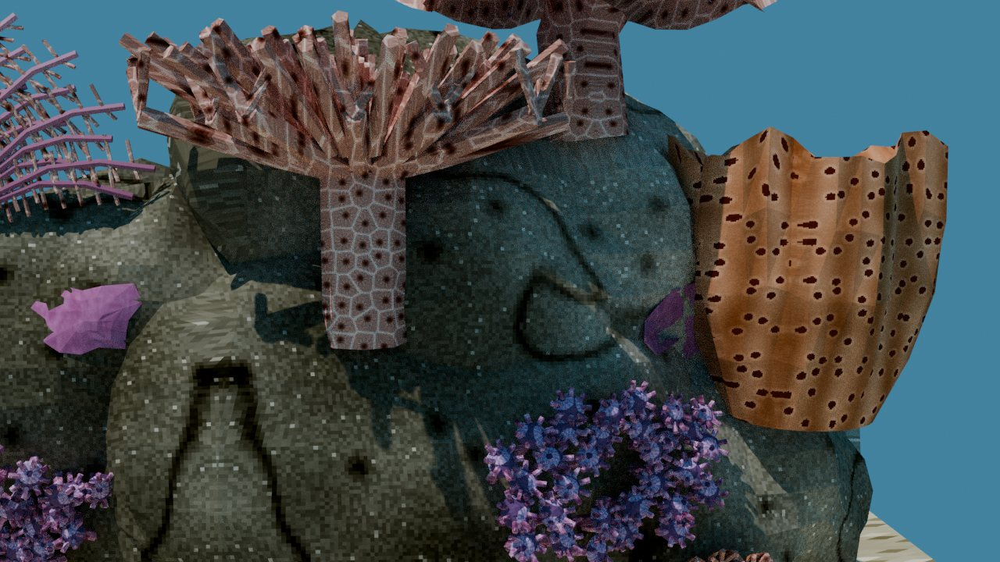 |

| Anime | Before | After |
|---|---|---|
| Wide | 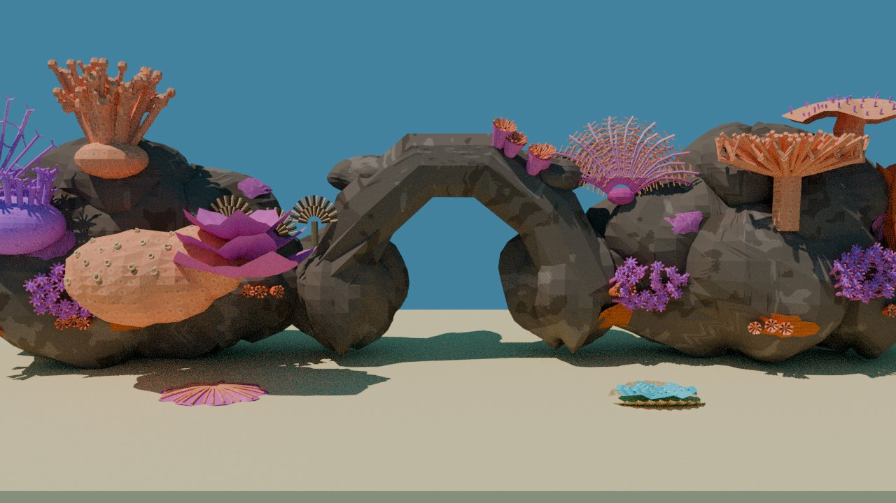 | 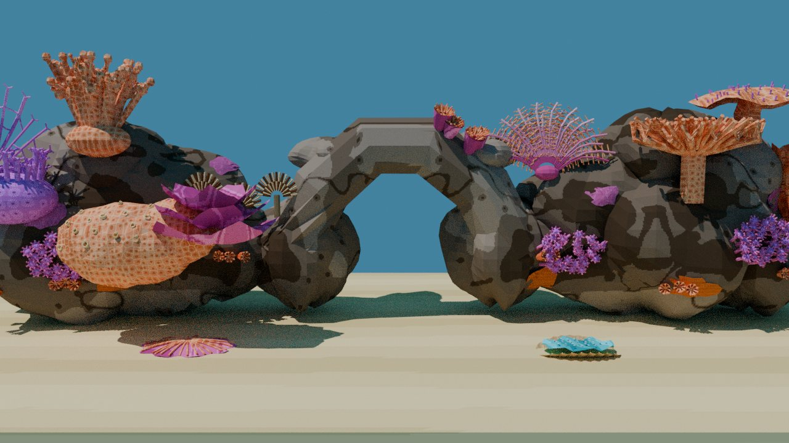 |
| Left rock and flowerpot | 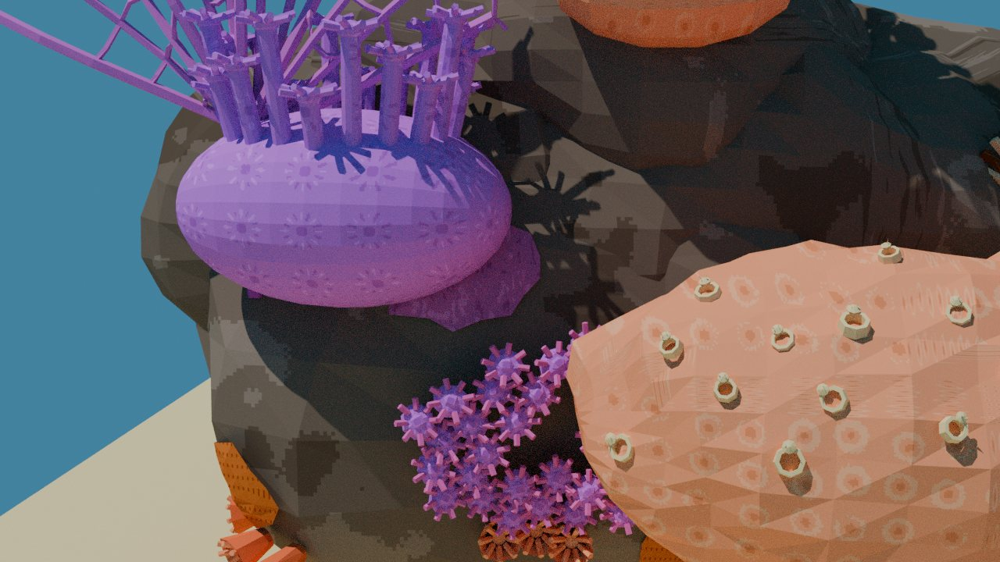 | 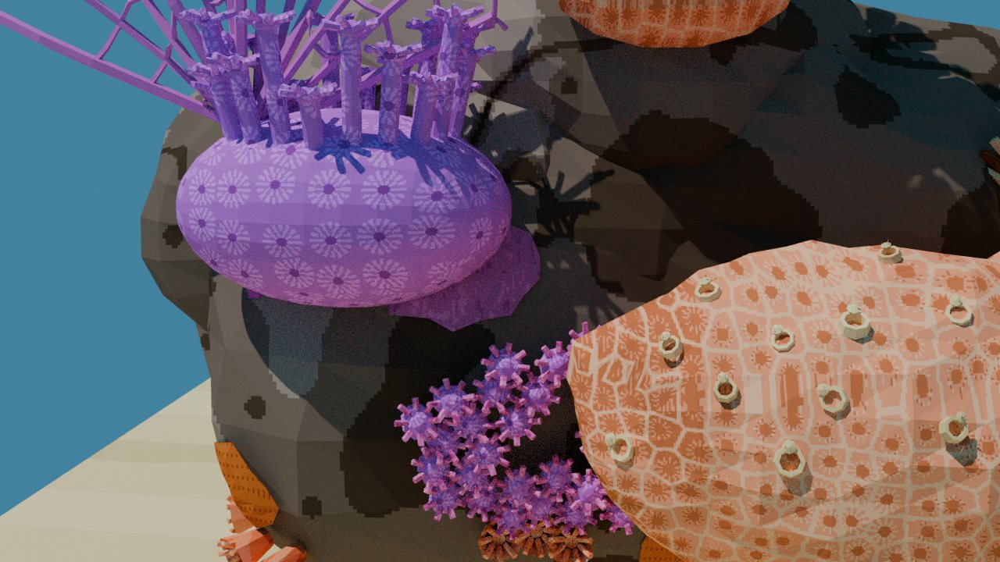 |
| Arch | 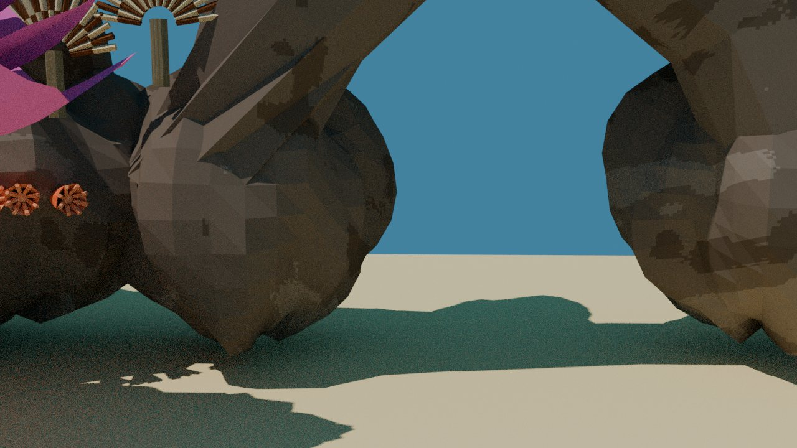 | 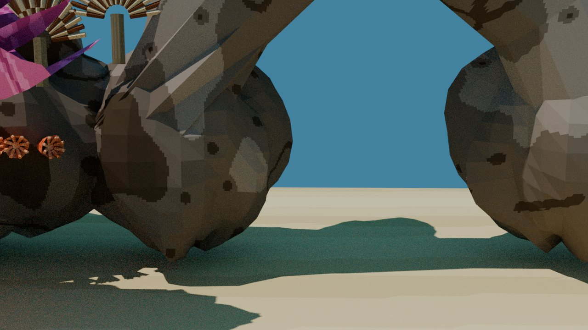 |
| Right rock | 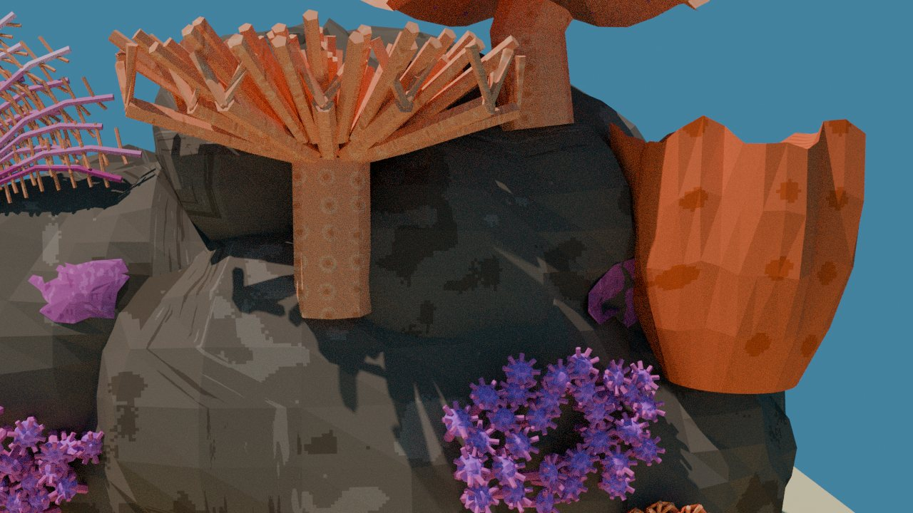 | 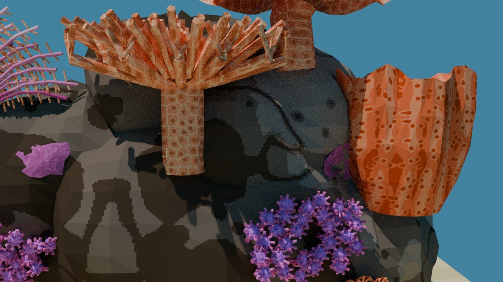 |

## Mapping changes (texture only; triangles unchanged)

- **Mirrored repeat for the world-projected tiles** (`reef/uvmap.py`).
    - Before, the static surfaces wrapped with `% 1`. Any face that crossed a repeat boundary got UVs spanning almost the whole tile: 10 % or more of the rock faces had a 90th-percentile span of about 225 texels, against 15–25 texels for the rest.
    - On a flat tile that smear was invisible; on a painted tile it would show as streaks.
    - The creature skins already used a mirrored repeat, so the static surfaces now use it too. After the change, the rock's 90th-percentile face span is about 24 texels.
- **Denser sponge tile:** the sponge tile now repeats at 1.1 cycles per unit, like the coral-surface tile. At the rock-scale 0.37, the barrel sponge's pores grew to leopard spots.
- **Known limit:** the world projection maps x and z, so faces that point along ±x, such as parts of the arch and the right rock's sides, still stretch the texture into streaks. Those faces were always mapped that way; the flat tiles hid it. Projecting each face along its dominant normal would fix it, as the flowerpot already does. That is not part of this change.
- **The flowerpot** shows the flower-head tile. Its dedicated *Goniopora* texture and geometry are option 1, waiting for the go-ahead.

## Checks

- `texcov.py --check`: PASS.
- The reef suites in the linux-test container: 180 passed, 4 failed. All 4 are the known failures: the worm harness, two menu-Taskfile tests and one screensaver import. The shipped levels are not rebuilt yet; that waits for the review.
- The atlas stays 1024², and no mesh changed.

## Reproduce

```sh
git archive 380337c3 wflevels/aquarium_thai_reef/reef | tar -x -C build-docker/reef-tiles-before
python3 docs/diagnostics/reef-tiles-2026-11-10/tile-sheet.py build-docker/reef-tiles-before docs/diagnostics/reef-tiles-2026-11-10
WF_CONTAINER_IMAGE=blender scripts/in-linux-container.sh blender --background \
  --python docs/diagnostics/reef-tiles-2026-11-10/render-tiles.py -- build-docker/reef-tiles-render before \
  build-docker/reef-tiles-before/wflevels/aquarium_thai_reef
WF_CONTAINER_IMAGE=blender scripts/in-linux-container.sh blender --background \
  --python docs/diagnostics/reef-tiles-2026-11-10/render-tiles.py -- build-docker/reef-tiles-render after
```
