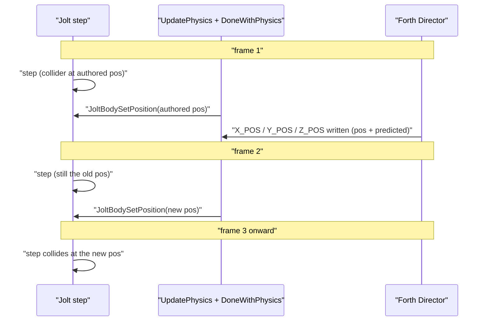

# Reef W5, R0 feasibility spike: source evidence (2026‑11‑08)

This spike answers the R0 questions in [W5 of the reef plan](../../plans/2026-11-08-reef-tanks-finish.md#w5--procedural-reef-random-rocks-a-rock-count-and-clustered-colonies-laid-out-in-forth-plan-only). Decisions D5 to D8 are taken as given: a baked rock-module kit laid out by the Forth Director at level entry, 1 to 5 rocks (default 3), Seed 0 means a new reef on every entry, and a Fixed layout is kept.

**Method.** I read the engine, the level generators and the Android app, and ran pure-Python size arithmetic over the committed level files. **Nothing was built or run.** `engine/wf_game` is built on the host against glibc 2.43 and does not run in this machine's containers. Every verdict below is therefore a reading of the code. Section 7 specifies the device measurements that would confirm them. Line numbers refer to branch `2026-new-level` at `aac370a8`.

| # | Question | Verdict | Engine change needed? |
|---|---|---|---|
| 1 | Forth moves, rotates, shows and hides anchored mesh actors at entry | **YES** | No |
| 2 | Colliders follow a move | **PARTIAL**: position yes, rotation never | No (constraint on the design) |
| 3 | A fresh seed per entry | **YES**: already clock-seeded on every level load | No |
| 4 | `ReefSettings` read by `property@`, shown on TV, phone and coordinator | **PARTIAL**: Forth and TV panel yes; phone and tray need app work | No engine change; Android app change |
| 5 | Memory and per-level limits | **YES, within limits**, with two self-imposed budgets to redefine | No |
| 6 | DFRM lobe pose applied once | **PARTIAL**: the pose persists, but the module then streams every frame | Yes, to make it cheap (not recommended) |
| 7 | Device cost | **UNKNOWN** until measured; the recipe is below | — |

---

## 1. Moving pieces: **YES**

**Evidence that Forth can move anchored actors once and have them render correctly afterwards:**

- `write-actor-mailbox ( val idx actor -- )` writes a mailbox on any actor (`engine/stubs/scripting_zforth.cc:1018-1031`). For the local system range it reaches `Actor::WriteSystemMailbox` (`wfsource/source/game/actor.cc:1935-1941`).
- `X/Y/Z_POS` set both the position and the predicted position (`actor.cc:1461-1513`). `RenderActor3D::Render` rebuilds the world matrix from `PhysicalAttributes` on every draw (`wfsource/source/renderassets/rendacto.cc:474-494`), so a moved actor draws at its new place from the next frame.
- The static-mesh path (E3) bakes each object **in local space** and receives the per-frame matrix (`RenderObject3D::RenderStatic(const Matrix34&)`, `wfsource/source/gfx/glpipeline/static_mesh.cc:817`, `:880`). Only content or atlas changes make a bake stale (`static_mesh.cc:25-36`). A move does not re-bake.
- The reef already does this on platform actors with Mobility Anchored: the Nudibranch (`X_POS`, `Z_POS`, `ROTATION_C`, `wflevels/aquarium_thai_reef/generate.py:388-392`), the SeaFan (`ROTATION_A`, `:382`) and the humbug shoal (`:366`). It also does it with the BoxfishVisual every tick. These run on cast1 today.
- The static reef groups are the same class: `platform.oad`, Mobility Anchored, Mass 0 (`generate.py:132-144`). Platforms get **no** Jolt body. Only StatPlats and anchored Generator meshes do (`actor.cc:541-591`, `:815-825`).

**Culling.** No per-actor frustum or bounds cull exists. `Level::RenderScene` draws every actor in the active room's render list whose visibility mailbox reads true (`wfsource/source/game/level.cc:1526-1547`). The back-face cull runs per face under the frame's matrix (`static_mesh.cc:7-9`). There are no cull bounds to refresh after a move.

**Show and hide.** `Actor::isVisible()` reads the mailbox named by the actor's `Visibility Mailbox` field (`actor.cc:897-901`). Global mailboxes 0 and 1 are the constants 0 and 1 (`wfsource/source/game/mailbox.cc:39-40`). The static reef groups use **1**, the constant (`generate.py:142`), so **they cannot be hidden today**. Each hideable piece needs its own global user cell. The Jellyfish companions show the pattern: `wf_Visibility Mailbox = 1800+k-1` (`wflevels/aquarium_tanks/generate.py:248`), driven from the Director (`:493`).

**Room membership.** Every actor is in the room's update list (`Actor::CanUpdate` returns true, `actor.cc:1073-1077`). `Level::updateRoomContents` checks each one against its room box every frame (`level.cc:1323-1337`, `wfsource/source/room/room.cc:268-286`, `movingObjectsOnly` defaults to false, `room.hp:88`). A piece moved outside the room box (`(-25,-30,-6)` to `(25,10,18)`, `generate.py:331`) is re-homed, and if no room contains it, it is removed from the game (`wfsource/source/room/rooms.cc:189-192`). **Park unused pieces inside the room box**, for example under the sand at z = −4.

**What a hidden actor still costs per frame** (code reading; section 7 measures it):

- `ActorStartFrame`, `predictPosition` (Anchored uses `NullHandler`, an empty body: `wfsource/source/movement/movement.cc:1126-1129`), `Actor::update` (message drain and the null animation manager: `actor.cc:905-960`) and `DoneWithPhysics` (`wfsource/source/movement/movementobject.cc:72-80`).
- One room-box test, and one mailbox read in the render loop.
- **No draw call, and no bake.** A never-drawn object is never baked, so it holds no GPU buffer. Its mesh is still loaded into the room slot.

**Two traps for the layout code** (both are existing behaviour):

1. **Rotation writes share one static latch.** `WriteSystemMailbox` keeps `static Euler rotationEuler` across **all** actors (`actor.cc:1419`). `ROTATION_A` and `ROTATION_B` only set the latch (`:1520`, `:1529`). `ROTATION_C` commits all three to the actor being written (`:1534-1539`). The layout must write `0 ROTATION_A`, `0 ROTATION_B`, then the heading `ROTATION_C`, in that order, for every piece. Side finding: `reef-life` writes the SeaFan's `ROTATION_A` and then the FeatherStar's `ROTATION_C` (`generate.py:382-383`), so the FeatherStar picks up the SeaFan's sway tilt every tick. The Nudibranch's `ROTATION_C` (`:391-392`) has the same exposure.
2. **Angles are revolutions**, `Angle::Revolution` (`actor.cc:1535`; `wfsource/source/math/angle.hpi:72`), wrapped modulo 1 (`wfsource/source/math/scalar.hpi:466-477`). Side finding: the Nudibranch's turn writes `3.141593` (`generate.py:391`). That is 0.1416 revolution, about 51°, not a half turn (0.5).

**Cheapest way forward.** Give every kit module and colony piece its own global visibility cell, write position and heading once on the first Director tick (A, B, C in order), and park unused pieces inside the room box. No engine change.

---

## 2. Colliders: **PARTIAL** (position follows, rotation never)

**How a StatPlat body is kept in sync.**

- A StatPlat builds a static Jolt trimesh from its mesh at `BindAssets` (`actor.cc:541-591`). The body is placed at the actor's position with **identity rotation always**: `JPH::Quat::sIdentity()` (`wfsource/source/physics/jolt/jolt_backend.cc:331-335`). Even an authored rotation is ignored.
- The `X/Y/Z_POS` handlers push only into a Jolt **character**, not into a body (`actor.cc:1461-1479`).
- **However**, every StatPlat is in the update list, and `UpdatePhysics` ends with `DoneWithPhysics` → `PhysicalAttributes::Update()` for each object (`movementobject.cc:155-161`). For Jolt, `Update()` copies the predicted position into the position and calls `JoltBodySetPosition(_joltBodyID, _position)` **every frame** (`wfsource/source/physics/jolt/physical.hpi:9-31`). Anchored objects predict nothing (`movement.cc:1126-1129`), so the predicted position a mailbox write set survives. Jolt 5.5.0's `BodyInterface::SetPosition` moves static bodies and updates the broadphase (`BodyInterface.cpp:456-477`). It does not activate them.
- **So a Forth `X/Y/Z_POS` write on a StatPlat collider does move its Jolt body.** The move lands about two frames late: the Director runs after `UpdatePhysics` (`level.cc:1250-1283`), so the body is pushed at the next frame's `DoneWithPhysics` and collides from the step after that. That delay is harmless at entry if the fish's spawn is clear.
- **Rotation is never pushed.** `Update()` pushes position only, and creation uses identity. A module turned by `ROTATION_C` keeps an unrotated collider.
- **Scale is never applied** to the trimesh either: the vertices are read raw (`actor.cc:566-569`).
- **Do not move a StatPlat outside the room box.** Outside the editor, `LevelRooms::AddObjectToRoom` asserts "Cannot generate or move a statplat at runtime" (`rooms.cc:157-158`). Moves inside the room never reach it, because the room test passes (`room.cc:282`).

**What the boxfish actually reads.** The original plan's "predictive braking keeps the box out of the rock using the tank's collider set" (`docs/plans/2026-11-02-gulf-of-thailand-reef-tank.md:575`) **is not in the code**. The braking, `tk-caps`, caps the drive against the **tank box** only: limit‑x, limit‑y, bottom and top (`wflevels/aquarium_tanks/fish_motion.fth:6-16`, `controller.fth` `tk-player-tick`). The rock is kept out by Jolt alone: the Player is Mobility Physics (`generate.py:206`), so it is a `CharacterVirtual` (`actor.cc:790-798`) that collides and slides against the static bodies. Moving the colliders is enough. No Forth braking table needs updating.

**Cheapest way forward, with no engine change:**

- Give **each module its own StatPlat box collider**, modelled in module-local coordinates with the module pivot at the box centre. Today's two colliders are boxes in world coordinates around an origin at 0 (`generate.py:171-188`), so they would need re-authoring.
- Restrict the headings the colliders must honour. A box centred on the pivot is unchanged by a half turn, so **headings 0 and 0.5 revolution** need no collider rotation. Small jitter (about ±10°) can be covered by padding the box.
- If arbitrary headings are wanted, bake one collider per heading bucket (for example 4 per module, 584 bytes each) and park the unused ones under the sand inside the room box.
- **Unused modules' colliders:** park them at z = −4 (the top of a 1.8‑unit box stays below the sand; the room floor is −6). Visibility has no effect on physics.
- **Fallback if a StatPlat ever trips the assert:** an anchored **Generator** with a mesh gets the same static trimesh (`actor.cc:815-825`, `:544-546`) and is not covered by the StatPlat assert. It carries Generator semantics, so it is a fallback only. It has not been tried.

---

## 3. Entropy: **YES**, no engine change

**The plan's premise is out of date.** `g_randomState` is initialised to 1 (`scripting_zforth.cc:76`), but `forth_engine::Init` reseeds it straight away from `system_clock ^ steady_clock` (`scripting_zforth.cc:1600-1606`). The clock seeding landed in `ef45ca33` "Expose clock seeded random words to zForth scripts". `Init` runs whenever a `ScriptRouter` is constructed (`engine/stubs/scripting_stub.cc:139-143`), and **every level load constructs one**: `Level` creates its interpreter at `level.cc:896` and deletes it at `level.cc:1008`. The shell interpreter is also recreated around each level (`wfsource/source/game/game.cc:291-297`). No shipped Forth calls `seed-random` (grep over `wflevels`, `scripts`, `tests`: no hits).

So **`random` already gives a different sequence on every entry**, on desktop and Android alike, because it is the same source file.

**Recipe for D7 in Forth:**

- **Seed = 0:** draw `random` (24 bits, `scripting_zforth.cc:80-89`) as the effective seed, then call `seed-random` with it. The reef is then reproducible from that number.
- **Seed > 0:** call `seed-random` with the setting.

**Precision constraint.** zForth cells are `float` (`engine/stubs/zfconf.h:24`). `property@` returns a value only when it lies in −32768 to 32767 (`scripting_zforth.cc:1391`). `property-int-bytes@` (179) returns the four bytes of an Int field (`:1395-1400`). Above 2^24 a float cannot hold every integer. **Limit the `Seed` field to 0 to 16,777,215** and compose it as `b0 + 256·b1 + 65536·b2` from `property-int-bytes@`. Alternatively, limit it to 0 to 32767 and use `property@`. The plan's draft of 0 to 2147483647 would give distinct seeds that collapse onto the same reef.

**What is not possible without an engine change:** writing the drawn seed back so that the TV panel shows it, as Planted does with `syncProperties` (`wfsource/source/game/plant_settings.h:50`). Forth has property read words but **no `property!`**. If Will wants the drawn seed visible and copyable, the smallest change is one word next to `property@`, for example `property! ( value owner field -- flag )`, which calls `Registry::set` for Int fields. **This needs permission.** It is not required for D7.

**Host-passed seed.** It works generically on desktop: `--property=ReefSettings.Seed=N` (`wfsource/source/game/main.cc:280-286`), applied to any RPRP schema before readers see it (`level.cc:621-623`). On Android, `dream_host.cc:43` is generic, but the only feeder is the Planted bridge (`android/screensaver/src/main/cpp/planted_bridge.h:1-8`, `kSchema = "PlantedTankSettings"`). See section 4.

---

## 4. Settings: **PARTIAL**

**The Forth side works like the Jellyfish.** `property@ ( owner field -- value flag )` is generic over the active registry (`scripting_zforth.cc:1380-1394`). The Jellyfish reads its catalog this way (`wflevels/aquarium_tanks/jelly_motion.fth:2`, `:6`), with the owner index baked into the header (`aquarium_tanks/generate.py:412`). It reads Companions **every tick** (`:501`), so a panel change takes effect live.

**Files and build steps a `ReefSettings` needs:**

1. **`wflevels/aquarium_thai_reef/settings.oas`**, written as in the plan's draft. Change `Seed` to `0..16777215` (section 3).
2. **`wflevels/aquarium_thai_reef/settings-bindings.json`**: `{"version":1,"owner":"Director","title":"Reef / Director","fields":{"Layout":{"id":1},"Rocks":{"id":2},"Colonies":{"id":3},"Seed":{"id":4}}}`.
3. **The same two files for `aquarium_thai_reef_anime/`.** Copy them, or have `generate.py` write both into `--out`. `build-aquarium-screensaver-levels.py` `attach_catalog` reads them from the tank's own directory (`scripts/build-aquarium-screensaver-levels.py:96`, `:119-124`).
4. **The actor map must carry `indices`.** `build-object-properties.py` reads `json[...]['indices']` (`scripts/build-object-properties.py:94`), and so does `attach_catalog` (`build-aquarium-screensaver-levels.py:102`). The reef writes `actors` (`generate.py:561`), so **today both would raise `KeyError`**. Add `'indices': indices` beside `'actors'`, or teach the two scripts to accept `actors`. Tests read `['actors']` (`tests/test_species_movement.py:138`, `:169`), so keep both keys.
5. **Append to both `build.sh` files** the four steps the Jellyfish runs (`wflevels/aquarium_jellyfish/build.sh`): build `wf_attr_edit` and `oas2oad-rs`, build `prep`, run `oas2oad` (`settings.oas` → `settings.oad`), then run `build-object-properties.py --oad … --bindings … --actor-map … --out settings.rprp --level wflevels/<level>-standalone.iff`. The catalog is attached to the **standalone** level only (`build-object-properties.py:62-84`).
6. **`check_tank_catalog`** has only two branches, and the `else` branch assumes `PlantedTankSettings` (`build-aquarium-screensaver-levels.py:64-83`). Add a `ReefSettings` branch with its four keys. Otherwise the reef screensaver variants fail the check once a bindings file exists.
7. **Director Forth:** add `: rf-settings-owner <Director index> ;` and read the four fields with `property@` (and `property-int-bytes@` for Seed). Poll them about once a second, and lay out again when one changes, so that panel edits take effect without a reload.

**Where it appears:**

| Surface | Verdict | Evidence |
|---|---|---|
| **TV and desktop in-app panel** | **YES, generic.** Hold A for 1 s opens the property host on any level with editable RPRP objects. With one owner it opens that owner's form directly | `engine/runtime_property_host.cpp:7`, `:12-18`, `:130-134`; `wfsource/source/game/game.cc:989`; `level.cc:649` binds the host to the level's registry |
| **Phone Dream settings** | **NO without app work.** The aquarium flavor's provider serves only `tank` and orientation. `PlantedSettingsProvider` is Planted-specific: it serves `planted-settings.json` and maps values through the typed `PlantedConfig` | `android/.../TankSettingsProvider.java:18-60`; `PlantedSettingsProvider.java:30`, `:99-128`; `TankChoice.java:14` lists both reef levels |
| **Coordinator tray** | **Generic on the coordinator side** (schema 2 capabilities: owner, type and field identity; no Planted-specific widgets), **but nothing feeds it**. The aquarium APK serves no capabilities document for the reef | `docs/plans/2026-10-21-planted-tank-screensaver.md:90-92` |
| **Dream launch overrides** | **NO without app work.** The OverrideSink in `dream_host.cc:43` is generic, but its only producer is the Planted bridge | `planted_bridge.h:1-8` |

**What is missing for the phone and the tray** (Android app code, not engine code):

- Generate `reef-settings.json` with `gen-settings-capabilities.py` from each reef `settings.rprp`, as `build_planted` does (`build-aquarium-screensaver-levels.py:241-244`).
- Ship it in the aquarium flavor's assets.
- Have the aquarium flavor's provider serve the selected tank's owner document and store the values.
- Have the player turn the saved values into `ReefSettings` launch overrides on each reef load, a generic version of `planted_bridge`.
- **UNKNOWN:** whether the hold‑A panel is reachable while the app runs as a Dream. `game.cc:630` and `:962` suspend the host in some paths. I did not trace which ones apply.

**ESCALATE (scope):** the plan says `ReefSettings` "is exposed … on the phone's Dream settings and the coordinator tray, through the generic provider the Planted Tank introduced". **That provider is not generic on the APK side.** W5a can ship TV-panel-only with no app change, or it can take on the aquarium-flavor provider and bridge work above. Will needs to choose.

---

## 5. Memory and size: **YES, within limits**

**Measured from the committed files** (`wflevels/aquarium_thai_reef*/*.iff` and `actor-map.json`):

| | Realistic | Anime |
|---|---:|---:|
| Standalone level | 7,985,152 B | 7,823,360 B |
| All mesh `.iff` | 3.74 MB | 3.58 MB |
| Room0 + Perm texture pages | 2 × 2.10 MB | 2 × 2.10 MB |
| Rock masses (left, right, arch): bytes, triangles | 591 KB, 21,436 | 307 KB, 15,096 incl. hulls |
| Rock bytes per triangle | 27.6 | 20.3 (hull in the same mesh) |
| Dressing groups (corals, life, shell): bytes, triangles | 1.87 MB, 42,954 | 1.73 MB, 54,560 |

The anime outline hulls live **inside** each group's mesh (anime `hull_triangles` equals the group triangle count, and both styles have 40 actors), so a module's hull moves with it automatically.

**Kit estimate (8 rock modules of about 6k triangles):**

- **Realistic rock:** 8 × 6,000 × 27.6 B ≈ **1.32 MB**, against 0.59 MB today (**+0.7 MB**).
- **Anime rock:** at today's decimation (about 2.5k triangles plus hull per module), 8 × 5,000 × 20.3 B ≈ **0.81 MB**. At 6k plus hull it is ≈ **1.95 MB**. Today's anime rock is 0.31 MB.
- **Dressing:** the dominant unknown. Reusable colony clumps shared across actors cost the file once. Per-module dressing at today's density would scale by about 8/3, from 1.87 MB to about 5.0 MB (**+3.1 MB**).
- **Fixed layout (D8):** if Fixed keeps today's 11 groups beside the kit rather than rebuilding them from kit pieces, add the kit on top of the current 8 MB.
- **Range:** a realistic level of about **8.7 to 12.4 MB**. Add **+2.1 MB** if the modules' baked light needs a second 1024² texture page. Texel density per module is **UNKNOWN** until the kit is unwrapped: today's `reef_atlas.tga` is 1024 × 1024 RGB.
- **Slots:** the level's RAM wrapper gives 32 MB to ROOM and 4 MB to PERM (`aquarium_thai_reef-standalone.iff.txt`). The kit fits with room to spare.

**Per-level limits:**

| Limit | Value | Kit impact |
|---|---|---|
| `STATIC_GROUPS_MAX` / `STATIC_TRIANGLES_MAX` (`wflevels/aquarium_thai_reef/config.py:6-8`) | 11 groups, 70,000 triangles, counted over **every** static group in `actor-map.json` (`report_budget.py:17-27`) | Self-imposed. A kit holds more groups and triangles than are visible at once, so the report must count the **worst-case visible set** (N = 5 plus dressing), not every loaded group. This is a budget-script change |
| Animated actors | ≤ 16 (`report_budget.py:27`); 15 used | Unchanged, provided the colony pieces are static |
| Mesh vertex index | `int16` (`wfsource/source/gfx/face.hp:34-36`): ≤ 32,767 vertices per mesh | A 5–7k-triangle module is far below it; `reef_hard` (11,606 triangles) already fits |
| Jolt body pool | 1,024 (`jolt_backend.cc:140`) | 8 to 32 colliders is negligible |
| Global mailboxes for visibility cells | user range 0–1900; **0 and 1 are constants**. Free per the original plan: **2–599**, 1112–1139, 1863–1900 (`docs/plans/2026-11-02-gulf-of-thailand-reef-tank.md:486-502`) | About 8 module cells plus one per colony piece. Allocate a block, for example 400–499, in the plan's allocation table and in its range check |
| Director layout scratch | 780–799 and 840–1099 reserved for the reef director (same table) | The layout state fits there |
| Actor count | 40 today | About 80 with 8 modules, 8 colliders and about 24 colony pieces. Each costs per-frame update work (section 1) and `OBJD` DRAM (1,000,000 B in the wrapper). The per-actor DRAM size is **UNKNOWN**; it would be read from the load-time memory report on device |

---

## 6. DFRM lobe pose applied once: **PARTIAL** (persists, but not cheap)

- **The pose persists.** `RenderActor3D::Deform` hands the deformer the actor's **own** writable vertex list (`rendacto.cc:576-599`). `DfrmDeformer::Pose` writes the positions and the face normals in place (`wfsource/source/renderassets/mesh_deformer.cc:280-292`). Nothing resets them, so one `dfrm-pose-curves` call (`scripting_zforth.cc:1640`) at entry leaves the shape posed with no per-frame re-pose. If a curve is on a timed clip, its pose time must be fixed for this to hold.
- **But posing takes the object off the static path for good.** `GetWrittableVertexList()` and `GetWritableFaceList()` set `_staticState = STATIC_DEFORMED` (`wfsource/source/gfx/rendobj3.hpi:54-58`, `rendobj3.hp:95`). Only a non-`BAKEABLE` state skips the bake (`static_mesh.cc:821`), and nothing resets it. A posed module would therefore **stream all of its triangles through `DrawTriangle` every frame**, the pre-E3 cost, for 5–7k triangles per module.
- **Other costs:**
    - The rock meshes carry no DFRM chunk today; Bind returns `NoMetadata` without one (`mesh_deformer.cc:264`).
    - Lobe scaling would invalidate the export-time site tables that the colonies attach to.
    - The collider would not follow.
- **Making it cheap needs an engine change** (permission needed): a "freeze" after a one-shot pose that returns the object to `STATIC_BAKEABLE` and re-bakes it once.
- **Recommendation:** drop item 7 from W5. Get the variety from module choice, spacing, heading (0 or 0.5 plus jitter), and optionally the uniform render scale (`X/Y/Z_SCALE`, `actor.cc:1299-1316`). With scale, the colony offsets must be scaled in Forth and the collider padded, because Jolt ignores scale.

---

## 7. Device cost: the measurement recipe (not run)

**Baseline.** cast1, wide idle, 120 s window starting 2 s after the selector is released, median of three runs: **24.38 FPS realistic, 22.21 FPS anime**; the gate is 20 FPS (`docs/diagnostics/reef-gameplay-verification-2026-11-05/README.md:425-443`, data in `../reef-cast1-performance-2026-11-08/`).

**Probe levels.** Build these in the Blender container with `scripts/level-build.sh` (no engine change), in both styles. Each is a `generate.py` flag on a throwaway branch in its own worktree:

| Probe | Content | What it isolates |
|---|---|---|
| **P0** | Today's level, rebuilt from the same commit | Build-to-build noise |
| **P1 hidden** | P0 plus 8 kit modules (copies of `reef_left`, `reef_right` and `reef_arch`, re-pivoted, about 6k triangles each) and 8 module StatPlat colliders. Every new module has its own visibility cell left at 0; the colliders are parked at z = −4 | The cost of hidden actors and parked colliders; the visible scene is identical to P0 |
| **P2 moved** | P1, plus on the first Director tick: move `reef_left`, `reef_right`, `reef_arch` and their colliders by a seeded offset (one write each, A/B/C rotation order) | The cost of a moved actor (expected: none after entry) and the entry-frame spike |
| **P3 count** | P1 plus 40 further hidden static actors (shared colony-clump mesh), about 100 actors in total | The slope of frame time against actor count |
| **P4 worst visible** | 5 modules visible plus dressing at "Dense" | The worst-case visible triangles against the 20 FPS gate |

**Procedure.**

1. Build the aquarium APK in its container and freeze a copy, as the Taskfile notes for Planted (`Taskfile.yml:1673`).
2. Submit through the shared coordinator: `WF_CC_APP=aquarium WF_CC_APK=<frozen apk> WF_CC_RECIPE=<recipe.json> task chromecast:profile` (`scripts/chromecast.py:12-36`).
3. **Recipe:** reuse the request of jobs J‑c37040e4a233 (realistic) and J‑24ee1da60153 (anime), changing only the APK. The exact request keys for selecting the reef style and wide view are not in this repo; read them from those jobs' receipts on the coordinator. **UNKNOWN here.**
4. **Order:** for each style, run P0, Px, P0, Px, P0, Px (alternating, against thermal drift): three runs each of 135 s, then compare medians.
5. **Pixel:** the same APK and recipe on the Pixel target.
6. **Analysis:** the coordinator's `summary.json` (fps, p50/p95/p99, `worst_ms`, `missed_refresh_percent`), as in `reef-cast1-performance-2026-11-08/*/summary.json`; and `scripts/analyse-aquarium-profile.py` for SurfaceFlinger captures.
7. **Entry spike and Forth cost:** on Android, put `--script-profile` in `wf_args.txt` (`scripting_zforth.cc:96-121`). It prints per-actor mean and worst ms every 5 s, which gives the Director's layout tick and its steady tick. Read `worst_ms` in the first 2 s of P2.

**Pass criteria (proposed):**

- **P1 and P3:** median FPS within 0.5 FPS of P0 in each style (about 1 ms at 22 FPS), which shows that hidden actors are free in practice.
- **P2:** steady FPS equal to P1; the layout tick under 50 ms worst.
- **P4:** at least 20 FPS median in each style on cast1.

---

## Verdict

- **Is D5 (Forth only) feasible as specified? Yes.**
    - Moving, rotating, showing and hiding anchored meshes work today from the Director, with no per-frame cost after entry beyond a hidden actor's small update-list overhead.
    - Per-entry entropy already exists. `random` is clock-seeded on every level load, so the plan's planned `fresh-seed` primitive is unnecessary.
    - Colliders follow a position write through the per-frame `DoneWithPhysics` push.
- **Design constraints the plan must absorb** (none needs the engine):
    1. Colliders cannot rotate or scale. Use a pivot-centred box per module, headings 0 or 0.5 plus padded jitter, or per-heading collider variants.
    2. Every hideable piece needs its own global visibility cell. Today's groups use the constant 1.
    3. Write A, B, C rotations in order, in revolutions.
    4. Keep every piece inside the room box. StatPlats assert if they leave it.
    5. Cap `Seed` at 24 bits (or 15).
    6. The budget report must count the worst-case visible set.
- **Unavoidable engine changes: none.** Optional, each needing Will's permission:
    - `property!`, to show the drawn seed on the panel;
    - a DFRM freeze-and-re-bake, for cheap lobe variety (not recommended).
- **App (non-engine) work, if the phone and tray are wanted:** an aquarium-flavor settings provider and a reef launch-override bridge (section 4). **This is the one material gap: ESCALATE for a scope decision.**
- **Recommended order:**
    1. **W5a, settings (T3):** `settings.oas` and bindings for both styles, `indices` in the actor map, `build.sh` steps, a `check_tank_catalog` branch, and Director `property@` reads with Layout = Fixed honoured. Ship TV-panel-only unless Will takes on the app work.
    2. **R0 device run (coordinator):** probes P0 to P3 from section 7, before the kit is authored. They need only copies of today's meshes.
    3. **W5b, the kit (T4):** re-pivoted modules with local site tables, anime hulls in-mesh, and per-module box colliders. Extend the budget report to the worst-case visible set, then run P4.
    4. **W5c, Forth layout (T3):** pick, space, founders and lineages, one-shot writes, parked leftovers, module-relative reaction anchors, a re-layout on settings change, and the boxfish patrol lane kept clear. The screensaver driver patrols x = ±3.3 at z 2.2 to 2.8, in front of the reef (`wflevels/aquarium_thai_reef/screensaver_player.fth:3-15`), and the fish's spawn must stay clear of every collider.
