# Reef W5b: the rock-module kit (2026‑11‑08)

This is the evidence for W5b of the [reef plan](../../plans/2026-11-08-reef-tanks-finish.md#w5--procedural-reef-random-rocks-a-rock-count-and-clustered-colonies-laid-out-in-forth-plan-only):
- the kit in the generator, for both styles;
- the Fixed layout as one arrangement of the kit;
- the visible-set and Room #0 slot budgets;
- probe P4 on cast1;
- review renders.

The Forth layout (W5c) is not part of this.

## What the kit is

| Module | Role | Rock actor | Pieces (shared visibility cell) | Collider (pivot-centred box) | Triangles realistic / anime |
|---|---|---|---|---|---:|
| left | hero | `reef_left` | rock, `reef_hard_left`, `reef_life_left`, `reef_life_left_1`; SeaFan, Nudibranch, WormCrowns, FeatherDusters, FlowerpotCoral, GuardCrab (cell 200) | `RockColliderLeft` (today's box) | 26,852 / 22,148 |
| arch | hero | `reef_arch` | rock, `reef_life_arch`; GiantClam, ShrimpOne, ShrimpTwo, HermitCrab (cell 201) | `RockColliderArch` (lintel only, new) | 14,115 / 9,819 |
| right | hero | `reef_right` | rock, `reef_hard_right`, `reef_life_right`, `reef_life_right_1`; FeatherStar, LeatherCoral (cell 202) | `RockColliderRight` (today's box) | 21,459 / 16,571 |
| ledge | filler | `reef_ledge` | rock (cell 203) | `RockColliderLedge` | 1,472 / 552 |
| pillars | filler | `reef_pillars` | rock (cell 204) | `RockColliderPillars` | 1,496 / 520 |
| tall | filler | `reef_tall` | rock (cell 205) | `RockColliderTall` | 1,556 / 568 |

- **Heroes are today's rocks.** The three hero modules are today's three voxel-remeshed rock masses. Each carries the dressing that grows on it.
    - [`reef/kit.py`](../../../wflevels/aquarium_thai_reef/reef/kit.py) splits today's merged groups (`reef_hard`, `reef_soft`, `reef_sponges`, `reef_life*`) by host module. Faces are joined into clusters by shared corners and touching bounding boxes, so a polyp's tentacles stay with it. Each cluster goes to the rock nearest its lowest point.
    - Each face keeps the UVs its original group gave it (some UV modes use per-mesh bounds).
    - Every hero piece is remeshed and UV-mapped in world space, as before, and only then re-pivoted onto the module's foot. **So the world geometry does not change.**
- **The plan names 8 modules; K = 6.** The plan's "barrel-sponge mass" and "table-coral mass" are both today's right rock, which cannot be split without changing the Fixed reef. The 6 modules are therefore 3 heroes plus 3 fillers (ledge, twin pillars, tall mass). The fillers are new seeded blob masses, remeshed coarser (voxel 0.13 realistic, 0.22 anime), baked alone, and parked under the sand.
- **Pivots** are each module's foot on the sand (z = 0.72). The left and right pivots are today's collider centres, (∓3.325, 0.5): within 5 cm of each rock's footprint centre, and they keep both boxes exact. The arch pivot is (0.15, 0.5).
- **Colliders** are boxes centred on the pivot in x and y, so headings 0 and ½ revolution leave them exact.
    - Left and right are today's boxes, to the millimetre (tested).
    - **The arch now has a lintel-only box** (world z 2.45–3.05). It closes the fish's path *through* the lintel rock, which it could swim through before. The cave below stays open, and the boxfish's spawn (z 3.53) is outside it. This is the one behavioural change to the Fixed reef; nothing visible changes.
    - Filler colliders wait at z = −4, inside the room box.
- **Colony clumps:** 9 actors, 3 each of zoanthid (856 triangles), cups (498) and crust (75). Each kind shares one mesh file. Each clump is built at the origin growing +z, so W5c rotates +z onto a site normal. Clumps are parked hidden, with cells 210–218, and are not baked (they are lit like the animals).
- **Visibility cells.** One cell per hideable piece, where "piece" means a whole module (rock, dressing and attached life always show and hide together) or a colony clump. The cells are 200–205 and 210–218, global user mailboxes from the free range 2–599.
    - The Director's new `reef-kit-init` writes 1 to the hero cells once at entry, behind guard cell 1112 (unassigned in the original plan's table). Until W5c exists, every entry shows the Fixed arrangement. W5c replaces this.
    - These allocations should be added to the plan's mailbox table.
- **Site tables:** 16 points per module with outward normals, in module-local coordinates (pivot at the origin, sand at z = 0). They are resolved on each module's own analytic surface with W3's method (ray casts against the seeded blobs, gradient normals).
    - Sites face the camera or face up, sit at least 0.12 above the sand, and are at least 0.28 apart.
    - The order is seeded, so W5c can take the first k.
    - Hero sites ignore the existing dressing. **W5c should put colonies on filler sites first.**
- **`actor-map.json` → `kit`** holds everything W5c needs per module:
    - name, role, cell, pivot (heroes) or park position (fillers), piece names and actor indices, collider name, actor index and box, attached actors, the 16 sites;
    - for the clumps: kind, cell, actor index, mesh;
    - for each attached animal: its module and pivot-relative offset;
    - the Fixed pivots and the init guard.

    `kit_budget` holds the Fixed and worst-visible counts.

## Fixed is unchanged

| Check | Realistic | Anime |
|---|---|---|
| Fixed static groups / triangles | 11 / 64,390 (before: 11 / 64,390) | 11 / 50,502 (before: 11 / 50,502) |
| Cooked vertices of every Fixed-visible actor, world space, against the pre-W5b level ([`compare_fixed.py`](probes/compare_fixed.py), [output](probes/compare-fixed-output.txt)) | max position offset **0.04 mm**, max UV offset **0** | 0.005 (the outline hull's own width; matched by nearest vertex), UV ≤ 0.0004 |
| Baked vertex colour | mean grey 163.08 → 163.11; 72% of vertices identical, the rest is per-object Cycles noise | 99.4% identical; 0.6% of vertices move one toon band |
| Render difference, before → after (same camera) | wide: mean \|Δ\| 0.025/255, **0.012%** of pixels > 8; three-quarter: 0.036% | wide: 0.010% |

| Before | After |
|---|---|
|  | [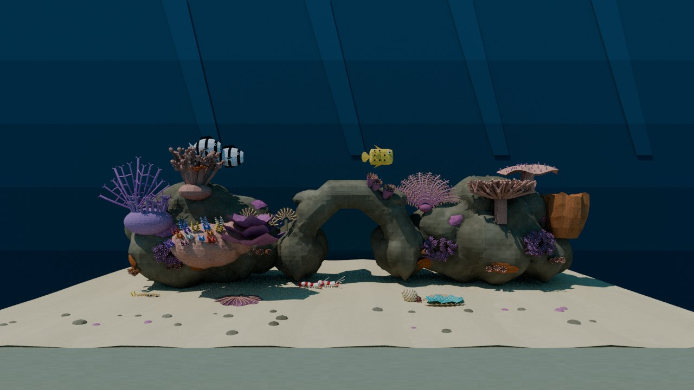](fixed-after-wide.jpg) |
| [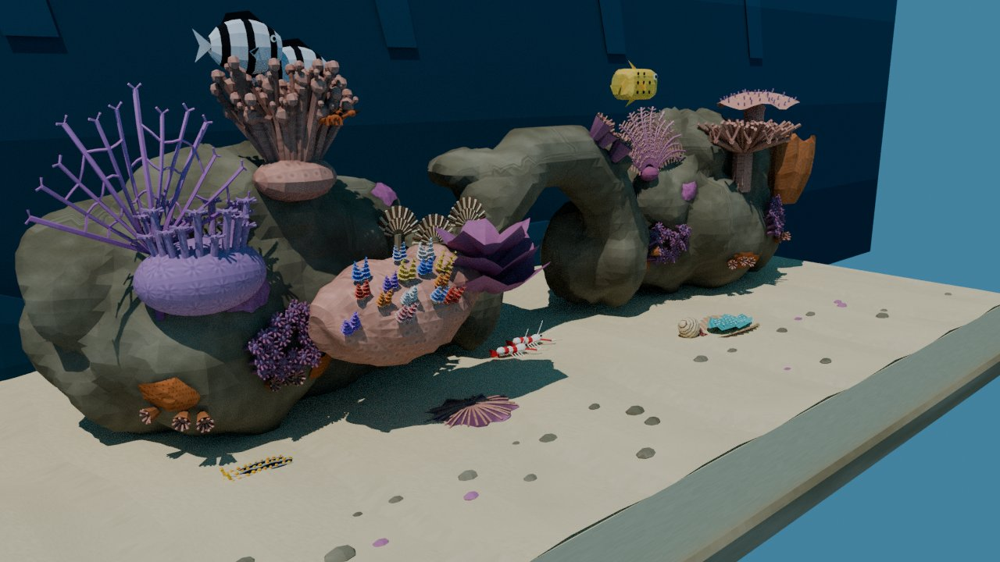](fixed-before-three-quarter.jpg) |  |
| [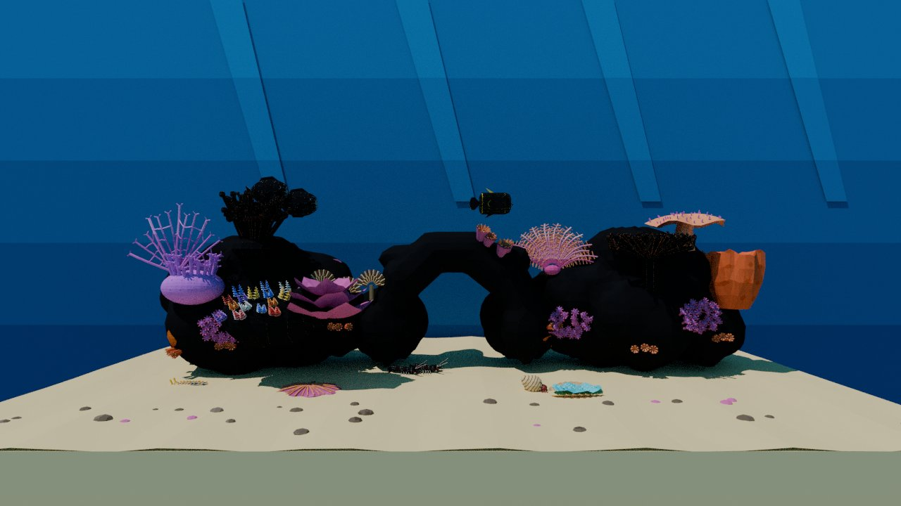](anime-fixed-before-wide.jpg) |  |

The renders are made by [`render-kit.py`](render-kit.py) from the **cooked** level files, with the meshes, UVs and baked colours as the level ships them and the positions from the `.lev`. They use CPU Cycles with a matte material, as [the W3 placement renders](../reef-placement-2026-11-08/README.md) do, so they do not show the engine's lighting.

## The kit and arrangements

**The modules alone, with their site points** (red; the rods are the normals). [Row](kit-row.jpg):

| [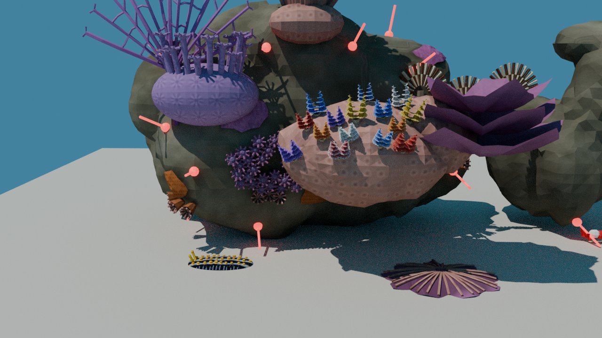](kit-left.jpg) | [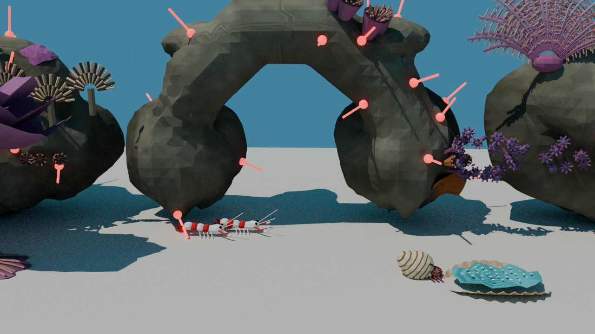](kit-arch.jpg) | [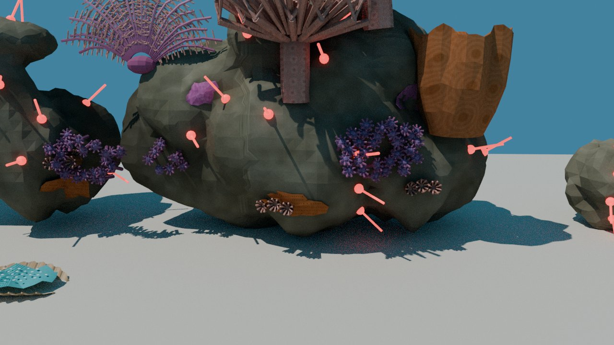](kit-right.jpg) |
|---|---|---|
| [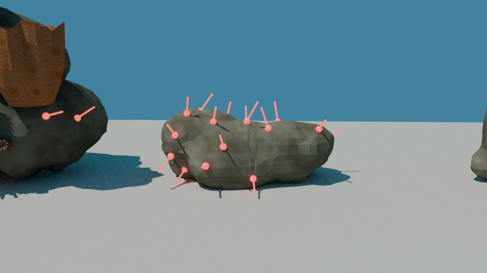](kit-ledge.jpg) | [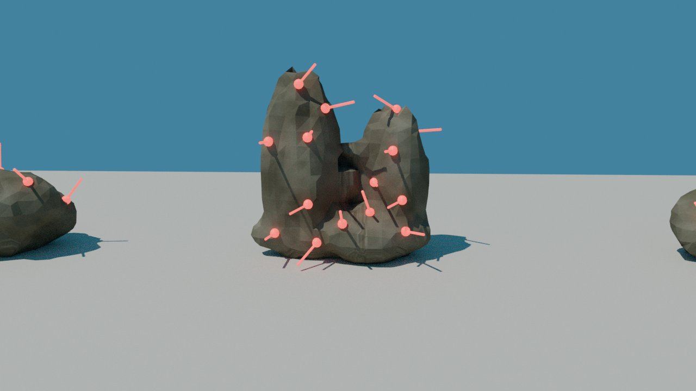](kit-pillars.jpg) | [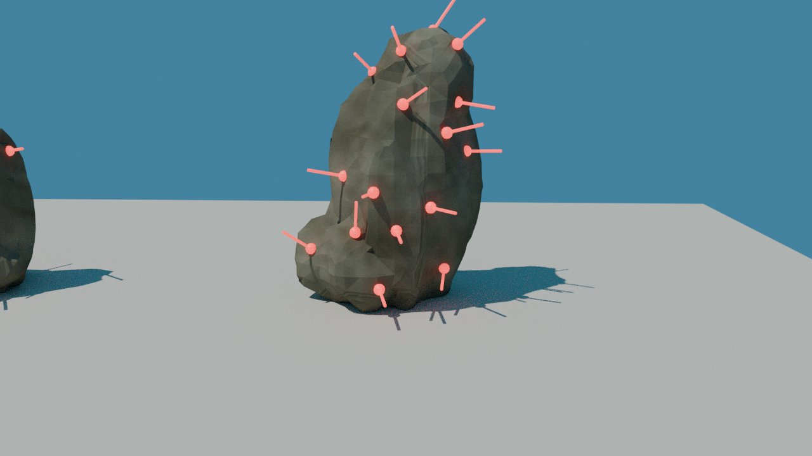](kit-tall.jpg) |

**Static arrangements** with heroes first and headings 0 or ½ revolution; attached life sits at pivot + offset, and clumps sit on filler sites. These are examples for review, not W5c's layout.

| 2 rocks | 3 rocks | 5 rocks |
|---|---|---|
| [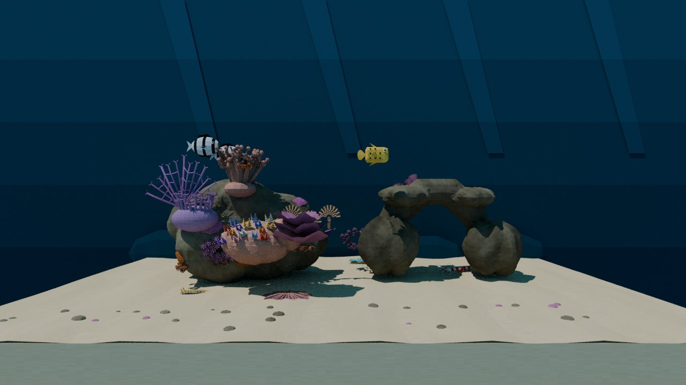](arrange-2-wide.jpg) | [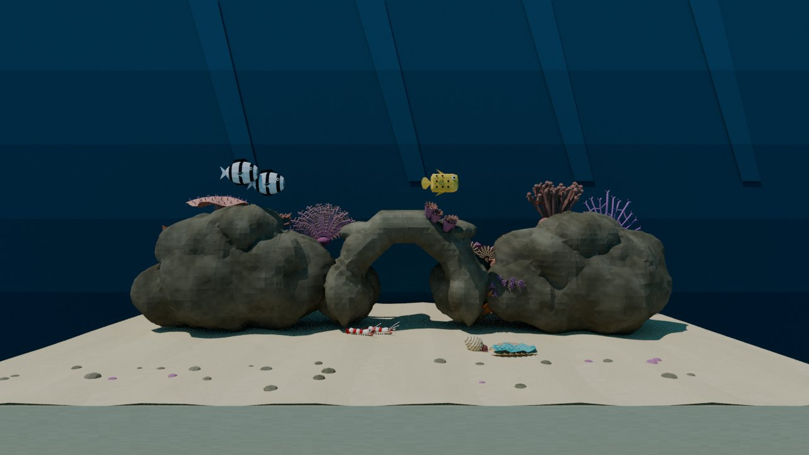](arrange-3-wide.jpg) | [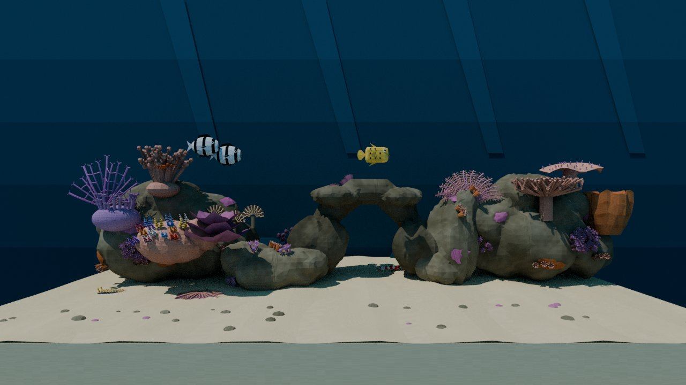](arrange-5-wide.jpg) |

The fillers are visibly coarser than the heroes, because they are built to the triangle budget. A finer remesh fits the budget in realistic but would eat into anime's frame time (see P4).

## Budgets (cooked, `report_budget.py --cooked`)

| | Realistic | Anime | Limit |
|---|---:|---:|---:|
| Fixed groups / triangles | 11 / 64,390 | 11 / 50,502 | 11 / 70,000 |
| Worst visible set: groups (3 heroes + dressing, 2 largest fillers, 9 clumps) | 22 | 22 | 22 (`KIT_VISIBLE_GROUPS_MAX`) |
| Worst visible triangles | **71,729** | **55,909** | 72,000 (`KIT_VISIBLE_TRIANGLES_MAX`; P4 shows it holds) |
| Worst visible outline hulls (with the animals') | 0 | **23,582** | 24,000 |
| **Room #0 slot**, every piece loaded (mesh files + 44 mesh-actor copies) | **18,287,240 B** (57%) | **18,444,944 B** (58%) | 32,000,000 |
| Actors | 56 (was 41) | 56 | — |

`build.sh` (both styles) now runs `report_budget.py --cooked --level <level>` after the binary build, and **the build fails** if any check fails. The slot model is the one fitted in [R0 section 9](../reef-w5-r0-2026-11-08/README.md#9-root-cause-of-the-realistic-p3-load-abort-2026-11-08). The 32 MB budget holds the kit with room to spare, so the 36 MB fallback is not needed.

## P4 on cast1 (2026‑11‑08)

**Probes.** Built by [`probes/make_p4.py`](probes/make_p4.py) and [`build_k0p4.sh`](probes/build_k0p4.sh) from copies of the W5b levels, in build-docker:
- **P0:** the pre-W5b level (R0's P0 APK), the control.
- **K0:** the W5b level unchanged (Fixed shown; fillers and clumps hidden and parked).
- **P4:** K0 plus a one-shot Director write: the two largest fillers (pillars, tall) and their colliders moved into view behind the hero gaps and shown, and all 9 clumps placed on their sites and shown. Positions only. The Forth VM confirmed the writes ([`test_p4_vm.py`](probes/test_p4_vm.py)).

**Protocol.** The same as P0–P3:
- the 2026‑11‑07 release APK with `cd.iff` swapped and debug-signed;
- the recipe recovered from J‑c37040e4a233 / J‑24ee1da60153, with `PANEL=require-hidden`;
- the 120 s idle window starting 2 s after the selector release;
- three rounds per style in alternating order (P0 K0 P4 / P4 K0 P0 / P0 K0 P4).

Jobs are listed in [`probes/jobs-p4.tsv`](probes/jobs-p4.tsv) and per-run figures in [`results-p4.json`](probes/results-p4.json).

| Style | Probe | Runs (FPS) | Median | Frame | Δ vs P0 | Gate (≥ 20 FPS) |
|---|---|---|---:|---:|---:|---|
| Realistic | P0 | 22.62, 22.90, 22.98 | 22.90 | 43.67 ms | — | pass |
| Realistic | K0 | 22.89, 22.63, 22.83 | 22.83 | 43.79 ms | +0.12 ms | pass |
| Realistic | **P4** | 22.05, 22.03, 21.96 | **22.03** | 45.39 ms | +1.72 ms | **pass** |
| Anime | P0 | 21.39, 21.24, 21.12 | 21.24 | 47.08 ms | — | pass |
| Anime | K0 | 20.89, 20.76, 20.83 | 20.83 | 48.01 ms | **+0.93 ms** | pass |
| Anime | **P4** | 20.26, 20.33, 20.19 | **20.26** | 49.35 ms | +2.27 ms | **pass, by 0.26 FPS** |

- **P4 passes the gate in both styles.** The worst visible set costs 1.7 ms realistic and 2.3 ms anime over the old level. The anime margin is thin: 0.65 ms to the 50 ms gate.
- **Anime K0 is 0.93 ms slower than P0, and that is outside the noise:** the runs do not overlap (P0 46.75–47.34 ms, K0 47.87–48.17 ms). Realistic K0 is unchanged (+0.12 ms). **Cause: UNKNOWN.**
    - The Fixed geometry, triangles and hull counts are the same.
    - The anime-only differences are the split `reef_hard_left` / `reef_hard_right` outline pieces (one hull before, two now) and three hidden filler hulls. Hidden actors measured about 4–8 µs each in R0, and that was not in anime.
    - **Not yet checked:** `--script-profile` and the frame profiler (`wf_args.txt --frame-profile`) on K0 against P0 in anime, to see whether the time goes to Actors, Director or Render.
- **Pixel:** skipped, as instructed.
- **Device:** cast1 was restored to `30554973…` by install job J‑dda48b85e48c, verified `685bf33b…` (the P4 APK) → `30554973…`. It reports `Idle · nothing queued (ready)`.

## Tests

`tests/test_thai_reef_kit.py` (new, 12 tests) checks:
- every dressing face of today's groups survives the split, with its original UVs;
- every exported hero piece sits at its pivot, and its vertices land on today's world positions;
- the colliders are pivot-centred, and the left and right boxes are today's;
- every hideable piece has its own free cell, and `reef-kit-init` shows only the heroes;
- the sites lie on their module's surface;
- the actor map's indices and offsets match the `.lev`;
- the cooked levels pass `report_budget.py`.

`tests/test_aquarium_thai_reef.py` has two legitimate adjustments:
- the prelit check lists the kit's piece names, because `reef_hard.iff` and the other merged files no longer exist;
- the anime hull check bounds the worst visible set's hulls, not every loaded piece's, because hidden fillers carry hulls too.

Run in the linux-test container: `test_aquarium_thai_reef`, `test_thai_reef_settings`, `test_thai_reef_skins`, `test_thai_reef_placement` (every W3 placement test), `test_species_movement`, `test_aquarium_menu`, `test_aquarium_screensaver_input` and `test_thai_reef_kit`. **165 passed, 4 failed.** The same 4 fail before W5b:
- `test_worm_engine_pose_leaves_other_crowns_unchanged`: the host-built harness does not run in the container;
- two menu-Taskfile tests;
- one screensaver-variant import.

## The anime K0 slowdown (2026‑11‑08, after P4)

**Question:** why anime K0 (the kit level with Fixed shown) runs about 0.9 ms slower than P0 (the pre-W5b level), while realistic K0 does not.

**Method:** A/B probes on cast1 under the same protocol as above (anime, wide idle, 120 s window, three alternating runs each). Each probe changes one thing. Job lists and per-run figures are in [`probes/anime-cost/`](probes/anime-cost/). The two scratch generator variants used for K4 and K5 are there too.

| Probe | What changes against K0 (the committed W5b level) | Runs (FPS) | Median | Δ |
|---|---|---|---:|---|
| K0 | — (control) | 20.81, 20.96, 20.84 | 47.99 ms | — |
| K1 | the shell (sand and water backdrop) drawn after the dressing instead of first | 20.99, 20.94, 20.94 | 47.75 ms | −0.24 ms vs K0; runs overlap, so noise |
| K3 | K1 + the 12 hidden kit actors (3 fillers, 9 clumps) removed from the render list | 20.86, 20.87, 20.94 | 47.91 ms | = K1 (K1 same session: 47.87 ms) |
| K4 | K1 + today's **merged** dressing groups (`reef_hard`, `reef_soft`, … as before W5b) instead of the per-module pieces | 21.33, 21.11, 21.07 | **47.37 ms** | −0.57 ms vs K1 (same session: 47.94 ms); = P0 (same session: 47.13 ms) |
| K5 | K1 with the per-module pieces kept but **not** re-pivoted (left at the world origin) | 20.86, 20.93, 20.79 | 47.94 ms | = K1 (same session: 47.75 ms); P0 46.89 ms |

Jobs:
- **K0, K1, P4B:** J‑804511b2554f, J‑e6714ae3ef67, J‑a835ad18695d (K0); J‑2dc87926021f, J‑4bc33b01a71c, J‑02332452ccd3 (K1); J‑e1f342a87cdf, J‑b419b745cc47, J‑9a3fcb9908ab (P4B, P4 on K1: 49.24 ms, the same as P4's 49.35 ms).
- **K3 session:** J‑379f670af075, J‑61db5b6c3865, J‑a3466c005b60 (K3), with K1 and P0 in [`jobs-k3.tsv`](probes/anime-cost/jobs-k3.tsv).
- **K4 session:** J‑1348e6f23431, J‑9f25300730f2, J‑b18fb5ea77dc (K4), with K1 and P0 in [`jobs-k4.tsv`](probes/anime-cost/jobs-k4.tsv). One P0 run there (J‑7f7101e988a5) had an incomplete window and is excluded.
- **K5 session:** J‑84627e77b049, J‑d6ababf2fc20, J‑76dba44240d3 (K5), with K1 and P0 in [`jobs-k5.tsv`](probes/anime-cost/jobs-k5.tsv).

**Conclusion:** about 0.6–0.9 ms in anime comes from drawing the hero dressing as more, smaller per-module pieces (7 pieces, split by host rock) instead of the old merged groups.
- **Draw order is not the cause.** K1 is within noise of K0.
- **The hidden kit actors are not the cause.** K3 equals K1. Outlines are in-mesh hulls, and a hidden actor is skipped before its draw (`level.cc:1533`), so it pays no outline cost.
- **Position and pivot are not the cause.** K5 equals K1.
- **Merging the dressing back recovers it.** K4 equals P0.
- **Realistic is unaffected:** K0 +0.12 ms, inside the noise.

**Where the per-piece cost sits** (best reading, **unproven**):
- A frame-profiled pair (`--frame-profile`; P0 J‑68930b9e007d and J‑97d6f945f65b, K0 J‑8ed004058aa2 and J‑95cc75165151) shows the same work on every counter: 27 draws, 15 static draws, 106,880 faces submitted, 52,760 faces culled, 54,120 triangles, 6,297,312 static vertex bytes, 12 uploads per frame.
- The visible actor and face totals also match in the cooked levels ([`count_draws.py`](probes/anime-cost/count_draws.py)).
- The extra time appears inside the profiler's **Render** section: 33.6–33.9 ms in P0 against 34.3–34.6 ms in K0. That section includes the GL driver calls and any wait on the GPU. Actors take +0.08 ms (the 16 extra actors), and Update and Director do not change.
- So the cost is not CPU work the engine counts. Most likely it is **on the GPU side of the static draws:** the same triangles, grouped differently per draw, change how the Mali GPU tiles and shades the coral dressing, which is dense, overlapping and outlined.
- Two points fit an overdraw or tiling cost: it appears only in anime, whose hard-coral pieces carry the outline hull and whose dressing has the most depth complexity; and moving the shell (K1) did not help.
- Not tested: grouping by kind across modules (K6 was built but not run when the investigation stopped). Mali hardware counters were not available through the coordinator.

**Decision (Will, 2026‑11‑08):** "keep the slowdown; the increased flexibility is worth it". The per-module split stays. Anime P4 passes the gate at 20.26 FPS (20.31 FPS on K1). The working tree's reef generator and levels are back at the committed W5b state (`65d165bf`).

**Device:** cast1 was restored to `30554973…` by install job J‑b8e2b08b5184, verified `5af99a98…` → `30554973…`. It reports `Idle · nothing queued (ready)`.
