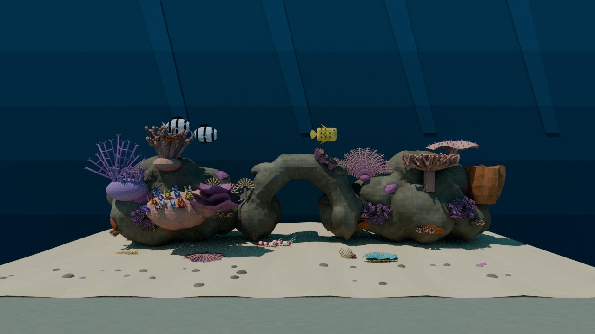
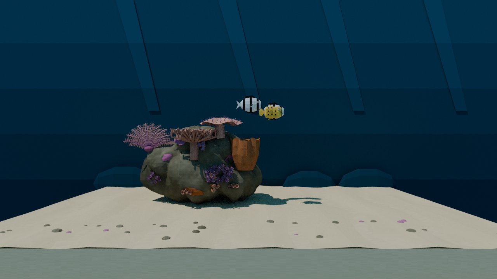
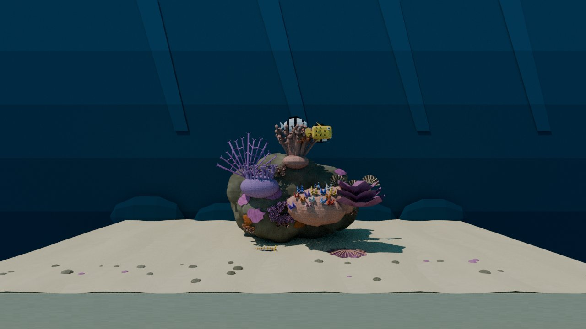
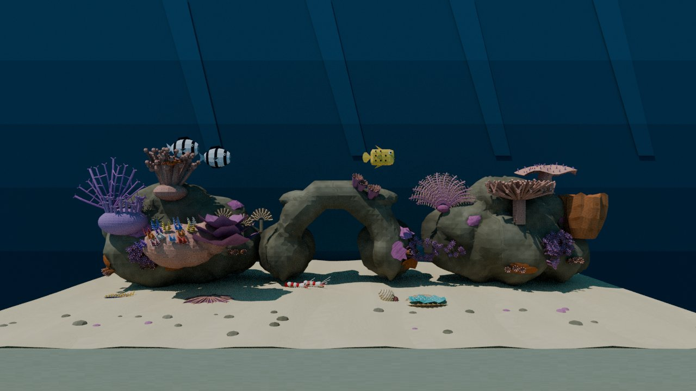
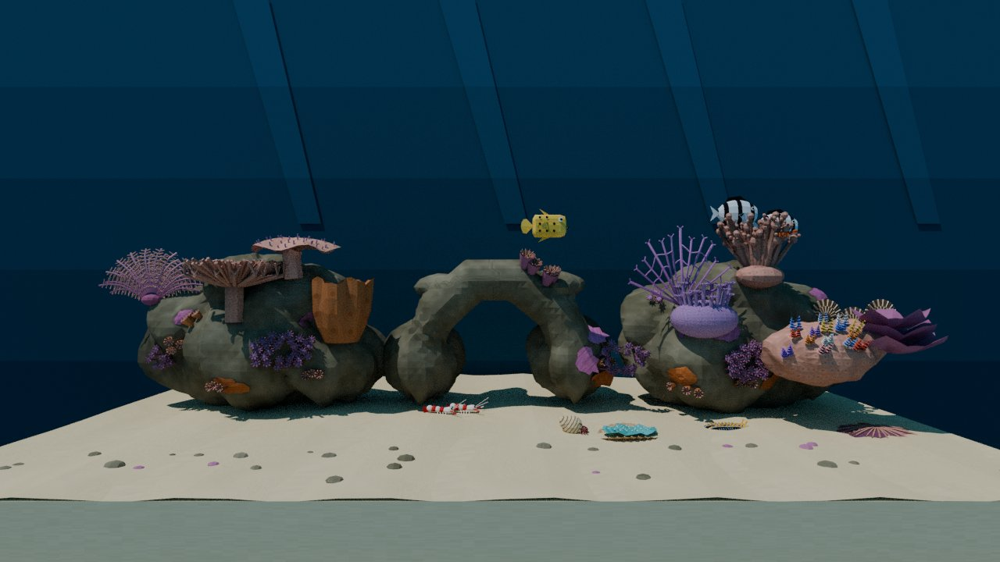
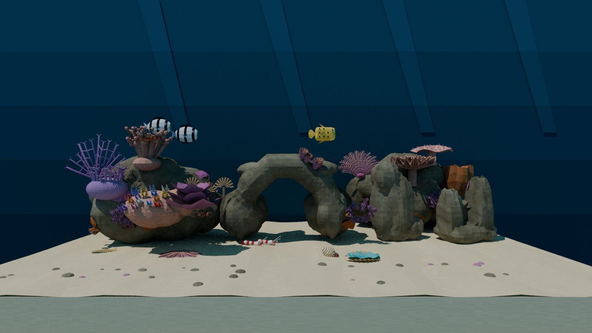
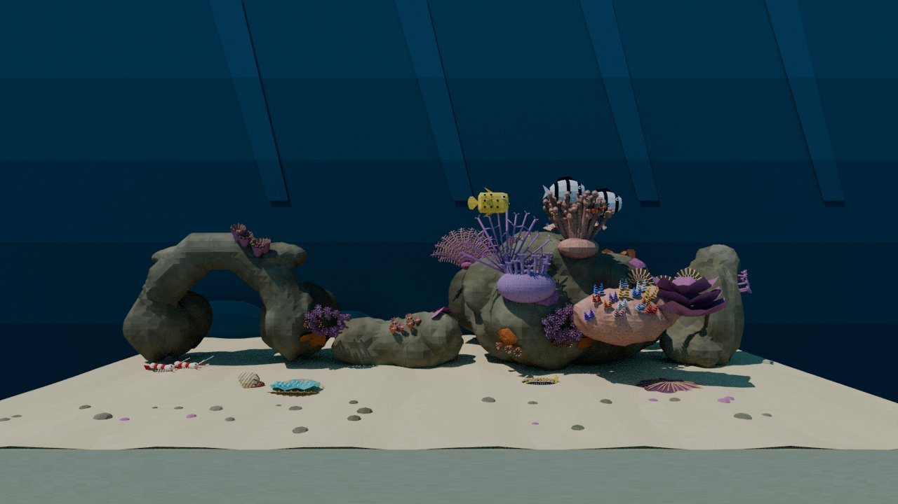
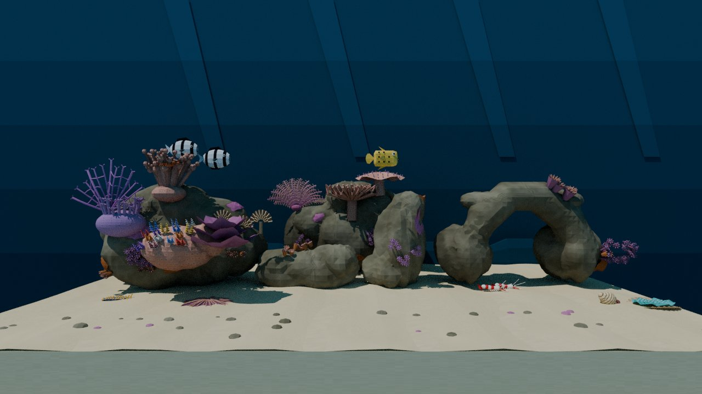
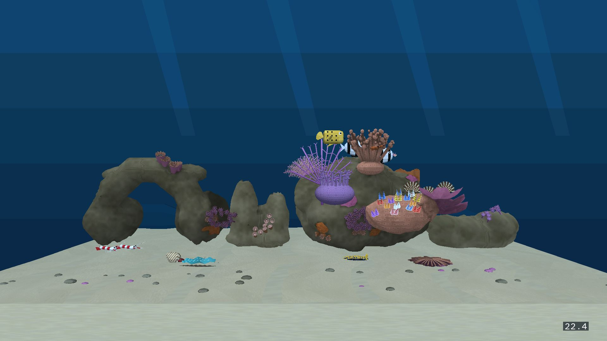
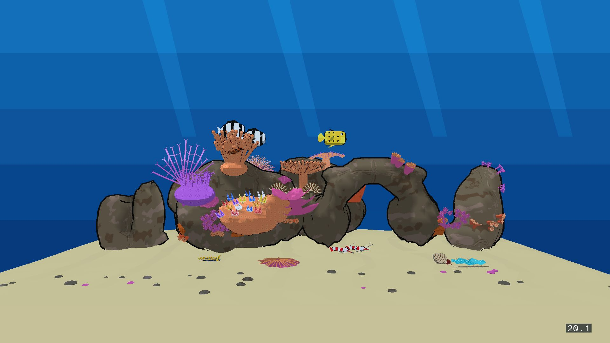

# Reef W5c: the Forth layout (2026‑11‑09)

This is the evidence for W5c of the [reef plan](../../plans/2026-11-08-reef-tanks-finish.md): the Director lays out the kit (W5b) at level entry, from ReefSettings. **The Layout default stays Fixed.**

## What the Director does

The code is [`reef/layout.py`](../../../wflevels/aquarium_thai_reef/reef/layout.py), which generates Forth from `actor-map.json`'s `kit` section at export. `generate.py` puts that Forth into the Director script.

- **Tables.** The data is compiled into the zForth dictionary at load:
    - per module: Fixed pivot, park position, footprint half-width, collider half-depth and role;
    - 16 site points per module, each with its clump orientation precomputed for heading 0 and for heading ½;
    - the clump actor and cell lists.

    Cells are stored in zForth's fixed 5-byte cell form (`,j` / `!j` / `@`), because typed memory access is off in this build. Nothing ray-casts at run time.
- **Order each tick:** `reef-poll` (the W5a settings poll, now its own word) → `reef-layout?` → the reactions. So the first tick already runs on the layout.
- **When the layout runs.** `reef-layout?` re-runs the layout on the first tick and whenever Layout, Rocks, Colonies or Seed changes (cells 860–863 against the applied copy in 870–873).
- **Layout = Fixed** shows the three heroes at their Fixed pivots, with every displacement 0. It hides and parks the fillers and clumps. This is today's reef: every position it writes equals the cooked one (tested).
- **Layout = Random:**
    1. **Seed.** Seed 0 draws `random` and keeps that seed (cell 875) while Seed stays 0, so changing Colonies does not change the rocks. Any other Seed calls `seed-random` with it. The generator then discards 16 values, because xorshift's first outputs barely differ for neighbouring small seeds.
    2. **Modules.** Rocks N = 1–5. With N ≥ 3 all three heroes show, plus N − 3 seeded fillers; with N < 3, N seeded heroes.
    3. **Front row:** the shown modules (with N ≥ 4, all but the right hero), in seeded order with seeded gaps of at least 0.3 between footprints (0.85 × the rock's half-width), x within ±5.6, pivot y 0.5–0.6. Heroes take heading 0; fillers take 0 or ½ revolution.
    4. **Back row (N ≥ 4):** the right hero (table coral, barrel sponge, leather coral; it has no reactions), centred behind the front fillers so its corals show above them. Pivot y 2.15–2.2, heading 0.
    5. **Placement.** Every piece of a module, its collider and its attached animals (at their baked offsets) are written once, and its cell is set. A hidden hero's collider waits at z = −4 under its Fixed pivot. A hidden filler waits at its park position. Both are inside the room box.
    6. **Colonies.** Sparse, Normal and Dense show 1, 2 and 3 clumps of each kind (3, 6 or 9). It is a founder-and-lineage scheme, after the Planted Tank's:
        - each kind's first clump goes on a seeded random free site;
        - each further clump goes on the free site nearest a random earlier clump of its kind, within 1.3, or becomes a new founder.
        - Sites come from the shown fillers when any show, otherwise from the shown heroes.
        - Each clump gets rotation A, B, C (C = 0) in revolutions, written in order, which turns its local +z onto the site normal.
- **Reactions** follow their hero through its displacement (cells 904–909), and are skipped while the hero is hidden (cells 880–882):
    - left hero: worm mouths, feather dusters, guard crab, nudibranch path, humbugs;
    - arch: giant clam, cleaner station and shrimp (cleaning needs the arch), hermit crab.
- **Lane and spawn.** Every front collider's front face stays at y ≥ −0.25, so the boxfish's patrol lane (`screensaver_player.fth`: x ±3.3, z 2.2–2.8, y about −0.5) and its spawn (0.7, −0.5, 3.53) stay clear. This is tested for 3–5 rocks over several seeds.

**Mailboxes.** These need adding to the plan's allocation table:
- 870–875: applied settings, laid-out flag, seed in use;
- 880–909: module shown, pivot x/y, heading, hero displacement;
- 910–960: layout scratch;
- 200–205 and 210–218: visibility cells (W5b).

The W5b guard cell 1112 is no longer used.

## Deviations from the brief

- **Five rocks do not fit one row.** The 12-unit tank holds about 11.2 units of footprint, and the three heroes alone take 10.0. With 4 or 5 rocks the right hero therefore stands in a back row, and the fillers stand in front.
    - My first version put the fillers in the back. The renders showed them completely hidden, so I changed it.
    - The back hero can be largely hidden behind the left rock, for example in the realistic device capture below. Its corals show when it lands behind the low fillers.
- **Footprint = 0.85 × the rock's half-width.** Neighbouring rocks may touch or overlap slightly at their lumpy edges, as today's left rock and arch do in Fixed. Their footprints never overlap. Using the full mesh width would not fit three heroes in the tank.
- **Humbugs** stay visible when the left hero is hidden (they are fish). They follow its displacement when it shows.
- **The random words** (`random`, `seed-random`) were added to the species-VM fixture in `tests/test_species_movement.py`, and to `tests/species_vm.c` together with `property-int-bytes@` and the `dumpa`/`dumpg`/`rng` commands, so the VM can run the layout.
- **`scripts/level_asset_links.py` now makes relative links.** The reef's Dream screensaver variants could not be rebuilt in the container: their mesh links pointed at the host path (`/home/will/…`), which is broken under `/src`, so textile failed. Relative links resolve in both places, and a stale absolute link is replaced.
- **The Forth word `reef-kit-init`** (W5b) is replaced by the layout. One W5b test was adjusted to match, and so was one W3 test: worm mouths are now emitted with the left hero's displacement (`x 904 tk@ + y 907 tk@ + z i reef-worm`).

## Tests

`tests/test_thai_reef_layout.py` (new, 14 tests) runs the exported Director in the real zForth VM. It passes on both styles (14 + 14):
- Fixed is the reviewed reef;
- Rocks 1–5 show the right modules (heroes first while Rocks ≥ 3) with heroes at heading 0, fillers at 0 or ½, no footprint overlap, everything inside the room box, and unused modules hidden and parked;
- the same seed gives the same reef and another seed gives another;
- Seed 0 draws a seed and keeps it across a Colonies change;
- Colonies shows 3, 6 or 9 clumps, each on a site point and turned out of the rock;
- anchors and attached animals follow their modules;
- the patrol lane and the spawn stay clear;
- neighbouring seeds pick different rocks.

**The reef suites** (`test_aquarium_thai_reef`, `_settings`, `_skins`, `_placement`, `test_species_movement`, `test_aquarium_menu`, `test_aquarium_screensaver_input`, `test_thai_reef_kit`, `test_thai_reef_layout`): **179 passed, 4 failed**. The 4 are the same ones that failed before W5b:
- the host-built worm harness;
- two menu-Taskfile tests;
- one screensaver-variant import.

## Review renders

The renders are made from the layouts the exported Director computes in the zForth VM ([`layout-dump.py`](layout-dump.py) → [`layouts.json`](layouts.json)), with the cooked meshes placed by [`render-layout.py`](render-layout.py). They use the wide camera, CPU Cycles and a matte material, so they do not show the engine's lighting.

| | Seed A | Seed B |
|---|---|---|
| Fixed |  | |
| 1 rock |  |  |
| 3 rocks |  |  |
| 5 rocks |  |  |

**Colonies sweep** (5 rocks, seed 41):

| Sparse | Normal | Dense |
|---|---|---|
|  |  |  |

The clumps are small (cups 6.5 cm radius, crusts about 24 × 16 cm in world units), so the sweep differs only in detail at the wide camera.

## cast1: Random, 5 rocks, Dense

**Probe.** [`probes/build_r5.sh`](probes/build_r5.sh) builds the W5c levels with the ReefSettings defaults flipped in the probe only: Layout Random, Rocks 5, Colonies Dense, Seed 0, so each entry draws a new reef.
- APK: the 2026‑11‑07 release APK with `cd.iff` swapped and debug-signed. Its libraries predate the rotation fix `4ca61197`; the layout writes A, B and C in order for each actor, so the old behaviour gives the same pose.
- Protocol: the same as P0–P4, 120 s wide-idle window.
- Jobs are in [`probes/jobs-r5.tsv`](probes/jobs-r5.tsv) and per-run figures in [`results-r5.txt`](probes/results-r5.txt).

| Style | Runs (FPS) | Median | Gate (≥ 20) |
|---|---|---:|---|
| Realistic | 22.30, 22.09, 22.11 | **22.11** | pass |
| Anime | 20.56, 20.52, 20.31 | **20.52** | pass |

Wide captures from the runs (each a different random reef):

| Realistic | Anime |
|---|---|
|  |  |

**Device:** cast1 was restored to `30554973…` by install job J‑915bbc52760a, verified `14e87026…` → `30554973…`. It reports `Idle · nothing queued (ready)`. The Pixel was not used.

## Rebuilt

These were rebuilt from the final generator:
- both reef levels (`task --force aquarium-thai-reef-level`, `… -anime-level`; both budget checks ok);
- the Aquarium menu bundle (`wflevels/aquarium-menu-cd.iff`, with the other tanks at HEAD);
- the reef's Dream screensaver variants (`scripts/build-aquarium-screensaver-levels.py aquarium_thai_reef aquarium_thai_reef_anime`, with the ReefSettings catalog check passing).
