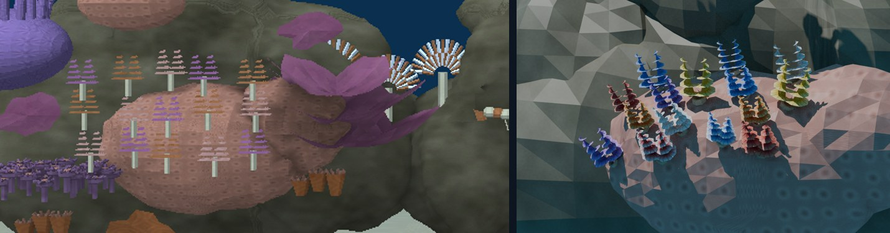
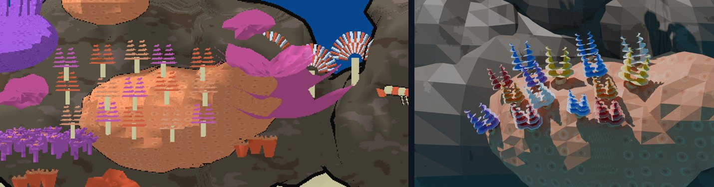
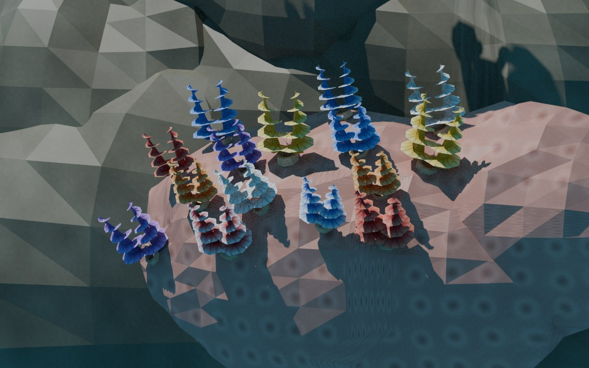
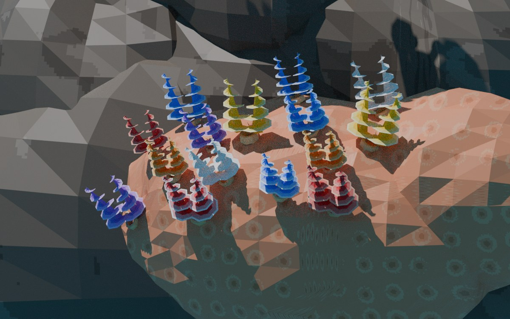
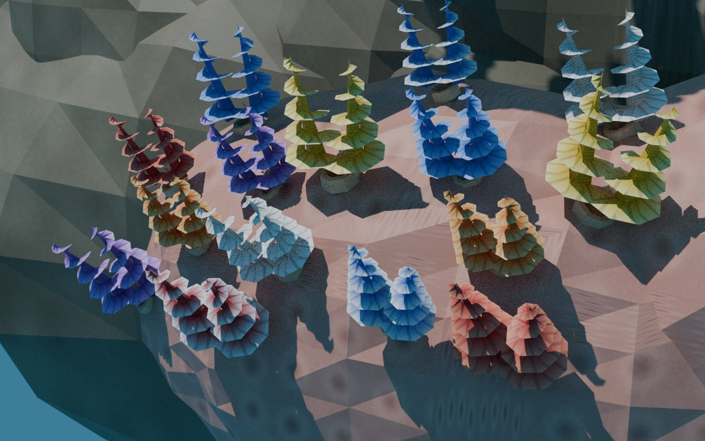
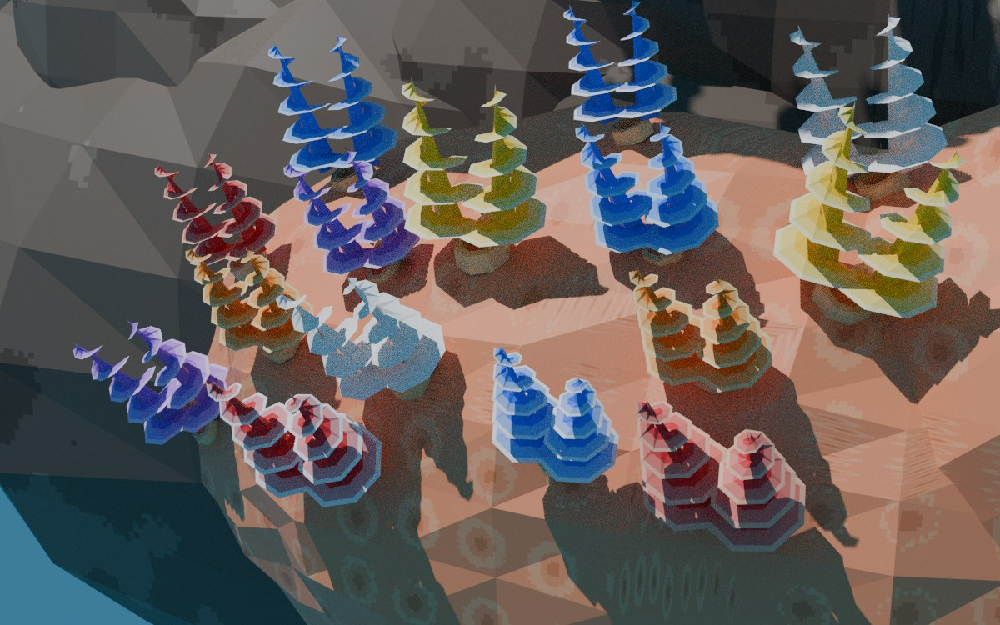
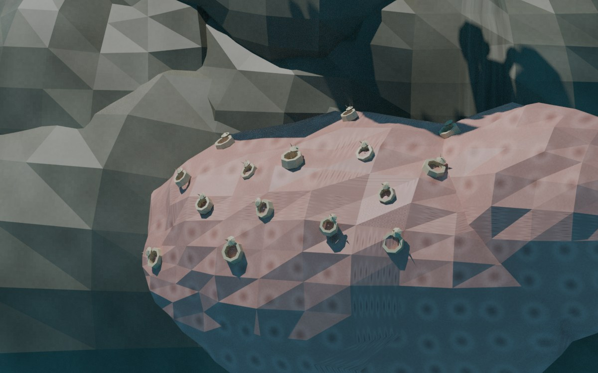
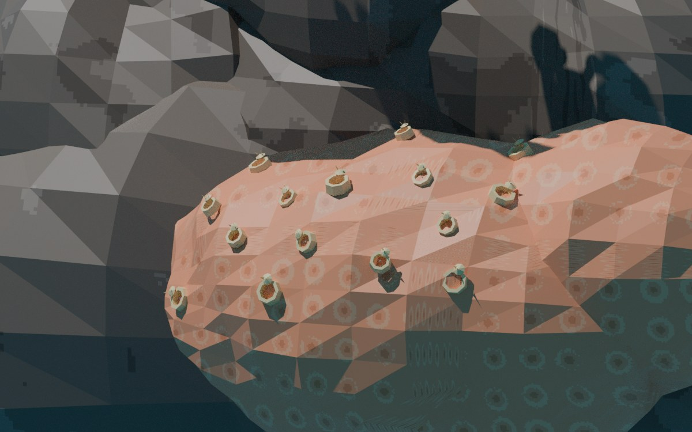

# Christmas tree worms, rebuilt: review, 8 November 2026

W1 of the [reef finishing plan](../../plans/2026-11-08-reef-tanks-finish.md), for Will's review. Will, 2026‑11‑08: "work on the christmas tree worms part only and let's review when done". D1–D4 accepted ("D1-D4: all yes").

> [!NOTE]
> The new views below are **Blender renders** (CPU Cycles, the static bake's sun, both styles' real reef atlases) of the generator's own meshes and UVs. They are **not engine captures**. The desktop engine could not run in a container on this machine: the host `engine/wf_game` needs glibc 2.43, the linux-test image has an older glibc, and the Blender image has no GL. Engine views need a device run (Pixel or Lenovo, through the coordinator), using the close-up variants that [`build-worm-views.sh`](build-worm-views.sh) builds.

## Before and after

Left: cast1 this morning. Right: the rebuilt worms, rendered from the direction of the game's wide camera, zoomed onto the boulder.





## Open, close and retracted

| | Realistic | Anime |
|---|---|---|
| Wide direction, open |  |  |
| Close ¾ view |  |  |
| Retracted (every crown at scale 0.02) |  |  |

## What changed

| Defect reported | Fix | Where |
|---|---|---|
| Flat "pine trees" on white pegs | Two spiral cones per worm: a thin core plus a two-sided helical ribbon of radioles, 4.5 turns. A static calcareous collar and a spined operculum sit on the coral. No stalk | `reef/life.py` `worm_crowns`, `worm_collars` |
| Rigid 5 × 3 grid floating 9–14 cm in front of the boulder | Seeded dart throwing on the Porites surface (same relief function as the coral), ≥ 0.14 apart, on camera-facing, upward-facing, non-flank surface, clear of the scroll coral | `reef/scene.py` `worm_mouths` |
| All crowns pointing straight up | Crown axis = normalize(surface normal + 0.7 up), always within 37° of the normal | same |
| Tan, pink and lilac borrowed tiles | Eight colour morphs (D1) in a new worm cell of the repacked 16-cell atlas (D2). Neighbours never share a morph; the anime atlas uses 3 tones | `reef/atlas.py` |
| Retract pulled the whole worm toward a point 15 cm below it | Each curve is rooted at its tube mouth along the crown axis. Scale 0.02 collapses the cones into the mouth; collar and operculum stay | `reef/worm_rig.py` |
| Anchor table out of step with the placement | `tree_worms` anchor = actor origin = centroid of the mouths; the director reads the mouths | `scene.py`, `generate.py` |

**Numbers.** Crowns are 4,920 triangles (budget 5,000, D4: true to life at ×10, 0.15–0.20 units tall); 15 animated actors, unchanged. Collars and opercula add 900 static triangles to `reef_hard`. Static totals are within 70,000 and the anime hull within 24,000.

**Side effect of the atlas repack (D2).** The existing surface tiles were 256 × 512 texels mapped to a square world period, so their patterns were squashed 2:1 vertically. As 256 × 256 cells they are now isotropic: polyp calices and sponge pores read as round. Every reef mesh re-exports for this reason.

## Tests

- `tests/test_thai_reef_placement.py` (new, 11 tests): mouths on the coral surface, facing and spacing rules, morph alternation, crowns no more than 1 cm into the coral, UVs inside their morph rows, anchors, and the built levels' director lines and DFRM curve roots.
- `tests/test_species_movement.py`: the worm reaction test now takes positions from `worm_mouths()`. The old version hard-coded the grid.
- `tests/test_aquarium_thai_reef.py`: unchanged; passes.

## Found on the way

- **Exporter bug, since 2026‑11‑03.** `wftools/wf_blender/export_level.py:777` unpacked three values from the four-value `split_verts` introduced by `09e9ff33` (vertex-light bake). Every Blender-rigged DFRM mesh failed to export, so the plants level would not build. It is fixed as its own commit.
- **Stale tank outputs.** The menu task rebuilds every tank. The other eight tanks' committed `.lvl` files date from 2026‑10‑25, before the 2026‑11‑02/03 object-definition changes, so every rebuild changes them. That rebuild left 25 of their files modified in the working tree. They are **not committed** and await Will's decision: either restore them, or commit a deliberate re-cook of all tanks. `wflevels/aquarium-menu-cd.iff` is in the same state.

## Reproduce

```sh
task aquarium-thai-reef-level && task aquarium-thai-reef-anime-level
python3 -m pytest -q tests/test_thai_reef_placement.py tests/test_aquarium_thai_reef.py tests/test_species_movement.py -k "reef or worm or thai"
WF_CONTAINER_IMAGE=blender scripts/in-linux-container.sh \
  blender --background --python docs/diagnostics/reef-worms-2026-11-08/render-worms.py -- build-docker/reef-worm-render
bash docs/diagnostics/reef-worms-2026-11-08/build-worm-views.sh     # close-up level variants for a device run
```
