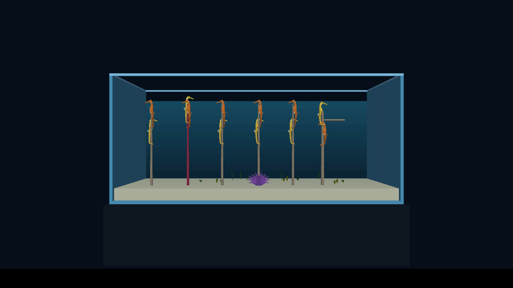
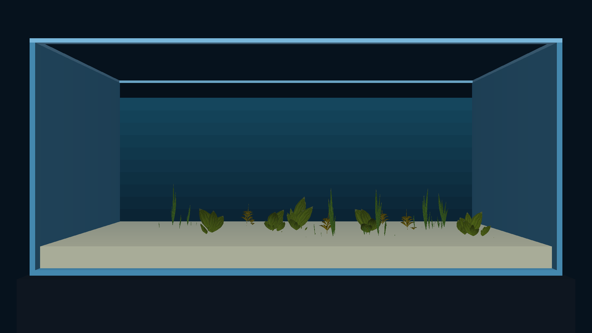

# Runtime object editing: cast2 closeout

11 November 2026. The engine migration is `cd6b9e9e`; documentation and
coordinator Task updates are `11744a1b`. All tests use coordinator-owned sessions.
The device's original Seahorse Grid screensaver selection was read before the
checks and restored afterward.

## Current screensaver APKs

Both current APKs include arm64-v8a and armeabi-v7a. Their bundles contain no
RPRP catalog. The Planted capabilities asset uses owner 31 and OAD field IDs;
Seed is capped at 2,147,483,647 and Hold seconds remains available.

| Check | Coordinator jobs | Result |
|---|---|---|
| Read original selection | J‑91e1b8744a8e | Seahorse Grid |
| Aquarium install | J‑a137b65d3d93 | Completed |
| Planted install | J‑dca7b0d59d3e | Completed |
| Aquarium select / preview / capture | J‑711baf940721 / J‑84599db72fb1 / J‑01c876d2873d | Rendered tank; image inspected |
| Planted select / preview / capture | J‑8354032840b9 / J‑c668d148ab47 / J‑05cea4930ba2 | Rendered growing plants; image inspected |
| Restore selection | J‑8b3d27d08343 | Seahorse Grid restored |

The Planted provider read-back is in `planted-select.log`. It reports owner 31,
Seed wire ID `31.129`, maximum `2147483647`, and Hold seconds. Full downloaded
coordinator receipts remain in the job-named directories under `docs/diagnostics/`.

## Fresh gameplay recording

The earlier queued recording J‑897f46fd7891 completed, but used a pre-migration
APK. It is retained as historical evidence and is not the final-build acceptance.

The fresh APK and SHA-256 are recorded in [game-apk.json](game-apk.json).
It includes both ABIs and the migrated menu bundle with no RPRP catalog.
[held-input-recipe.json](held-input-recipe.json) enters the planted tank, holds
Right, Left, Up and Down for three seconds each, releases each direction, and
captures the scene again at 40 and 46 seconds after all input is released.
Final recording: J‑2a9de06204d9. Its result is pending: coordinator control became unavailable for all devices
before it could start. Do not count the historical recording as this check.

## Scope of closeout

The migration's native tests, baseline/screensaver tests, phone tests, bridge
checks, both-ABI Android builds and cast1/cast2 screensaver previews have passed.
This does not close the separate baseline Pixel/forms/runtime-options acceptance,
Planted exact-timing/soak gates, fixed-size string OAD work, or real-OAD Editor
Label follow-up. Those retain their own TODO items.
