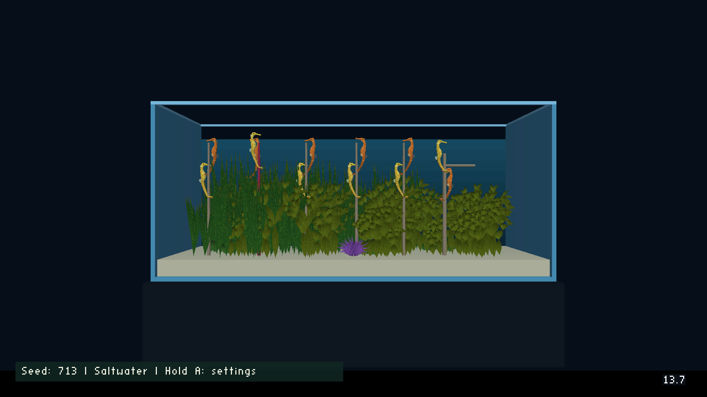

# Six seahorse pairs on cast1

16 October 2026. Will requested four additional pairs: six pairs, twelve residents.

- All 88 focused asset, settings, complete exported-script, behavior and tail tests passed (203.43 s); see [test log](tests.log).
- Settings cover None through six pairs, default six; freshwater hides all residents and posts.
- Four new vertical holdfasts provide separate entry homes for the added pairs.
- State uses existing level mailboxes, excluding HUD slots 70–72 and 1800–1899. The last resident redirects three cells to 1112–1114; the actor map records this layout. No engine code changes.
- The permanent pool is 6 MB. A desktop assertion demonstrated that the previous 3 MB pool was too small for twelve residents on 64-bit builds.
- Cast1 check J‑767e9ce236c4 completed successfully. Its screenshot was inspected with all residents and posts rendered. The current level-load log has no Forth compile/evaluation errors, DFRM load failures or allocation errors matching the recorded scan.
- The app log is cumulative. Earlier compile errors in it belong to older sessions. The [scoped current log](current-run-wf.log) begins at the latest level-load Forth initialization and includes this run's saltwater settings. [Log check](log-check.json) records the complete downloaded log's hash and the scope used.
- The [frozen APK receipt](variants.json) identifies the corrected build. It keeps the verified normal-convention native libraries, rebuilds the selector, and sets six pairs, seed 713, saltwater, age 150 and growth paused.
- The full corrected check evidence is in `engine/objs_game/.tmp/seahorse-six-pairs/device-fixed`. Re-download with `task chromecast:evidence JOB=J-767e9ce236c4 OUT=...`.
- First recording J‑a4b8d6aee65f supplied preliminary render evidence; the corrected build was checked after the pool and mailbox fixes. Final demo J‑87f711215525 shows that corrected build for two minutes.
- Desktop virtual-display runs subsequently loaded and stepped the corrected level without an assertion or Forth error. Early attempts failed for environmental reasons (missing display and host/container glibc mismatch); a capture during the full `/tmp` filesystem is unusable. Cast1 supplies the inspected image.
- This is a correctness and visibility check, not a performance benchmark.

