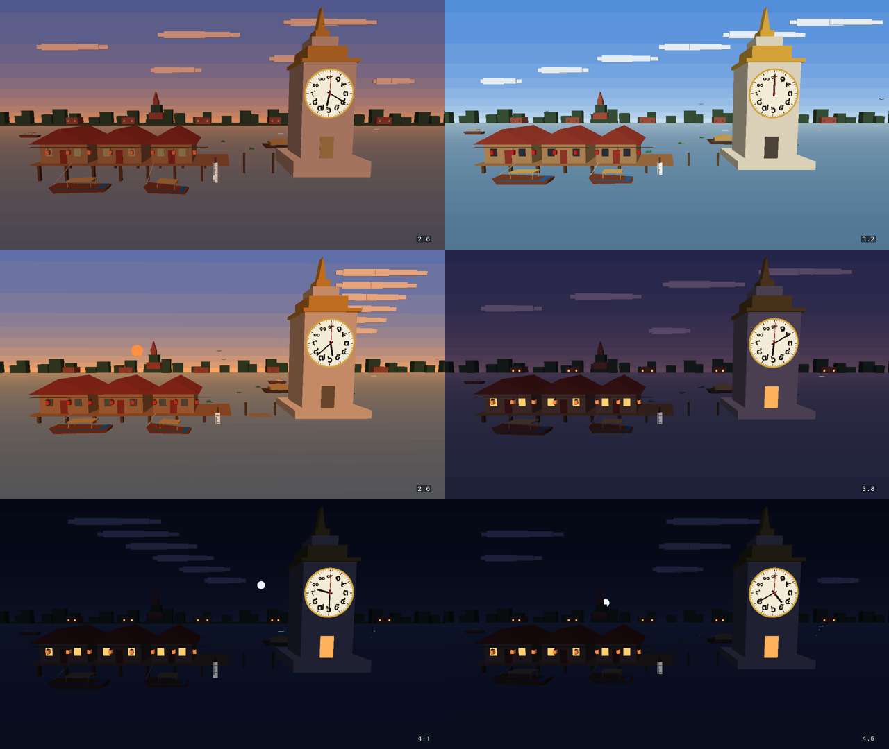
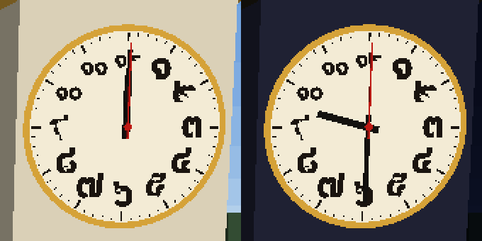

# Tide Harbour Phase 2 on the desktop engine — 2026‑11‑21

Plan: [Tide Harbour](../../plans/2026-11-21-tide-harbour-clock.md), Phase 2 and Verification 3 and 8 (desktop half). Level: `wflevels/tide_harbour-standalone.iff`, built by `bash wflevels/tide_harbour/build.sh`. Engine: the container's Debug and ASan `wf_game` (`scripts/build-wf-game-container.sh --dev`), drawn by Mesa's software GL under `xvfb-run` at 1280 × 720. **This is not a Chromecast measurement:** the frame-rate figure in each capture's corner is software GL in a Debug build and means nothing for cast1, and the colours are Mesa's, not the TV's.

## The six moments

`python3 scripts/check-tide-harbour.py --capture docs/diagnostics/tide-harbour-phase2-2026-11-21/moments` (the wall clock frozen with a dated `WF_WALL_CLOCK`, Thai time, eight frames stepped before each screenshot).



| Capture | Thai time | Tide (model) | Sun altitude | What it shows |
|---|---|---|---|---|
| [`20261117T062000.png`](moments/20261117T062000.png) | 2026‑11‑17 06:20 | 1.36 m (low) | −0.5° | dawn: warm horizon, windows going out |
| [`20261121T120000.png`](moments/20261121T120000.png) | 2026‑11‑21 12:00 | 2.55 m | 56.5° | noon: the authored day colours, nothing re-coloured |
| [`20261121T173800.png`](moments/20261121T173800.png) | 2026‑11‑21 17:38 | 2.63 m | 1.4° | the sunset: the sun's disc setting behind the far bank's temple, south of west |
| [`20261121T181000.png`](moments/20261121T181000.png) | 2026‑11‑21 18:10 | 2.59 m | −5.9° | dusk: windows, lanterns and the tower arch lit |
| [`20261121T213000.png`](moments/20261121T213000.png) | 2026‑11‑21 21:30 | 1.96 m | −52.7° | night: the moon up, the dial bright |
| [`20261124T044000.png`](moments/20261124T044000.png) | 2026‑11‑24 04:40 | 2.56 m | −24.3° | deep night at another tide |

The dial at noon and at 21:30, enlarged four times (Thai numerals, D8):



**What is wrong with them, honestly:**

- **The lower half of every frame is empty water.** The water bars no longer show seams (the light now strikes tops and camera-facing fronts equally), but the near-to-far colour change and the waves are too faint to see, so the foreground reads as a flat grey or blue plane. The concept art fills that space with boats and reflections.
- **The tide is not readable from the gauge board at this framing**: the board is a few pixels wide. The water level against the stilts and the raft does change between captures, but only by looking closely.
- **The dial's digits are small**: about 13 px tall at 720p, so about 20 px on a 1080p TV, and ๑๐, ๑๑ and ๑๒ are drawn smaller than the single digits so that they fit between their neighbours. Legibility across a room is not measured (D8's TV-distance check is Phase 4).
- **The light ignores direction**: the look depends only on the sun's altitude, so at dawn the west sky (in front of the camera) glows warm although the sun rises behind the camera.
- **The sky is ten flat bands** and they show as steps at dusk, as the water bars did before.
- **Boats, ropes and birds are small**; the birds are barely visible.
- The first build's numerals were broken (pieces of ๓ and ๙ missing, from concave n-gons the exporter triangulates as fans) and every moving actor was at the origin (the export read a stale `matrix_world`); both are fixed, and the second has a test.

## The engine against the model

`scripts/check-tide-harbour.py --compare --options` in the Linux container under `xvfb-run` (what `task check-tide-harbour` runs after building the engine), raw output:

```
2026-11-21T10:08:22 : 87 actors; tide 2.3562 m (model 2.3562); worst position 0.022 mm (bird_1/3009), rotation 0.005 deg (lantern_7/3013), scale 0.00001 (bird_5/3042)
2026-11-21T17:40:00 : 87 actors; tide 2.6276 m (model 2.6276); worst position 0.081 mm (cloud_5/3009), rotation 0.005 deg (raft/3012), scale 0.00000 (rope_1/3041)
2026-11-21T18:12:30.5 : 87 actors; tide 2.5821 m (model 2.5821); worst position 0.045 mm (bird_2/3009), rotation 0.005 deg (bar_31/3012), scale 0.00001 (bird_1/3042)
2026-11-21T23:59:59.9 : 87 actors; tide 1.7738 m (model 1.7738); worst position 0.301 mm (bird_2/3009), rotation 0.006 deg (lantern_1/3013), scale 0.00001 (bird_3/3042)
2026-11-22T00:00:00.4 : 87 actors; tide 1.7738 m (model 1.7738); worst position 0.014 mm (bar_14/3010), rotation 0.005 deg (boat_0/3014), scale 0.00000 (glint_1/3040)
2027-03-02T02:45:00 : 87 actors; tide 2.5899 m (model 2.5899); worst position 0.075 mm (bird_1/3009), rotation 0.006 deg (lantern_3/3013), scale 0.00000 (rope_0/3041)
2026-06-21T18:30:12 : 87 actors; tide 1.1314 m (model 1.1314); worst position 0.121 mm (sun/3011), rotation 0.005 deg (lantern_7/3013), scale 0.00000 (glint_7/3040)
2030-07-04T16:20:05.5 : 87 actors; tide 0.7815 m (model 0.7815); worst position 0.088 mm (bird_1/3009), rotation 0.006 deg (bar_31/3012), scale 0.00000 (rope_0/3041)
PASS
2026-11-21T15:02:30 {'drift': 0}: 2 actors; tide 2.8381 m (model 2.8381); worst position 0.000 mm (cs_wide/3010), rotation 0.000 deg (), scale 0.00000 ()
2026-11-21T15:02:30 {'drift': 1}: 2 actors; tide 2.8381 m (model 2.8381); worst position 0.000 mm (), rotation 0.000 deg (), scale 0.00000 ()
2026-11-21T15:02:30 {'numerals': 0}: 2 actors; tide 2.8381 m (model 2.8381); worst position 0.000 mm (cs_wide/3010), rotation 0.000 deg (), scale 0.00000 ()
2026-11-21T15:02:30 {'numerals': 1}: 2 actors; tide 2.8381 m (model 2.8381); worst position 0.000 mm (cs_wide/3010), rotation 0.000 deg (), scale 0.00000 ()
2026-11-21T15:02:30 {'numerals': 2}: 2 actors; tide 2.8381 m (model 2.8381); worst position 0.000 mm (cs_wide/3010), rotation 0.000 deg (), scale 0.00000 ()
2026-11-21T15:02:30 {'gauge': 0}: 2 actors; tide 2.8381 m (model 2.8381); worst position 0.000 mm (cs_wide/3010), rotation 0.000 deg (), scale 0.00000 ()
2026-11-21T15:02:30 {'gauge': 1}: 2 actors; tide 2.8381 m (model 2.8381); worst position 0.000 mm (cs_wide/3010), rotation 0.000 deg (), scale 0.00000 ()
2026-11-21T15:02:30 {'life': 0}: 2 actors; tide 2.8381 m (model 2.8381); worst position 0.000 mm (cs_wide/3010), rotation 0.000 deg (), scale 0.00000 ()
2026-11-21T15:02:30 {'life': 1}: 2 actors; tide 2.8381 m (model 2.8381); worst position 0.000 mm (cs_wide/3010), rotation 0.000 deg (), scale 0.00000 ()
PASS
```

The settings run writes each field's cell over the debug bridge (the settings object will write it once it exists) and checks the camera and every visibility cell against the model; each passing "Off" run differs from the default by the 6° drift or by a visibility cell, so the writes took effect. The colours the director writes (`FACE_COLOR` 3037 to 3039) cannot be read back from the engine; they are checked in the zForth VM (`tests/verify_tide_harbour_forth.py`) and seen in the captures above.

## Not measured

Everything on a TV: the frame rate (by day and at night, with 86 actors streamed after the first dusk), the 10-minute run, the banding of the water and of the sky bands at 1080p, the night colours, and the dial's legibility across a room. These are Phase 4.
