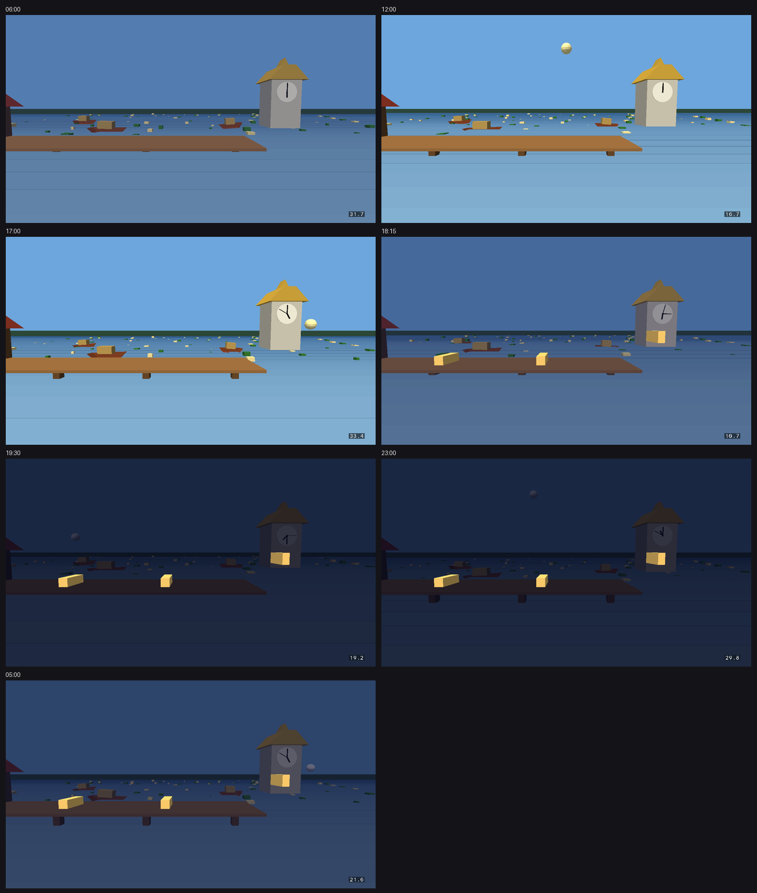
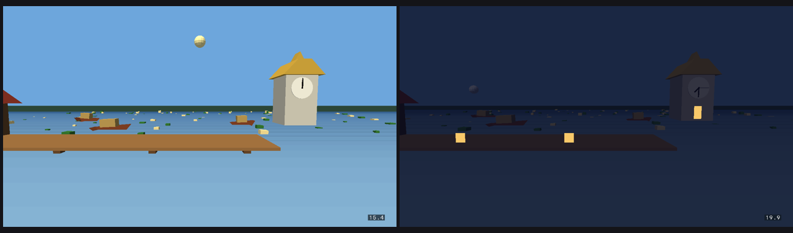
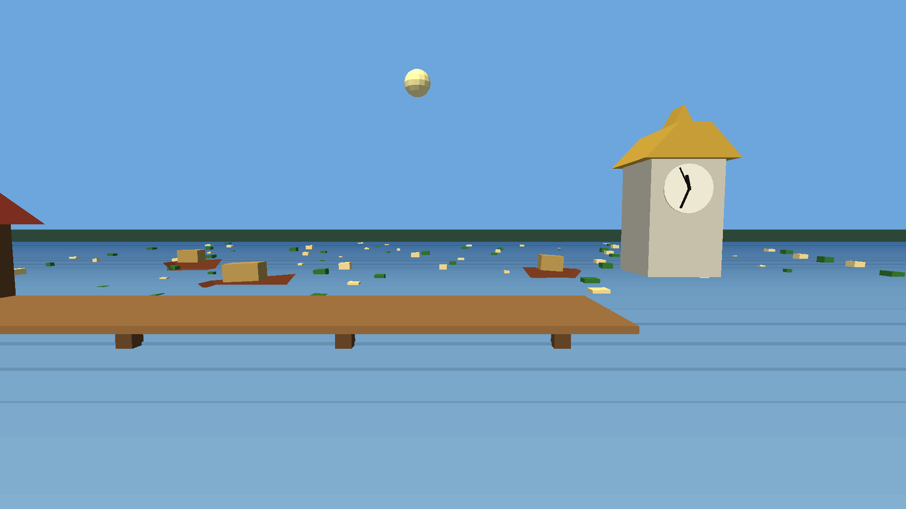
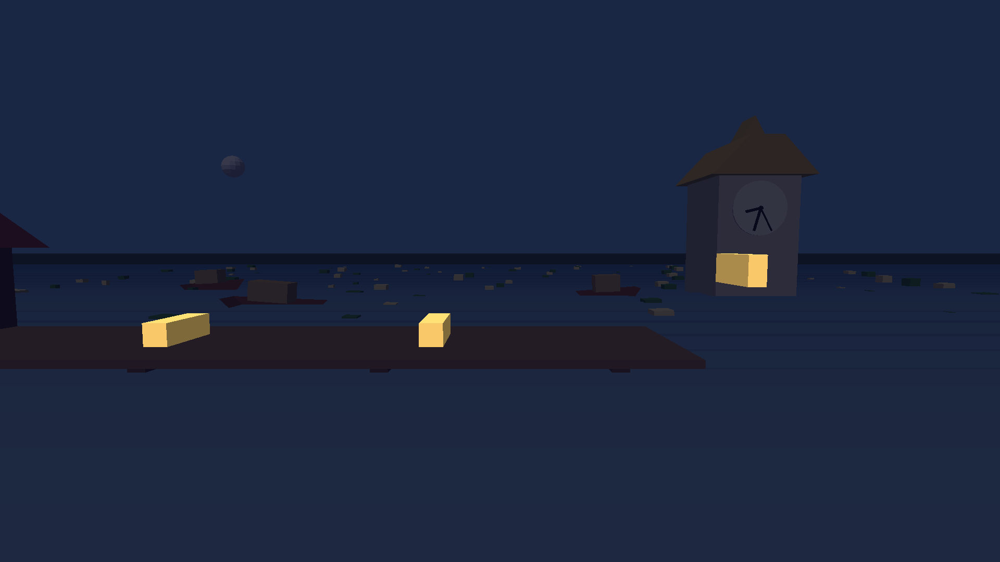

# Tide Harbour Phase 0 spike, desktop half — 2026‑11‑21

Plan: [Tide Harbour](../../plans/2026-11-21-tide-harbour-clock.md), Phase 0 (a) and (b). Sources: [`wflevels/tide_spike/`](../../../wflevels/tide_spike/spike.py). Rebuild with `bash wflevels/tide_spike/build.sh`; run with `wflevels/tide_spike/run_desktop.py` (the Linux container engine, under xvfb).

**What this is, and is not.** Four throwaway levels. The sections below this one ran in the Debug-and-ASan engine in the container, drawn by Mesa's software GL: **that is not a Chromecast measurement**, and absolute frame times mean nothing there; only the *relative* cost of one variant against another and the *look* do. The real frame rates and the look on the TV are in [The cast1 half](#the-cast1-half), measured on 2026‑11‑21 from a Release APK.

## The four variants

| Variant | Posed actors | What it tests | Median frame, ms | 90th percentile, ms |
|---|---|---|---|---|
| a | 46 | 36 water bars, 3 boats, hands, sun, moon, a few fillers | 20.6 | 31.4 |
| b | 100 | the same, with more fillers | 23.5 | 30.6 |
| c | 150 | the plan's actor budget (D7) | 35.6 | 48.4 |
| d | 150 | variant c on a fast day (240 s), with day-to-night veils and glow overlays | 33.6 | 42.9 |

Raw results are in [`desktop-runs.json`](desktop-runs.json). Every run had `director_running`, `bar_18_z_moved` true (the director's pose reaches the engine), and no engine log problems. The cost rises with the number of posed actors; variant d, with a translucent full-screen veil, is no slower than c in software GL, which says nothing about a Chromecast.

## Finding 1: day to night with no light control works

Nine translucent veils (three warm, six night blue, each a box of fixed opacity in front of the camera) and one director that shows exactly one at a time through its visibility mailbox turn the scene from day to dusk, night and pre-dawn in clean steps. Lit windows and lantern glows, drawn in front of the veils, stay bright. The director's cells matched the code at each photographed hour (18:15: darkness 0.50, veil 5; 19:30: darkness 1.0, veil 9; 05:00: darkness 0.80, veil 7).

What the captures also show, for the plan:

- the tower **dial is dimmed** at night and its hands are hard to read; it needs the same drawn-in-front treatment as the glows;
- the **moon is dimmed** too, for the same reason;
- the warm sunset veils (1 to 3) were not photographed: at 17:00 the scene is still full day and at 18:15 it is already veil 5; and there is no warm glow along the horizon, which a veil cannot give;
- **faint horizontal lines** show across the daytime water. That is the banding the spike was meant to look for; software GL at 1280 × 720 is not the TV.

## Finding 2: the guide's lighting recipe has the wrong sign

[`lighting-sweep.json`](lighting-sweep.json), from [`measure_lighting.py`](../../../wflevels/tide_spike/measure_lighting.py). Five sun settings (the pale-blue sky box and ambient 0.5 are the same in all); each number is how lit a face of known normal is (rendered colour ÷ authored colour; 0.50 is ambient alone):

| Euler B, C (degrees) | pier top (+z) | pier front (−y) | tower left (−x) |
|---|---|---|---|
| −50, −70 (what `docs/level-building.md` said) | 0.50 | 0.50 | 0.68 |
| +40, +90 | 1.00 | 1.10 | 0.52 |
| −50, +110 | 0.50 | 0.97 | 0.52 |
| +50, −70 | 1.10 | 0.50 | 0.68 |
| +50, +110 | 1.10 | 0.97 | 0.52 |

All fifteen readings agree with one rule: a face is lit when its normal opposes the vector (cos B·cos C, cos B·sin C, −sin B). So **B = +alt tilts the light down**, the reverse of the sign in the guide. The guide's text was measured on 2026‑09‑20 and the engine's face-normal hand was reversed on 2026‑10‑16; that is the likely cause and was not tested. [`level-building.md`](../../level-building.md#lighting--every-level-needs-directional-and-ambient) and the [troubleshooting guide](../../level-design-troubleshooting.md) are corrected.

An earlier version of this sweep gave identical results for every setting, because the knob never reached the Blender container (the build forwards only `TANK_*`, `AQUARIUM_*`, `LIONFISH_*`, `BETTA_*`, `PLANTED_*` and `SHRIMP_*`). That is now a troubleshooting entry too.

## Finding 3: a zero-thickness quad is not invisible

The troubleshooting guide says a mesh too thin along the camera's depth axis can be invisible. Variant d was rebuilt with the sky, all nine veils and all seven glows as **single quads** ([`TANK_SPIKE_QUAD=1`](../../../wflevels/tide_spike/spike.py)), wound counter-clockwise as seen from the camera. At 19:30 the sky and water regions are the same RGB as the box build (26, 39, 67 and 30, 41, 65), the glows show, and the veil dims the scene as before ([run](zero-thickness-quads-run.txt)). Minute Machine's 8 mm cards, thin along the same axis, render on the TV. So thickness is not the cause of the guide's invisible coin; that entry is corrected.

## The cast1 half

Chromecast HD (`chromecast-test-01`, armeabi-v7a), the Release APK `screensaver-tidespike-release.apk` (4 201 103 bytes, sha256 `e0829f04…ffa7f`), the coordinator's `profile` workflow. Display refresh 59.94 Hz (16.683 ms). One activity per variant (`TideSpikeActivity`, `…BActivity`, `…CActivity`, `…DActivity` play levels 0 to 3); the layer name in each run's `summary.json` names the activity that was measured. Variant a: 3 runs of 60 s after a 10 s warm-up; b, c and d: 2 runs of 30 s after a 10 s warm-up, shortened on Will's direction not to hold cast1 for long.

| Variant | Posed actors | Median FPS | Runs (FPS) | Missed refreshes | Worst frame |
|---|---|---|---|---|---|
| a | 46 | **59.46** | 59.49, 59.46, 59.17 | 0.76%, 0.81%, 1.30% | 33.4 ms |
| b | 100 | **59.31** | 59.25, 59.38 | 1.17%, 0.95% | 33.4 ms |
| c | 150 (the plan's budget, D7) | **59.29** | 59.44, 59.14 | 0.84%, 1.35% | 33.4 ms |
| d, morning | 150, fast day; no veil showing yet | **58.01** | 57.75, 58.26 | 3.80%, 2.88% | 33.4 ms |
| d, night | 150; dark veil and lit-window glows on screen | **29.97** | 29.97 (one run) | **100%** | 33.4 ms |

Variants a to c hold the display's refresh rate to within about 1.3%, and the three do not differ by more than the run-to-run spread (about 0.3 FPS), so the table shows that they do not differ visibly, not that more actors are free.

**Variant d in the morning says nothing about the veil.** The fast day starts at 06:00 at launch and runs 10 s per hour, and the day-time runs measured the first minute: one veil of nine is shown at a time, and none is shown by day. Its 1.3 FPS and the extra missed refreshes against c are the cost of the glow and veil actors being in the scene, not of drawing a veil.

**At night the frame rate halves.** One run of 30 s with the dark veil and the seven lit-window glows on screen (frames below): 909 frames, **every interval 33.4 ms** from the first to the last (p50, p99 and worst are all 33.37 ms), 29.97 FPS, 100% of refreshes missed. The display is locked to every second refresh: drawing a frame takes just over 16.7 ms. The Android thermal status was 0 and the board temperature 38 °C, the same as in the day run, so it is not throttling. The plan's gate is 30 FPS median over 120 s (Phase 4); 29.97 is on that line with no headroom, and the cause was not isolated (the full-screen veil, the glows, or filling 1080p). That is the spike's central finding: **the veil approach (D5) as built does not leave headroom on a Chromecast HD at night.**

**The engine log is cumulative.** `wf.log` in a job's evidence contains every launch since the APK was installed: the start lines read `0,0,0` (variant a), `1,1` (b), `2,2` (c), a single `0` that I cannot attribute, then `3,3` (d), and the device's own logcat for a later job shows `start level 3`. Reading only the first two matches of a `grep` makes every variant look like level 0. One level‑0 start sits between c and d; each measured run's layer names the right activity, so the table stands.

### Daytime frames from the TV

`cast1-d-daytime-run1.png` and `cast1-d-daytime-run2.png` are 1920 × 1080 captures from the profile runs. **The water bands.** Thin darker lines cross the foreground water (at y of about 687, 728, 782 and 852 in the first frame, 683, 723, 773 and 841 in the second), and the last rows of the frame form a lighter step (from y of about 925). Each line is the seam between two of the 36 water bars, which are flat colours. It is visible on the TV from a normal distance; it was already visible in software GL ([Finding 1](#finding-1-day-to-night-with-no-light-control-works)). Which fix works (narrower bars with smaller colour steps, or per-vertex colour if the engine interpolates it) has not been tested.

### Night frames from the TV

`cast1-d-night-idle.png` and `cast1-d-night-end.png` (1920 × 1080; raw numbers in `cast1-d-night-summary.json`). The veil darkens the whole scene, the lit windows and the lantern boxes stay bright in front of it, the moon is dim, and **the tower dial is dimmed so far that its hands are hard to read**: the dial and the moon need the same drawn-in-front treatment as the glows (as in the software-GL finding above). The water bands at night as well, in the foreground below the pier (at y of about 800, 887 and 1015 in the second frame).

## What was not found or not measured

- What costs the extra frame time at night: the veil, the glows or the 1080p fill rate. Not isolated.
- The warm dusk veils (1 to 3) on the TV, and a measurement of night at 120 s or more.
- Which near plane rules: `display.cc` passes 1.0, the baseline authors a CamShot `Hither` of 0.1.
- One level‑0 engine start between the c and d measurements.
- The remedy for the water banding.
