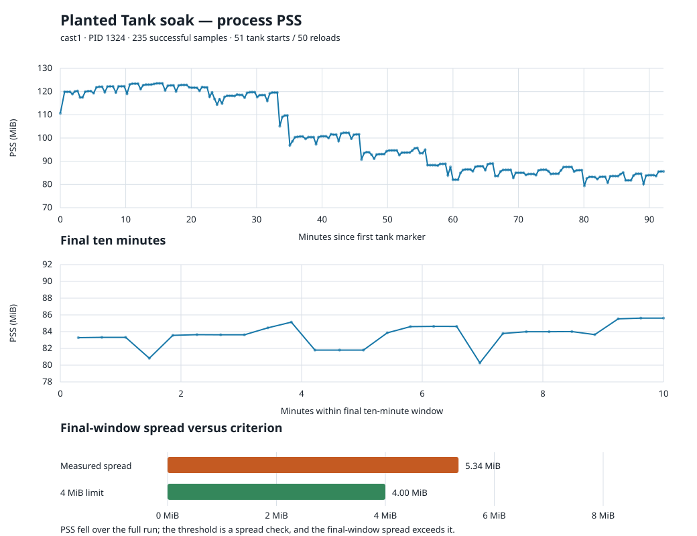

# Planted Tank device checks, 2026-11-01

## Cast1: 50 reload soak

The frozen Planted Tank APK (SHA-256 `b8bd0dae325fc16bf676c162b050bb66798c941c94a17875eb9eb82ca4da9a6b`) ran on cast1 in coordinator job J‑35043d20bf78 with `Growth speed=6` (8×), `Hold seconds=5`, and no screen recording. The owned session was ended after 51 distinct `PLANTS settings-source=RPRP` tank-start markers: the initial tank and **50 reloads**. The first marker was at 18:16:25.745 and the last at 19:47:32.827 local time. Intervals between markers ranged from 100.169 to 125.705 seconds (median 106.582 seconds). The sequence included 25 freshwater and 26 saltwater tanks.

All 235 successful process samples reported PID 1324 before and after sampling. The job completed, the coordinator restored the foreground, and a search of the captured app logs found no fatal exception, fatal signal, or ANR. These checks pass.

**The plan's PSS spread limit does not pass.** Across all 235 samples, PSS ranged from 81,315 to 126,513 KiB (45,198 KiB, about 44.1 MiB). The full-run spread is dominated by a decline over time, so it is not itself evidence of a leak. In the final ten minutes there were 26 samples, ranging from 82,200 to 87,672 KiB. Their spread was 5,472 KiB (5.34 MiB), which exceeds the 4 MiB limit (4,096 KiB) by 1,376 KiB (1.34 MiB). The final-window median was 85,728 KiB. For comparison, the median in minutes 10–20 was 125,793 KiB. The samples show no sustained upward trend, but they do not meet the specified spread threshold. Changing tank contents and Android memory reclamation could contribute to the variation; this run does not identify its cause. Keep the memory criterion open until its measurement window or threshold is reviewed and the result is re-evaluated.

[Full coordinator evidence](cast1-soak/interactive-timeline.json) contains each sample and its corresponding `input-sample-*-meminfo.txt` and `input-sample-*-logcat.txt` files. [Job receipt](cast1-soak/receipt.json) records completion and cleanup. The APK's original values were restored: [speed 6→3](restore-speed/receipt.json), [hold 5→120](restore-hold/receipt.json). [Readback](cast1-restored/screensaver.json) confirms the prior Seahorse Grid Dream selection. Cast1 was then returned to the shared pool.

## Default timing remains open

Job J‑d239b9098b4a recorded a 360-second cast1 session at 1× and a 120-second hold, but screen recording slowed frames enough for the growth clock to ignore many `delta too large` frames; it produced only one tank marker. A no-video preflight at 8× and a 5-second hold, J‑d626dce8840f, measured 104.264 seconds between two tank markers. Neither establishes the plan's exact **1× reload-to-reload interval**. The earlier Pixel run captured a reset roughly 315.7 seconds after launch, but its initial tank timestamp was lost from the log ring. See the [2026-10-30 report](../wf-device-checks-2026-10-30/README.md).

The coordinator's interactive sampler works on the TV profile; the Pixel profile does not accept owned timed input, and non-interactive video recording is capped at 600 seconds, too short for two default cycles. Cast1 was occupied by another owner's queued work after the soak. A future cast1 no-video session with periodic samples can close the exact timing check without disturbing the user's cast2 work.
