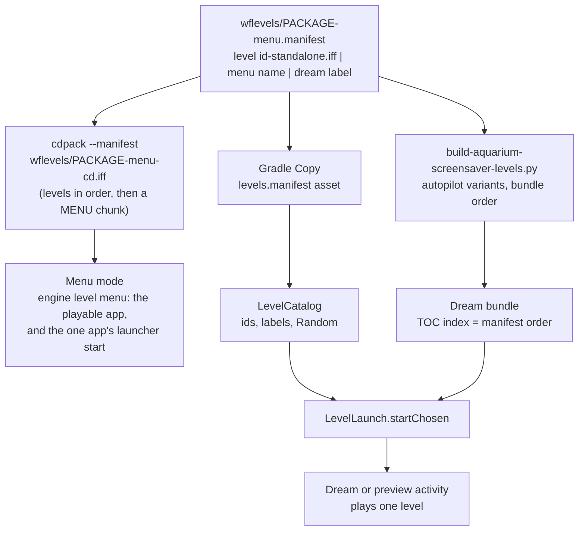
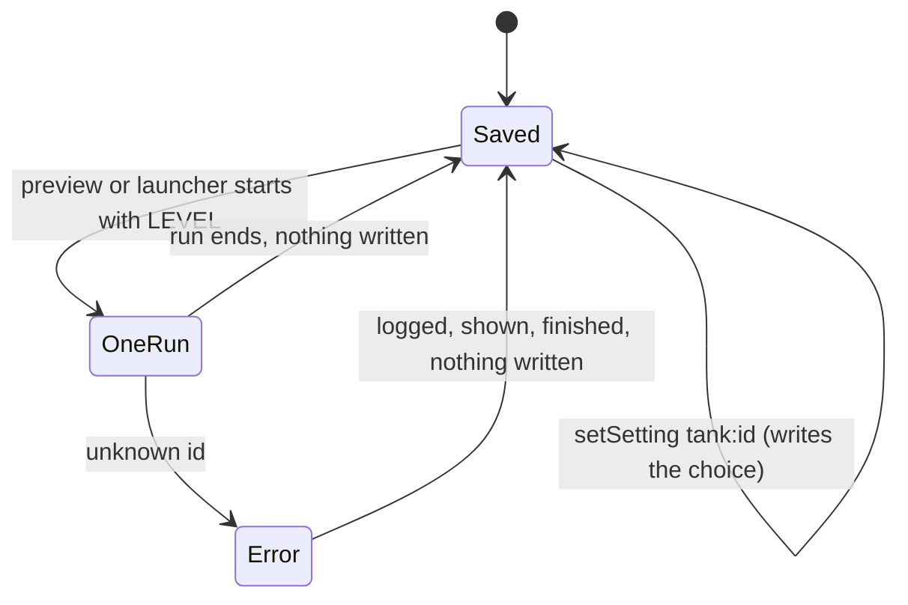
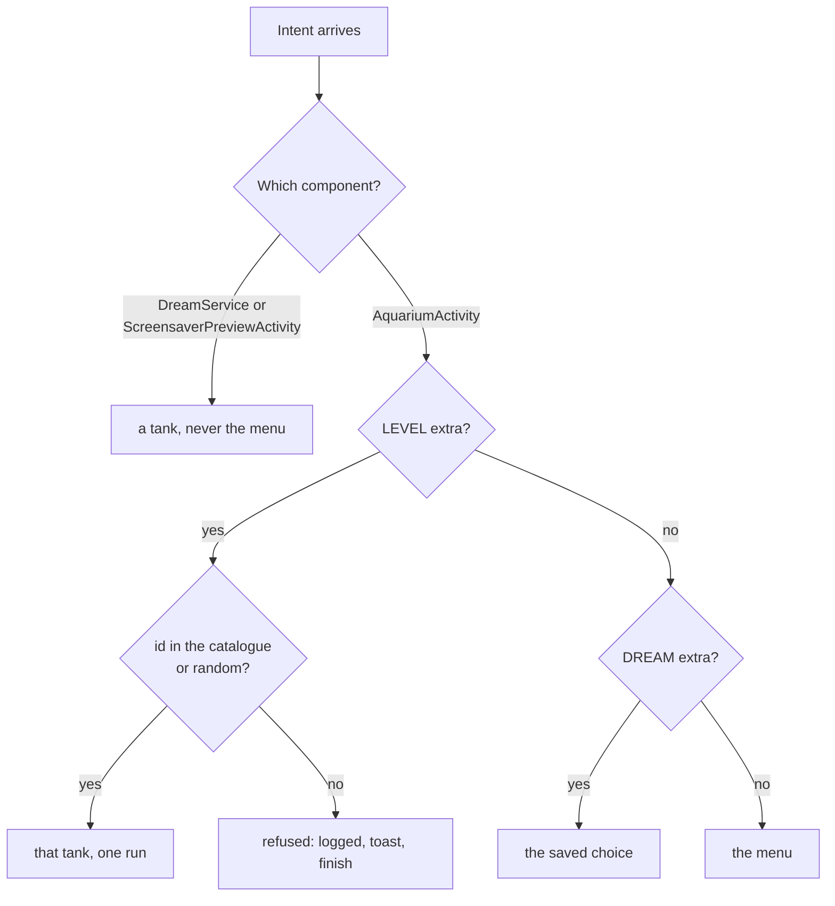

# How to combine several levels, add a chooser menu, make it one app with the screensaver, and test it

This is the recipe for a package that holds more than one World Foundry level: one bundle, a menu that picks a level, and the same list driving a screensaver (Dream) that plays a saved choice or one named level for one run. The Aquarium is the worked example (eleven tanks). The SMB world select is the other menu example. Since 2026‑11‑21 the Aquarium is also **one app that is both**: the menu when you open it from the launcher, the screensaver when Android starts it as one (section 4).

Related, so nothing is said twice:

- Adding a level to the main `cd.iff` (no menu): [`level-building.md`](../level-building.md), "Adding a level to the main cd.iff".
- Why the menu is an engine overlay and how Back works: [`plans/2026-10-01-level-menu-selector.md`](../plans/2026-10-01-level-menu-selector.md).
- The screensaver launch design and its decisions: [`plans/2026-11-21-aquarium-menu-and-screensaver-launch.md`](../plans/2026-11-21-aquarium-menu-and-screensaver-launch.md).
- The Android screensaver module: [`android/screensaver/README.md`](../../android/screensaver/README.md).
- The one-app decision, signals and edge cases: [`plans/2026-11-21-one-aquarium-app.md`](../plans/2026-11-21-one-aquarium-app.md).

## The whole picture

One file lists the levels. Everything else reads it.



## 1. Combine levels into one bundle with a chooser

1. **Build each level's standalone bundle**, `wflevels/<id>-standalone.iff`. It must be the L4-rooted file, not the bare `<id>.iff`: `game.cc` seeks one sector before it reads each level's RAM chunk. A level's id is its file name without `-standalone.iff`.
2. **Write the manifest**, `wflevels/<package>-menu.manifest`. One entry per line:

   ```
   title WF Aquarium
   prompt Choose a tank
   level aquarium_jellyfish-standalone.iff | Jellyfish
   level aquarium_plants-standalone.iff | Planted Tank | Planted Urchin
   ```

   - `title` and `prompt` are the menu's heading and caption.
   - `level <file> | <menu name> [| <dream label>]`: paths are relative to the manifest. The optional third column is the name the screensaver shows when it differs from the menu name; `cdpack` ignores it.
   - All text is printable ASCII, 1 to 60 characters. `#` starts a comment.
   - **The order is the bundle's table-of-contents order.** Level `n` is TOC entry `1 + n`.
3. **Pack it.** `cdpack` writes the levels in order and then a `MENU` chunk, so the engine shows the chooser:

   ```
   wftools/cdpack-rs/target/release/cdpack wfsource/source/game/shell-menu.fth \
       --manifest wflevels/<package>-menu.manifest -o wflevels/<package>-menu-cd.iff
   ```

   Add a `build-cd-iff-<package>-menu` task that depends on each level's build task, as `build-cd-iff-aquarium-menu` does. `shell-menu.fth` replaces `shell.fth` for a menu bundle. Without `--manifest` a bundle has no menu and is byte for byte what it was.
4. **Run it on the desktop.** Copy the task `run-aquarium-menu` (Taskfile): it copies the bundle to a gitignored `build-<package>-menu/cd.iff` and runs `wf_game` there. Up and Down choose, Space starts, Backspace in a level returns to the menu, Escape quits. On Android, Back in a level returns to the menu and Back on the menu exits.
5. **Put it in the app.** The Android flavor's `assets/cd.iff` is a symlink to the menu bundle (`android/app/src/aquarium/assets/cd.iff` is the example). A flavor that needs more video memory reads its flags from `assets/wf_args.txt`, one flag per line; `run-aquarium-menu` reads the same file so the desktop run matches.

**Adding a level later:** build its standalone, add one `level` line, rebuild the bundle. That is the only place a level is added. A level that needs a driver for the screensaver also needs one line in `SCRIPT_NAMES` in `scripts/build-aquarium-screensaver-levels.py`; a level without an entry takes the generic path.

**Level chains.** A level that ends by loading another one (the SMB flagpoles) writes `LEVEL_TO_RUN` (mailbox 5000) and `END_OF_LEVEL` (mailbox 1905). The index it writes is the TOC index, so keep a chain's levels in the same relative order in every bundle that holds it. The SMB menu bundle is the reference.

## 2. Use the same list in a screensaver

The Android screensaver (`android/screensaver`, package `org.worldfoundry.screensaver`, flavor `aquarium`) plays a level on its own, with an autopilot, when Android starts it.

1. **Autopilot variants.** `python3 scripts/build-aquarium-screensaver-levels.py` (run in the container: `scripts/in-linux-container.sh python3 scripts/build-aquarium-screensaver-levels.py`) reads the manifest, builds an `<id>_screensaver` variant of each level, and packs `wflevels/aquarium-screensaver-cd.iff` in manifest order. A manifest id with no `wflevels/<id>/` directory stops the build and names the id.
2. **The catalogue.** Gradle copies the manifest into the flavor's assets as `levels.manifest` (`copyAquariumLevelCatalog` in `android/screensaver/build.gradle.kts`). `LevelCatalog` parses it at runtime: `ids()`, `label(id)`, `valid(id)`, `indexOf(id)` (the level's index in the bundle) and `choose(requested, saved, rng)`. It is one generic class: a second package copies its own manifest into its own flavor the same way, never a copy of the class.
3. **The saved choice.** The Dream plays the saved level, `random` by default. The coordinator's or Homeboard's settings call writes it with `setSetting tank:<id>`; `getCapabilities` lists the choices. This is what Android plays when it goes idle.

## 3. Start one specific level, for one run

A launcher, `adb` or the coordinator can start a named level without changing what the Dream plays when idle. Pass the **`org.worldfoundry.screensaver.LEVEL`** string extra to the preview activity or the TV launcher activity:

```
adb shell am start -n org.worldfoundry.screensaver/.ScreensaverPreviewActivity \
    --es org.worldfoundry.screensaver.LEVEL aquarium_jellyfish
```

- The value is a catalogue id, or `random`.
- It applies to that run only. It never writes the saved choice.
- With no extra, `ScreensaverPreviewActivity` and the Dream play the saved choice, exactly as before. **The launcher activity `.AquariumActivity` no longer does:** a plain launcher start there shows the tank menu (section 4); only a start with the `DREAM` or `LEVEL` extra plays a tank.
- **An id the catalogue does not hold is an error**: it is logged (`LevelLaunch`, "unknown level"), shown as a toast, and the activity finishes. There is no fallback to the saved level, so a typo in a caller never looks like it worked.
- The decision is in one place, `LevelLaunch.startChosen(context, player, requested)`. It also hands a level its launch overrides first (Sea Stars' saved settings today). `AquariumDreamService` calls the same method with no request.



**Who can send it today** (status 2026‑11‑21)

| Caller | State |
|---|---|
| `adb shell am start ... --es org.worldfoundry.screensaver.LEVEL <id>` | works. Run on a Chromecast (Cast1) through the coordinator: `aquarium_jellyfish` showed jellyfish and `aquarium_plants` showed the Planted Urchin tank, with the saved tank left at `random` |
| Coordinator `screensaver-show` | works. The `level` argument shipped in coordinator 0.1.213. From **0.1.219** it is `task chromecast:screensaver:show DEVICE=<id> LEVEL=<id>`, a `level` field on MCP `job-submit`, and a level chooser beside **Show now** in the tray. Before 0.1.219 only the environment variable `WF_CC_LEVEL=<id>` worked, and a `LEVEL=` argument was **silently ignored**: check the launch command in the job's `commands.json` for `--es …LEVEL` (section 5) |
| Homeboard Preview, idle timer, remote key | Homeboard's Stage 5; filed in its `TODO.md` |

## 4. One package that is both the app and the screensaver

The Aquarium used to be two packages: the playable app (`org.worldfoundry.wf_game.aquarium`, with the tank menu) and the screensaver (`org.worldfoundry.screensaver`, which played the saved choice and had no menu). Launching the screensaver by hand therefore gave a random tank and no menu. It is now one package, `org.worldfoundry.screensaver`, that decides by how it was started. Design, measurements and edge cases: [`plans/2026-11-21-one-aquarium-app.md`](../plans/2026-11-21-one-aquarium-app.md).

| How it is started | What you get |
|---|---|
| Launcher, Homeboard's app tile, `launch`: a plain `MAIN` + `LEANBACK_LAUNCHER` start of `.AquariumActivity`, no extras | the **tank menu** (the engine's own level menu, the same as the playable app) |
| `.AquariumActivity` with the `LEVEL` extra | that tank, for one run |
| `.AquariumActivity` with the `DREAM` extra | the saved choice (Random by default) |
| `.ScreensaverPreviewActivity`, with or without `DREAM` or `LEVEL` | a tank, as before: the saved choice, or the `LEVEL` one. Never the menu |
| The Dream (`AquariumDreamService`): Android idle, **Start now**, `screensaver-trigger` | a tank, as before. Never the menu |



How it is built:

- **One pure decision.** `LaunchMode.forLauncherActivity(level, dream)` returns `MENU`, `PLAY_SAVED` or `PLAY_LEVEL(id)`. No Android types, so `task test-aquarium-launch-mode` covers every row. The Dream and preview classes do not call it, which is why they cannot show the menu. A `LEVEL` extra of another type (`--ei … LEVEL 3`) is read as text and refused as an unknown id.
- **Two bundles in one APK.** `assets/cd.iff` is the autopilot bundle, used for every screensaver start. `assets/menu-cd.iff` is a symlink to the tracked `wflevels/aquarium-menu-cd.iff`, the file the playable app ships. The engine opens a bundle by the fixed name `cd.iff`, so the native host calls `WFAndroidSetBundleAsset` to open the menu one in menu mode. Both are built from the manifest, so there is still one roster. The APK grew from 10 593 217 to 17 386 111 bytes. One merged bundle was rejected: the assets are stored compressed and opened for random access, so every tank behind the other mode's 25 MB would load slower.
- **Menu mode.** `TankPlayer.MENU` (−1) makes the host open `menu-cd.iff`, pass no level number so the menu bundle's shell asks the player, and keep the menu drawer and the remote's keys. The saved choice is never written from the menu.
- **Back**, as in the playable app: an open settings form closes first; Back in a tank returns to the menu; Back on the menu leaves the app.
- **Leaving.** The activity finishes on pause (Home, recents), so the next launcher start is a fresh menu.

Commands, and what to expect on top (package `org.worldfoundry.screensaver`):

```
# the menu
am start -W -n org.worldfoundry.screensaver/.AquariumActivity \
    -a android.intent.action.MAIN -c android.intent.category.LEANBACK_LAUNCHER
# a tank, no menu (what screensaver-show does)
am start -S -W -n org.worldfoundry.screensaver/.ScreensaverPreviewActivity \
    --es org.worldfoundry.screensaver.DREAM aquarium \
    --es org.worldfoundry.screensaver.LEVEL aquarium_plants
```

Logcat tag `wf_dream`: `start the launcher menu (menu-cd.iff)` then `level-menu: showing 11 entries ("WF Aquarium")` for the menu; `start level <n>` for a tank; `Back in a tank: returning to the menu`, `Back on the menu: leaving the app` for Back.

A single-level package, or one whose levels have no menu, keeps the plain behaviour of section 3 and needs none of this.

## 5. Test it on a real Chromecast through the coordinator

Devices belong to the coordinator's queue: use it, not raw `adb`. Everything here is a job; each device runs one job at a time.

1. **Install.** `task chromecast:screensaver:install DEVICE=chromecast-test-01 APK=/absolute/path/screensaver-aquarium-release.apk`. Its launcher check (`verify-launch`) compares the **home-screen icon artwork**; it does not start the app, and neither does a separate `verify-launch` job.
2. **A normal launch** (the menu): `task chromecast:check DEVICE=chromecast-test-01 APP=screensaver DURATION=20`. It runs `am start -W -n …/.AquariumActivity`, holds for the duration, then restores the previous screen. Download the evidence with `task chromecast:evidence JOB=<id> OUT=<empty-dir>`: `screenshot.png` shows the screen, `wf.log` the app's own log (section 7).
3. **A tank for one run** (no menu). `screensaver-show` acts on the **selected** screensaver, so select the app first, then restore the original:
   ```
   task chromecast:screensaver:select DEVICE=… COMPONENT=org.worldfoundry.screensaver/org.worldfoundry.screensaver.AquariumDreamService
   task chromecast:screensaver:show   DEVICE=… LEVEL=aquarium_plants
   task chromecast:screensaver:select DEVICE=… COMPONENT=<the component you read before>
   ```
   Read the original selection first with `task chromecast:screensaver:status DEVICE=…` (`selected_component`). Evidence: `screensaver.png`, `screensaver.json` (`observed_component` must be `.ScreensaverPreviewActivity`; the `tank` setting must still be the saved value) and `commands.json` (the `am start` line must carry `--es …LEVEL <id>`).
4. **The Dream.** Select the app's Dream as above, then `task chromecast:screensaver:trigger DEVICE=…`; the job waits for Android to start it. Restore the selection afterwards.
5. **Back.** Needs key presses while the app is in front, so a coordinator Remote session; not part of a one-shot job.

Gotchas, each one met in practice:

- `screensaver-show` on a screensaver without level support (Seahorse Grid selected) is refused with `screensaver-level-unavailable` before anything launches. That is the check working.
- `LEVEL=` before coordinator 0.1.219 is ignored without an error: look at `commands.json` (step 3).
- `screensaver-select` of a component that is **not installed** used to end `plugin-error` and fence the device (a readd had to clear it). From 0.1.219 it is a clean refusal, `invalid-request` with `screensaver-component-not-installed`, health unchanged.
- A direct screenshot (`capture PERSONAL=true`) is refused while another job holds the device; a queued `capture` job is not.
- The coordinator tasks run from the `chromecast-coordinator` checkout; the APK path is a file path, not a hash.

## 6. The tanks: ids, menu names and Dream labels

One manifest line gives three names. `wflevels/aquarium-menu.manifest` is the source; the Dream label is the optional third column. The id is the file name without `-standalone.iff`, and it is what `LEVEL` and `setSetting tank:<id>` take.

| id | Menu name | Dream label |
|---|---|---|
| `random` | (not a level) | Random: the saved-choice default; the menu does not list it, and the tray's level chooser does not offer it |
| `aquarium` | Clownfish & Sea Anemone | Clownfish |
| `aquarium_blue_shrimp` | Blue Shrimp | Blue Shrimp |
| `aquarium_betta` | Calm Betta | Betta |
| `aquarium_jellyfish` | Jellyfish | Jellyfish |
| `aquarium_lionfish` | Lionfish | Lionfish |
| `aquarium_plants` | Planted Tank | **Planted Urchin** |
| `aquarium_arowana` | Asian Arowana | Arowana |
| `aquarium_tiger_barbs` | Tiger Barbs | Tiger Barbs |
| `aquarium_thai_reef` | Gulf of Thailand Reef | Thai Reef |
| `aquarium_thai_reef_anime` | Gulf of Thailand Reef - Anime | Thai Reef Anime |
| `aquarium_sea_stars` | Sea Stars | Sea Stars |

The menu shows eleven entries (1 of 11); the Dream's `tank` setting offers twelve choices, those eleven plus `random`. Two frames seen on Cast1 (2026‑11‑21) so you know what right looks like: `aquarium_jellyfish` is jellyfish drifting between two curved glass panes; `aquarium_plants` ("Planted Urchin") is tall plant stems with seahorses clinging to them and a purple sea urchin on the sand. The names differ on purpose, so a tank reported by the wrong name is usually not a bug: check the id.

## 7. Read the engine log

Each package writes its engine log to `/sdcard/Android/data/<package>/files/wf.log`. The coordinator collects it for you: `screensaver-list` saves the last 300 lines as `screensaver-engine.log` when the selected screensaver is a registered one, and a `check` job saves `wf.log` in its evidence. Lines seen so far:

| Line | Meaning |
|---|---|
| `=== wf_dream start the launcher menu (menu-cd.iff) ===` | menu mode: the launcher start |
| `level-menu: showing 11 entries ("WF Aquarium")` | the menu opened with the manifest's eleven tanks |
| `=== wf_dream start level N ===` | a tank, by its index in the bundle (manifest order), for the Dream, the preview or `LEVEL` |
| `Back in a tank: returning to the menu`, `Back on the menu: leaving the app` | Back handling |
| `PLANTS generation=… shoots=… mode=saltwater` | the planted-tank generator ran: the Planted Urchin tank |
| `PLANTS settings-source=OAD … selector_override=0` | not yet explained. It appeared on a run whose frame showed the requested tank, so it does not mean the level was ignored |
| `delta too large: …` | a long frame time, normal while a tank loads |

## 8. Register a package with the coordinator

The coordinator knows a screensaver package through one entry in `scripts/wf_device/plugins/android/applications.json` (in the `chromecast-coordinator` repo; the contract is `docs/settings-provider-contract.md` there). Without it `screensaver-show`, the tray and the level chooser do not know the package. Fields, from the Aquarium, Clocks and Seahorse Grid entries:

| Field | What it is | Aquarium | 3D Clocks | Seahorse Grid |
|---|---|---|---|---|
| key | the registry name | `screensaver` | `clocks-screensaver` | `seahorse-screensaver` |
| `package` | Android package | `org.worldfoundry.screensaver` | `org.worldfoundry.clocks` | `org.worldfoundry.seahorsegrid` |
| `kind` | `screensaver` | yes | yes | yes |
| `activity` | what a plain `launch` starts: the menu for the Aquarium | `…/.AquariumActivity` | `…/…ClocksActivity` | `…/…SeahorseGridActivity` |
| `dream_component` | the DreamService to select | `…AquariumDreamService` | `…ClocksDreamService` | `…SeahorseGridDreamService` |
| `preview_activity` | what `screensaver-show` starts | `…/.ScreensaverPreviewActivity` | the launcher activity | its own preview activity |
| `preview_extra`, `preview_value` | an extra `show` always adds | `…DREAM` = `aquarium` | none | `…DREAM` = `seahorse_grid` |
| `level_launch_extra` | the one-run extra; present means "supports `LEVEL`" | `…LEVEL` | `…LEVEL` | none |
| `level_setting_id` | the settings-provider setting whose choices are the levels | `tank` | `clock` | none |
| `settings_authority` | the content provider for `getCapabilities` and `setSetting` | `….screensaver.settings` | `….clocks.settings` | `….seahorsegrid.settings` |
| `native`, `scenes` | `false`, `[]` for a screensaver | | | |

The level list is not in the registry: the coordinator and the tray read it from the app's own settings provider (the `level_setting_id` setting's options), and refuse an id the app does not list before any launch. A package with no `level_launch_extra` gets no chooser and a `screensaver-level-unavailable` refusal.

## 9. Make another package use it

Everything above is generic. To give another set of levels (for example the 3D Clocks) the same chooser and launch:

1. Write its `<package>-menu.manifest` in the format above.
2. Give its Gradle flavor a `Copy` task that puts the manifest in its assets as `levels.manifest`, like `copyAquariumLevelCatalog`, and add the output to that flavor's `assets` source set.
3. In its launch activities, call `LevelLaunch.startChosen(this, player, getIntent().getStringExtra(LevelLaunch.EXTRA_LEVEL))` and `finish()` when it returns `false`. If the package should also show a menu on a normal launch (section 4), put the launcher activity's decision behind a pure `LaunchMode`-style function and add the menu bundle to the APK as in section 4.
4. Do **not** copy `LevelCatalog` or `LevelLaunch`; add the source directory to the flavor if it is not in this module.
5. Register the package with the coordinator (section 8) and test it on a device (section 5).

**3D Clocks.** The package exists now (`org.worldfoundry.clocks`, registry key `clocks-screensaver`, level setting `clock`) and takes the `LEVEL` extra, but it has no menu: it has no playable-app twin, only the screensaver. Will decided on 2026‑11‑21 that launching it by hand should show a **menu of clock faces**, with the same rule as the Aquarium: launcher start gives the menu; the Dream, the preview and `LEVEL` give a face and never the menu. That needs its own `clocks-menu.manifest` and menu bundle (section 1) and the mode function above; it is a separate piece of work on the Clocks package, not part of the Aquarium change. Single-level apps (Seahorse Grid, the retired standalone Planted Tank) are not part of this mechanism.

## 10. Check your work

| What | Command |
|---|---|
| The roster, menu bundle bytes and the menu's real behaviour | `scripts/in-linux-container.sh python3 -m pytest tests/test_aquarium_menu.py tests/test_level_menu.py -q` |
| A third column changes no byte of the bundle | `tests/test_level_menu.py::test_third_column_leaves_the_bundle_byte_identical` (in the run above) |
| The catalogue and `choose()` in plain Java, and its order against the bundle's | `task test-level-catalog` |
| The screensaver variants follow the manifest | `scripts/in-linux-container.sh python3 -m pytest tests/test_aquarium_screensaver_input.py tests/test_aquarium_screensaver_catalog.py -q` |
| The launch-mode decision (every row of section 4) | `task test-aquarium-launch-mode` |
| The menu on the desktop | `task run-aquarium-menu` |
| The menu and the level start on a real Chromecast | section 5 |

Builds and tests run in containers, never on the host: see the Containers section of the repository `CLAUDE.md`.
