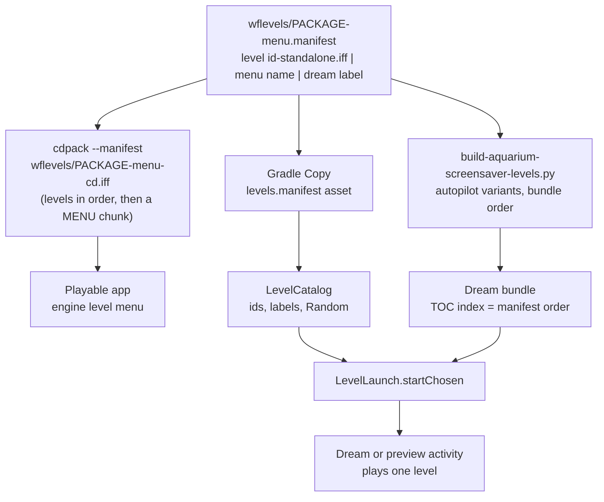
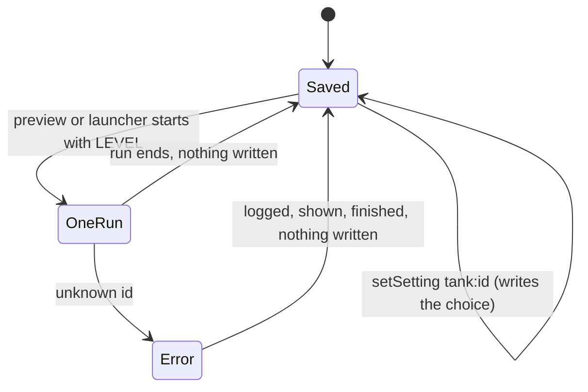

# How to combine several levels, add a chooser menu, and start one level from a screensaver

This is the recipe for a package that holds more than one World Foundry level: one bundle, a menu that picks a level, and the same list driving a screensaver (Dream) that plays a saved choice or one named level for one run. The Aquarium is the worked example (eleven tanks). The SMB world select is the other menu example.

Related, so nothing is said twice:

- Adding a level to the main `cd.iff` (no menu): [`level-building.md`](../level-building.md), "Adding a level to the main cd.iff".
- Why the menu is an engine overlay and how Back works: [`plans/2026-10-01-level-menu-selector.md`](../plans/2026-10-01-level-menu-selector.md).
- The screensaver launch design and its decisions: [`plans/2026-11-21-aquarium-menu-and-screensaver-launch.md`](../plans/2026-11-21-aquarium-menu-and-screensaver-launch.md).
- The Android screensaver module: [`android/screensaver/README.md`](../../android/screensaver/README.md).

## The whole picture

One file lists the levels. Everything else reads it.



## 1. Combine levels into one bundle with a chooser

1. **Build each level's standalone bundle**, `wflevels/<id>-standalone.iff`. It must be the L4-rooted file, not the bare `<id>.iff`: `game.cc` seeks one sector before it reads each level's RAM chunk. A level's id is its file name without `-standalone.iff`.
2. **Write the manifest**, `wflevels/<package>-menu.manifest`. One entry per line:

   ```
   title WF Aquarium
   prompt Choose a tank
   level aquarium_jellyfish-standalone.iff | Jellyfish
   level aquarium_plants-standalone.iff | Planted Tank | Planted Urchin
   ```

   - `title` and `prompt` are the menu's heading and caption.
   - `level <file> | <menu name> [| <dream label>]`: paths are relative to the manifest. The optional third column is the name the screensaver shows when it differs from the menu name; `cdpack` ignores it.
   - All text is printable ASCII, 1 to 60 characters. `#` starts a comment.
   - **The order is the bundle's table-of-contents order.** Level `n` is TOC entry `1 + n`.
3. **Pack it.** `cdpack` writes the levels in order and then a `MENU` chunk, so the engine shows the chooser:

   ```
   wftools/cdpack-rs/target/release/cdpack wfsource/source/game/shell-menu.fth \
       --manifest wflevels/<package>-menu.manifest -o wflevels/<package>-menu-cd.iff
   ```

   Add a `build-cd-iff-<package>-menu` task that depends on each level's build task, as `build-cd-iff-aquarium-menu` does. `shell-menu.fth` replaces `shell.fth` for a menu bundle. Without `--manifest` a bundle has no menu and is byte for byte what it was.
4. **Run it on the desktop.** Copy the task `run-aquarium-menu` (Taskfile): it copies the bundle to a gitignored `build-<package>-menu/cd.iff` and runs `wf_game` there. Up and Down choose, Space starts, Backspace in a level returns to the menu, Escape quits. On Android, Back in a level returns to the menu and Back on the menu exits.
5. **Put it in the app.** The Android flavor's `assets/cd.iff` is a symlink to the menu bundle (`android/app/src/aquarium/assets/cd.iff` is the example). A flavor that needs more video memory reads its flags from `assets/wf_args.txt`, one flag per line; `run-aquarium-menu` reads the same file so the desktop run matches.

**Adding a level later:** build its standalone, add one `level` line, rebuild the bundle. That is the only place a level is added. A level that needs a driver for the screensaver also needs one line in `SCRIPT_NAMES` in `scripts/build-aquarium-screensaver-levels.py`; a level without an entry takes the generic path.

**Level chains.** A level that ends by loading another one (the SMB flagpoles) writes `LEVEL_TO_RUN` (mailbox 5000) and `END_OF_LEVEL` (mailbox 1905). The index it writes is the TOC index, so keep a chain's levels in the same relative order in every bundle that holds it. The SMB menu bundle is the reference.

## 2. Use the same list in a screensaver

The Android screensaver (`android/screensaver`, package `org.worldfoundry.screensaver`, flavor `aquarium`) plays a level on its own, with an autopilot, when Android starts it.

1. **Autopilot variants.** `python3 scripts/build-aquarium-screensaver-levels.py` (run in the container: `scripts/in-linux-container.sh python3 scripts/build-aquarium-screensaver-levels.py`) reads the manifest, builds an `<id>_screensaver` variant of each level, and packs `wflevels/aquarium-screensaver-cd.iff` in manifest order. A manifest id with no `wflevels/<id>/` directory stops the build and names the id.
2. **The catalogue.** Gradle copies the manifest into the flavor's assets as `levels.manifest` (`copyAquariumLevelCatalog` in `android/screensaver/build.gradle.kts`). `LevelCatalog` parses it at runtime: `ids()`, `label(id)`, `valid(id)`, `indexOf(id)` (the level's index in the bundle) and `choose(requested, saved, rng)`. It is one generic class: a second package copies its own manifest into its own flavor the same way, never a copy of the class.
3. **The saved choice.** The Dream plays the saved level, `random` by default. The coordinator's or Homeboard's settings call writes it with `setSetting tank:<id>`; `getCapabilities` lists the choices. This is what Android plays when it goes idle.

## 3. Start one specific level, for one run

A launcher, `adb` or the coordinator can start a named level without changing what the Dream plays when idle. Pass the **`org.worldfoundry.screensaver.LEVEL`** string extra to the preview activity or the TV launcher activity:

```
adb shell am start -n org.worldfoundry.screensaver/.ScreensaverPreviewActivity \
    --es org.worldfoundry.screensaver.LEVEL aquarium_jellyfish
```

- The value is a catalogue id, or `random`.
- It applies to that run only. It never writes the saved choice.
- With no extra, the activity plays the saved choice, exactly as before.
- **An id the catalogue does not hold is an error**: it is logged (`LevelLaunch`, "unknown level"), shown as a toast, and the activity finishes. There is no fallback to the saved level, so a typo in a caller never looks like it worked.
- The decision is in one place, `LevelLaunch.startChosen(context, player, requested)`. It also hands a level its launch overrides first (Sea Stars' saved settings today). `AquariumDreamService` calls the same method with no request.



**Who can send it today**

| Caller | State |
|---|---|
| `adb shell am start ... --es org.worldfoundry.screensaver.LEVEL <id>` | works with the build that has `ec9b872e` or later; not yet run on a Chromecast (plan Verification 5 and 6) |
| Coordinator `screensaver-show` | **not yet.** It accepts only settings `overrides`. A `level_launch_extra` field in `applications.json` and a `level` argument are the open TODO item "Homeboard and coordinator one-run tank start" |
| Homeboard Preview, idle timer, remote key | Homeboard's Stage 5; filed in its `TODO.md` |

## 4. Make another package use it

Everything above is generic. To give another set of levels (for example the 3D Clocks) the same chooser and launch:

1. Write its `<package>-menu.manifest` in the format above.
2. Give its Gradle flavor a `Copy` task that puts the manifest in its assets as `levels.manifest`, like `copyAquariumLevelCatalog`, and add the output to that flavor's `assets` source set.
3. In its launch activities, call `LevelLaunch.startChosen(this, player, getIntent().getStringExtra(LevelLaunch.EXTRA_LEVEL))` and `finish()` when it returns `false`.
4. Do **not** copy `LevelCatalog` or `LevelLaunch`; add the source directory to the flavor if it is not in this module.

The 3D Clocks package does not exist yet, so this step is parked in the TODO item "Screensaver `LEVEL` extra: Chromecast acceptance and the 3D Clocks wiring". Single-level apps (Seahorse Grid, the Planted Tank app) are not part of this mechanism.

## 5. Check your work

| What | Command |
|---|---|
| The roster, menu bundle bytes and the menu's real behaviour | `scripts/in-linux-container.sh python3 -m pytest tests/test_aquarium_menu.py tests/test_level_menu.py -q` |
| A third column changes no byte of the bundle | `tests/test_level_menu.py::test_third_column_leaves_the_bundle_byte_identical` (in the run above) |
| The catalogue and `choose()` in plain Java, and its order against the bundle's | `task test-level-catalog` |
| The screensaver variants follow the manifest | `scripts/in-linux-container.sh python3 -m pytest tests/test_aquarium_screensaver_input.py tests/test_aquarium_screensaver_catalog.py -q` |
| The menu on the desktop | `task run-aquarium-menu` |

Builds and tests run in containers, never on the host: see the Containers section of the repository `CLAUDE.md`.
