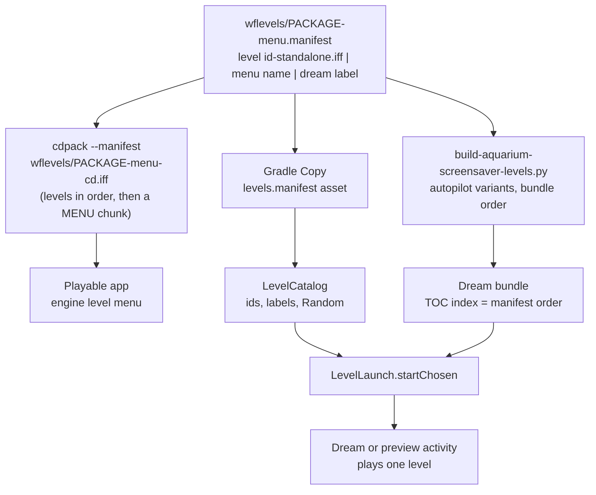
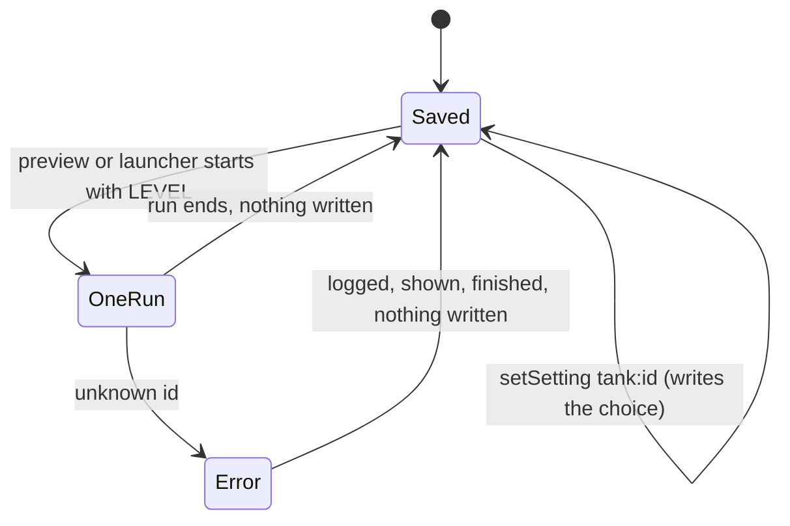

# How to combine several levels, add a chooser menu, and start one level from a screensaver

This is the recipe for a package that holds more than one World Foundry level: one bundle, a menu that picks a level, and the same list driving a screensaver (Dream) that plays a saved choice or one named level for one run. The Aquarium is the worked example (eleven tanks). The SMB world select is the other menu example.

Related, so nothing is said twice:

- Adding a level to the main `cd.iff` (no menu): [`level-building.md`](../level-building.md), "Adding a level to the main cd.iff".
- Why the menu is an engine overlay and how Back works: [`plans/2026-10-01-level-menu-selector.md`](../plans/2026-10-01-level-menu-selector.md).
- The screensaver launch design and its decisions: [`plans/2026-11-21-aquarium-menu-and-screensaver-launch.md`](../plans/2026-11-21-aquarium-menu-and-screensaver-launch.md).
- The Android screensaver module: [`android/screensaver/README.md`](../../android/screensaver/README.md).

## The whole picture

One file lists the levels. Everything else reads it.



### What the app is on the device

The combined app is **the screensaver module's host grown a menu mode**, not the standard NativeActivity app plus a screensaver entry point. One Java `SurfaceView` (`TankPlayer`) and one native host (`android/screensaver/src/main/cpp/dream_host.cc`) run the menu, a tank started from it, and the Dream. The standalone Aquarium app (the NativeActivity host, `hal/android/native_app_entry.cc`) was retired when the two became one, so **a feature of that host exists in the combined app only if `dream_host.cc` or `TankPlayer.java` has it.** What the combined host does with input (all in menu mode; the Dream takes none):

| Input | Where it goes |
|---|---|
| TV remote keys, a gamepad's buttons | `TankPlayer.key` to `MenuKeyLatch` (a tap shorter than one frame still reads once), then `HALInjectJoystickButtons` |
| A gamepad's analog stick and hat | `LauncherActivity.dispatchGenericMotionEvent` to `GamepadStick` to the same latch |
| A touch on a phone (a touchscreen and no TV) | queued by `TankPlayer`, handled on the game thread: the engine's touch settings form first (`propertyui::touchEvent`: the entry button at the top right, then the form), then a tap on a menu row, then the on-screen controller (`TouchBridge`: joystick, D, B, C, A; narrowed to A and C while a story card is open) |
| Back | `LauncherActivity` to `applyMenuBack` |

Still missing from the old host, tracked in [the touch plan](../plans/2026-11-22-aquarium-clocks-touch-controls.md): the phone as a TV's gamepad and settings editor, and the crash log.

## 1. Combine levels into one bundle with a chooser

1. **Build each level's standalone bundle**, `wflevels/<id>-standalone.iff`. It must be the L4-rooted file, not the bare `<id>.iff`: `game.cc` seeks one sector before it reads each level's RAM chunk. A level's id is its file name without `-standalone.iff`.
2. **Write the manifest**, `wflevels/<package>-menu.manifest`. One entry per line:

   ```
   title WF Aquarium
   prompt Choose a tank
   level aquarium_jellyfish-standalone.iff | Jellyfish
   level aquarium_plants-standalone.iff | Planted Tank | Planted Urchin
   ```

   - `title` and `prompt` are the menu's heading and caption.
   - `level <file> | <menu name> [| <dream label>]`: paths are relative to the manifest. The optional third column is the name the screensaver shows when it differs from the menu name; `cdpack` ignores it.
   - All text is printable ASCII, 1 to 60 characters. `#` starts a comment.
   - **The order is the bundle's table-of-contents order.** Level `n` is TOC entry `1 + n`.
3. **Pack it.** `cdpack` writes the levels in order and then a `MENU` chunk, so the engine shows the chooser:

   ```
   wftools/cdpack-rs/target/release/cdpack wfsource/source/game/shell-menu.fth \
       --manifest wflevels/<package>-menu.manifest -o wflevels/<package>-menu-cd.iff
   ```

   Add a `build-cd-iff-<package>-menu` task that depends on each level's build task, as `build-cd-iff-aquarium-menu` does. `shell-menu.fth` replaces `shell.fth` for a menu bundle. Without `--manifest` a bundle has no menu and is byte for byte what it was.
4. **Run it on the desktop.** Copy the task `run-aquarium-menu` (Taskfile): it copies the bundle to a gitignored `build-<package>-menu/cd.iff` and runs `wf_game` there. Up and Down choose, Space starts, Backspace in a level returns to the menu, Escape quits. On Android, Back in a level returns to the menu and Back on the menu exits.
5. **Put it in the app.** The app's `assets/menu-cd.iff` (or `cd.iff` for a pack with no separate menu) is a symlink to the menu bundle: `android/screensaver/src/aquarium/assets/menu-cd.iff` is the example. The VRAM flags the Aquarium uses are `wflevels/aquarium-wf_args.txt`, one flag per line; `run-aquarium-menu` reads that file so the desktop run matches. A pack that needs more video memory ships its own `assets/wf_args.txt` (Clocks does).

**Adding a level later:** build its standalone, add one `level` line, rebuild the bundle. That is the only place a level is added. A level that needs a driver for the screensaver also needs one line in `SCRIPT_NAMES` in `scripts/build-aquarium-screensaver-levels.py`; a level without an entry takes the generic path.

**3D Clocks batch workflow:** Will is iterating through a batch of clocks. For each clock, write a plan with diagrams explaining its behavior and high-fidelity visual mockups before implementation. Link the mockups from the plan and update the diagrams and mockups when feedback materially changes the design. Implement its standalone level and settings in main, and verify it on the PC, including its motion and time changes. As the last implementation step, run the actual level in a visible PC window for Will to see and provide feedback. Defer Chromecast testing, pack-manifest additions, bundle and APK builds, and deployment until Will says the batch is ready. Then test and measure the clocks on Chromecast, update the combined app/screensaver pack, and deploy and verify it on the available devices using the order below. Record unavailable devices and outstanding checks. This batching instruction applies until Will ends the batch.

Work in the main checkout; do not create a worktree or branch automatically. When an isolated worktree is needed and its work is merged, preserve any needed artifacts, remove the finished worktree and delete its merged branch.

**Order for a new level:** (1) build its standalone and exercise the actual level on the PC, including controls, animation, settings and any time-dependent transitions; (2) freeze a device build and test the level on a Chromecast through the coordinator, capturing its appearance and measuring frame time and memory; (3) append the approved level to the pack manifest and rebuild both the playable chooser and screensaver bundles; (4) build and freeze the combined release APK and deploy it to every intended available device, then verify the launcher and screensaver. Record unavailable devices and complete their checks when they return. A successful playable-menu build alone does not update the Aquarium Dream bundle. For WF Clocks, `task clocks-regenerate` rebuilds the clocks and bundle, `task clocks-check` checks the tracked outputs, and `task build-clocks-apk` builds the combined APK. For Aquarium, `task build-cd-iff-aquarium-menu` packs the playable menu and `task build-aquarium-screensaver-apk` rebuilds the Dream variants and bundle and packages both. Keep existing manifest entries in order: their positions are the saved level indices.

For a temporary device-test manifest, check where its level paths resolve and refresh any copied standalone after every rebuild. Verify that the frozen APK's `assets/cd.iff` actually contains the current standalone bytes; a successful APK build alone can package an older copy.

When running a clock visibly from a container, pass the host's actual time zone into it; the test image defaults to UTC. For example, mount the host's `/etc/localtime` read-only as `/tmp/wf-host-localtime` in the container and set `TZ=:/tmp/wf-host-localtime`. Verify the displayed time against the host, including daylight-saving rules, rather than assuming the container inherits the desktop's zone.

Inspect both `assets/menu-cd.iff` and `assets/cd.iff` when the pack has separate chooser and Dream bundles (Clocks can share one); exercise both paths on the computer before device verification.

**Level chains.** A level that ends by loading another one (the SMB flagpoles) writes `LEVEL_TO_RUN` (mailbox 5000) and `END_OF_LEVEL` (mailbox 1905). The index it writes is the TOC index, so keep a chain's levels in the same relative order in every bundle that holds it. The SMB menu bundle is the reference.

## 2. Use the same list in a screensaver

The Aquarium app's Dream half (`android/screensaver`, flavor `aquarium`; its `applicationId` is `org.worldfoundry.game.aquarium`, renamed on 2026‑11‑22 from `org.worldfoundry.screensaver`, which stays the Java code package; see [One Aquarium APK](../plans/2026-11-22-one-aquarium-apk.md)) plays a level on its own, with an autopilot, when Android starts it.

1. **Autopilot variants.** `python3 scripts/build-aquarium-screensaver-levels.py` (run in the container: `scripts/in-linux-container.sh python3 scripts/build-aquarium-screensaver-levels.py`) reads the manifest, builds an `<id>_screensaver` variant of each level, and packs `wflevels/aquarium-screensaver-cd.iff` in manifest order. A manifest id with no `wflevels/<id>/` directory stops the build and names the id.
2. **The catalogue.** Gradle copies the manifest into the flavor's assets as `levels.manifest` (`copyAquariumLevelCatalog` in `android/screensaver/build.gradle.kts`). `LevelCatalog` parses it at runtime: `ids()`, `label(id)`, `valid(id)`, `indexOf(id)` (the level's index in the bundle) and `choose(requested, saved, rng)`. It is one generic class: a second package copies its own manifest into its own flavor the same way, never a copy of the class.
3. **The saved choice.** The Dream plays the saved level, `random` by default. The coordinator's or Homeboard's settings call writes it with `setSetting tank:<id>`; `getCapabilities` lists the choices. This is what Android plays when it goes idle.

## 3. Start one specific level, for one run

A launcher, `adb` or the coordinator can start a named level without changing what the Dream plays when idle. Pass the **`org.worldfoundry.screensaver.LEVEL`** string extra to the preview activity or the TV launcher activity:

```
adb shell am start -n org.worldfoundry.game.aquarium/org.worldfoundry.screensaver.ScreensaverPreviewActivity \
    --es org.worldfoundry.screensaver.LEVEL aquarium_jellyfish
```

The short form `-n <applicationId>/.Class` resolves the leading dot against the **applicationId**, not the code package. The `applicationId` is `org.worldfoundry.game.aquarium` and the classes live in `org.worldfoundry.screensaver`, so the dot form would name a class that does not exist: always use the full class, `org.worldfoundry.game.aquarium/org.worldfoundry.screensaver.ScreensaverPreviewActivity`. The extra's key, `org.worldfoundry.screensaver.LEVEL`, is a plain string and does not change.

- The value is a catalogue id, or `random`.
- It applies to that run only. It never writes the saved choice.
- With no extra, the activity plays the saved choice, exactly as before.
- **An id the catalogue does not hold is an error**: it is logged (`LevelLaunch`, "unknown level"), shown as a toast, and the activity finishes. There is no fallback to the saved level, so a typo in a caller never looks like it worked.
- The decision is in one place, `LevelLaunch.startChosen(context, player, requested)`. It also hands a level its launch overrides first (Sea Stars' saved settings today). `AquariumDreamService` calls the same method with no request.



**Who can send it today**

| Caller | State |
|---|---|
| `adb shell am start ... --es org.worldfoundry.screensaver.LEVEL <id>` | works with the build that has `ec9b872e` or later; not yet run on a Chromecast (plan Verification 5 and 6) |
| Coordinator `screensaver-show` | **not yet.** It accepts only settings `overrides`. A `level_launch_extra` field in `applications.json` and a `level` argument are the open TODO item "Homeboard and coordinator one-run tank start" |
| Homeboard Preview, idle timer, remote key | Homeboard's Stage 5; filed in its `TODO.md` |

## 4. Make a new pack (an app that is also the screensaver)

Two packs exist today, built the same way: **WF Aquarium** (flavor `aquarium`, `wflevels/aquarium-menu.manifest`, 12 tanks) and **WF Clocks**, the 3D Clocks (flavor `clocks`, `wflevels/clocks-menu.manifest`, including Anamorphic Shards). A third pack follows the same steps. The roster is append-only: a level's position is its id in the bundle.

1. **Name the package `org.worldfoundry.game.<name>`** (Will, 2026‑11‑22: `org.worldfoundry.game.aquarium`, `org.worldfoundry.game.clocks`) and set it as the flavor's `applicationId` in `android/screensaver/build.gradle.kts`. The name is the game, never the mechanism: not `…screensaver`, not `…wf_game.<name>`. The Java `namespace` (`org.worldfoundry.screensaver`) is a separate setting and stays. Aquarium and Clocks carry the new ids since 2026‑11‑22, and the tables below show them ([One Aquarium APK](../plans/2026-11-22-one-aquarium-apk.md), D5).
2. Write `wflevels/<package>-menu.manifest` in the format above.
3. Give its Gradle flavor a `Copy` task that puts the manifest in its assets as `levels.manifest`, like `copyAquariumLevelCatalog` and the Clocks equivalent in `android/screensaver/build.gradle.kts`, and add the output to that flavor's `assets` source set.
4. Pack the bundle (`cdpack --manifest`, for Clocks `scripts/pack-clocks-bundle.py`) into the flavor's assets.
5. Add one launcher activity, `public final class <Pack>Activity extends LauncherActivity {}`, and declare it in the flavor's manifest with the `LEANBACK_LAUNCHER` category. It has no code of its own: every pack's launch behaviour is `LauncherActivity`'s (next paragraph). Its Dream service calls `LevelLaunch.startChosen(this, player, null)`.
6. Do **not** copy `LevelCatalog` or `LevelLaunch`; add the source directory to the flavor if it is not in this module.
7. If any level's textures are larger than the Dream host's default 1024 slot, ship `assets/wf_args.txt` with `--vram-slot-width=...` for the flavor (Clocks does: the village's room page is 2048 wide). `tests/test_dream_host_vram.py` checks every page in the bundle fits.
8. **Give every level in the roster a settings object** (next section), then run the audit.

**Every pack behaves the same.** A pack is one APK that is both the app and the screensaver, and WF Aquarium and WF Clocks behave identically (Will, 2026‑11‑21). One class, `LauncherActivity`, decides what a start does, through the pure function `LaunchMode`:

| How it starts | What happens |
|---|---|
| Starting the app (launcher, remote, a person) | The engine's **chooser menu** over the pack's levels. Choosing one plays it for this run only and writes nothing; Back in a level returns to the menu, Back on the menu leaves |
| The system running the screensaver (the Dream service) | **A random level**, or the saved choice if the user set one, and never the menu |
| Any start with the `LEVEL` extra (a catalogue id or `random`) | **That level**, no menu; an unknown id starts nothing |
| Any start with the `DREAM` extra (the preview activity, `screensaver-show`) | The saved choice, `random` by default, no menu |

`LaunchMode` has a unit-test row for every start (`task test-aquarium-launch-mode`), and `tests/test_launcher_parity.py` checks that each pack's activity is empty, extends `LauncherActivity`, and that one menu path in the host (`dream_host.cc`) serves both. **Where the menu comes from** is the one thing a pack chooses: the engine's menu is a MENU chunk in the pack's bundle. WF Clocks keeps it inside its `cd.iff` (one set of levels serves the app and the screensaver). WF Aquarium plays playable tanks from the menu and autopilot tanks as the screensaver, so it ships the playable menu bundle as a second asset, `menu-cd.iff`, beside the autopilot `cd.iff`; the host takes the second bundle only when the APK carries it. The decision and its reasons are in [`plans/2026-11-21-one-aquarium-app.md`](../plans/2026-11-21-one-aquarium-app.md).

Single-level apps (Seahorse Grid, the Planted Tank app) are not part of this mechanism.

## 5. Give every level settings, and a way to open them

**Every 3D clock must have a settings object and the hold-A keypress that opens it** (Will, 2026‑11‑21), and every aquarium tank should; the audit exits 1 until they do. A level offers user-controlled settings when it carries a **settings object**: an empty actor of a `<Name>Settings` type whose fields are `SHOW_AS_LIVE`. Six pieces make one, and `scripts/audit-level-settings.py` checks all six for every level in both rosters.

| Piece | What it is | Model to copy |
|---|---|---|
| type | `wfsource/source/oas/<name>settings.oas` (`@include settings.inc`, `PROPERTY_SHEET_HEADER`, fields), its generated `.oad` and `.ht`, one line appended to each of the eight `objects.*` registry files, and a trivial `Actor` subclass `wfsource/source/game/<name>settings.{cc,hp}` that never renders or updates | `cuckoovillagesettings.*`, `seastarssettings.*` (53d7c718) |
| fields | at least one `SHOW_AS_LIVE` field; no commas in help strings (`prep` splits macro arguments on commas even in quotes) | `cuckoovillagesettings.oas` |
| level | the generator places one empty carrying `wf_schema_path` = the `.oad`, no model, no mass | `wflevels/cuckoo_village/blender_create_cuckoo_village.py` |
| director | the level's script reads each field with `property@ ( actor field -- value valid )`; the actor index comes from the export, the field index from the `catalog` tool (`wftools/wf_attr_edit`), written into the script at export time | `wflevels/cuckoo_village/forth.py` |
| phone | `android/screensaver/src/<flavor>/assets/*.json`, made from the `.oad` by `scripts/gen-settings-capabilities.py`, so the phone and the coordinator can list the fields | the Sea Stars asset |
| test | a `tests/test_<name>_settings.py` that checks the field ranges and defaults and the registry position | `tests/test_cuckoo_village_settings.py` |

Two limits today: the phone form is served by `LevelSettings.java`, which knows only Sea Stars until the Tide Harbour plan's Phase 3 generalises it by clock id, so a phone asset for another level is not yet read; and Minute Machine's object is that plan's Phase 2b.

Adding a type touches engine registration and its small settings-holder actor. Will pre-approved those routine changes for settings objects in new levels on 2026‑11‑23: add the level's OAS/OAD, holder class and object-registry entries needed to expose its settings. Other engine changes still require discussion and explicit permission under `AGENTS.md`.

### The settings every level offers (Show framerate)

**Every settings holder also carries the global sheet, declared once** in `wfsource/source/oas/global_settings.inc` (today one field, **Show framerate**, a live checkbox, default off). A holder gets it by ending its `.oas` with `@include global_settings.inc` just before `TYPEFOOTER`; it goes **last**, so none of the holder's own field ids move. A level with no settings of its own places one **`LevelSettings`** object (`levelsettings.oas`, the minimal holder: nothing but the global sheet), made the same way as the table above. The engine's side is one row per global in `wfsource/source/game/global_settings.cc` (`"Show framerate"` sets `fpscounter::enabled`), applied when a holder is edited and once when the level loads.

To add a global setting: one line in `global_settings.inc`, one row in `global_settings.cc`, then regenerate every holder's `.oad` and `.ht` (`oas2oad`, `wfsource/source/oas/regen-headers.sh`), the phone assets (`scripts/gen-settings-capabilities.py`) and rebuild the levels. `tests/test_global_level_settings.py` fails if a holder forgets the include, if the `.inc` and the engine table disagree, or if a compiled `.oad` lacks the field. Plan and roll-out status: [global level settings](../plans/2026-11-22-global-level-settings.md); until the levels are rebuilt, a level built earlier works unchanged and simply lacks the field.

### How a user opens the settings

- **On the TV remote or a gamepad: hold A, the remote's centre (OK) button, alone for 1 second, in the level.** `Host::gesture` in `engine/runtime_property_host.cpp` counts the hold; a tap, or A with any direction held, is an ordinary level control and resets it. At 1 s the host opens the form of the one editable object, or a picker when several objects are editable. It works only when the level has at least one editable object: an object with a stored, non-read-only field. Without a settings object the gesture does nothing, which is exactly what a level with no settings looks like on a TV.
- **On a phone: the Dream settings form**, through the `org.worldfoundry.game.aquarium.settings` provider, which needs the phone asset above.
- **From the coordinator or Homeboard:** the same `getCapabilities`/`setSetting` calls, again from the phone asset.

### Check it

```
python3 scripts/audit-level-settings.py            # both rosters, one row per level, "opens with" column
python3 scripts/audit-level-settings.py --strict   # exit 1 while any level lacks any of the six
```

A level whose row ends in `NOTHING` has no way to open settings. Then test on a device: install the pack, start the level, hold OK for a second, and expect the form to list your fields.

## 6. Test it on a real Chromecast through the coordinator

Devices belong to the coordinator's queue: use it, not raw `adb`. Everything here is a job; each device runs one job at a time.

1. **Install.** `task chromecast:screensaver:install DEVICE=chromecast-test-01 APK=/absolute/path/screensaver-aquarium-release.apk`. Its launcher check (`verify-launch`) compares the **home-screen icon artwork**; it does not start the app, and neither does a separate `verify-launch` job.
2. **A normal launch** (the menu): `task chromecast:check DEVICE=chromecast-test-01 APP=screensaver DURATION=20`. It runs `am start -W -n …/org.worldfoundry.screensaver.AquariumActivity`, holds for the duration, then restores the previous screen. Download the evidence with `task chromecast:evidence JOB=<id> OUT=<empty-dir>`: `screenshot.png` shows the screen, `wf.log` the app's own log (section 8).
3. **A tank for one run** (no menu). `screensaver-show` acts on the **selected** screensaver, so select the app first, then restore the original:
   ```
   task chromecast:screensaver:select DEVICE=… COMPONENT=org.worldfoundry.game.aquarium/org.worldfoundry.screensaver.AquariumDreamService
   WF_CC_LEVEL=aquarium_plants task chromecast:screensaver:show DEVICE=…
   task chromecast:screensaver:select DEVICE=… COMPONENT=<the component you read before>
   ```
   Read the original selection first with `task chromecast:screensaver:status DEVICE=…` (`selected_component`). Evidence: `screensaver.png`, `screensaver.json` (`observed_component` must be `.ScreensaverPreviewActivity`; the `tank` setting must still be the saved value) and `commands.json` (the `am start` line must carry `--es …LEVEL <id>`).
4. **The Dream.** Select the app's Dream as above, then `task chromecast:screensaver:trigger DEVICE=…`; the job waits for Android to start it. Restore the selection afterwards.
5. **Keys, Back, and short taps.** A one-shot `check` job can press remote keys and capture the screen at chosen moments, so the menu, a tank, Back and a short tap are all testable without a Remote session. Give the job an `input_script` (MCP `job-submit`, workflow `check`, `app` the registered name, `panel: "require-hidden"`, `duration` longer than the last event): `{"at": 4, "capture": "menu1"}`, `{"at": 5, "key": "DPAD_DOWN", "action": "down"}`, `{"at": 5.02, "key": "DPAD_DOWN", "action": "up"}`, `{"at": 11, "key": "DPAD_CENTER", "action": "down"}`, `{"at": 11.05, "key": "DPAD_CENTER", "action": "up"}`, `{"at": 18, "key": "BACK", "action": "down"}`, `{"at": 18.1, "key": "BACK", "action": "up"}`, and so on (`at` is seconds from the start; `action: "hold"` takes `ms`, 50 at least). The evidence has `input-frame-NNN.png` for each capture, in order, and `input-timeline.json` with every key edge and its **device uptime**: read it for the real tap length, which ran about 3 ms longer than planned (a planned 20 ms tap was held 23 ms; the shortest the coordinator can send is about 1.4 frames at 60 Hz, so it cannot test a tap shorter than one frame). A script whose last Back leaves the app ends `failed` with `target-left-foreground`: that is the checker noticing the app left, so look at the last capture (the Google TV home screen) rather than at the status. A Dream's own screenshot is solid black; prove what it ran from the app's engine log (section 8, selecting the app's Dream first so `screensaver-list` reads that package's `wf.log`).

Gotchas, each one met in practice:

- `screensaver-show` on a screensaver without level support (Seahorse Grid selected) is refused with `screensaver-level-unavailable` before anything launches. That is the check working.
- **`LEVEL=aquarium_plants` on the `task` line is dropped silently**, whatever the coordinator version: the Taskfile maps `OVERRIDES` but not `LEVEL`, so the client never sees it. Put the level in the environment as `WF_CC_LEVEL=aquarium_plants task chromecast:screensaver:show DEVICE=…` (measured on cast1, 2026‑11‑22: the `am start` line gained `--es …LEVEL aquarium_plants` only then). Before coordinator 0.1.219 the service also ignores a level without an error. Either way, look at `commands.json` (step 3) for the `LEVEL` extra.
- `screensaver-select` of a component that is **not installed** used to end `plugin-error` and fence the device (a readd had to clear it). From 0.1.219 it is a clean refusal, `invalid-request` with `screensaver-component-not-installed`, health unchanged.
- A direct screenshot (`capture PERSONAL=true`) is refused while another job holds the device; a queued `capture` job is not.
- The coordinator tasks run from the `chromecast-coordinator` checkout; the APK path is a file path, not a hash.

### On a phone (the Pixel)

The Pixel is Will's daily phone: ask before a job that takes the screen. A Dream starts only on lock **while charging**, not after idle minutes.

1. **Install** with the same `install` job against `phone-pixel-8-pro`; the phone must be awake and unlocked (`device-locked` otherwise).
2. **See the controller.** A `check` job launches the app and keeps a screenshot (`panel: require-hidden`): the menu with the joystick at the lower left and D, B, C, A at the lower right. The job closes the app when it ends, so a coordinator `phone-input` tap cannot follow it; driving the app is a person's job.
3. **Drive it.** Stick down moves the highlight, **A** starts the tank (or tap a row), the stick steers in the tank. In a tank with settings the **entry button at the top right** opens the form; tick, then Apply. A hold on A for one second also opens it where the level takes that gesture.
4. **A TV is the other half of the check:** on cast1 no controller is drawn and the remote's keys work (section 6, the `input_script` check).

## 7. The tanks: ids, menu names and Dream labels

One manifest line gives three names. `wflevels/aquarium-menu.manifest` is the source; the Dream label is the optional third column. The id is the file name without `-standalone.iff`, and it is what `LEVEL` and `setSetting tank:<id>` take.

| id | Menu name | Dream label |
|---|---|---|
| `random` | (not a level) | Random: the saved-choice default; the menu does not list it, and the tray's level chooser does not offer it |
| `aquarium` | Clownfish & Sea Anemone | Clownfish |
| `aquarium_blue_shrimp` | Blue Shrimp | Blue Shrimp |
| `aquarium_betta` | Calm Betta | Betta |
| `aquarium_jellyfish` | Jellyfish | Jellyfish |
| `aquarium_lionfish` | Lionfish | Lionfish |
| `aquarium_plants` | Planted Tank | **Planted Urchin** |
| `aquarium_arowana` | Asian Arowana | Arowana |
| `aquarium_tiger_barbs` | Tiger Barbs | Tiger Barbs |
| `aquarium_thai_reef` | Gulf of Thailand Reef | Thai Reef |
| `aquarium_thai_reef_anime` | Gulf of Thailand Reef - Anime | Thai Reef Anime |
| `aquarium_sea_stars` | Sea Stars | Sea Stars |

The menu shows eleven entries (1 of 11); the Dream's `tank` setting offers twelve choices, those eleven plus `random`. Two frames seen on Cast1 (2026‑11‑21) so you know what right looks like: `aquarium_jellyfish` is jellyfish drifting between two curved glass panes; `aquarium_plants` ("Planted Urchin") is tall plant stems with seahorses clinging to them and a purple sea urchin on the sand. The names differ on purpose, so a tank reported by the wrong name is usually not a bug: check the id.

## 8. Read the engine log

Each package writes its engine log to `/sdcard/Android/data/<package>/files/wf.log`. The coordinator collects it for you: `screensaver-list` saves the last 300 lines as `screensaver-engine.log` when the selected screensaver is a registered one, and a `check` job saves `wf.log` in its evidence. Lines seen so far:

| Line | Meaning |
|---|---|
| `=== wf_dream start the menu (…) of N ===` | menu mode: a normal start |
| `level-menu: showing 11 entries ("WF Aquarium")` | the menu opened with the manifest's eleven tanks |
| `=== wf_dream start level N ===` | a tank, by its index in the bundle (manifest order), for the Dream, the preview or `LEVEL` |
| `Back in a tank: returning to the menu`, `Back on the menu: leaving the app` | Back handling |
| `PLANTS generation=… shoots=… mode=saltwater` | the planted-tank generator ran: the Planted Urchin tank |
| `PLANTS settings-source=OAD … selector_override=0` | not yet explained. It appeared on a run whose frame showed the requested tank, so it does not mean the level was ignored |
| `delta too large: …` | a long frame time, normal while a tank loads |

## 9. Register a package with the coordinator

The coordinator knows a screensaver package through one entry in `scripts/wf_device/plugins/android/applications.json` (in the `chromecast-coordinator` repo; the contract is `docs/settings-provider-contract.md` there). Without it `screensaver-show`, the tray and the level chooser do not know the package. Fields, from the Aquarium, Clocks and Seahorse Grid entries:

| Field | What it is | Aquarium | 3D Clocks | Seahorse Grid |
|---|---|---|---|---|
| key | the registry name | `screensaver` | `clocks-screensaver` | `seahorse-screensaver` |
| `package` | Android package | `org.worldfoundry.game.aquarium` | `org.worldfoundry.game.clocks` | `org.worldfoundry.seahorsegrid` |
| `kind` | `screensaver` | yes | yes | yes |
| `activity` | what a plain `launch` starts: the menu for the Aquarium | `…/org.worldfoundry.screensaver.AquariumActivity` | `…/org.worldfoundry.screensaver.ClocksActivity` | `…/…SeahorseGridActivity` |
| `dream_component` | the DreamService to select | `…AquariumDreamService` | `…ClocksDreamService` | `…SeahorseGridDreamService` |
| `preview_activity` | what `screensaver-show` starts | `…/org.worldfoundry.screensaver.ScreensaverPreviewActivity` | `…/org.worldfoundry.screensaver.ScreensaverPreviewActivity` | its own preview activity |
| `preview_extra`, `preview_value` | an extra `show` always adds | `…DREAM` = `aquarium` | none | `…DREAM` = `seahorse_grid` |
| `level_launch_extra` | the one-run extra; present means "supports `LEVEL`" | `…LEVEL` | `…LEVEL` | none |
| `level_setting_id` | the settings-provider setting whose choices are the levels | `tank` | `clock` | none |
| `settings_authority` | the content provider for `getCapabilities` and `setSetting` | `org.worldfoundry.game.aquarium.settings` | `org.worldfoundry.game.clocks.settings` | `….seahorsegrid.settings` |
| `native`, `scenes` | `false`, `[]` for a screensaver | | | |

**When a package is renamed** (as Aquarium and Clocks were on 2026‑11‑22, to `org.worldfoundry.game.<name>`: coordinator 0.1.222), its registry entry's `package`, `activity`, `dream_component`, `preview_activity` and `settings_authority` change in the same administrator upgrade of the coordinator as the Gradle `applicationId`. Either half alone breaks installs: an APK whose package is not the registered one cannot be installed or launched by its registry key. The old package stays installed beside the new one until it is removed by hand, because the coordinator has no uninstall.

The level list is not in the registry: the coordinator and the tray read it from the app's own settings provider (the `level_setting_id` setting's options), and refuse an id the app does not list before any launch. A package with no `level_launch_extra` gets no chooser and a `screensaver-level-unavailable` refusal.

## 10. Check your work

| What | Command |
|---|---|
| The roster, menu bundle bytes and the menu's real behaviour | `scripts/in-linux-container.sh python3 -m pytest tests/test_aquarium_menu.py tests/test_level_menu.py -q` |
| A third column changes no byte of the bundle | `tests/test_level_menu.py::test_third_column_leaves_the_bundle_byte_identical` (in the run above) |
| The catalogue and `choose()` in plain Java, and its order against the bundle's | `task test-level-catalog` |
| The screensaver variants follow the manifest | `scripts/in-linux-container.sh python3 -m pytest tests/test_aquarium_screensaver_input.py tests/test_aquarium_screensaver_catalog.py -q` |
| The menu on the desktop | `task run-aquarium-menu` |
| The launch-mode decision (every row of section 4) | `task test-aquarium-launch-mode` |
| The menu on a real Chromecast, a level start, the Dream | section 6 |
| Every level has a settings object and a way to open it | `python3 scripts/audit-level-settings.py` (section 5) |
| The on-screen controller and the gamepad stick (pure logic) | `task test-touch-bridge` |
| The global settings (one declaration, every holder, the engine table) | `scripts/in-linux-container.sh python3 -m pytest tests/test_global_level_settings.py -q` |
| The engine's table of global settings (a level load against an Apply, two holders) | `task test-global-settings` |
| Every built level carries the global settings | `python3 scripts/audit-level-settings.py --roster levels --strict` |

Builds and tests run in containers, never on the host: see the Containers section of the repository `CLAUDE.md`.
