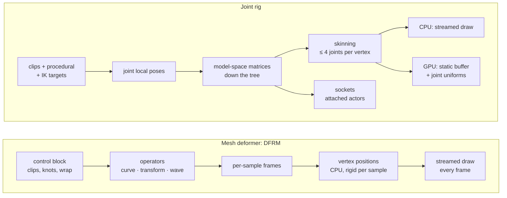

# Mesh deformers or joint rigs?

16 October 2026 · **Investigation, for a decision by Will.** This compares the generic mesh deformer now being built (the [seahorse plan](../plans/2026-10-16-saltwater-seahorses.md), Phase 1) with **joint rigs**: a skeleton of joints, per-vertex skin weights and joint animation clips. No code changes. Numbers marked *est.* are estimates; the rest cite the source or a measurement.

## The question

Until now World Foundry has animated meshes in two ways: five per-species C++ deformers (fish, fin, swim, jelly, lion), and rigid actors posed one by one from Forth. It has no skeleton, no skinning and no parenting ([clownfish plan, M5–M7](../plans/2026-09-30-clownfish-idle-animation.md)). Phase 1 of the seahorse plan is now adding:

- **one generic deformer slot** per actor (`MeshDeformer`), with the five existing kinds moved behind it and golden-tested;
- **`DFRM` v1**, a data-driven deformer with two operators. The *rooted curve* drives the 35-joint tail; *weighted transforms* drive head and eyes. Both play pre-animated clips, and the curve adds runtime contact (gripping a post).

A **joint rig** is the standard alternative in game engines:
- a **tree** of joints with a bind pose;
- each vertex weighted to up to four joints (linear blend skinning);
- clips of joint rotations and translations;
- blending and inverse kinematics (IK);
- **sockets** where other objects attach to a joint.

Which should World Foundry's animated meshes use, now and later?

## Short answer

1. **They are not opposites.** `DFRM`'s rooted curve *is* a joint chain in which every vertex follows exactly one joint. A weighted transform is a one-joint skin group. A joint rig is the general case: branching trees, blended influences at bends, and sockets.
2. **Keep Phase 1 as planned.** The seahorse needs a chain, clips and contact, and `DFRM` gives all three with the smallest engine change. One cheap design choice keeps the door open: make the evaluator's per-joint **frames** an explicit intermediate result, separate from vertex placement. A later skinning deformer can then reuse the pose stage instead of rebuilding it.
3. **Joint rigs earn their cost with the first consumer that needs any of:**
    - a branching skeleton (limbs, legs, fingers, the anemone's crown);
    - soft skin that blends two or more joints at a bend;
    - sockets, so one actor can ride on another's joint;
    - importing rigged models (Blender armatures, glTF skins).

   Among today's animals only the parked sea anemone needs one of these: a tree of 48 tentacles on a contracting disc.
4. **Deformer phase 2 should not start before a joint-rig spike.** That phase re-expresses fish, fin, swim, lion and jelly as `DFRM` operators. The same bodies could instead be joint chains driven by procedural wave generators, which is how most engines animate fish. A short spike, measured on Chromecast, should decide which representation D6 uses.
5. **GPU skinning is the one place a rig could be clearly cheaper on the Chromecast.** It keeps vertices in static buffers and drops the per-frame upload. It touches both render backends and the CPU culling path, so it needs its own [measured experiment](../plans/2026-10-16-gpu-skinning-chromecast-experiment.md).

## How each works

The two pipelines share the middle: both compute a frame per joint (per curve sample) and then move vertices with those frames. They differ in four places:
- what produces the poses (operators versus clips, IK and procedural generators);
- how the frames are connected (chains hanging off one root, versus a tree);
- how many frames each vertex blends (one versus up to four);
- where skinning runs (CPU only, versus CPU or GPU).

## Side by side

| | Mesh deformer (`DFRM`, being built) | Joint rig |
|---|---|---|
| Structure | Curves (chains) and transform groups, each hanging off the mesh root | A tree: any joint can have children |
| Influences per vertex | 1 (rigid per sample) or a transform weight | Up to 4, blended (linear blend skinning) |
| Procedural motion | **Native.** Operators take a few channels (phase, amplitude, wrap) and compute the pose | Needs pose generators that write joint rotations. Same maths, one more layer |
| Pre-animated clips | Curve angles per frame (3 × int16 per joint) | Joint rotation and translation tracks |
| Blending | Two clips plus an additive knot layer (Phase 1, E2) | Arbitrary layers and masks; standard |
| Contact / IK | The curve's wrap override (grip a post) | IK solvers (two-bone, chain); **Jolt has none**, so we would write them |
| Sockets / parenting | Write-backs only (wrap centre, tail tip) | Built in: any joint's matrix can place another actor |
| Authoring | Blender armature, converted by a **custom** exporter step (swing–twist into flex, lateral, twist) | Blender armature and weights export almost directly |
| Interchange | None outside World Foundry | glTF skins; the [glTF plan](../plans/2026-07-05-gltf-import-export.md) deliberately left skins out (`:115`, `:120`) |
| CPU work per vertex | ≈ 18 flops (one rotate + add), *est.* | ≈ 50 flops (four weighted matrix transforms), *est.* |
| GPU option | No: positions are produced on the CPU | Yes: skin in the vertex shader; vertices stay in static buffers |
| Bytes per vertex | ≈ 16 (sample index, kind, offset) | ≈ 8 (4 joint indices + 4 weights as bytes) |
| Bytes per joint per clip frame | 6 | 8–28 (quantised to full-float rotation + translation) |
| Existing code to reuse | The five deformers' patterns; the E0 slot | **Jolt's skeleton module**: `Skeleton`, `SkeletalAnimation::Sample`, `SkeletonPose::CalculateJointMatrices`. It is already compiled into the engine ([`Jolt.cmake:422-424`](../../engine/vendor/jolt-physics-5.5.0/Jolt/Jolt.cmake)) and so far unused |
| Testability | Pure functions on vertex arrays; bit-exact golden tests | The same, once skinning is a deformer kind |
| Engine scope | Phase 1 as approved (D1) | New chunks (skeleton, skin, clips), pose evaluation, a skinning deformer, Forth words, sockets. GPU skinning adds shaders in both backends |

## How each handles the animals we have

| Animal | With `DFRM` | With a joint rig | Better fit |
|---|---|---|---|
| Seahorse tail | One 35-sample curve, clips, wrap contact | A 35-joint chain, clips, plus an IK or curvature solver for the grip | **`DFRM`**: the contact maths is native |
| Fish body (clownfish, tiger barbs) | A travelling-wave operator over a root-to-tip weight (Deformer phase 2) | A chain of 6–10 spine joints driven by a sine generator; soft skin at each joint | Even. The rig gains import and sockets; the wave operator is cheaper and needs no joints |
| Betta fins | A wave on UV-weighted membrane rows | Many short joint chains (fin rays), or a wave generator per ray | **`DFRM`**: membranes are fields, not bones |
| Jellyfish bell | A radial operator, if one fits | Radial joints around the rim; awkward | Neither is natural; keep the species kind |
| Lionfish | Regions as transforms and waves (`LRIG` converted) | A tree: spine, jaw, pectorals, spines | **Rig**, slightly: it is already a tree with a jaw |
| Sea anemone (parked) | 48 curves rooted on a contracting disc; needs curve roots on a moving parent | A tree: disc joint → 48 tentacle chains | **Rig**: the anemone *is* a tree |
| Urchin spines | Today: 8 rigid actors. As `DFRM`: transform groups | One root, 8 spine joints | Even; either beats 8 actors |
| A walking character (none planned) | Not expressible without inventing a tree | The standard tool | **Rig** |

## What it costs on the Chromecast

**Measured:**
- Adding the urchin's 2,680 streamed triangles cost **+3.8 ms render CPU** on Chromecast 1, and its 8 extra actors cost +0.59 ms of Director time ([urchin comparison](../plans/2026-10-05-sea-urchin-realism/comparison.md)).
- Plant drawing dominates the frame ([dense planted tank plan](../plans/2026-10-03-aquarium-dense-planted-tank.md)).
- Meshes that don't change are drawn from static buffers since 2026‑10‑08. Any CPU deformer takes its actor off that path, because it hands out writable vertices.

**Estimated, for one 900-vertex seahorse:**
- Rigid curve placement is ≈ 16,000 flops; four-joint skinning is ≈ 45,000. Both are small next to re-uploading the vertices every frame. **On the CPU, a rig and `DFRM` cost about the same**: the streaming dominates both.
- **GPU skinning would remove the upload.** Both Chromecasts report a **Mali-G31 with OpenGL ES 3.2** (device logs in `docs/diagnostics/`). The modern vertex shader uses 7 attributes ([`backend_modern.cc:68-74`](../../wfsource/source/gfx/glpipeline/backend_modern.cc)), and GLES 3 guarantees at least 16, so joint indices and weights fit. Thirty-five joints as 3 × vec4 each is 105 uniform vectors, under the guaranteed 256.

**GPU skinning also has three real obstacles:**
1. Back-face culling runs on the CPU from rest-pose normals, and the static path also bakes plane distances. Skinned faces move, so those decisions go wrong. See the next section.
2. The Metal backend ([`backend_metal.mm`](../../wfsource/source/gfx/metal/backend_metal.mm)) needs the same shader change for macOS and iOS.
3. Visibility culling needs conservative bounds, because the CPU never sees the skinned positions.

## Back-face culling, and why moving vertices collides with it

**How culling works today.**
- **Where:** World Foundry never enables `GL_CULL_FACE`. Winding is inconsistent across the engine: the `rendacto.cc` cube is clockwise seen from inside, Blender boxes are counter-clockwise from outside, and the matte is ad hoc. A hardware cull would erase surfaces that are hard to enumerate ([back-face culling plan](../plans/2026-06-13-planetarium-dome-view-engine-wide-backface-culling.md), "Why software"). So since 2026‑09‑21 every triangle passes a **software** test, written once ([`backface_cull.hp`](../../wfsource/source/gfx/backface_cull.hp)):
  - rotate the face's stored normal into eye space;
  - move the triangle's centroid into eye space;
  - the face is back-facing when their dot product is > 0.

  A `DOUBLE_SIDED` material is exempt.
- **Where the normal comes from:** each face's normal is computed **once, when the mesh loads**, from the rest positions ([`rendobj3.cc:286`](../../wfsource/source/gfx/rendobj3.cc)). Every poly renderer then passes that stored normal to `DrawTriangle`, e.g. [`rendftl.cc:74-81`](../../wfsource/source/gfx/glpipeline/rendftl.cc). The same normal also drives the flat lighting.
- **The static path goes further.** For each material group of a baked mesh, it tests every face and writes the survivors' triangle numbers into an index list, which is uploaded for that draw ([`static_mesh.cc:773-809`](../../wfsource/source/gfx/glpipeline/static_mesh.cc)). Its fast form doesn't even read positions. It uses each face's plane distance, *normal · centroid*, which is **baked once** when the mesh is baked (`:557`).

**Why GPU skinning collides with this.** With GPU skinning the vertices move only inside the vertex shader. The CPU still holds the rest pose, so every culling decision is made for a shape that isn't on screen:
1. **Holes.** A face that was back-facing at rest but has turned toward the camera is culled. Example: the inside of a seahorse tail ring that has coiled 180°.
2. **Wasted faces.** A face that turned away is still drawn. The depth test hides it on a closed mesh, but it costs fill.
3. **Silhouette flicker.** Faces near edge-on flip between the two, frame to frame.
4. **Wrong lighting.** The vertex's packed normal (`a_normal`) is a rest normal unless the shader rotates it by the joint matrix too.

Three more parts of the static path assume fixed geometry:
- **translucent runs** are never baked; they stream through a sorted queue, which needs CPU positions;
- the bake's **check mode** compares recorded against baked triangles;
- **visibility culling** uses rest bounds.

A skinned mesh must be exempt from the first two and needs conservative bounds for the third.

**Ways out, simplest first:**
1. **Don't cull skinned meshes.** Mark their groups cull-exempt and draw the whole static index buffer. That removes the per-draw index upload too. The cost is rasterising back faces, about 2× the fragments of a closed mesh. For a 16 cm seahorse on a TV that is likely small, but it should be measured on the Mali-G31.
2. **Hardware culling only for skinned draws.** This is safe only for meshes whose winding our own exporter guarantees (counter-clockwise outward). The cull state has to join the backend's batch key, and Metal needs `setCullMode` too.
3. **Conservative CPU culling per joint.** Cull a joint's faces only when they face away in every pose the joint can reach. This is complex and fragile. Not recommended.

**The CPU deformers have the same problem today.** The five existing deformers move vertices but never update face normals. Their cull and lighting therefore use rest normals against deformed centroids. For a fish's small sideways sway the error is small, but a coiled seahorse tail would show holes. Two consequences:
- **`DFRM` (Phase 1):** it now rotates each deformed face's rest normal by its ring's frame every frame. Rigid per-ring binding makes that exact, at one 3 × 3 multiply per face. This was added to the plan and sent to the Phase 1 agent on 2026‑10‑16.
- **The five existing kinds:** fixing them changes their output, which would break the bit-exact golden fixtures of the E0 move. So it's a separate follow-up, with deliberately re-recorded fixtures.

A joint rig on the CPU would need the same per-face normal update. On the GPU it needs the shader-side normal rotation and one of the three options above.

## What building joint rigs would take

- **Asset chunks:** a skeleton (names, parents, inverse bind matrices), a skin (≤ 4 joint indices and weights per vertex, as bytes) and clips (quantised rotation and translation tracks). The exporter writes them from Blender armatures, beside `LRIG` and `DFRM`. glTF skins can follow through the glTF tooling.
- **Pose:** Jolt's `SkeletalAnimation::Sample` and `SkeletonPose::CalculateJointMatrices` (already compiled in), plus blending and two simple IK solvers of our own.
- **Skinning:** first as a **sixth `MeshDeformer` kind** in the E0 slot (CPU, streamed). GPU skinning is a later, measured step.
- **Sockets:** a joint matrix published to mailboxes, which the Director uses to place an attached actor. This is the pattern `DFRM` already uses for the wrap centre and tail tip. A dedicated "attached" mobility would come later, if needed.
- **Forth:** words to play and blend clips, override a joint, set an IK target and read a socket.
- **Permission:** all of this is engine work, outside D1.

The generic-deformation proposal says not to build "a full skeletal/morph system before demonstrating the need" ([proposal `:65`](../plans/2026-10-05-sea-anemone-realism/generic-deformation-proposal.md)). This document is that test. The need is **not** demonstrated for the aquarium animals; it **is** for the anemone and for any future character.

## Recommendation

1. **Phase 1: no change of direction.** Ask the in-flight agent to keep the evaluator's per-joint frames as an explicit array between "pose" and "place vertices". That costs nothing now and lets a skinning deformer reuse the pose stage later.
2. **Before Deformer phase 2, run a time-boxed joint-rig spike** on a throwaway worktree, T4. It would:
    - add a CPU skinning deformer kind using Jolt's skeleton on the clownfish body, from a Blender armature with a procedural sine generator;
    - add a GL-only GPU skinning path for the same mesh;
    - measure both on Chromecast 1 against today's `fish-deform`.

   D6's representation, `DFRM` waves or joint chains, follows from that table.
3. **Make joint rigs a first-class feature when the first consumer needs a tree, soft skin, sockets or glTF import.** The sea anemone's revival is the likeliest trigger. At that point the E0 slot, the clip format and the curve's contact maths all carry over.

## Sources in this repository

- Phase 1 design, E0–E6: [seahorse plan](../plans/2026-10-16-saltwater-seahorses.md)
- Existing deformers: [`rendacto.cc:186-300`, `:675-692`](../../wfsource/source/renderassets/rendacto.cc); state in [`rendacto.hp:142-148`](../../wfsource/source/renderassets/rendacto.hp)
- The legacy vertex-animation system and why it does not apply: [`anim.cc:146-163`](../../wfsource/source/anim/anim.cc), [`animmang.cc`](../../wfsource/source/anim/animmang.cc)
- Jolt skeleton API: [`SkeletalAnimation.h:72`](../../engine/vendor/jolt-physics-5.5.0/Jolt/Skeleton/SkeletalAnimation.h), [`SkeletonPose.h:47-57`](../../engine/vendor/jolt-physics-5.5.0/Jolt/Skeleton/SkeletonPose.h), [`Skeleton.h:47-48`](../../engine/vendor/jolt-physics-5.5.0/Jolt/Skeleton/Skeleton.h)
- Generic-deformation proposal: [`generic-deformation-proposal.md`](../plans/2026-10-05-sea-anemone-realism/generic-deformation-proposal.md)
