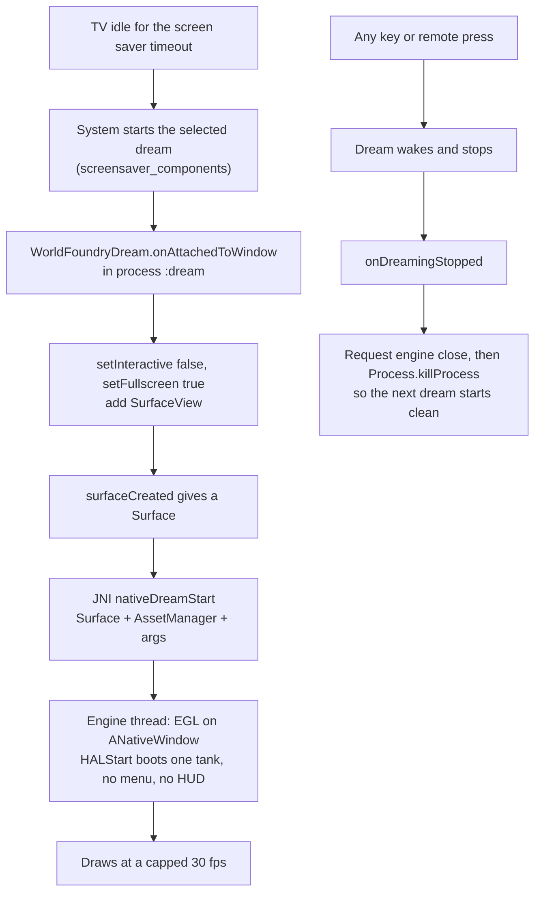
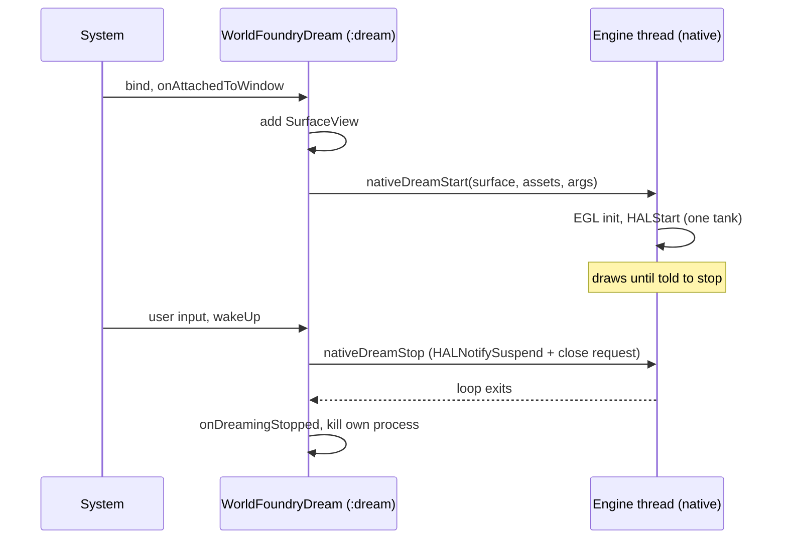
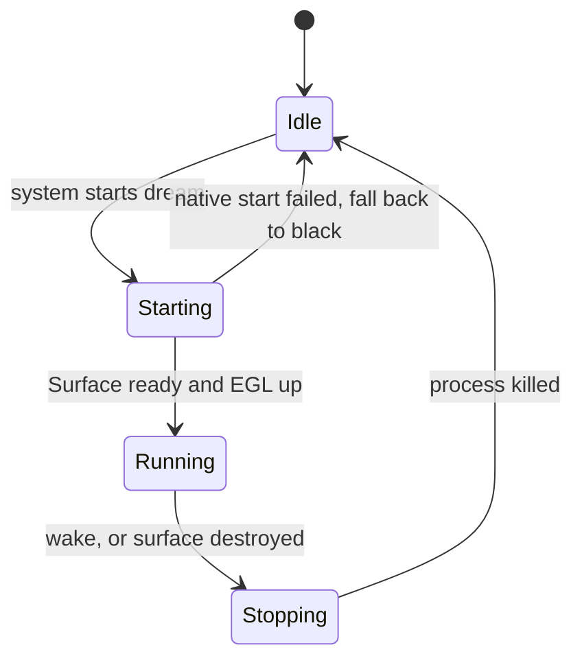

# Chromecast screensaver from a World Foundry level

Status: **separate video Dream built, visually verified, installed and selected on both test Chromecasts, 2026‑10‑17.** This is a recording of the aquarium level, not live engine rendering. Claude's initial research was written when its usage limit was reached; distribution was checked against current sources later the same day.

## Short answer

Yes, it is feasible, and the aquarium is the natural first candidate. On a Chromecast with Google TV a screensaver is an Android **Dream**: a `DreamService` inside an installed APK. Three things are needed; the third is a major distribution constraint:

1. **A `DreamService` that shows the level.** The deployed prototype plays a recording. Live rendering would require an engine host: our game app is a `NativeActivity`, and a dream is a *service* with a window, so `android_main` cannot be reused as it stands.
2. **A level that runs with no input.** The aquarium already animates on its own; the tank selector, HUD and phone‑controller QR code must not appear.
3. **Installing it as *the* screensaver.** Google TV removed the Settings option for third‑party screensavers, so it is set over adb (`settings put secure screensaver_components …`).

Cheapest first step: a dream that plays the existing recorded video of the level. It tests the Dream lifecycle and device selection on real hardware before any engine work.

## Build boundary (Will's decision)

Build the screensaver as a **separate Android TV app**, with its own application ID, manifest, resources, assets, and release artifact. Do not add a Dream service to the existing `android/app` game APKs or use a flavor that shares their `libwf_game.so`: the current flavors all package the same native library. Keep `DreamService`, setup UI, and any Android TV lifecycle code in the screensaver app. Desktop, web, iOS, and ordinary Android game builds must not compile or package it.

For the recorded-video prototype, a new module such as `android/screensaver` can use Android media playback and the aquarium recording without changing engine code. For a live level later, give that module its own Android-only native host target (for example `wf_dream`) that links the existing engine library. The current `wf_game` NativeActivity shell stays with the game app. If the engine library itself needs a new surface/lifecycle interface or frame cap, propose the exact changes and obtain explicit permission before editing it. Verify build isolation by inspecting both APKs and building at least one non-Android target.

**Prototype status:** `android/screensaver` builds as `:screensaver:assembleDebug`, with its own package `org.worldfoundry.screensaver`, TV launcher, `DreamService`, and a silent looping recording derived from `tests/recordings/aquarium_phase4_motion_demo.mp4`. The bundled copy removes gameplay instruction text. The APK contains no native library. This is a video screensaver prototype, not a live level or release candidate. The separate coordinator registers the package and provides a `dream-check` workflow. Its reviewed release was deployed with existing recovery records preserved; the coordinator's full predeployment suite passed (1,364 passed, 25 skipped). Use only coordinator sessions, never direct ADB.

**Device result:** The `TextureView` player produced visible aquarium Dream captures on both TVs. Earlier captures on [device 01](../diagnostics/screensaver-texture-dream-cast1/dream.png) and [device 02](../diagnostics/screensaver-texture-dream-cast2/dream.png) use a recording with instruction text. The final APK removes it; its clean Dream was captured on [device 01](../diagnostics/screensaver-final-dream-cast1/dream.png) and [device 02](../diagnostics/screensaver-final-dream-cast2-verified/dream.png), with no phone-controller prompt or QR code. Fullscreen launcher captures are also clean on [device 01](../diagnostics/screensaver-final-check-cast1/screenshot.png) and [device 02](../diagnostics/screensaver-final-check-cast2/screenshot.png). Both final `check` jobs verified installed SHA-256 `b314400f2d1e43509fd80baee1268e070960fad0d599a1eb5a9b03c72ffcbfc0`. The frozen APK is `/tmp/worldfoundry-screensaver-20261017-v4-debug.apk`; reproducible build details are in [the module README](../../android/screensaver/README.md).

Persistent selection completed on both: [device 01](../diagnostics/screensaver-selected-cast1/configure.json), [device 02](../diagnostics/screensaver-selected-cast2/configure.json). Each job read back `org.worldfoundry.screensaver/.AquariumDreamService` and recorded the prior `com.google.android.apps.tv.dreamx/.service.Backdrop`. Device 01 also needed [allow-standby](../diagnostics/screensaver-allow-standby-cast1/configure.json) so powered idle can start a Dream. To restore the original selection on either device, run `task chromecast:configure DEVICE=chromecast-test-01 CHANGE=google-tv-ambient` (substitute device 02 as needed). To restore device 01's previous powered-awake behavior, run `task chromecast:configure DEVICE=chromecast-test-01 CHANGE=stay-awake-while-powered`.

The first `SurfaceView` build yielded uniformly dark (`#101010`) captures even though Android reported video rendering started. Switching only the screensaver module to `TextureView` fixed both launcher and Dream output. The coordinator's generic `install` artwork matcher reported a mismatch on this Google TV launcher and initiated safe recovery; `check` verified installation and visible playback. This does not affect the Android Dream selection but remains a coordinator launcher-verification limitation.

A later cast2 `dream-check` began with Android's private Dream activity already foreground. Its first capture caught a stale Dream record marked `isWaking=true` while Home was on screen, and cleanup could not relaunch that private activity. The coordinator now accepts restoration of this transient foreground only after verifying the original Dream is still selected and returning to verified Home. It also requires an active, foreground Dream before capturing. The reviewed hotfix preserved recovery records; an owned `readd` cleared cast2's fence. New checks on both devices completed with restored settings and clean aquarium Dream screenshots linked above.

The coordinator workflow installs the frozen APK, journals the original `screensaver_components`, `screensaver_enabled`, and `screen_off_timeout` values, temporarily selects `org.worldfoundry.screensaver/.AquariumDreamService`, and waits for natural idle activation. It captures the Dream and restores all three settings and the previous foreground within the owned session. The APK remains installed. It uses no root-only Dream shell command. Submit it when the enrolled plugin advertises the workflow and the queue shows an unreserved TV:

```sh
task chromecast:queue
task chromecast:submit DEVICE=chromecast-test-02 APP=screensaver WORKFLOW=dream-check APK=/absolute/path/screensaver-debug.apk ASYNC=true
task chromecast:watch JOB=J-example
task chromecast:evidence JOB=J-example OUT=docs/diagnostics/screensaver-dream-check
```

After a successful Dream check, persistent selection uses the coordinator's reviewed configuration. First inspect the device's original component in the check evidence. If it is Google's `com.google.android.apps.tv.dreamx/.service.Backdrop`, this command selects the aquarium; the resulting `configure.json` records the exact original and an undo command. The APK must already be installed.

```sh
task chromecast:configure DEVICE=chromecast-test-02 CHANGE=aquarium-screensaver
```

This setting alone does not guarantee that a device will start its Dream while powered; the device's current sleep and Dream settings still matter. Do not change those persistently without checking their originals and intended behavior. The `google-tv-ambient` configuration is an exact inverse only when the recorded original component was Google's Backdrop.

## Distribution: the missing product constraint

**Installing an APK and selecting the system screensaver are different operations.** We can distribute a Dream app through Google Play, but on current Chromecast with Google TV the user cannot select a third-party Dream in Google's Ambient Mode settings. Google documents only Google Photos, Art gallery and AI art as sources there. [Aerial Views](https://github.com/theothernt/AerialViews/blob/master/README.md), a third-party Dream already distributed on Google Play, instructs Google TV users to enable debugging and use ADB (or a separate screensaver manager app that also needs debugging) to select it. This is evidence for a workable enthusiast path, not a consumer-friendly one-click installation. [Google TV Help](https://support.google.com/googletv/answer/10070821?hl=en)

| Route | What the customer does | Reach / tradeoff |
|---|---|---|
| **Play Store screensaver app with a normal “Watch aquarium” launcher activity** | Install and open with the remote; it runs fullscreen until exited | Best broad release. Easy to discover and use, but launching it manually does **not** replace the idle screensaver. The separate screensaver APK can include both this activity and a Dream. |
| **Play Store app plus Dream** | Install from Play, then enable Developer options and debugging and select our component with ADB, or use a compatible manager | Real automatic idle screensaver for users willing to do setup. Play distributes and updates the APK; it does not perform the selection. Provide exact illustrated instructions, a verification step, and a restore step. |
| **Signed APK outside Play** | Sideload, then perform the same selection step | Suitable for private pilots; more friction and update burden, with no benefit for activating the Dream. |
| **OEM / platform integration** | Manufacturer or Google exposes our Dream in system settings or ships it as a trusted component | The only credible route to a seamless default idle experience on locked-down Google TV; requires a partner/platform change. |

The app cannot silently run `settings put secure screensaver_components` for the customer. That setting is secure, and Android says [`WRITE_SECURE_SETTINGS`](https://developer.android.com/reference/android/Manifest.permission#WRITE_SECURE_SETTINGS) is **not for third-party applications**. `WRITE_SETTINGS` is a different permission for system settings and does not solve this. An on-device wizard or companion phone app could *guide* pairing and setup, but cannot remove the user's debugging/authorization steps through the ordinary app permission model. Treat any helper's ability to run the command as device-specific and test it; do not promise automatic activation.

For a supported enthusiast installation, publish the exact Dream component name in the app and support article. The customer would install the app, enable Developer options and wireless/USB debugging, pair an ADB client, save their current value with `settings get secure screensaver_components`, then set `settings put secure screensaver_components <our-package>/<our-service>` and read it back. The restore instructions should use the *saved original value*, not assume that every brand has the same default component. [Aerial Views' setup and restore instructions](https://github.com/theothernt/AerialViews/blob/master/README.md) show this pattern. These commands describe an end-user setup route; our project device testing remains coordinator-owned.

**Play readiness is separate work.** Google requires TV form-factor opt-in, an AAB, a TV listing and review; its current [Android TV distribution guide](https://developer.android.com/training/tv/publishing/distribute) also says TV apps must support 64-bit architectures and 16 KB page sizes from **August 1, 2026**. Our [Gradle config](../../android/app/build.gradle.kts) includes `arm64-v8a` and `armeabi-v7a`, but that alone does not prove the native binaries pass the 16 KB requirement. Confirm it before promising a Play launch. A TV launcher activity, remote navigation and banner are also part of the [TV app requirements](https://developer.android.com/training/tv/get-started/create).

**Product recommendation:** ship a separate aquarium screensaver app that people can start from the TV home screen, with a Dream in that screensaver APK if device tests pass. The existing aquarium game APK remains separate. Advertise “screensaver on supported Android TV devices”; explain that Google TV requires manual setup. If automatic, no-setup idle activation is the central selling point, Google TV is a poor launch target without a platform partner. A recorded-video Dream can validate the customer setup path before requesting permission for engine changes needed by a live level.

## What the repo already gives us (verified by reading the code)

| Fact | Where |
|---|---|
| One APK per game via Gradle flavors (`aquarium`, `condo`, `smb`, …); aquarium runs on a Chromecast HD at 59.9 fps | `android/app/build.gradle.kts`, `docs/plans/2026-09-30-aquarium-chromecast.md` |
| `android_main(android_app*)` is welded to `NativeActivity`: it takes the asset manager from `app->activity`, waits for `APP_CMD_INIT_WINDOW`, pumps `ALooper`, and calls `ANativeActivity_setWindowFlags` | `wfsource/source/hal/android/native_app_entry.cc:651` |
| The engine has process‑lifetime globals; `android_main` ends with `_exit(EXIT_SUCCESS)` and a new game starts in a **fresh process** | `native_app_entry.cc:745` |
| Home‑then‑reopen crashed both apps once (`RESUME` arrives ~120 ms before `INIT_WINDOW`); fixed, guarded by `android-device-run.sh --resume` | `lifecycle.cc`, plan step 9 |
| The TV already starts its Dream after ~5 min idle, and **our app stops drawing** when it does; the device script sends `KEYCODE_WAKEUP` to avoid it | `docs/porting-status.md:84`, `scripts/android-device-run.sh:226` |
| The aquarium fades in an idle animation after 0.35 s without input; eight tanks sit behind a selector menu | `wflevels/aquarium/aquarium.md:56`, `wflevels/aquarium-menu.manifest` |
| `INTERNET` permission, the phone‑pad server and the QR overlay exist only in the aquarium and condo flavors | `android/app/src/aquarium/AndroidManifest.xml` |
| Two test Chromecasts: 01 is a Chromecast HD, 02 is a Chromecast (`sabrina`); both reported Android 14 and `armeabi-v7a` on 2026‑10‑17 | `task chromecast:devices`, coordinator inspect evidence |

## How Google TV picks a screensaver

- **Verified (search result, [Aerial Views README](https://github.com/mouthofadesert/aerialviews)):** an update to Google TV removed the user interface option to set a third‑party screensaver or change its timeout; the workaround is developer mode plus adb. The project says this affects nearly all devices shipping Google TV on Android TV 12 or later, including the Chromecast with Google TV. See also [Review Geek](https://www.reviewgeek.com/125089/chromecast-with-google-tv-loses-third-party-screensavers/amp/) and a [community example](https://community.kpn.com/streaming-122/hoe-kan-je-de-chromecast-google-tv-screensaver-later-laten-komen-625879) of `settings put secure screensaver_components <component>`.
- **Verified on both test devices:** selecting `org.worldfoundry.screensaver/.AquariumDreamService` makes the system start the Dream after idle. Coordinator captures of the final clean-video APK show the aquarium on both, without a phone-controller prompt or QR code.
- **Android API and device behavior checked:** a Dream declares a service protected by `android.permission.BIND_DREAM_SERVICE`, an intent filter for `android.service.dreams.DreamService`, and optional Dream metadata. The video prototype implements this lifecycle and calls `setInteractive(false)` so input ends the Dream. The coordinator sent Home after each check and restored its temporary settings. See the [DreamService reference](https://developer.android.com/reference/android/service/dreams/DreamService).

```xml
<service android:name=".WorldFoundryDream" android:exported="true"
         android:process=":dream"
         android:permission="android.permission.BIND_DREAM_SERVICE">
  <intent-filter>
    <action android:name="android.service.dreams.DreamService"/>
    <category android:name="android.intent.category.DEFAULT"/>
  </intent-filter>
  <meta-data android:name="android.service.dream" android:resource="@xml/dream"/>
</service>
```

## Options

| | Approach | Verdict |
|---|---|---|
| **A** | `DreamService` hosts a `SurfaceView`; a new JNI entry hands its `Surface` to the engine on its own thread, in a separate `:dream` process that exits when the dream stops | **Recommended.** The `:dream` process matches how the engine already restarts (fresh process, `_exit`), so no re‑init against stale globals. |
| **B** | Dream launches the existing `NativeActivity` | Rejected: a dream is not an activity host, background activity starts are restricted, and the dream ends when another activity takes the foreground. **UNVERIFIED** on Android 14 TV. |
| **C** | Dream plays a pre‑recorded video of the level | **Good spike and fallback.** Costs almost no engine work, e.g. `tests/recordings/aquarium_phase4_motion_demo.mp4`. Loses "it is the live level". |
| **D** | Classic Chromecast Ambient Mode / Backdrop | Not applicable: not extensible, and our devices run Google TV. |

## Mechanism







## Work required for option A

Ranks are proposals; ranking stays with the orchestrator.

| # | Change | Where | Tier |
|---|---|---|---|
| 1 | Create a separate Android-only native Dream host target linked to `wfengine`, with its own surface/lifecycle bridge; propose any required engine library interface changes for permission before editing | new screensaver host source and CMake target; engine only after approval | T4 |
| 2 | `WorldFoundryDream` (Java), `res/xml/dream.xml`, manifest entry with `android:process=":dream"`, kill the process in `onDreamingStopped` | new `android/screensaver` module | T3 |
| 3 | Screensaver assets: boot **one tank directly** (no selector), HUD and QR overlay off, phone‑pad server and `INTERNET` not requested | screensaver module assets/config | T3 |
| 4 | Frame cap (30 fps is enough for fish and halves heat on a stick that runs for hours); no audio | engine option | T2 |
| 5 | Installation, temporary Dream selection, and restoration are handled inside an owned coordinator session | `../chromecast-coordinator` `dream-check` workflow | T2 |
| 6 | Device checks: Dream starts, draws, wakes on a key, restarts 20 times without a crash | extend the coordinator workflow after the first device result | T3 |

## Resolved device questions and remaining work

1. Both devices had Google Backdrop selected, `screensaver_enabled=1` and a 600,000 ms screen timeout. Device 01 had `stay_on_while_plugged_in=3`; its reviewed `allow-standby` job changed this to `0` and recorded the inverse. Device 02 was already at `0`. See [device 01 inspection](../diagnostics/screensaver-inspect-cast1/hardware-software.json), [device 02 inspection](../diagnostics/screensaver-inspect-cast2/hardware-software.json) and [standby change](../diagnostics/screensaver-allow-standby-cast1/configure.json).
2. Both devices accepted the Dream component and started it naturally after the temporary six minute timeout. A separate `cmd package query-services` listing was unnecessary to establish that behavior.
3. [AOSP's Dream shell command](https://android.googlesource.com/platform/frameworks/base/+/b6680141a9de/services/core/java/com/android/server/dreams/DreamShellCommand.java) restricts forced Dream starts to root; our checks used natural idle activation through the coordinator.
4. No special Dream settings activity was required on these devices. Longer term power, thermal and repeated wake/restart behavior remains unmeasured.

## Recommendation

1. **Completed:** deploy the separate video Dream, coordinator registration and `dream-check` workflow; inspect both devices and verify final clean-video Dream captures and restoration.
2. **Next product decision:** decide whether a recorded aquarium is sufficient for a public screensaver. A Play release needs a signed app bundle, TV review and customer instructions for manual Google TV selection.
3. **Future live level:** option A for the aquarium, rows 1 to 6 above. Prepare a concrete engine change proposal and obtain Will's explicit permission before modifying engine code.

No mockups: the only visible surface is the existing level, which is unchanged, apart from removing the selector, HUD and QR code. A plan written from this should add the real captures.

## Sources

- [Aerial Views README](https://github.com/mouthofadesert/aerialviews): Google TV removed the UI for third‑party screensavers; adb workaround.
- [Review Geek: Chromecast with Google TV loses third‑party screensavers](https://www.reviewgeek.com/125089/chromecast-with-google-tv-loses-third-party-screensavers/amp/)
- [KPN community post on `screensaver_components`](https://community.kpn.com/streaming-122/hoe-kan-je-de-chromecast-google-tv-screensaver-later-laten-komen-625879)
- [Android `DreamService` reference](https://developer.android.com/reference/android/service/dreams/DreamService)
