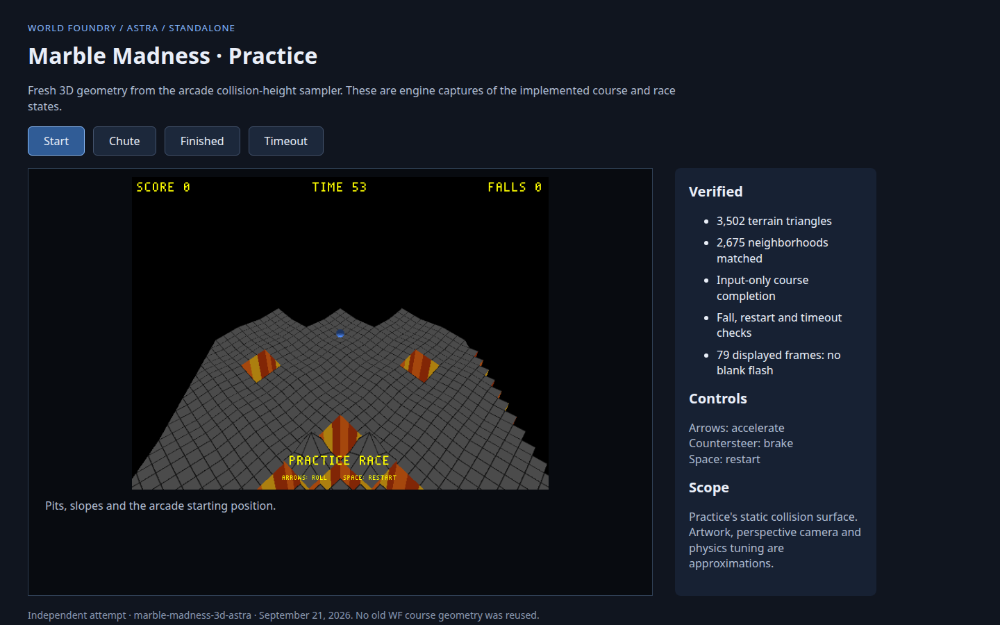

# Plan: Marble Madness — true-3D reimplementation (independent attempt)

**Date:** 2026-09-21
**Status:** Delivered — standalone Practice collision surface and playable race; visual/behavior fidelity limits documented below
**Goal:** A faithful, true-3D reimplementation of arcade Marble Madness's courses in WorldFoundry, built fresh — not by extending the existing stalled implementation. This is one of **two independent, parallel attempts** (this one, on branch `marble-madness-3d-astra`; a second on branch `marble-madness-3d-fable`, built by a Claude Code session in a separate worktree). Will is comparing the two approaches; they must not share code or coordinate with each other.

## Why "start fresh" — read this first

WorldFoundry already has a Marble Madness recreation effort at `wflevels/marble-madness/` (see `docs/marble-madness/README.md`), and separately the currently-shipped `marble-madness`/`marble-madness-2` levels in `wflevels/`. **Will's explicit instruction: ignore both existing implementations. Do not read, reuse, extend, or build on top of their `.lev`/`.iff`/Blender-script files.** The existing effort's own verdict on the shipped levels was that they were never accurate arcade conversions (physics/ball-movement was fine, course geometry was not), and the ROM-faithful effort stalled part-way (M3 of 5, see `docs/plans/2026-05-01-marble-madness-faithful.md` for what that means if you're curious about *why* it stalled, but do not treat its implementation choices as a starting point).

**What you SHOULD use freely — all the prior research, none of the prior implementation:**

- `docs/investigations/2026-05-01-marble-madness-rom-level-data.md` — how the arcade ROM's level data was located and decoded. This is the ground truth for accurate course geometry: real arcade level layouts, not guesses.
- `docs/investigations/2026-05-01-mm-level-elevations.md` — elevation/height-field data for the courses, with MAME reference screenshots for cross-checking.
- `wflevels/marble-madness/decode_levels.py` and `wflevels/marble-madness/levels.json` (already-decoded output) — **you may run/read the decoder and use its output data**, but do not reuse `rom_to_blender.py` or any of the Blender scene scripts that consume it; write your own geometry pipeline.
- `assets/arcade-roms/marble.zip` — the vendored ROM the decoder reads, if you need to re-derive anything the decoder doesn't already expose.
- `docs/plans/2026-05-02-level-recreation-workflow.md` — process notes on how the previous effort approached level recreation (useful context on pitfalls, not a spec to follow).
- `docs/plans/2026-05-01-marble-madness-faithful.md` — the previous effort's full milestone breakdown (M1–M5+), physics/camera notes (isometric camera math, camera-relative input, fixed-point angle format gotchas), and its 42-test coverage target table. Read this for the *domain knowledge* (what an accurate camera/physics/course setup needs to get right) — the specific files it produced are what you're not reusing.
- `docs/plans/2026-04-28-marble-player-sphere.md`, `docs/plans/2026-04-28-replace-player-mesh-with-sphere-marble-in-marble.md`, `docs/plans/2026-04-30-duplicate-marble-madness-level-for-physics-motion-co.md` — smaller prior investigations into ball/physics representation, same rule: read for findings, don't reuse the artifacts.
- General engine docs: `docs/level-building.md`, `docs/level-design-troubleshooting.md`, `docs/level-layouts.md`, `~/WorldFoundry-wbniv/CLAUDE.md` (coordinate systems, Euler angle conventions — read carefully, there's a documented bug in a code comment vs. the actual implementation, noted there).

## What "true 3D" means here

The shipped `marble-madness`/`marble-madness-2` levels are simplified/inaccurate course geometry riding on the engine's existing 3D renderer and (per the recent backface-culling effort) correctly-wound meshes — but the *courses themselves* don't match the arcade original's layout. "True 3D reimplementation" means: use the engine's real 3D physics (Jolt, already integrated — see `wfsource/source/physics/jolt/`) and real 3D course geometry derived from the decoded ROM data, so the marble actually rolls on accurately-shaped 3D terrain (slopes, chutes, ramps, gaps) matching the arcade courses' real elevation/layout data, viewed from an isometric-style camera as the original used.

## Scope

Pick your own implementation path, but the deliverable should be:

1. At least one fully accurate, playable course (Practice and/or Beginner are the natural starting points — smallest courses, per the ROM data). Judge "accurate" against the decoded level data and the MAME reference screenshots in the elevations investigation, not against the existing WF implementation.
2. A clear write-up of your approach: how you turned the decoded ROM data into WF level geometry, what your camera/physics setup is, what's faithful vs. approximated and why, and how far you got (which of the 6 arcade courses — Practice, Beginner, Intermediate, Aerial/Advanced, Silly, Ultimate — are complete vs. not attempted).
3. If you have time/budget after a first accurate course, extend to more courses — but a single genuinely accurate course beats a rough pass at all six.

## Where to put it

New level(s) under `wflevels/marble-madness-3d/` (or similar — your call), **not** inside the existing `wflevels/marble-madness/` directory, so there's no risk of colliding with or accidentally modifying the existing implementation. Don't touch `wflevels/marble-madness/`, `wflevels/marble-madness-2/`, or the shipped `cd.iff` bundle list — this is a standalone, non-shipped level for now, run directly via `wf_game -L<path>`, same as the existing effort's levels are.

## Process

Follow this repo's normal conventions: plan-first (this doc, update it as you go), commit at natural checkpoints on your branch (`marble-madness-3d-astra`), don't touch files outside your remit. `task build` must stay green throughout. Write up verification the way this repo does it elsewhere (numbered steps + raw output + PASS/FAIL) rather than prose claims.


## Astra execution plan

- [x] Cross-check the old descriptor interpretation against the saved arcade captures. Preserve raw records; do not silently turn uncertain fields into geometry.
- [x] Build a fresh, reproducible standalone Practice course with shared render/collision triangles and an isometric follow camera.
- [x] Wire marble control, fall recovery, race timer, finish detection, and restart using zForth and the engine's Jolt path.
- [x] Verify source-data fidelity, winding and nondegenerate geometry, compile the bundle, run the engine, and capture visual/playability evidence.
- [x] Record fidelity limits and course coverage; commit only this attempt's work.

### Result and correction to the research

The old `0x1DEC0` records are **object-spawn rectangles and script arguments, not terrain heights**. The brief's description of them as ground-truth elevation data was incorrect. No old course geometry or Blender scripts were read or reused. The unavailable local ROM was replaced for extraction by the public Internet Archive preservation set; no ROM archive or program image is committed.

The actual Practice header at `0x2BEE2`, reached through `0x2BE00`, supplies the packed terrain sampler at `0x1CABA`. A fresh MAME capture provides playfield and dynamic indirect-table state. The new converter emits the arcade's split-triangle collision surface: **1,823 nonempty cells, 3,502 top triangles, 4,818 triangles including authored skirts**. The marble collides with that same mesh through Jolt.

[Implementation, provenance, reproduction and fidelity limits](../../wflevels/marble-madness-3d/README.md). Practice's static collision course and standalone race are implemented. Beginner, Intermediate, Aerial, Silly and Ultimate are not attempted. Artwork, skirt depth, perspective projection, motion tuning, frozen dynamic terrain, score and respawn rules are approximations; this is not a pixel- or behavior-exact arcade port. The sphere uses the existing Jolt CharacterVirtual/MarbleHandler rather than angular rigid-body physics.

### Visible result

[](2026-09-21-marble-madness-true-3d-reimplementation/practice-review.html)

The self-contained review switches among start, chute, finished and timeout engine captures. It fits a 1440×900 canvas and carries its assets inline.

### Reported flicker and fix

Will reported the **entire window contents flickering**, while the window remained open. `WfCaptureActive()` rendered every frame to the capture FBO, but `CaptureFrame()` returned before blitting unless a PNG/video frame was being written. Swapping the stale default back buffers caused the flashes. The fix always blits the offscreen frame to the live window before deciding whether to read/save pixels, and restores framebuffer binding on the no-read path. It does not change screenshot timing.

The regression check samples the presented X window on a private Xvfb display, covering frames before and after the PNG. All 79 samples contained at least 90,295 visible pixels. This checks live presentation, not just the offscreen PNG. Subsequent automated runs use the private display to avoid disturbing Will's desktop.

### Verification

1. Run the course geometry and gameplay regression checks.

```text
$ python3 wflevels/marble-madness-3d/verify_geometry.py
test_captured_source_identity (__main__.PracticeGeometry.test_captured_source_identity) ... ok
test_independent_arcade_interpolation_and_voids (__main__.PracticeGeometry.test_independent_arcade_interpolation_and_voids) ... ok
test_native_projection_scale (__main__.PracticeGeometry.test_native_projection_scale) ... ok
test_nondegenerate_unique_upward_surface (__main__.PracticeGeometry.test_nondegenerate_unique_upward_surface) ... ok
test_start_support_and_finish_channel (__main__.PracticeGeometry.test_start_support_and_finish_channel) ... ok

----------------------------------------------------------------------
Ran 5 tests in 0.197s

OK

PASS: 251 MAME queries matched; 1823 terrain cells extracted
PASS: 2675 complete neighborhoods compared with independent instruction-level reference; 0 mismatches
PASS: 1823 complete neighborhoods compared with independent instruction-level reference; 0 mismatches
```

PASS. Five geometry checks, 251 live MAME queries (mostly the start), 2,675 independently evaluated neighborhoods, and a second comparison covering every one of the 1,823 retained cells. The independent reference is Marble Love commit `113cf5de969ff62cb1d7b901340206f30122f658`; TypeScript annotations were removed for the local Node runtime without altering executable statements. Gameplay results are recorded in step 4.

2. Regenerate and compile the standalone level from its source inputs.

```text
$ python3 wflevels/marble-madness-3d/build.py --tools-root /home/will/WorldFoundry-wbniv
levcomp v0.1.0
  input : marble-madness-3d.lev.bin
  .lc   : /home/will/WorldFoundry-wbniv-mm3d-astra/wfsource/source/oas/objects.lc
  output: marble-madness-3d.lvl
  oad   : /home/will/WorldFoundry-wbniv-mm3d-astra/wfsource/source/oas
  meshes: .
  parsed 10 objects
  loaded 29 classes
  loaded OAD schemas
  mesh bbox for terrain.iff: [-655360, -655360, -589824, 4325376, 4128768, 80265]
  mesh bbox for marble.iff: [-31457, -31457, -31457, 31457, 31457, 31457]
  mesh bbox for finish.iff: [2981888, 3601203, -240795, 3440640, 3607757, -44187]
  wrote 4528 bytes
  wrote asset.inc
  wrote marble-madness-3d.iff.txt
  wrote marble-madness-3d.ini
Practice: 1823 source cells, 3502 surface triangles, 4818 total triangles, 7970 vertices
Bounds: (-10, -10, -9, 66, 63, 1.224744871391589)
Built: /home/will/WorldFoundry-wbniv-mm3d-astra/wflevels/marble-madness-3d/marble-madness-3d-standalone.iff

SHA-256 before and after the final rebuild:
0dce1aa023c26dcd78dd30260fc704a3e32251c363e4a76dfe2a7febc5a957c3
0dce1aa023c26dcd78dd30260fc704a3e32251c363e4a76dfe2a7febc5a957c3
```

PASS. Ten actors compiled; repeated generation produces an identical standalone bundle.

3. Run `task build` on this branch.

```text
$ task build

=== Linking ===

Built: /home/will/WorldFoundry-wbniv-mm3d-astra/engine/wf_game
Run:   cd /home/will/WorldFoundry-wbniv-mm3d-astra/wfsource/source/game && DISPLAY=:0 /home/will/WorldFoundry-wbniv-mm3d-astra/engine/wf_game
```

PASS. Linux debug/ASan engine built successfully. Existing engine warnings remain; no new build failure.

4. Run the standalone course in the engine and exercise movement, falling/respawn, finish, and restart; save screenshots and raw logs.

```text
$ DISPLAY=:97 python3 wflevels/marble-madness-3d/verify_runtime.py --output-dir /tmp/mm3d-final-evidence
PASS: 79 presented frames before/after PNG; minimum visible pixels 90295
t=0 waypoint=0 xyz=-0.00,0.00,0.48 race=1 falls=0 time=59.8
t=1 waypoint=0 xyz=2.43,2.45,0.43 race=1 falls=0 time=58.8
t=2 waypoint=1 xyz=3.60,6.20,-0.42 race=1 falls=0 time=57.8
t=3 waypoint=1 xyz=3.65,10.60,-0.98 race=1 falls=0 time=56.8
t=4 waypoint=3 xyz=4.65,14.15,-1.25 race=1 falls=0 time=55.8
t=5 waypoint=4 xyz=6.59,17.49,-1.97 race=1 falls=0 time=54.8
t=6 waypoint=5 xyz=9.95,19.03,-2.36 race=1 falls=0 time=53.8
t=7 waypoint=5 xyz=14.30,19.21,-3.19 race=1 falls=0 time=52.8
t=8 waypoint=5 xyz=18.46,19.45,-3.19 race=1 falls=0 time=51.8
t=9 waypoint=6 xyz=21.25,21.29,-3.17 race=1 falls=0 time=50.8
t=10 waypoint=6 xyz=23.90,23.92,-3.19 race=1 falls=0 time=49.8
t=11 waypoint=6 xyz=27.05,27.17,-3.17 race=1 falls=0 time=48.8
t=12 waypoint=6 xyz=30.36,30.25,-3.87 race=1 falls=0 time=47.8
t=13 waypoint=7 xyz=32.08,32.17,-3.22 race=1 falls=0 time=46.9
t=14 waypoint=8 xyz=35.02,32.71,-3.54 race=1 falls=0 time=46.1
t=15 waypoint=9 xyz=38.17,35.11,-4.04 race=1 falls=0 time=45.1
t=16 waypoint=9 xyz=38.43,38.92,-3.90 race=1 falls=0 time=44.1
t=17 waypoint=10 xyz=39.52,42.24,-3.88 race=1 falls=0 time=43.1
t=18 waypoint=11 xyz=40.87,43.24,-3.85 race=1 falls=0 time=42.4
t=19 waypoint=11 xyz=44.90,43.69,-3.99 race=1 falls=0 time=41.4
t=20 waypoint=13 xyz=48.09,45.08,-4.07 race=1 falls=0 time=40.5
t=21 waypoint=13 xyz=48.70,48.78,-3.97 race=1 falls=0 time=39.5
t=22 waypoint=13 xyz=48.87,53.10,-4.01 race=1 falls=0 time=38.4
PASS: input-only Practice completion, zero falls, 37.76s remaining, score 4776
PASS: restart after finish resets score, time and position
PASS: forced fall increments counter and respawns at start
PASS: timeout stops directional movement
PASS: restart after timeout
PASS: expired deadline takes precedence over goal overlap
PASS: no AddressSanitizer or script compile errors
```

PASS. The complete race used directional input only, with zero falls and 37.76 seconds remaining. Mailbox position mutations are used only in the separately identified fall/deadline fault tests. Captures and the presentation samples are in the co-named evidence directory.

5. Check that the old Marble Madness levels and shipped bundle list are unchanged.

```text
$ git diff --exit-code 6d72171e -- wflevels/marble-madness wflevels/marble-madness-2 wflevels/marble-madness.lev wflevels/marble-madness.iff wflevels/marble-madness-2.lev wflevels/marble-madness-2.iff wflevels/cd.iff wflevels/cd.iff.txt wfsource/source/game/cd.iff android/app/src/main/assets/cd.iff
(no output; exit 0)
$ git diff --check
(no output; exit 0)
```

PASS. Existing course assets and shipped bundles are untouched; only this independent attempt and its small shared HUD/presentation changes are staged.

## Subsequent authorization: bundle inclusion

After reviewing the course and its video, Will explicitly requested: "add this level to cd.iff". This supersedes the standalone-only restriction above. Astra is now appended as level 6 in both this worktree and the main checkout; the original six payloads and shell/default boot are unchanged. `task run-marble-3d-astra` now loads the local bundle, and `task run -- 6` also selects it. Direct `run.py` standalone loading remains available. See the [bundle integration plan](2026-09-21-add-marble-astra-to-cd-iff.md) for the new verification; the original standalone verification above remains a historical record.
