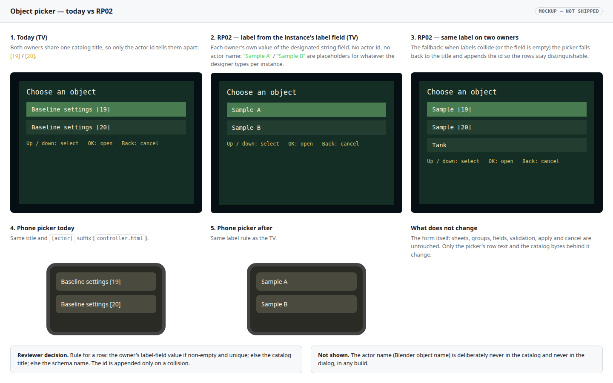

# RP02 property catalog: one schema table, per-owner values, instance labels

**Superseded 2026‑10‑16** by [runtime object editing on OAS/OAD](2026-10-16-runtime-object-editing.md): settings become standard OAS object types and the runtime reads the `.oad`, so no `RP02` chunk is needed. Kept for its trace of why `RP01` exists.

Status: **proposed, not started.** Engine changes for this feature were authorised by Will on 2026‑10‑06 (see [generic settings integration](../../wflevels/baseline/docs/generic-settings-integration.md)); this plan needs a go-ahead on the decisions marked **Decision** before work starts.

## Context

The runtime settings dialog is fed by a per-level property catalog: an `RP01` record per settings owner, appended to the level as an `RPRP` chunk. [`catalog()`](../../scripts/build-object-properties.py) writes it and [`Registry::load`](../../engine/runtime_properties.cpp) reads it. Two things are wrong with it today.

**1. The record is repeated per owner.** Measured on 2026‑10‑11 by calling `catalog()` on the baseline's `settings.oad` and `settings-bindings.json`:

- each owner's record is **17 172 bytes** with **115 fields**;
- `SampleSettings` (actor 19) and `SampleSettings2` (actor 20) are **byte-identical except for the actor id**.

Both owners share one OAD, so the schema (keys, labels, help, groups, choices, ranges) is written twice. The values are a second copy again: they are the `initial` strings in `bindings.json`, not read from the actor's own properties, and the field ids in `bindings.json` are a second source of truth beside the OAD.

**2. The picker cannot tell two owners apart.** The owner title is one string per catalog, so both owners are "Baseline settings", and the picker appends the actor id: `Baseline settings [19]` and `Baseline settings [20]` ([`runtime_settings_ui.cc:32`](../../wfsource/source/game/runtime_settings_ui.cc) and [`controller.html:213`](../../wfsource/source/hal/phonepad/controller.html)). The id is a debug artefact, not a name.

**Why the catalog exists at all** (traced 2026‑10‑11): the engine keeps each actor's OAD data as packed C structs generated into `.ht` headers (`_Common`, `_Movement`, `_Mesh`, `_Target`, ...). Field names, labels, ranges and help text are not available at runtime. The only runtime name-to-offset table, `kPropMap` in [`wfmut.cpp`](../../engine/mutation/wfmut.cpp), covers three blocks and is compiled out of shipped builds. The settings fields live in no compiled struct: the settings actors are bare `Target` actors, and adding the fields to `target.oad` would change the layout for every `Target` (the "global actor schema change" the [object editor plan](2026-10-06-runtime-oas-oad-object-editor.md) avoids). So the catalog cannot be dropped; its shape can be fixed.

## Approach

Replace `RP01` with **`RP02`**: the same idea with the duplication removed and a label slot added.

- **Schema table, once per OAD.** Each distinct schema is written once: id, name, and the field list exactly as `RP01` writes it today (key, label, help, group, choices, kind, show, rule, min, max, scale, width, max length, field id).
- **Object records.** Per owner: actor id, schema id, an optional title, an optional **label field id** (`0` = none), and the owner's values as `(field id, string)` pairs. The values are validated at load as today.
- **Picker label rule.** A row shows the owner's label-field value if it is non-empty and unique among rows; otherwise the title; otherwise the schema name. The actor id is appended **only when two rows would still be identical**. The actor name is never in the catalog or the dialog, in any build.
- **Cooker.** [`catalog()`](../../scripts/build-object-properties.py) splits `bindings.json` into schema-level entries (field ids, `readonly`, `max_length`) and per-owner entries (initial values, title, `label_field`). [`settings_fixture.py`](../../wflevels/baseline/settings_fixture.py) writes one shared schema binding plus a small per-owner file.
- **Runtime.** `Registry::load` accepts `RP02`. It keeps accepting `RP01` so levels built against the frozen runtime and older APKs still load; the cooker switches to `RP02` only for builds that carry the refreshed runtime. A new `Object::label()` implements the rule above; the TV picker and the phone picker both call it, and the phone snapshot JSON carries the computed label.

Rejected: reading values from the actor's own struct block. It needs a layout change in every actor class that wants settings and does not exist for shipped builds, so it is a different project.

**Critical files:** `scripts/build-object-properties.py`, `engine/runtime_properties.cpp` (+ header), `wfsource/source/game/runtime_settings_ui.cc`, `wfsource/source/hal/phonepad/controller.html`, `wflevels/baseline/settings_fixture.py`, `wflevels/baseline/build.py`, `tests/test_object_properties.py`.

**Other producers and consumers to check before starting** (found by name, not yet read): `scripts/plant_settings_catalog.py` has a `catalog_payload(level)` and so is probably a second producer of the same chunk; the planted tank reads its values through the registry; and the Forth read functions listed in the object editor plan read `Registry` values. All must keep working on `RP02`.

**Expected size effect: small.** The baseline saves about one 17 KB schema (the second copy), and the chunk is padded to 2 048‑byte sectors. The real gains are one source of truth and the instance label, not bytes.

### Decisions needed

1. **Label source.** Per-owner title only (no engine change beyond `RP02` itself), or title plus a designated string field (`label_field`, needs the runtime to read a live value). This plan assumes both, with the field optional.
2. **Back-compat window.** Dual-read `RP01`/`RP02` in the runtime (assumed), or cut over everything at the next runtime refresh.
3. **Where per-instance values come from for real levels.** For the baseline they are fixture bindings. How Blender per-instance properties reach the catalog (the `plant_settings_catalog.py` path) is not yet verified.

## Mockups

The change has one visible surface, the object picker (TV and phone). The catalog bytes themselves have none.

Today's rows read `Baseline settings [19]` and `[20]`; after the change each owner shows its own label, with the id appended only on a collision; the phone picker uses the same rule. The form itself is unchanged. [Open the interactive mockup](2026-10-11-rp02-property-catalog/picker.html).

## Out of scope

- Storing settings values in the actor's own OAD struct block (needs per-class layout changes; separate design).
- Exposing the Blender actor name in any build.
- Changing the settings form, validation, apply/cancel or the planted-tank behaviour.
- Making the web player and the Android build share one source for the baseline's `--vram-*` flags (separate defect, tracked with the browser-floor investigation).

## Verification

1. **`RP02` round-trips.** `python3 tests/test_object_properties.py` passes, including new cases: one schema shared by two owners, per-owner values, a label field, a missing or invalid label field, and an `RP01` catalog still loading.
2. **Baseline records shrink and stay equivalent.** Build the baseline and compare the decoded `RP01` and `RP02` catalogs: every owner has the same fields and values in both; the `RPRP` chunk is smaller than 2 × 17 172 bytes of payload.
3. **Native desktop picker.** `python3 wflevels/baseline/verify.py --desktop` still passes (two owners, independent selection and isolation), and a capture of the picker shows two distinct labels with no actor id.
4. **Collision fallback.** A fixture with two owners sharing a label shows the title plus the id on both rows.
5. **Phone picker.** The phone snapshot for the baseline lists two distinct labels and selecting each opens the matching owner.
6. **Planted tank unchanged.** The planted-tank settings (seed, water type, growth speed) open and apply exactly as before on the same `RP02` build.
7. **Device.** The frozen APK with the new runtime shows the new picker on both Chromecasts (cast1 and cast2), recorded as coordinator-owned sessions.
