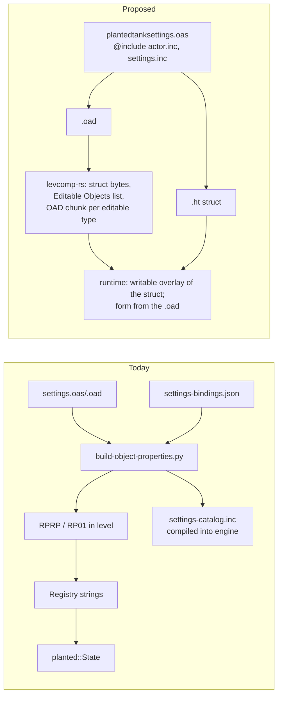
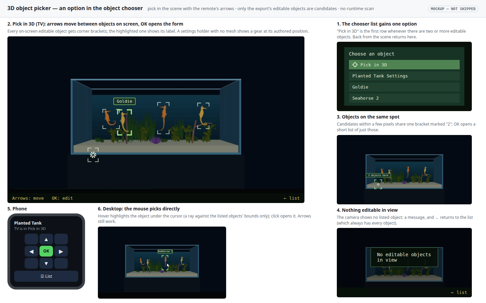
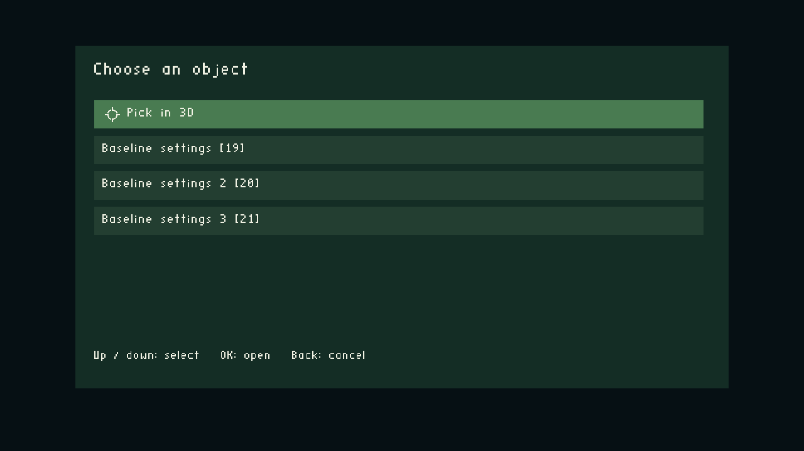
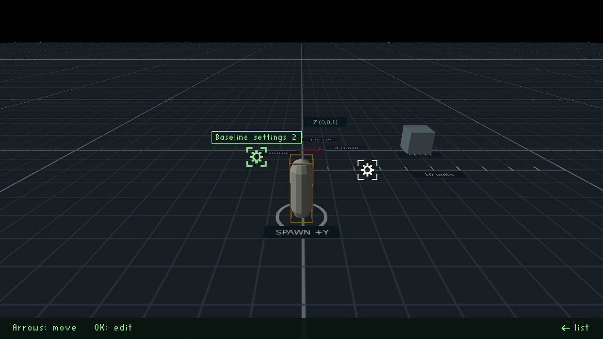
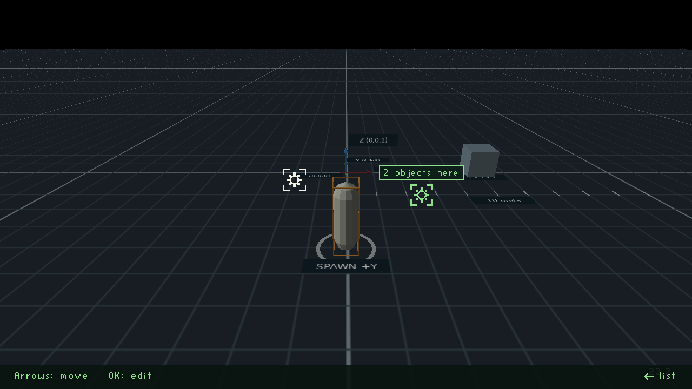
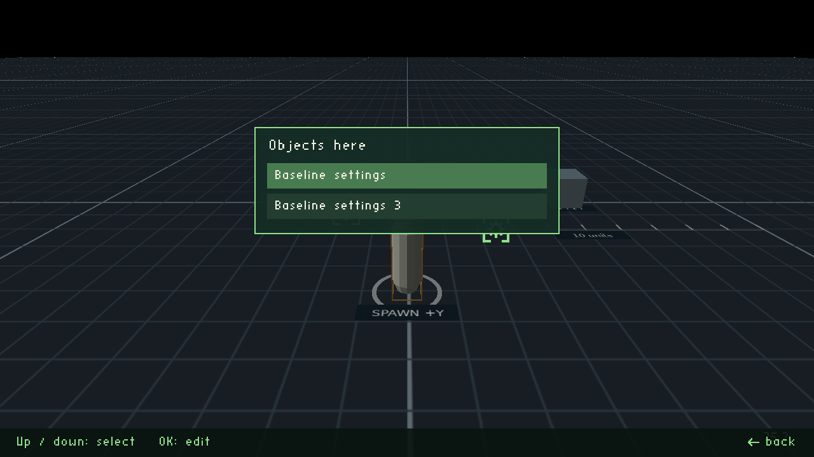
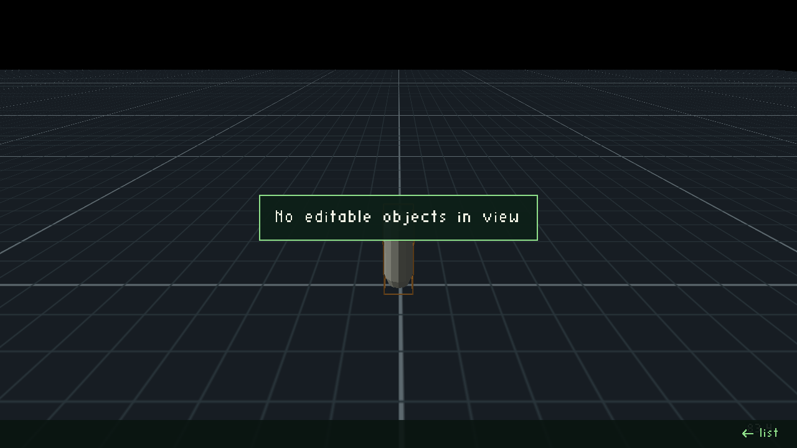

# Runtime object editing on OAS/OAD: any object, standard types, no catalog chunk

16 October 2026 · **Proposed.** It supersedes [RP02](2026-10-11-rp02-property-catalog.md) and keeps the goal of the [runtime object editor plan](2026-10-06-runtime-oas-oad-object-editor.md): any object can be edited on the TV or phone. That plan's host, TV form and phone form stay. Its `RP01` data layer is replaced. Engine changes need Will's confirmation of the scope below; the 2026‑10‑06 authorisation covered that plan's "minimal core changes".

## Decisions

**Made (Will, 2026‑10‑16):**

| # | Decision |
|---|---|
| M1 | A settings holder is a standard OAS object type, not a bespoke catalog. Inheritance is `@include`: `PlantedTankSettings` inherits `Settings` through `@include settings.inc`, as every type inherits `Actor` through `actor.inc`. |
| M2 | **Any object can be editable**, not only one settings object per level. A settings holder is just one editable object. |
| M3 | Finding objects by type happens **only at export**, never by scanning at runtime. The export writes the list and the runtime follows it. |
| M4 | Seed stays an `INT32` capped at 0…2³¹−1. |
| M5 | Labels are XDATA strings (`XDATA_COPY`), as the convention requires for strings. |
| M6 | **Labels:** automatic at export (the type's display name plus an ordinal, e.g. "Seahorse 2"). An optional **Editor Label** in `actor.inc` (`XDATA_COPY`) overrides it. Labels must be unique within a level, or the build fails. |
| M7 | **Editability is automatic at export:** an object is editable exactly when its type declares at least one live field. No per-instance flag. Add an opt-out only if a picker ever gets crowded. |
| M8 | **Live fields are declared in the OAS** with a `SHOW_AS_LIVE` modifier bit (0x40), following the `SHOW_AS_VECTOR` (0x80) pattern. A type with live fields implements one change hook, and every live field has a test proving an edit takes effect. Non-live fields show read-only. **The UI never prints "live":** editable fields carry no marker; read-only fields are dimmed and show a padlock icon (Will, 2026‑10‑16). |
| M9 | **`--edit-all`, desktop/debug builds only** (Will, 2026‑10‑16): a switch that makes every object in the level editable, whether or not its type declares a live field. It is compiled out of release and Android builds, so shipped behaviour still follows the export's list (M3, M7). Under the switch the chooser lists every object; one the export didn't list is labelled with its type's display name and actor index. Non-live fields become editable too: an edit lands in the overlay, and takes effect only where the engine re-reads that field, so there is no per-field test requirement for them. Listing every object is a walk of the level's object array, not a search by type, so M3's rule against runtime type scans still holds. |

**Open:**

| # | Question | Recommendation |
|---|---|---|
| O4 | Engine permission | Confirm the scope under "Engine changes". |

## Context: what exists today, from the code

The planted tank's settings exist in **five forms**:
1. `settings.oas`/`settings.oad`;
2. `settings-bindings.json`, holding ids and initial values;
3. the `RP01` records in the level's `RPRP` chunk;
4. the same catalog **compiled into the engine** (`plant_settings.h:47` includes `wflevels/aquarium_plants/settings-catalog.inc`);
5. the hand-written `planted::State`, synced by hard-coded field ids (`plant_settings.h:49`).

The live values sit in the registry's strings and in `planted::State`, **never** in an actor's struct.

Facts from the survey:
- levcomp-rs only loads `<class>.oad` from `wfsource/source/oas`, so it never sees `settings.oad`. No shipped level contains `.oad` descriptors; only `wf_edit` reads `.oad` files.
- Struct fields are `int32`/`fixed32` only (`oadtypes.s:38-52`). levcomp writes them in OAD order with no padding (`oad_loader.rs:68-117`).
- Actor data is read-only (`_oadData` is `const`). Common-block pages are de-duplicated across actors (`common_block.rs:3-6`).
- Of the 2026‑10‑06 plan's "multiple owners", the only case is the baseline level's **two dummy `target` actors**, which exist to exercise the picker (`wflevels/baseline/generate.py:209`).



## Design

1. **Types.**
    - `wfsource/source/oas/settings.inc` is the base. It holds the defaults a non-rendering holder of values needs (no mesh sheet, no physics), plus anything every settings holder comes to share.
    - `plantedtanksettings.oas`: `TYPEHEADER(Planted Tank Settings, PlantedTankSettings)`, `@include actor.inc`, `@include settings.inc`, then the sheet:
        - Seed: `INT32` 0…2147483647, `SHOW_AS_NUMBER|SHOW_AS_LIVE`;
        - Water type: radio buttons, live;
        - Growth speed: slider, live;
        - Initial age: `FIXED32`, read-only;
        - Textures, Sway, Random seed on entry.

      The seahorse plan's Phase 3 fields (Seahorses, Greeting) join this sheet.
    - Each type is registered as an `OBJECTENTRY`, so the existing `.mas` rules generate its `.oad` and `.ht` (`GNUobjects.mas:41`, `:102`).
2. **`actor.inc`, appended, so it's global but tolerant of older levels:** one field, **Editor Label** (`XDATA_COPY`, optional), the override for M6.
3. **`LevelObj`, appended:** an **Editable Objects** list (`XDATA_OBJECTLIST`). levcomp-rs fills it at export with every object whose type declares at least one `SHOW_AS_LIVE` field (M7); it reads that from the type's `.oad`. It also gives each one its label (the automatic one, or the override), and fails the build on duplicate labels. The engine treats a `LevelObj` whose `OADSize` predates the field as "nothing editable".
4. **Shipped schema:** levcomp writes one `OAD ` chunk per type that has editable objects. It holds the standard `.oad` bytes, about 1.5 KB per field (12 KB for `PlantedTankSettings`). Trimming the padding can come later without changing the layout.
5. **Runtime overlay, so edits change only that object** (as the 2026‑10‑06 plan requires):
    - At construction an editable object gets a writable copy of its class struct, and `_oadData` points at the copy. Engine code reading through `getOad()` therefore sees the edited values unchanged.
    - Common-block pages are copy-on-write for that object when a live field in them is edited.
    - Offsets come from a C++ port of levcomp-rs's `field_size` and `OadReader` (`oad_loader.rs:68-117`, `decompile.rs:152-260`), the tool that writes the bytes. A parity test covers every `.oad` in `wfsource/source/oas`.
6. **Live fields (M8):**
    - **Declared.** A field is live when its OAS entry adds `SHOW_AS_LIVE` to its show-as (e.g. `SHOW_AS_SLIDER|SHOW_AS_LIVE`). Liveness can't be inferred from the data: it means the engine re-reads the field after construction, which is a property of engine code.
    - **Honoured.** A type with live fields implements `OnPropertiesChanged(changedFields)` on its actor class. Apply writes the overlay, then calls the hook, which re-reads what the type uses. The planted tank already re-reads Water type and Growth speed every tick, so its hook is nearly empty; a changed Seed triggers a regenerate.
    - **Enforced.** Every live field has a test that edits it, applies, and checks the effect, so a field marked live that does nothing fails the build. Fields without the bit are read-only: dimmed, with a padlock icon and no text tag. Editable fields carry no marker at all, and the word "live" never appears in the UI. The TV form draws the padlock from its rectangle primitives if its font has no lock character.
7. **UI, kept:**
    - The 2026‑10‑06 host, TV form and phone form remain.
    - The picker lists the `LevelObj` Editable Objects by label. A level with one editable object opens its form directly, as today.
    - The form is built from the object type's `.oad`: labels, help, ranges, choices, show-as. Fields without `SHOW_AS_LIVE` are read-only, dimmed, with a padlock icon.
8. **Scripts:** `property@ ( actor field -- value valid )` keeps its signature. It now reads the overlay struct, with field = descriptor index.
9. **Migration:**
    - **Planted tank:** a `PlantedTankSettings` actor joins the level. `planted::State` reads its struct and `syncProperties` goes. The `settings-catalog.inc` include leaves the engine, and `settings-bindings.json` and the level's `RPRP` are removed.
    - **Baseline:** its one sample becomes a standard editable object, and `SampleSettings2` is deleted.
    - The `RP01` reader stays only until no committed level uses it. Then it is removed along with `build-object-properties.py` and `scripts/plant_settings_catalog.py`.

### 3D object picker (Phase P, implemented ahead of the rest)

Will asked for it on 2026‑10‑16: pick an object by pointing at it in the scene, as **an option in the object chooser list**. It works on today's host, where the candidates are the `RP01` owners. After phase 2 the same code takes its candidates from the `LevelObj` Editable Objects list.

- **Entry.** The chooser's first row is **Pick in 3D**, with a crosshair icon, whenever there are two or more candidates. A single candidate still opens its form directly.
- **Candidates.** Only the chooser's own objects are candidates; nothing is scanned. While the picker is open, each candidate is projected through the active camera every frame: its world bounds, or for a meshless object (a settings holder) its position, shown as a gear marker. Candidates behind the camera or off screen are skipped.
- **Remote and keyboard.**
    - The first highlight is the candidate nearest the screen centre.
    - An arrow moves to the best candidate in that direction: the smallest distance plus twice the perpendicular offset, within ±60° of the arrow.
    - OK opens the existing form (`Form::begin`). Back returns to the chooser, and Back again closes the dialog.
- **Same spot.** Candidates whose projected centres fall within 12 px share one bracket, labelled "N objects here". OK on it opens a short list of just those.
- **Nothing in view.** A message says no editable objects are in view, and Back returns to the list, which always has every object.
- **Desktop mouse.** Hover casts a ray against the candidates' bounds only, and the nearest hit is highlighted; a click is OK. If the desktop HAL exposes no cursor position, arrows only; the trace in Phase P says which.
- **Phone.** The phone chooser gains a **Pick in 3D** button. In pick mode the phone shows a D-pad, OK and **List**, and they drive the TV highlight.
- **Look.**
    - Every candidate gets corner brackets. The highlighted one gets a thicker green bracket and a label tag.
    - Meshless objects show a gear. No status words appear.
    - The scene is dimmed by 28 %, with a hint bar: Arrows move, OK edits, ← list.
    - The game's own input is held while the picker is open, as the dialog already does, and the camera doesn't move.
- **Cost:** N projections per frame, only while the picker is open; nothing when it is closed.
- **Where:**
    - `wfsource/source/game/runtime_settings_ui.cc` (draw and input);
    - the host's mode state (`engine/runtime_property_host.cpp`);
    - the phone page (`wfsource/source/hal/phonepad/controller.html`);
    - a projection helper using the active camera's matrices;
    - position and bounds lookup by actor id.
- **Test fixture.** The baseline level's `SampleSettings2` moves to its own position. A new `SampleSettings3` sits on `SampleSettings`' spot, so one level exercises both arrow navigation and the shared bracket. Phase 4 later reduces the baseline to one object.

[](2026-10-16-runtime-object-editing/picker.html)

[Open the interactive mockup](2026-10-16-runtime-object-editing/picker.html). It is regenerated by `build_picker.py`.

### Engine changes (scope for O4)

- `wfsource/source/oas`: `settings.inc`, `plantedtanksettings.oas`, the `actor.inc` (Editor Label) and `levelobj.oas` (Editable Objects) appends, and `SHOW_AS_LIVE` in `oad.h`.
- The `OnPropertiesChanged` hook on the actor base class, called after Apply.
- `game/level.cc`: the `OAD ` chunk loader and the `LevelObj` list.
- `baseobject`: the writable overlay and copy-on-write.
- A C++ descriptor walker.
- `property@` backing.
- `plant_settings.h`: drop the included catalog and the hand-mirrored state.
- The 2026‑10‑06 host, which takes its owners from the `LevelObj` list.

**Tools:** levcomp-rs (the list, labels and `OAD ` chunks) and the Blender exporter (the new properties).

## Mockups

[](2026-10-16-runtime-object-editing/editor.html)

It shows:
- the TV picker listing editable objects by automatic label ("Seahorse 2") and an override ("Goldie");
- the Planted Tank Settings form, built from its `.oad`, with Initial age dimmed and padlocked (read-only) and no marker on the editable fields;
- the same form on the phone;
- the export failing on a duplicate label.

[Open the interactive mockup](2026-10-16-runtime-object-editing/editor.html). The 3D object picker's mockup is in its own section above.

## Phases

| Phase | Work | Engine edit | Suggested tier |
|---|---|---|---|
| 0 | **Trace before building:** the type registration points (factory, type ids, `.mas` lists); the `XDATA_COPY`/`XDATA_OBJECTLIST` path through levcomp-rs and the engine; how the exporter writes an object's OAD properties | no | T3 |
| 1 | `settings.inc`, `plantedtanksettings.oas`, the `actor.inc`/`levelobj.oas` appends, `SHOW_AS_LIVE`; levcomp-rs list, labels and `OAD ` chunks, with tests | `oas/` only | T4 |
| 2 | Runtime: `OAD ` loader, descriptor walker (parity test), writable overlay with copy-on-write, `property@`, host fed from the list; the desktop/debug `--edit-all` switch (M9) | yes | T4 |
| 3 | Planted tank migration on desktop and both Chromecasts: dialog, phone, water-type switch, seed apply | yes (`plant_settings.h`) | T3 |
| 4 | Baseline migration; delete `SampleSettings2` | no | T2 |
| 5 | Retire `RP01`, the cooker scripts and `settings-bindings.json` once no level uses them | yes (reader removal) | T2 |
| P | **3D object picker** on today's host (above), with desktop and Chromecast screenshots; implemented now, at Will's request | yes (UI, input, projection) | T3 |

## Out of scope

- **Persisting runtime edits** back to the level or the repository. Edits stay session-only, as in the 2026‑10‑06 plan.
- **Editing the `.oad` schemas themselves at runtime.**
- **Translatable labels** (a string table). Revisit if localisation is planned.
- **Trimming the shipped `.oad` padding.** It's an optimisation, deferred until size matters.

## Verification

1. Every `.oad` in `wfsource/source/oas` gives identical field offsets from the C++ walker and levcomp-rs: `ctest --test-dir build -R oad_walker_parity`.
2. levcomp writes the Editable Objects list, labels and `OAD ` chunks, and a duplicate override label fails the build: `python3 -m pytest -q tests/test_editable_objects_export.py`.
3. Only objects whose type declares a live field are listed; objects of other types never appear: `python3 -m pytest -q tests/test_editable_objects_export.py`. Editing one object's live field leaves every other object unchanged, including a field on a shared common page: `ctest -R oad_overlay_isolation`.
4. Every `SHOW_AS_LIVE` field has a test that edits it and observes the effect; a field marked live whose edit changes nothing fails. Seed round-trips 0 and 2147483647 and rejects 2147483648; a non-live field is read-only: `ctest -R oad_overlay_isolation` and the host tests.
5. Planted tank on desktop: Hold A shows the form built from `plantedtanksettings.oad`, and Water type and Seed apply. The level contains no `RPRP` chunk, and `plant_settings.h` includes no level file: `python3 -m pytest -q tests/test_aquarium_plants.py && ! grep -q settings-catalog.inc wfsource/source/game/plant_settings.h`.
6. Both Chromecasts: picker, form, phone apply/cancel, and Back/Home/resume all pass, recorded under `docs/diagnostics/`.
7. A level built before the `actor.inc`/`levelobj.oas` appends still loads, with "nothing editable": `ctest -R levelobj_short_record`.
8. After phase 5, `grep -rln "RP01" engine wfsource scripts wflevels/*.py` lists nothing.

**Phase P (3D object picker):** each step records its screenshots under `docs/plans/2026-10-16-runtime-object-editing/evidence/picker/` and embeds them here.

9. Unit tests pass for the projection, the arrow-direction choice (synthetic layouts: a row, a column, a diagonal, behind-camera, off-screen), the 12 px same-spot grouping, and the mouse ray pick: `scripts/in-linux-container.sh ctest --test-dir /build/sh -R object_picker --output-on-failure`.

    ```
    $ scripts/in-linux-container.sh ctest --test-dir /build/sh -R object_picker --output-on-failure
    Internal ctest changing into directory: /build/sh
    Test project /build/sh
        Start 7: object_picker
    1/1 Test #7: object_picker ....................   Passed    0.00 sec

    100% tests passed, 0 tests failed out of 1

    Total Test time (real) =   0.01 sec
    ```

    **PASS** (2026‑10‑16, Release `/build/sh` on `object-picker-3d`). The test is `tests/object_picker_test.cc` against `engine/object_picker.hpp`; it also covers the ±60° cone edge (50° in, 70° out) and the 12 px threshold (11.5 px grouped, 13 px apart).
10. **Desktop screenshots**, baseline level, Release build in the container under Xvfb:
    - (a) the chooser with **Pick in 3D** first;
    - (b) pick mode with the first highlight;
    - (c) after → the highlight on the next object;
    - (d) the "2 objects here" bracket and its short list;
    - (e) "No editable objects in view" with the camera turned away;
    - (f) mouse hover, if the HAL exposes a cursor.

    All are captured by a scripted run, e.g. `wf_game --frame-step-smoke` with injected keys.

    ```
    $ scripts/in-linux-container.sh /build/desktop-capture.sh /src/docs/plans/2026-10-16-runtime-object-editing/evidence/picker
    captured /src/docs/plans/2026-10-16-runtime-object-editing/evidence/picker/a-chooser.png
    captured /src/docs/plans/2026-10-16-runtime-object-editing/evidence/picker/b-pick.png
    captured /src/docs/plans/2026-10-16-runtime-object-editing/evidence/picker/c-after-right.png
    captured /src/docs/plans/2026-10-16-runtime-object-editing/evidence/picker/d1-same-spot.png
    captured /src/docs/plans/2026-10-16-runtime-object-editing/evidence/picker/d2-short-list.png
    captured /src/docs/plans/2026-10-16-runtime-object-editing/evidence/picker/e-nothing-in-view.png
    ```

    The script is `tests/picker_screenshots.py`, run under Xvfb in the container. It drives Release `wf_game -Lwflevels/baseline-standalone.iff` with injected joystick input over the debug bridge: hold OK 1.4 s, OK, →, OK. A second session moves the player to (40, 40) first, so the follow camera faces away from the owners.

    (a) The chooser, with Pick in 3D first and highlighted:
    

    (b) Pick mode. The first highlight is Baseline settings 2, the gear nearest the centre:
    

    (c) After →, the highlight moves to the next object to the right:
    

    (d) That object is the shared bracket "2 objects here" (`d1-same-spot.png`, the same frame as (c)). OK on it opens the short list of just those two:
    

    (e) The camera is turned away:
    

    (f) **Not captured.** The desktop HAL exposes no cursor: `gfx/gl/mesa.cc` selects `ButtonPress` but not pointer motion, and only `printf`s the button. The ray pick (`wfpick::cursorRay`, `wfpick::rayPick`, `Host::pickHover`) is implemented and unit-tested in step 9, but no HAL input is wired to it.

    **PASS** for (a) to (e). (f) is not applicable, because the HAL has no cursor.
11. **Chromecast 1 screenshots** through the coordinator, on the baseline level: the chooser with the option, pick mode with a highlight, and the highlight after an arrow press from the phone's D-pad. The release is reinstalled afterwards and its hash verified.

    **NOT RUN (escalated).** No coordinator workflow can reach pick mode under owned-job rules:
    - `press` sends at most 20 key taps, and none of them can hold OK.
    - Opening the chooser needs a one-second held OK, or the phone's `r:open`. Only reviewed validators do either (for example `baseline_checks.py` with `held_key` and `Phone`), and they live in the separate `chromecast-coordinator` repository.

    A new reviewed validator is needed, for example `baseline-picker`:
    1. hold OK and capture the chooser;
    2. press OK and capture pick mode;
    3. send `r:<session>:move:right` from the phone and capture the moved highlight.

    No APK was built and no device job was submitted, so there was nothing to restore. The existing `baseline-settings` validator will now fail its `stable_two_owner_picker` assertion, because the plan's fixture has three owners. It also opens the first owner after DOWN, because row 0 is Pick in 3D. That validator needs the same update.
12. The existing settings checks still pass: single-owner direct open (planted tank), apply/cancel, phone reconnect, Back/Home/resume.

    ```
    $ scripts/in-linux-container.sh python3 -m pytest -q -p no:cacheprovider tests/test_runtime_property_host.py tests/test_object_properties.py tests/test_plant_runtime.py tests/test_plant_phone.py tests/test_plant_catalog.py tests/test_runtime_options.py
    FAILED tests/test_runtime_property_host.py::test_phone_picker_isolation_fractional_values_and_reconnect
    FAILED tests/test_plant_phone.py::test_complete_phone_settings_and_reconnection
    FAILED tests/test_plant_phone.py::test_generic_colour_and_text_transactions
    3 failed, 28 passed in 124.61s (0:02:04)
    ```

    The three failures are `ModuleNotFoundError: No module named 'playwright'`, because the container image has no Playwright. Those three Playwright phone tests were run on the host:

    ```
    $ python3 -m pytest -q -p no:cacheprovider tests/test_runtime_property_host.py tests/test_plant_phone.py
    ....                                                                     [100%]
    4 passed in 44.40s
    ```

    The desktop baseline checks and engine smoke tests, in the container under Xvfb:

    ```
    $ python3 wflevels/baseline/verify.py --desktop
    146 of 146 checks passed
    $ ctest --test-dir /build/sh -R "object_picker|wf_game_smoke"
    100% tests passed, 0 tests failed out of 9
    ```

    **PASS** on desktop. The 31 tests cover:
    - single-owner direct open (the host test and the planted-tank harness);
    - apply and cancel;
    - phone reconnect, through the real phone transport in Playwright;
    - the host's new Pick in 3D cases: first highlight, arrows, the same-spot group, Back from group to scene to list to closed, nothing in view, no camera, and the phone verbs.

    Back/Home/resume is an Android lifecycle check and needs the device, so it is **not run**; see step 11.

**macOS (Metal) build, outside the numbered steps** (2026‑10‑16): the picker touches `backend_metal.mm` (`CameraMatrices`), which Linux never compiles. The branch was rebased onto `2026-new-level` (`06787e0d`) and gained `c6fc62c8`, which mirrors GL's guard: false until the first `CaptureTextView`. Codemagic `macos-desktop-debug` on `ci/object-picker-3d-macos` [build 6ad1f95b](https://codemagic.io/app/6aafa6886ab3f21cf431a6cb/build/6ad1f95bf67be9ac6c3ab928) finished green: `backend_metal.mm` compiled, `AQUARIUM PARITY: MATCH`, and the windowed smoke and close-path/fullscreen steps passed. **PASS** (compile and smoke; Pick in 3D itself is not driven on the Mac).
