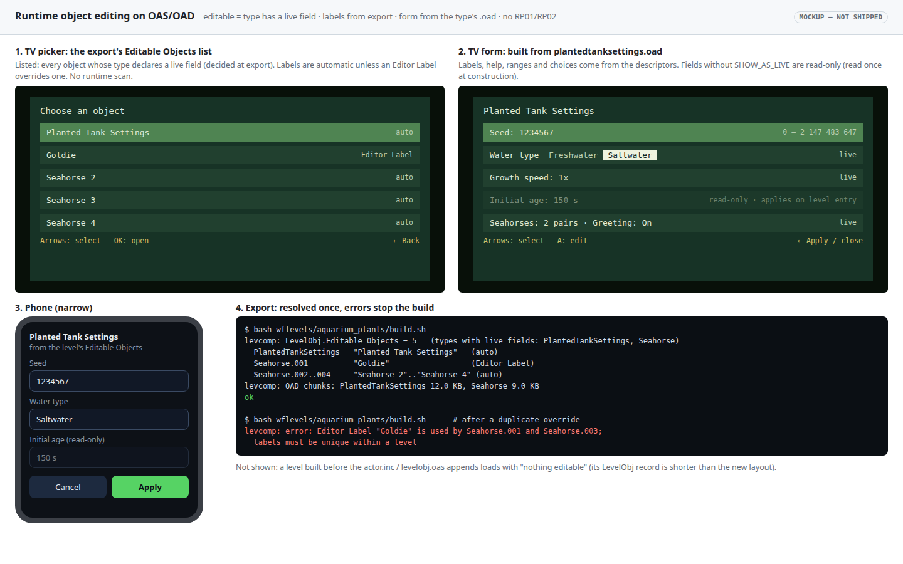

# Runtime object editing on OAS/OAD: any object, standard types, no catalog chunk

16 October 2026 · **Proposed.** It supersedes [RP02](2026-10-11-rp02-property-catalog.md) and keeps the goal of the [runtime object editor plan](2026-10-06-runtime-oas-oad-object-editor.md): any object can be edited on the TV or phone. That plan's host, TV form and phone form stay. Its `RP01` data layer is replaced. Engine changes need Will's confirmation of the scope below; the 2026‑10‑06 authorisation covered that plan's "minimal core changes".

## Decisions

**Made (Will, 2026‑10‑16):**

| # | Decision |
|---|---|
| M1 | A settings holder is a standard OAS object type, not a bespoke catalog. Inheritance is `@include`: `PlantedTankSettings` inherits `Settings` through `@include settings.inc`, as every type inherits `Actor` through `actor.inc`. |
| M2 | **Any object can be editable**, not only one settings object per level. A settings holder is just one editable object. |
| M3 | Finding objects by type happens **only at export**, never by scanning at runtime. The export writes the list and the runtime follows it. |
| M4 | Seed stays an `INT32` capped at 0…2³¹−1. |
| M5 | Labels are XDATA strings (`XDATA_COPY`), as the convention requires for strings. |

| M6 | **Labels:** automatic at export (the type's display name plus an ordinal, e.g. "Seahorse 2"). An optional **Editor Label** in `actor.inc` (`XDATA_COPY`) overrides it. Labels must be unique within a level, or the build fails. |
| M7 | **Editability is automatic at export:** an object is editable exactly when its type declares at least one live field. No per-instance flag. Add an opt-out only if a picker ever gets crowded. |
| M8 | **Live fields are declared in the OAS** with a `SHOW_AS_LIVE` modifier bit (0x40), following the `SHOW_AS_VECTOR` (0x80) pattern. A type with live fields implements one change hook, and every live field has a test proving an edit takes effect. Non-live fields show read-only. |

**Open:**

| # | Question | Recommendation |
|---|---|---|
| O4 | Engine permission | Confirm the scope under "Engine changes". |

## Context: what exists today, from the code

The planted tank's settings exist in **five forms**:
1. `settings.oas`/`settings.oad`;
2. `settings-bindings.json`, holding ids and initial values;
3. the `RP01` records in the level's `RPRP` chunk;
4. the same catalog **compiled into the engine** (`plant_settings.h:47` includes `wflevels/aquarium_plants/settings-catalog.inc`);
5. the hand-written `planted::State`, synced by hard-coded field ids (`plant_settings.h:49`).

The live values sit in the registry's strings and in `planted::State`, **never** in an actor's struct.

Facts from the survey:
- levcomp-rs only loads `<class>.oad` from `wfsource/source/oas`, so it never sees `settings.oad`. No shipped level contains `.oad` descriptors; only `wf_edit` reads `.oad` files.
- Struct fields are `int32`/`fixed32` only (`oadtypes.s:38-52`). levcomp writes them in OAD order with no padding (`oad_loader.rs:68-117`).
- Actor data is read-only (`_oadData` is `const`). Common-block pages are de-duplicated across actors (`common_block.rs:3-6`).
- Of the 2026‑10‑06 plan's "multiple owners", the only case is the baseline level's **two dummy `target` actors**, which exist to exercise the picker (`wflevels/baseline/generate.py:209`).

```mermaid
flowchart LR
    subgraph Today
      O1[settings.oas/.oad] --> C[build-object-properties.py]
      B[settings-bindings.json] --> C
      C --> R[RPRP / RP01 in level]
      C --> I[settings-catalog.inc<br/>compiled into engine]
      R --> G[Registry strings]
      G --> S[planted::State]
    end
    subgraph Proposed
      T[plantedtanksettings.oas<br/>@include actor.inc, settings.inc] --> OAD[.oad] & HT[.ht struct]
      OAD --> LC[levcomp-rs: struct bytes,<br/>Editable Objects list,<br/>OAD chunk per editable type]
      LC --> RT[runtime: writable overlay of the struct;<br/>form from the .oad]
      HT --> RT
    end
```

## Design

1. **Types.**
    - `wfsource/source/oas/settings.inc` is the base. It holds the defaults a non-rendering holder of values needs (no mesh sheet, no physics), plus anything every settings holder comes to share.
    - `plantedtanksettings.oas`: `TYPEHEADER(Planted Tank Settings, PlantedTankSettings)`, `@include actor.inc`, `@include settings.inc`, then the sheet:
        - Seed: `INT32` 0…2147483647, `SHOW_AS_NUMBER|SHOW_AS_LIVE`;
        - Water type: radio buttons, live;
        - Growth speed: slider, live;
        - Initial age: `FIXED32`, read-only;
        - Textures, Sway, Random seed on entry.

      The seahorse plan's Phase 3 fields (Seahorses, Greeting) join this sheet.
    - Each type is registered as an `OBJECTENTRY`, so the existing `.mas` rules generate its `.oad` and `.ht` (`GNUobjects.mas:41`, `:102`).
2. **`actor.inc`, appended, so it's global but tolerant of older levels:** one field, **Editor Label** (`XDATA_COPY`, optional), the override for M6.
3. **`LevelObj`, appended:** an **Editable Objects** list (`XDATA_OBJECTLIST`). levcomp-rs fills it at export with every object whose type declares at least one `SHOW_AS_LIVE` field (M7); it reads that from the type's `.oad`. It also gives each one its label (the automatic one, or the override), and fails the build on duplicate labels. The engine treats a `LevelObj` whose `OADSize` predates the field as "nothing editable".
4. **Shipped schema:** levcomp writes one `OAD ` chunk per type that has editable objects. It holds the standard `.oad` bytes, about 1.5 KB per field (12 KB for `PlantedTankSettings`). Trimming the padding can come later without changing the layout.
5. **Runtime overlay, so edits change only that object** (as the 2026‑10‑06 plan requires):
    - At construction an editable object gets a writable copy of its class struct, and `_oadData` points at the copy. Engine code reading through `getOad()` therefore sees the edited values unchanged.
    - Common-block pages are copy-on-write for that object when a live field in them is edited.
    - Offsets come from a C++ port of levcomp-rs's `field_size` and `OadReader` (`oad_loader.rs:68-117`, `decompile.rs:152-260`), the tool that writes the bytes. A parity test covers every `.oad` in `wfsource/source/oas`.
6. **Live fields (M8):**
    - **Declared.** A field is live when its OAS entry adds `SHOW_AS_LIVE` to its show-as (e.g. `SHOW_AS_SLIDER|SHOW_AS_LIVE`). Liveness can't be inferred from the data: it means the engine re-reads the field after construction, which is a property of engine code.
    - **Honoured.** A type with live fields implements `OnPropertiesChanged(changedFields)` on its actor class. Apply writes the overlay, then calls the hook, which re-reads what the type uses. The planted tank already re-reads Water type and Growth speed every tick, so its hook is nearly empty; a changed Seed triggers a regenerate.
    - **Enforced.** Every live field has a test that edits it, applies, and checks the effect, so a field marked live that does nothing fails the build. Fields without the bit show read-only, with "applies on level entry".
7. **UI, kept:**
    - The 2026‑10‑06 host, TV form and phone form remain.
    - The picker lists the `LevelObj` Editable Objects by label. A level with one editable object opens its form directly, as today.
    - The form is built from the object type's `.oad`: labels, help, ranges, choices, show-as. Fields without `SHOW_AS_LIVE` are read-only.
8. **Scripts:** `property@ ( actor field -- value valid )` keeps its signature. It now reads the overlay struct, with field = descriptor index.
9. **Migration:**
    - **Planted tank:** a `PlantedTankSettings` actor joins the level. `planted::State` reads its struct and `syncProperties` goes. The `settings-catalog.inc` include leaves the engine, and `settings-bindings.json` and the level's `RPRP` are removed.
    - **Baseline:** its one sample becomes a standard editable object, and `SampleSettings2` is deleted.
    - The `RP01` reader stays only until no committed level uses it. Then it is removed along with `build-object-properties.py` and `scripts/plant_settings_catalog.py`.

### Engine changes (scope for O4)

- `wfsource/source/oas`: `settings.inc`, `plantedtanksettings.oas`, the `actor.inc` (Editor Label) and `levelobj.oas` (Editable Objects) appends, and `SHOW_AS_LIVE` in `oad.h`.
- The `OnPropertiesChanged` hook on the actor base class, called after Apply.
- `game/level.cc`: the `OAD ` chunk loader and the `LevelObj` list.
- `baseobject`: the writable overlay and copy-on-write.
- A C++ descriptor walker.
- `property@` backing.
- `plant_settings.h`: drop the included catalog and the hand-mirrored state.
- The 2026‑10‑06 host, which takes its owners from the `LevelObj` list.

**Tools:** levcomp-rs (the list, labels and `OAD ` chunks) and the Blender exporter (the new properties).

## Mockups

[](2026-10-16-runtime-object-editing/editor.html)

It shows:
- the TV picker listing editable objects by automatic label ("Seahorse 2") and an override ("Goldie");
- the Planted Tank Settings form, built from its `.oad`, with Initial age read-only because it isn't live;
- the same form on the phone;
- the export failing on a duplicate label.

[Open the interactive mockup](2026-10-16-runtime-object-editing/editor.html).

## Phases

| Phase | Work | Engine edit | Suggested tier |
|---|---|---|---|
| 0 | **Trace before building:** the type registration points (factory, type ids, `.mas` lists); the `XDATA_COPY`/`XDATA_OBJECTLIST` path through levcomp-rs and the engine; how the exporter writes an object's OAD properties | no | T3 |
| 1 | `settings.inc`, `plantedtanksettings.oas`, the `actor.inc`/`levelobj.oas` appends, `SHOW_AS_LIVE`; levcomp-rs list, labels and `OAD ` chunks, with tests | `oas/` only | T4 |
| 2 | Runtime: `OAD ` loader, descriptor walker (parity test), writable overlay with copy-on-write, `property@`, host fed from the list | yes | T4 |
| 3 | Planted tank migration on desktop and both Chromecasts: dialog, phone, water-type switch, seed apply | yes (`plant_settings.h`) | T3 |
| 4 | Baseline migration; delete `SampleSettings2` | no | T2 |
| 5 | Retire `RP01`, the cooker scripts and `settings-bindings.json` once no level uses them | yes (reader removal) | T2 |

## Out of scope

- **Persisting runtime edits** back to the level or the repository. Edits stay session-only, as in the 2026‑10‑06 plan.
- **Editing the `.oad` schemas themselves at runtime.**
- **Translatable labels** (a string table). Revisit if localisation is planned.
- **Trimming the shipped `.oad` padding.** It's an optimisation, deferred until size matters.

## Verification

1. Every `.oad` in `wfsource/source/oas` gives identical field offsets from the C++ walker and levcomp-rs: `ctest --test-dir build -R oad_walker_parity`.
2. levcomp writes the Editable Objects list, labels and `OAD ` chunks, and a duplicate override label fails the build: `python3 -m pytest -q tests/test_editable_objects_export.py`.
3. Only objects whose type declares a live field are listed; objects of other types never appear: `python3 -m pytest -q tests/test_editable_objects_export.py`. Editing one object's live field leaves every other object unchanged, including a field on a shared common page: `ctest -R oad_overlay_isolation`.
4. Every `SHOW_AS_LIVE` field has a test that edits it and observes the effect; a field marked live whose edit changes nothing fails. Seed round-trips 0 and 2147483647 and rejects 2147483648; a non-live field is read-only: `ctest -R oad_overlay_isolation` and the host tests.
5. Planted tank on desktop: Hold A shows the form built from `plantedtanksettings.oad`, and Water type and Seed apply. The level contains no `RPRP` chunk, and `plant_settings.h` includes no level file: `python3 -m pytest -q tests/test_aquarium_plants.py && ! grep -q settings-catalog.inc wfsource/source/game/plant_settings.h`.
6. Both Chromecasts: picker, form, phone apply/cancel, and Back/Home/resume all pass, recorded under `docs/diagnostics/`.
7. A level built before the `actor.inc`/`levelobj.oas` appends still loads, with "nothing editable": `ctest -R levelobj_short_record`.
8. After phase 5, `grep -rln "RP01" engine wfsource scripts wflevels/*.py` lists nothing.
