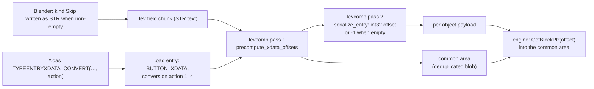
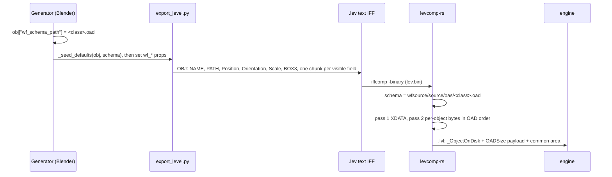
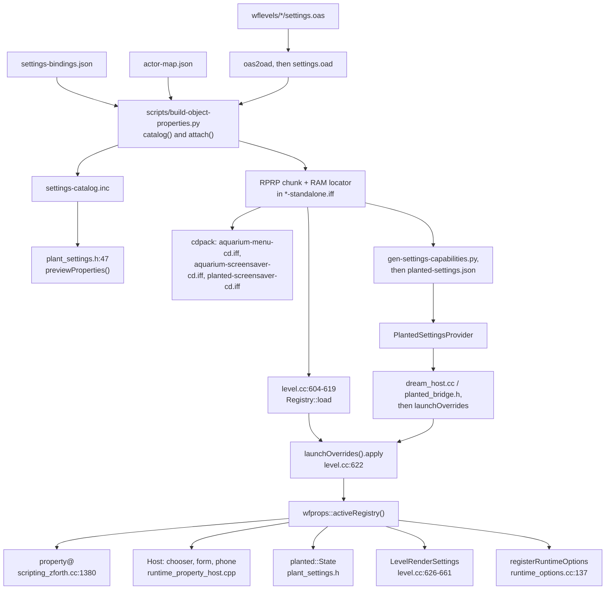

# Runtime object editing: Phase 0 trace

10 November 2026 · Phase 0 of [runtime object editing](../2026-10-16-runtime-object-editing.md) ("trace before building"). This trace changes no code. Every `path:line` is checked against the working tree of `2026-new-level` at `4f4b4f99`, on 2026‑11‑10. Three files that other sessions have edited but not committed are cited at their working-tree lines, which are the lines Phase 1 will meet: `scripts/build-object-properties.py`, `scripts/build-aquarium-screensaver-levels.py` and `tests/test_aquarium_screensaver_catalog.py`. Where a line differs from `HEAD`, the trace says so.

Nothing here was built or run. Every finding comes from reading the source, `grep` and `git`. Two facts were measured on files in the working tree: the `.oad` sizes (`ls -l`) and the common-area lengths in the `.lvl` headers (Python `struct`).

> **The design cannot be built as written in one place.** Design item 2 appends **Editor Label** to `actor.inc` and expects older levels to tolerate it. They won't. `actor.inc` is included **before** each type's own fields, so a field added there is inserted into the middle of every class struct, and every type-specific field moves by 4 bytes ([§2.3](#23-is-the-append-tolerated)). The `LevelObj` append is safe, and it has a working precedent. This needs a decision before Phase 1 ([§8](#8-risks-and-open-questions), R1).

## Contents

1. [Type registration](#1-type-registration)
2. [`XDATA_COPY` and `XDATA_OBJECTLIST`](#2-xdata_copy-and-xdata_objectlist)
3. [How the exporter writes an object's OAD properties](#3-how-the-exporter-writes-an-objects-oad-properties)
4. [`_oadData`, common blocks and the overlay](#4-_oaddata-common-blocks-and-the-overlay)
5. [`property@`](#5-property)
6. [Every RPRP/RP01 user today](#6-every-rprprp01-user-today)
7. [Line-number drift](#7-line-number-drift)
8. [Risks and open questions](#8-risks-and-open-questions)

---

## 1. Type registration

### 1.1 The real pipeline is not the `.mas` files

The plan says the existing `.mas` rules generate each type's `.oad` and `.ht` (`GNUobjects.mas:41`, `:102`). Those lines exist, but **no build executes either `.mas` file**. Nothing outside `docs/` and the two files themselves refers to `GNUobjects.mas` or `objects.mas`. `GNUobjects.mas` has no rule that produces a `.oad` at all; its `.oad` line is a dependency list only (`wfsource/source/oas/GNUobjects.mas:140`). These are the paths that are live today:

| Output | Generator | Where it's run | Checked by |
|---|---|---|---|
| `<name>.ht` | `prep` + `oadtypes.s`, then an awk port of `cstruct.pl` | `wfsource/source/oas/regen-headers.sh:61-66`, which loops over **every** `*.oas` | `wftools/oas2oad-rs/tests/ht_codegen.rs:34` (`task test-codegen`, `Taskfile.yml:2066-2069`) |
| `objects.c`, `.col`, `.e`, `.h`, `.inc`, `.lc` | `prep` over `objects.{s,cos,es,hs,ins,lcs}`, each including `objects.mac` | `regen-headers.sh:70-75` (`task gen-oas-headers`, `Taskfile.yml:2061-2064`) | `ht_codegen.rs:81-88` checks only `objects.{c,e,h}` |
| `<name>.oad` (committed golden) | `oas2oad` (prep, then g++, then objcopy `.data`) | by hand, per file; no task regenerates them all | `wftools/oas2oad-rs/tests/oas_to_oad.rs:73` (every `.oas` that has a golden `.oad`; an `.oas` without one is skipped, `:94`) |
| `objects.car`, `objects.ctb` | `coltab.pl` | **not wired** to any task or script | none |
| `objects.p` | `objects.ps` | **not regenerated**; stale (it stops at `Alias_KIND 25`, `wfsource/source/oas/objects.p:50`) | none |

`docs/level-building.md:1514-1525` says `regen-headers.sh` regenerates only `objects.{c,e,h}`. That's out of date: the script now writes `.col`, `.inc` and `.lc` too (`regen-headers.sh:71,74,75`). The doc is right that `objects.ctb`/`.car` are not revived.

### 1.2 Where a type is registered

| Registration point | Location | Mechanism |
|---|---|---|
| Master list | `wfsource/source/oas/objects.mac:18-57` | `OBJECTENTRY(Name,collidable)`; the position in the list **is** the type id |
| Kind enum | `wfsource/source/oas/objects.h:20-51`, `objects.e:23-52`, included into `BaseObject::EActorKind` at `wfsource/source/baseobject/baseobject.hp:66-70` | `Name_KIND`, then `MAX_OBJECT_TYPES` |
| Factory | `wfsource/source/oas/objects.c` (template at `objects.s:10`), compiled into `wfsource/source/game/level.cc:96`; called from `Level::constructObject`, `level.cc:226` | `case Actor::Name_KIND: object = OadName(startData)`; an `OBJECTONLYTEMPLATEENTRY` or `OBJECTNOACTORENTRY` constructs `NULL` |
| Class headers | `wfsource/source/oas/objects.inc` (template `objects.ins:10`), included at `level.cc:91` | `#include "<lowercase name>.hp"` |
| Collision flag | `objects.col` (from `objects.cos:11`), included at `wfsource/source/game/actor.cc:78` | the `collidable` argument |
| Collision table | `objects.car`, included at `wfsource/source/physics/collision.cc:464` | `collisionInteractionTable[MAX_OBJECT_TYPES]²`. The committed table has 27 rows and 27 columns against 29 types, so rows 27-28 (`File`, `Dir`) are zero-filled, which is `CI_NOTHING` (`wfsource/source/physics/collision.hp:18`) |
| Class name to type id, at export | `objects.lc` (from `objects.lcs`); `wftools/levcomp-rs/src/lc_parser.rs:26-29` lowercases the name and returns its position; `wftools/levcomp-rs/src/lvl_writer.rs:296-300` writes that position as `_ObjectOnDisk::type` | lowercase names in list order |
| Class name to schema, at export | `wftools/levcomp-rs/src/oad_loader.rs:36-58` loads every `<stem>.oad` in the OAD directory, keyed by the lowercased stem; `wftools/wf_blender/build_level_binary.sh:32,64` passes `wfsource/source/oas` | file stem |
| `MovementClass` default | `wfsource/source/oas/movebloc.inc:26`, `@e0(OASNAME@+_KIND)`; `oas2oad` passes `-Dname_KIND=<index from objects.lc>` (`wftools/oas2oad-rs/src/main.rs:287-306`); every `kind()` asserts it, e.g. `wfsource/source/game/target.cc:53` | the `.lc` position must exist **before** `oas2oad` runs, and `--objects-lc` must be passed (`oas_to_oad.rs:63` passes it) |
| C++ class | `wfsource/source/game/<name>.{hp,cc}`: an `Actor` subclass with `kind()` and an `Oad<Name>()` factory | globbed into the build by `CMakeLists.txt:410` (`file(GLOB … CONFIGURE_DEPENDS "${SRC}/${dir}/*.cc")`), so no CMake edit is needed; Android builds through the same CMake |
| Editor class picker (optional) | `engine/wf_edit/main.cc:2134-2138` (`kClasses[]`) | hard-coded list of 27 names |

Two traps from the `Gold` case study (`docs/level-building.md:1539-1566`, commits `7bf3de08`, `e83ad5a1`) apply directly:

- If a type id moves, every compiled level changes meaning. **Append new entries at the end of `objects.mac`**, after `OBJECTONLYTEMPLATEENTRY(Dir,1)` at `objects.mac:56`, so that kinds 0-28 keep their numbers.
- If `oas2oad` runs before `objects.lc` holds the new name, it warns, uses `name_KIND=0` (`oas2oad-rs/src/main.rs:294-296`), and the `kind()` assert fires the first time the object is constructed.

The comment's "names must not exceed 8 characters" (`objects.mac:15`) is no longer enforced: `Generator` and `Destroyer` already have 9.

### 1.3 Worked example: `Target`

`Target` is the closest existing type to a settings holder. It's actor-only (`@include actor.inc`, no sheet of its own, `wfsource/source/oas/target.oas:12-19`), it never renders (`CanRender()` returns false, `wfsource/source/game/target.cc:66-69`), its `update()` is empty (`target.cc:59-62`), and the baseline's two settings owners are plain `target` actors today (`wflevels/baseline/generate.py:168-189`). It touches:

| File | Role |
|---|---|
| `wfsource/source/oas/objects.mac:23` | `OBJECTENTRY(Target,0)` |
| `wfsource/source/oas/target.oas` | schema |
| `wfsource/source/oas/target.oad` | golden, 190 928 bytes |
| `wfsource/source/oas/target.ht` | `struct _Target`: the actor.inc fields only (5 page offsets, `MeshName`, `TemplateObject`) |
| `objects.h:24`, `objects.e`, `objects.c` (`case Actor::Target_KIND`), `objects.inc:23`, `objects.lc:18`, `objects.col` | generated |
| `wfsource/source/game/target.hp:50-68`, `target.cc:37-87` | class, `kind()`, `OadTarget` |
| `wftools/wf_oad/tests/fixtures/target.oad` | the copy the Blender generators read (see [§3](#3-how-the-exporter-writes-an-objects-oad-properties)) |
| `engine/wf_edit/main.cc:2138` | editor picker |

### 1.4 Files a new `SeaStarsSettings` type touches

**Edited by hand:**

1. `wfsource/source/oas/objects.mac`: append `OBJECTENTRY(SeaStarsSettings,0)` after line 56. It gets kind 29, and `MAX_OBJECT_TYPES` becomes 30. No `COLTABLEENTRY` is needed, because collidable is 0.
2. `wfsource/source/oas/seastarssettings.oas` (new): `TYPEHEADER(Sea Stars Settings,SeaStarsSettings)`, `@include actor.inc`, `@include settings.inc`, then the nine fields.
3. `wfsource/source/oas/settings.inc` (new; Phase 1 creates it, and it doesn't exist today).
4. `wfsource/source/game/seastarssettings.hp` and `.cc` (new): copy `Target`, with `kind()` asserting `SeaStarsSettings_KIND`, `CanRender()` false, `OadSeaStarsSettings()`, and the `OnPropertiesChanged` no-op once Phase 2 adds the hook.

**Regenerated and committed (never edited by hand), in this order:**

5. `bash wfsource/source/oas/regen-headers.sh`, which writes `objects.c`, `objects.col`, `objects.e`, `objects.h`, `objects.inc`, `objects.lc` and `seastarssettings.ht` (it also rewrites every other `.ht`; they should come out byte-identical).
6. `oas2oad --objects-lc=wfsource/source/oas/objects.lc … -o wfsource/source/oas/seastarssettings.oad wfsource/source/oas/seastarssettings.oas`. Commit the golden copy so that `oas_to_oad.rs` checks it.

**Not touched:** `objects.car`/`.ctb` (the zero rows already mean `CI_NOTHING`), `GNUobjects.mas`/`objects.mas` (dead), `objects.p` (stale, and `oas2oad` doesn't need it), levcomp-rs (nothing is per type), the Blender exporter (nothing is per type: the class is the schema file's stem, `wftools/wf_blender/export_level.py:1239`), and `CMakeLists.txt` (globbed).

**Depending on how the generator is written:**

7. `wftools/wf_oad/tests/fixtures/seastarssettings.oad`, but only if the Sea Stars generator takes schemas from the fixtures directory, as `wflevels/aquarium_tanks/generate.py:50` does. Recommendation: point it at `wfsource/source/oas`, as `wflevels/baseline/generate.py:55` does, so there is one copy.
8. `engine/wf_edit/main.cc:2134-2138`, optionally, so that the editor's Add menu offers it.

**Shared with Phase 1 rather than with this type:** the `SHOW_AS_LIVE` mask in every place that compares `show_as` exactly ([§8](#8-risks-and-open-questions), R4).

---

## 2. `XDATA_COPY` and `XDATA_OBJECTLIST`

### 2.1 The path

| Step | `XDATA_COPY` (action 1) | `XDATA_OBJECTLIST` (action 2) |
|---|---|---|
| Declared | `wfsource/source/oas/oad.h:121-122`; example `wfsource/source/oas/common.inc:21` (the Script field) | `oad.h:122`; the only user is `wfsource/source/oas/activate.inc:10` ("Activated By Object List", in `spike.oas` and `activate.oas`) |
| Per-object size | 4 bytes (`wftools/levcomp-rs/src/oad_loader.rs:82-87`) | 4 bytes, same |
| Exporter | written as `STR` when non-empty (`wftools/wf_blender/export_level.py:1747-1762`) | the same code; it writes nothing when empty |
| levcomp, pass 1 | text, NUL, padded to 4, then `common.add` (`oad_loader.rs:203-208`); empty text writes nothing (`:209`) | **an empty list and a non-empty list both write only the `0xFFFFFFFF` terminator** (`oad_loader.rs:193-202`). The name-to-index resolution iff2lvl did was never ported; the code says so (`:196-201`) |
| levcomp, pass 2 | the offset, or `-1` when pass 1 wrote nothing (`oad_loader.rs:345-368`) | always the offset of the terminator |
| Engine | `startupData->commonBlock->GetBlockPtr(offset)`, e.g. `wfsource/source/game/actor.cc:325` (Script) and `wfsource/source/game/tool.cc:69` | a pointer to a `-1`-terminated `int32` array of **level object indices**, the `.lev` index plus 1 for the NULL slot (`wftools/levcomp-rs/src/lev_parser.rs:101-107`); read by `wfsource/source/physics/activate.cc:62-63` and walked at `:181-195` |

Engine caveats:

- `activate.cc:62` treats an offset of `0` as "no list", but 0 is a valid common offset, and the first block added often lands there.
- `XDATA_COPY` offsets of `-1` must be checked before `GetBlockPtr` is called.

### 2.2 What Phase 1 has to build here

- **Non-empty `XDATA_OBJECTLIST` emission doesn't exist.** Phase 1 has to write the Editable Objects indices, resolved from levcomp's own scan of the schemas, not from `.lev` text, followed by the terminator.
- **An `XDATA_OBJECTLIST` holds indices only** (`activate.cc:181-195`). The plan's per-object labels ("Seahorse 2") have nowhere to go in it ([§8](#8-risks-and-open-questions), R3).
- **Deduplication can swap one string for another.** `CommonBlockBuilder::add` compares only `len-1` bytes at 4-byte strides (`wftools/levcomp-rs/src/common_block.rs:28-37`). A string whose length is ≡ 3 (mod 4) has no padding, so its NUL is the one byte that isn't compared, and the string can match an aligned prefix of a longer string. For example, `"Cat"` can match the start of `"Cats…"` ([§8](#8-risks-and-open-questions), R8).

### 2.3 Is the append tolerated?

**`levelobj.oas`: yes, verified.** There is a working precedent:

- **Prewarm No Palette Program** was appended as the last `LevelObj` field (`wfsource/source/oas/levelobj.oas:168-175`). The file's comment says to add later fields after it, never before (`:170-173`).
- `Level::initLevelOad` records the object's `OADSize` (`wfsource/source/game/level.cc:177-182`), and the field is read only through a bounded helper (`wfsource/source/game/levelobj_fields.hp:31-47`, called from `level.cc:197-200`).
- `tests/test_levelobj_fields.py` tests it.
- `Camera` uses the same pattern for its appended style fields (`wfsource/source/game/camera.cc:74-75`).

The safety is per read, not global. Nothing in the engine compares `OADSize` with `sizeof(struct)`; `level.cc:813` uses `OADSize` only to size template copies. So the Editable Objects field must be read only through a `LevelObjPayloadHolds`-style helper. Any plain `getOad()->EditableObjects` read on an old level reads the start of the next object.

**`actor.inc`: no, refuted.** "Appending" to `actor.inc` doesn't append to any struct:

- `actor.inc` ends with `@include flagbloc.inc` (`wfsource/source/oas/actor.inc:19`), which supplies `TemplateObject` (`wfsource/source/oas/flagbloc.inc:8`).
- Every `.oas` includes `actor.inc` **first**, then its own sheets (`levelobj.oas:10-13`, `target.oas:12-13`).
- In the generated struct, the actor.inc fields come first and the type's own fields follow. For example, `wfsource/source/oas/levelobj.ht` has `int32 TemplateObject;` immediately followed by `int32 NumberOfMailboxes;`.

A field added at the end of `actor.inc` therefore lands between `TemplateObject` and the first type-specific field of **every** class. Every `.ht` and every golden `.oad` changes. In every level compiled before the change, every type-specific field (Camera fog and style, LevelObj mailboxes, Player, Director, Enemy and so on) is read 4 bytes too far on. `OADSize` gating can't help, because the fields that move are the old ones, not the new one. Only `TemplateObject` and the page offsets before it stay where they were (`level.cc:800-803` reads `TemplateObject` through `_Actor`).

---

## 3. How the exporter writes an object's OAD properties

| Stage | Location | What happens |
|---|---|---|
| Schema attach | `wflevels/baseline/generate.py:55-56` (`wfsource/source/oas`), `wflevels/aquarium_tanks/generate.py:50,136-137` (`wftools/wf_oad/tests/fixtures`) | `obj['wf_schema_path']` names the `.oad`; the stem is the class |
| Defaults | `wftools/wf_blender/export_level.py:55-81` (`_seed_defaults`) | one `wf_<key>` custom property per field, from the schema |
| Field walk | `export_level.py:1650-1764` (`_emit_lev_fields`) | for each `schema.fields()`: skip sections and groups; skip `show_as == 6` unless the field is `Skip` (`:1673`); `Int`/`Bool` becomes `I32` with `DATA`, plus a `STR` label when it has items (`:1681-1694`); `Float` becomes `FX32` (`:1695-1700`); `Enum` writes only `STR` for `show_as == 4`, otherwise `DATA` + `STR` (`:1701-1717`); `Str`, `ObjRef`, `FileRef`, `Skip` become `STR`/`FILE` (`:1718-1762`) |
| Schema parse | `wf_core.load_schema` (crate `wftools/wf_py`, using `wftools/wf_attr_schema/src/lib.rs:213-248`; `classify` at `:304`) | Bool when `show_as` is 8 or 3 (`:312`); hidden when `show_as == 6` (`:156`) |
| Struct bytes | `wftools/levcomp-rs/src/oad_loader.rs:232-372` (`serialize_oad_data`, `serialize_entry`); sizes at `:68-91`, total at `:96-117` | OAD order, no padding; `COMMONBLOCK…ENDCOMMON` sections go to the common area, 4-aligned, and leave a 4-byte offset (`:247-263`); `int_value` takes the enum `STR` only when `show_as` **equals** 4 or 5 (`:399-411`) |
| Header and payload | `wftools/levcomp-rs/src/lvl_writer.rs:63-77` (sizes), `:146-162` (the two passes), `:301` (`OADSize` as `i16`) | `_ObjectOnDisk` is 68 bytes, followed by the payload, padded to 4 |
| Reader (decompile) | `wftools/levcomp-rs/src/decompile.rs:134-185` (`OadReader`), `:199-551` (`emit_oad_fields`) | the same walk, used to read bytes back |

Two copies of the schemas exist. The Blender generators for the aquarium tanks read `wftools/wf_oad/tests/fixtures/`, while levcomp reads `wfsource/source/oas/`. They already disagree for `camera.oad`, `gold.oad` and `levelobj.oad` (`cmp`, 2026‑11‑10). The difference is harmless for a field the generator doesn't set, because levcomp writes the schema default. But a generator that sets a field missing from the fixture copy loses that value silently ([§8](#8-risks-and-open-questions), R10).

---

## 4. `_oadData`, common blocks and the overlay

### 4.1 Where `_oadData` comes from and who reads it

- It's declared `const void* const _oadData;` (`wfsource/source/baseobject/baseobject.hp:94-98`). Both the pointer and the data are const.
- `BaseObject::BaseObject` sets it (`wfsource/source/baseobject/baseobject.cc:30-33`). The value is passed down from `Actor::Actor`, `wfsource/source/game/actor.cc:658-659`: `MovementObject(startupData, (void*)(startupData->objectData + 1), theLevel->GetCommonBlock(), …)`.
- `startupData->objectData` points into the loaded LVL chunk (`level.cc:832-835`, set at `level.cc:301`). That chunk is a heap buffer (`level.cc:1820-1823`), so the memory is writable; only the C++ type is const.
- **Readers:** each class's `getOad()`, e.g. `wfsource/source/game/gold.hp:19`, `wfsource/source/game/camera.hp:73`, `wfsource/source/game/director.hpi:46` (about 25 classes; `grep _oadData`). The `Actor` page accessors are at `wfsource/source/game/actor.hpi:131-177`, and `wfsource/source/physics/physicalobject.hpi:61` reads it too.

**There is no per-object deduplication.** The comment at `baseobject.hp:94-96` says actors with equal OAD values share bytes. That isn't true of levcomp's output: each object has its own payload at `objdata + 1` (`lvl_writer.rs:296-355`). Only the `COMMONBLOCK` pages (`movebloc`, `toolset`, `common`, `mesh`, `shadow`, `actor.inc:5-18`) and the XDATA blobs are shared, through `CommonBlockBuilder::add` (`common_block.rs:24-45`). A type's own fields, including every field a settings type would declare in its own sheet, live in the per-object payload and are never shared.

### 4.2 Common-block pages

- `CommonBlock` is a base pointer plus a size (`wfsource/source/baseobject/commonblock.hp`). `GetBlockPtr(offset)` returns `base + offset`.
- The level builds one of them (`level.cc:759`). Every object stores a **copy by value** (`baseobject.hp:100`), handed to it at `actor.cc:659`.
- Page offsets live in the per-object payload (`moveblocPageOffset` and the others; see any `.ht`).
- The common areas of the aquarium levels are 22-91 KB, and baseline's is 4.6 KB (`.lvl` header, `commonDataLength`). For example, `aquarium_plants.lvl` is 46 788 bytes and `aquarium_tiger_barbs.lvl` is 89 980.
- The debug bridge already writes into shared pages in place with `const_cast` (`engine/mutation/wfmut.cpp:191-204`). So today an edit through the bridge reaches every actor that shares the page. That's the isolation bug the overlay must avoid.

### 4.3 The insertion point

The overlay can go where the plan puts it, so this isn't an escalation, but `_oadData`'s `const` pointer means it has to be in place **before construction**, not reassigned afterwards. The cleanest place:

1. **`Level` constructor, `level.cc:830-836`.** For each index in the export's Editable Objects list (or every index under `--edit-all`), copy `_ObjectOnDisk` plus `OADSize` bytes into a level-owned writable buffer, then call `ConstructStartupData(startupData, copy, index)`. Template objects already get exactly this kind of copy (`level.cc:812-816`). `Actor::Actor` (`actor.cc:659`) then passes `copy + 1` down, and every `getOad()` reader sees the overlay with no change.
   - The level keeps the non-const pointer in an index-to-buffer table for the Apply path.
   - Only two places compute object addresses from `_levelData->objectsOffset`: `level.cc:170` (`initLevelOad`) and `level.cc:776`. If `LevelObj` itself is ever editable, `initLevelOad` must be pointed at the copy.
2. **Copy-on-write for common pages.** Offsets are relative to the shared base, and a heap page elsewhere can't be reached with an `int32` offset on a 64-bit host. The choices:
   - **(a)** give each editable object its own `CommonBlock` (`actor.cc:659`): a private copy of the whole common area, costing 22-91 KB for each editable object that edits a common-page field;
   - **(b)** make `BaseObject::GetBlockPtr` (`wfsource/source/baseobject/baseobject.hpi:41-45`) consult a small per-object page-redirect map before `_commonBlock.GetBlockPtr`.

   Recommendation: choose (b), and only in Phase 2's isolation test. None of `SeaStarsSettings`' nine fields is in a common page, so the first user needs no copy-on-write at all.
3. **Templates.** Objects spawned from a template share one `objectData` copy (`level.cc:812-816`, and `SafelyConstructTemplateObject` at `level.cc:2000`). An editable spawned object needs its own overlay, which the registry handles today with `_runtimeProperties.clone` (`level.cc:2121`) and `.remove` (`level.cc:1376`, `:1635`).

---

## 5. `property@`

- **Definition:** `: property@ 178 sys ; : property-int-bytes@ 179 sys ; : property-text-byte@ 180 sys ;` (`engine/stubs/scripting_zforth.cc:1640`). These are syscalls user 50, 51 and 52, handled at `scripting_zforth.cc:1380-1403`.
- **What it reads today:** `wfprops::activeRegistry()->object(actor)`, the RP01 registry loaded from the level's `RPRP` (`level.cc:624`), and the field by **RP01 field id**, not a struct offset or an OAD index (`scripting_zforth.cc:1384-1387`). It is valid only when the actor exists in the level and the registry holds a descriptor and a value (`:1388`).
- **Kinds and range:** `property@` returns a number for RP01 kind < 3, or 0/1 for kind 4, and is **valid only for values in [-32768, 32768)** (`:1389-1394`). `property-int-bytes@` returns 4 bytes for kind 0 (`:1395-1400`), and `property-text-byte@` returns one byte of a text value (`:1401-1403`).
- **Why the range limit:** a zForth cell is a `float` (`engine/stubs/zfconf.h:24`), exact only up to 2²⁴. That's why `wflevels/aquarium_tanks/planted_cycle.fth:17-20` reads Hold seconds with `property-int-bytes@`.
- **Callers:** the Director's actor index plus a bindings id.
  - Reef: `wflevels/aquarium_thai_reef/generate.py:519-527` (fields 1-3, mailboxes 860-862)
  - Planted: `wflevels/aquarium_tanks/generate.py:529` (field 2), `wflevels/aquarium_tanks/generate.py:567-571` with `planted_cycle.fth:15,18,22`
  - Seahorses: `wflevels/aquarium_tanks/seahorse.py:83,883-884` (fields 8, 9)
  - Jellyfish: `wflevels/aquarium_tanks/jelly_motion.fth:2`
  - Test VMs: `tests/species_vm.c:11`, `tests/test_seahorse_behaviour.py:55`, `tests/seahorse_settings_roundtrip.cc:2`

After migration (plan item 8), the actor becomes the settings object's index, written at export, and the field becomes the descriptor index. Every caller above changes both numbers. Sea Stars' **Seed** (0…2147483647) can't come back through `property@`; it needs `property-int-bytes@` or a new word ([§8](#8-risks-and-open-questions), R6).

---

## 6. Every RPRP/RP01 user today

### 6.1 Writers

| User | Location | What it does | After migration |
|---|---|---|---|
| `scripts/build-object-properties.py` | `catalog()` `:26-62` (`RP01` header `:28`), `attach()` `:64-88` (`RPRP` chunk `:74`, `:82`; RAM locator `:86`), CLI `:90-100` (`--oad --bindings --actor-map --out --level --include`) | cooks an `.oad` plus bindings into RP01, appends `RPRP`, writes the RAM locator and the `.inc` | deleted in Phase 5. Its `oad_schema()` (`:20-24`, which calls `wftools/wf_attr_edit/target/release/catalog`) is the OAD normaliser the new form builder can reuse |
| `scripts/plant_settings_catalog.py` | `records()` `:33`, `catalog_payload()` `:57-66`, `configure_level()` `:68-100` (runs `oas2oad` `:84`, loads the cooker `:87`, rebuilds RP01 `:93`), `configure_cd()` `:102`, `require_catalog_runtime()` `:126`, `reject_removed_arguments()` `:131-133` | rewrites the authored values of an existing catalog for capture and profiling fixtures | replaced by a helper that patches the settings object's struct bytes in the `.lvl`, or that writes `.lev` field values before levcomp. Deleted in Phase 5 |
| its importers | `scripts/build-aquarium-screensaver-video-variants.py:18`, `scripts/build-planted-seahorse-variants.py:25`, `scripts/build-seahorse-close-variants.py:18,78-80`, `scripts/check-sea-urchin-runtime.py:14`, `scripts/package-growing-plants-profiles.py:4`, `scripts/package-plant-resolution-comparison.py:12`, `scripts/package-sea-urchin-phase.py:10`, `wflevels/aquarium_tanks/seahorse_capture.py:28`, `wflevels/aquarium_tanks/seahorse_behaviour_capture.py:32` | per-run settings variants | switch to the replacement helper, or to `--property=` launch overrides where a run only needs a value |
| tank build scripts | `wflevels/aquarium_plants/build.sh` (`oas2oad` for `settings.oad`, then `build-object-properties.py` with `--include` and `--level`), `wflevels/aquarium_jellyfish/build.sh:18-20`, `wflevels/aquarium_thai_reef/build.sh:23-25`, `wflevels/aquarium_thai_reef_anime/build.sh:25-27` | cook and attach after `build_level_binary.sh` | the step goes. The settings object goes into the `.lev` from the generator, and levcomp does the rest |
| screensaver variants | `scripts/build-aquarium-screensaver-levels.py` `attach_catalog()` `:88-128` (`oas2oad` `:119`, check `:128`, called `:154`), and a second `oas2oad` at `:230` (`HEAD`: `:110`, `:119`, `:221`) | copy the tank's catalog onto `_screensaver` variants | goes. The variant inherits the settings object from its `.lev`. The "Seahorses/Greeting" check at `:215` becomes a check on the object |
| baseline | `wflevels/baseline/build.py:46-58` (two owners, `OWNER_SHEETS`), `wflevels/baseline/settings_fixture.py:122`, `wflevels/baseline/runtime_options_fixture.py:117`, `scripts/level_memory_settings.py` (via `wflevels/baseline/memory_settings_fixture.py:6-20`) | FieldTypes, RuntimeSettings and memory sheets; the gallery is compiled but not attached | Phase 4. **The plan's baseline description is out of date**: `SampleSettings`, `SampleSettings2` and `SampleSettings3` are already retired (`wflevels/baseline/generate.py:169,183-185`). The owners are `FieldTypes` (`wflevels/baseline/field-types.oas`) and `RuntimeSettings` (`wflevels/baseline/runtime-settings.oas`, `TYPEHEADER(Settings)`), both plain `target` actors (`generate.py:168-189`). See R5 and R11 |
| reef generator | `wflevels/aquarium_thai_reef/generate.py:746-748` | copies `settings.oas` and the bindings into the anime style | the anime level places the same `ReefSettings` object |
| capabilities | `scripts/gen-settings-capabilities.py:2-26`, run at `Taskfile.yml:1713` into `android/screensaver/src/planted/assets/planted-settings.json` | RP01, then the phone capabilities JSON | generated from the type's `.oad` plus the level's export list instead (same JSON shape) |

### 6.2 Checks

| User | Location | After migration |
|---|---|---|
| `check_tank_catalog` | `scripts/build-aquarium-screensaver-levels.py:64-85`: exactly two `RPRP` tags and one schema name, required keys per tank, no "Hold seconds" | rewritten to assert that the variant's `LevelObj` Editable Objects list names one object of the tank's settings type, and that the type's `.oad` carries the keys |
| Planted screensaver | `Taskfile.yml:1702-1714` (`PlantedConfigTest` against `planted-settings.json`) | unchanged in shape; the input JSON comes from the new generator |
| baseline verify | `wflevels/baseline/verify.py:71-78` (parses RP01) | reads the `LevelObj` list and the `.oad`; Phase 4 |

### 6.3 Engine readers

| User | Location | After migration |
|---|---|---|
| RPRP load | `wfsource/source/game/level.cc:604-619` (the locator in RAM padding, `memcmp "RPRP"` at `:617`) into `Registry::load`, `engine/runtime_properties.cpp:22` | kept until Phase 5; then the `OAD ` loader and the `LevelObj` list replace it |
| Registry | `engine/runtime_properties.hpp:12-41` (`Field`, `Object`, `Registry`; `editableObjects()` `:32`, implemented at `engine/runtime_properties.cpp:44-49` as "any non-readonly stored field") | the registry keeps the host's per-owner draft model, but its objects are built from the `LevelObj` list and the `.oad`, with values read from and written to the overlay |
| Launch overrides (`f3c3ff16`, 2026‑10‑21) | `engine/runtime_properties.hpp:62-84`, `engine/runtime_properties.cpp`; applied at `level.cc:622`; set by `--property=Schema.Key=Value` (`wfsource/source/game/main.cc:278-286`) and by Android (`android/screensaver/src/main/cpp/dream_host.cc:40-50`, `android/screensaver/src/main/cpp/planted_bridge.h:27-32`); tested by `tests/launch_overrides_test.cpp`; used by `scripts/check-thai-reef.py:185-187` | stays keyed by (type name, OAD field name), but is applied to the listed objects of that type, a walk of the export's list, so M3 holds |
| Host and UI | `engine/runtime_property_host.cpp:6-21` (`bind`, `available`, `consumer`, owners from `editableObjects()` `:15`, `openOwner` `:19`), `wfsource/source/game/runtime_settings_ui.cc`, picker candidates `engine/object_picker.hpp:7`; `level.cc:649-674` | owners come from the `LevelObj` list (plan item 7) |
| Planted tank | `wfsource/source/game/plant_settings.h`: compiled-in catalog `:46-48` (`#include "../../../wflevels/aquarium_plants/settings-catalog.inc"` at `:47`); `properties()` `:49`; hard-coded ids in `enter()` `:29-37` and `syncProperties()` `:50`; consumer `:52-77`; `open()` `:78-82` | plan item 9: `planted::State` reads the `PlantedTankSettings` struct through the overlay, and `syncProperties` and the include go. **`previewProperties()` exists because the selector menu (`aquarium-menu-cd.iff`) previews settings when no tank is loaded** (`:49`); Phase 3 must decide where that preview's schema comes from (R12) |
| Level render settings | `level.cc:626-661`; `engine/room_render_settings.hpp:8-45` (`currentRoomOnly`, `aspectSetting`); stained glass mailbox 621 (`level.cc:652-661`); `wfsource/source/gfx/authored_view.hp:25` | **no committed level carries `LevelRenderSettings` today** (`grep -a`: no `.iff` contains it). Recommendation: make these `LevelObj` fields in the Rendering sheet, after Prewarm No Palette Program, read through `levelobj_fields.hp`. `tests/test_ios_sim_chapter.py:88` expects `source=RPRP` in a log line |
| Runtime options | `wfsource/source/game/runtime_options.cc:137-148` (schema `"Settings"`, fields 1000-1199 named `runtime_*`), registered at `level.cc:674`; `tests/test_runtime_options.py` | the baseline `RuntimeSettings` owner becomes an editable object; R5 covers the name `Settings` |
| `property@` | [§5](#5-property) | reads the overlay |
| Removed CLI | `wfsource/source/game/main.cc:275` (refuses the old `--plant-*` flags and points to RPRP) | the message points to the settings object |

### 6.4 Android

| User | Location | After migration |
|---|---|---|
| `PlantedSettingsProvider` | `android/screensaver/src/main/java/org/worldfoundry/screensaver/PlantedSettingsProvider.java:20-60`: serves the `planted-settings.json` asset (`:30`), produced from RP01 by `gen-settings-capabilities.py` (`:253`), merged with saved values; turns `owner.field` launch overrides into `PlantedConfig` (`:161-190`) | the same contract; the asset's generator reads the `.oad` and the export list |
| `PlantedConfig` | `PlantedConfig.java:17-47`: **`SEED_MAX = 4294967295`** (`:33`) | must match M4's `INT32` cap (R7) |
| Bridge | `dream_host.cc:137-146` (`nativeConfigure`), `planted_bridge.h:27-32` (schema `PlantedTankSettings`, keys `Seed`, `Water type`, …) writes launch overrides; `TankPlayer.java:69,86` | unchanged if the override keys stay (type name, field name) |
| `TankSettingsProvider` | `TankSettingsProvider.java:18-70`: **it doesn't read any catalog**; it serves only the Tank choice and Orientation | no change. The plan's Unparked section lists it as a catalog reader, which it isn't |
| `SeahorseSettingsProvider` | `SeahorseSettingsProvider.java:18-21`: orientation only | no change |

### 6.5 Levels, catalogs and bindings

Ten `-standalone.iff` files carry `RPRP` (`grep -l -a RPRP wflevels/*.iff`). Four are generated and untracked:

| Level | Tracked | Type | Bindings | After migration |
|---|---|---|---|---|
| `aquarium_plants-standalone.iff` | yes | `PlantedTankSettings` (`wflevels/aquarium_plants/settings.oas:5`) | `wflevels/aquarium_plants/settings-bindings.json` (owner Director, ids 1-9, actions 100-102) | a `PlantedTankSettings` object in the `.lev`; the bindings, `settings.rprp` and `settings-catalog.inc` are deleted |
| `aquarium_plants_screensaver-standalone.iff` | no | the same | `wflevels/aquarium_plants_screensaver/settings-bindings.json` (no) | inherits it from the variant `.lev` |
| `planted_tank_screensaver-standalone.iff` | no | `PlantedTankSettings` (`wflevels/planted_tank_screensaver/settings.oas`) | `wflevels/planted_tank_screensaver/settings-bindings.json` (yes) | the same; Hold seconds becomes a field of this level's object |
| `aquarium_jellyfish-standalone.iff` | yes | `JellyfishSettings` (`wflevels/aquarium_jellyfish/settings.oas`) | `wflevels/aquarium_jellyfish/settings-bindings.json` | a `JellyfishSettings` object |
| `aquarium_jellyfish_screensaver-standalone.iff` | no | the same | `wflevels/aquarium_jellyfish_screensaver/settings-bindings.json` (no) | inherited |
| `aquarium_thai_reef-standalone.iff` | yes | `ReefSettings` (`wflevels/aquarium_thai_reef/settings.oas`) | `wflevels/aquarium_thai_reef/settings-bindings.json` (`Taskfile.yml:1337,1356`) | a `ReefSettings` object |
| `aquarium_thai_reef_anime-standalone.iff` | yes | `ReefSettings` (`wflevels/aquarium_thai_reef_anime/settings.oas`) | `wflevels/aquarium_thai_reef_anime/settings-bindings.json` | the same |
| `aquarium_thai_reef_screensaver-standalone.iff`, `aquarium_thai_reef_anime_screensaver-standalone.iff` | no | `ReefSettings` | their own `settings-bindings.json` (no) | inherited |
| `baseline-standalone.iff` | yes | `FieldTypes` + `Settings` (the RuntimeSettings sheet) | `wflevels/baseline/field-types-bindings.json`, `wflevels/baseline/runtime-settings-bindings.json`; gallery `settings-gallery-bindings.json` not attached | Phase 4 |

Three packed bundles carry the catalogs on: `wflevels/aquarium-menu-cd.iff` (tracked), `wflevels/aquarium-screensaver-cd.iff` and `wflevels/planted-screensaver-cd.iff` (not tracked). They're rebuilt from the standalones and need no logic of their own.

The plan counts nine `settings-bindings.json` files. That's right: four tracked, `planted_tank_screensaver`'s tracked, and four untracked generated variants. The baseline uses differently named bindings files that the count leaves out.

### 6.6 Tests that touch any of it

| Test | Key line | After migration |
|---|---|---|
| `tests/test_object_properties.py` | `:9` (loads the cooker) | rewritten against the overlay and the `.oad` form; the failure noted in plan step 12 goes with it |
| `tests/object_property_core_test.cpp` | `:1` | the same |
| `tests/test_runtime_property_host.py`, `tests/runtime_property_host_test.cpp`, `tests/runtime_property_host_phone.cc` | `test_runtime_property_host.py:13` | fed by the new registry builder; the host logic is unchanged |
| `tests/test_runtime_property_presentation.py`, `tests/runtime_property_presentation_test.cpp` | `test_runtime_property_presentation.py:5` | the presentations come from `.oad` `show_as` with the `LIVE` bit masked |
| `tests/runtime_property_controls_test.cpp`, `tests/runtime_property_touch_test.cpp`, `tests/test_touch_settings_plan_examples.py:78` | | the same |
| `tests/plant_catalog_test.cpp`, `tests/test_plant_catalog.py:11` | include `plant_settings.h`; import `plant_settings_catalog` | rewritten for the struct (plan verification step 5) |
| `tests/plant_phone_host.cc`, `tests/test_plant_phone.py:9`, `tests/plant_runtime_harness.cc`, `tests/test_plant_runtime.py:8` | build `plant_settings.h` | the same |
| `tests/test_seahorse_settings.py:2`, `tests/seahorse_settings_roundtrip.cc:2`, `tests/test_seahorse_behaviour.py:55` | Director fields 8 and 9 | new indices |
| `tests/test_aquarium_screensaver_catalog.py` (uncommitted edits) | `:1` | follows `check_tank_catalog` |
| `tests/test_planted_screensaver.py:116` | reads the bindings | reads the `.oad` |
| `tests/test_thai_reef_settings.py:1`, `tests/test_species_movement.py:352` | `ReefSettings` | the same, through the object |
| `tests/test_settings_capabilities_catalog.py:1` | RP01 to capabilities | the new generator |
| `tests/test_baseline_field_types.py:32`, `tests/baseline_owners_test.cpp:3`, `tests/test_runtime_options.py:42`, `tests/test_level_memory_settings.py:53` | baseline catalogs | Phase 4 |
| `tests/launch_overrides_test.cpp:4` | `launchOverrides()` | applies to the overlay |
| `tests/test_ios_sim_chapter.py:88` | expects `source=RPRP` | the log token changes |
| `tests/species_vm.c:11`, `tests/test_goby.py:56` | a `property@` stub | new semantics |
| `android/…/test/…/PlantedConfigTest.java:19` | capabilities JSON | the same shape |
| `tests/fixtures/renderer/style-scene.json:2` | mentions a settings field by name only | none |

---

## 7. Line-number drift

| Plan citation | Today | Status |
|---|---|---|
| `GNUobjects.mas:41`, `:102` | `wfsource/source/oas/GNUobjects.mas:41` (`%.ht : %.oas`), `:102` (the HT `OBJECTENTRY`) | lines unchanged, **but the file is dead**; see [§1.1](#11-the-real-pipeline-is-not-the-mas-files) |
| `plant_settings.h:47` (catalog include) | `wfsource/source/game/plant_settings.h:47` | unchanged |
| `plant_settings.h:49` (hard-coded field ids) | `syncProperties` is at `plant_settings.h:50`; the ids are also at `:29-37` (`enter()`) and `:64-72` (`committed`). Line 49 is `properties()` | moved by 1 |
| `oadtypes.s:38-52` (int32/fixed32 only) | `wfsource/source/oas/oadtypes.s:38-52` (`INT32` `:41`, `FIXED32` `:45-47`, strings ignored `:51-52`; `BOOLEAN` is `int32`, `:53`) | unchanged |
| `oad_loader.rs:68-117` | `wftools/levcomp-rs/src/oad_loader.rs:68-91` (`field_size`), `:96-117` (`per_object_size`) | unchanged |
| `decompile.rs:152-260` | `wftools/levcomp-rs/src/decompile.rs:134-185` (`OadReader`, with `read_bytes` at `:153`), `:199-551` (`emit_oad_fields`) | moved; the walker starts at `:134` |
| `common_block.rs:3-6` | `wftools/levcomp-rs/src/common_block.rs:3-6` | unchanged |
| `wflevels/baseline/generate.py:209` (two dummy `target` actors) | gone: the owners are `FieldTypes` and `RuntimeSettings`, placed by `settings_owners()` at `wflevels/baseline/generate.py:168-189`; `SampleSettings1-3` are retired (`:169`) | out of date |
| `level.cc:617` (RPRP read) | `wfsource/source/game/level.cc:617` (the block is `:604-619`) | unchanged |
| `level.cc:631` (`LevelRenderSettings`) | `level.cc:631` (log line); readers `:626`, `:639-640`; consumer `:656-661` | unchanged |
| `oad.h` `SHOW_AS_VECTOR` (0x80) | `wfsource/source/oas/oad.h:91` | unchanged |
| `game/level.cc` (`OAD ` loader; no line given) | no generic chunk lookup exists; see R9 | n/a |
| `engine/runtime_property_host.cpp`, `wfsource/source/game/runtime_settings_ui.cc`, `wfsource/source/hal/phonepad/controller.html`, `wfsource/source/gfx/gl/mesa.cc`, `engine/object_picker.hpp`, `tests/object_picker_test.cc`, `tests/picker_screenshots.py` | all present | unchanged |
| Unparked: "`check_tank_catalog` in `build-aquarium-screensaver-levels.py`" | `scripts/build-aquarium-screensaver-levels.py:64` | present |
| Unparked: "Android's `PlantedSettingsProvider` reads the catalog" | it reads a JSON asset generated from the catalog ([§6.4](#64-android)) | true, indirectly |
| Unparked, Phase 3: "the two Android providers" | `TankSettingsProvider` reads no catalog | wrong for `TankSettingsProvider` |
| Context: "12 KB for `PlantedTankSettings`" | about 207 KB; see R2 | wrong |

---

## 8. Risks and open questions

**R1. Editor Label in `actor.inc` breaks every compiled level.** ([§2.3](#23-is-the-append-tolerated)) An addition at the end of `actor.inc` is inserted before every type's own fields in every struct (`actor.inc:19`, `levelobj.ht`). Older levels then misread every type-specific field, and `OADSize` can't detect it.
- **Recommendation:** keep M6 but resolve it at export. levcomp reads an optional **Editor Label** from the `.lev` object, written by the exporter as a plain custom property and not an OAD field, and writes each listed object's final label into the `LevelObj`, beside the Editable Objects list (R3). No class struct changes, and older levels are untouched.
- **Other options:** put Editor Label in `settings.inc`, which covers settings types only and drops M2's "any object"; or append to `actor.inc` and rebuild every committed level in the same change, which isn't tolerant and churns every `.oad`, `.ht` and `.iff`.
- **This is a design decision for T4/T5.**

**R2. The `OAD ` chunk is about 190 KB per type, not 12 KB.** Each `.oad` entry is 1 491 bytes, with an 80-byte header: `settings.oad` holds 11 entries in 16 481 bytes. `actor.inc` contributes 128 entries: `target.oad` and `actor.oad` are 190 928 bytes. So a settings type with `@include actor.inc` ships about 139 entries (about 207 KB).
- **Recommendation:** ship only the entries from the type's first own `PROPERTY_SHEET_HEADER` onward, plus the index of the first entry shipped, so descriptor indices stay global. Or ship a compact table: key, label, kind, `show_as`, min, max, default, items, help, offset.
- Decide before Phase 1 fixes the chunk layout. On Chromecast HD, 200 KB per level is not negligible.

**R3. Labels have nowhere to go.** An `XDATA_OBJECTLIST` is a `-1`-terminated index array (`activate.cc:181-195`).
- **Recommendation:** a second appended `LevelObj` field, **Editable Object Labels** (`XDATA_COPY`), holding NUL-separated labels in list order. levcomp checks uniqueness and fails the build on a duplicate (M6).

**R4. `SHOW_AS_LIVE` (0x40) breaks exact `show_as` comparisons.** These places compare `show_as` with `==`:
- `wftools/levcomp-rs/src/oad_loader.rs:402-403`: a radio field marked live would silently lose its `STR`-to-index mapping;
- `wftools/wf_attr_schema/src/lib.rs:156`, `:312`;
- `wftools/wf_blender/export_level.py:64`, `:1673`, `:1708`;
- `wftools/wf_blender/operators.py:95`;
- `engine/wf_edit/level_doc.cc:964-969`;
- the runtime presentation code that will read `.oad`.

`SHOW_AS_VECTOR` (0x80) gets away with it only because no live path compares those fields.
- **Recommendation:** Phase 1 adds one masking helper in `wf_oad` (`show_as & 0x3f`) and in C++, and uses it everywhere above. Then rebuild `wf_core.so` (crate `wftools/wf_py`). Add a test that a `SHOW_AS_RADIOBUTTONS|SHOW_AS_LIVE` field round-trips through levcomp.

**R5. The base type's name `Settings` is already taken.**
- The baseline's RuntimeSettings owner is RP01 schema `Settings` (`wflevels/baseline/runtime-settings.oas:2`), and so is the gallery (`wflevels/baseline/settings-gallery.oas`).
- `registerRuntimeOptions` keys on `schema == "Settings"` (`wfsource/source/game/runtime_options.cc:140`).

`settings.inc` itself is only an include, so there's no clash yet. But a future standalone `Settings` OAS type, or a form title taken from `TYPEHEADER`, would collide while the two systems coexist.
- **Recommendation:** never register a `Settings` type in `objects.mac`; key runtime options on their own type name in Phase 4.

**R6. `property@` can't return Sea Stars' Seed.** Values must be in [-32768, 32768) (`scripting_zforth.cc:1391`), and a cell is a `float` (`engine/stubs/zfconf.h:24`).
- **Recommendation:** the Director reads Seed with `property-int-bytes@` (syscall 179), whose kind check (`scripting_zforth.cc:1397`) must accept `INT32` descriptors. Or the Director only needs "Seed changed" plus a 24-bit hash. The Sea Stars plan (`docs/plans/2026-11-10-starfish-tank.md`, Level settings) should say which.

**R7. M4 narrows the planted Seed.** Today Seed is an 11-byte string holding a `uint32` (`wflevels/aquarium_plants/settings.oas:7`, parsed up to `UINT32_MAX` at `plant_settings.h:23`). Android allows up to 4 294 967 295 (`PlantedConfig.java:33`), and `wftools/wf_attr_edit/src/lib.rs:64` tests it.
- **Recommendation:** Phase 3 clamps or rejects saved Android values above 2 147 483 647, with a test, and changes `PlantedConfig.SEED_MAX` and `parseSeed` in the same commit.

**R8. String deduplication in the common area.** ([§2.2](#22-what-phase-1-has-to-build-here)) A label or `XDATA_COPY` string of length ≡ 3 (mod 4) can resolve to a longer string that shares its prefix (`common_block.rs:28-37`).
- **Recommendation:** levcomp adds labels with an exact-match `add`, or appends an extra NUL so the terminator is always compared. Add a test with `"Cat"` and `"Cats"`. The iff2lvl oracle parity tests constrain any change to the existing `add`.

**R9. There is no generic way to find an `OAD ` chunk.** The level reader uses a positional TOC (`wfsource/source/asset/assets.hp:103-106`: ASMP, LVL, PERM, then rooms from index 3) and fixed RAM tags (`level.cc:675-679`). The two optional extras both use locators in RAM padding: `RPRP` (`level.cc:604-619`) and `DLOG` (`level.cc:696-708`).
- **Recommendation:** put the descriptor bytes in the LVL common area, referenced from the `LevelObj` (an `XDATA_COPY`-style offset per editable type, after R3's field). That needs no new IFF chunk, no TOC slot and no locator, and it's loaded with the level already. A third RAM locator is the fallback. This is a Phase 2 decision; the plan says only "the `OAD ` chunk loader".

**R10. Two copies of the schemas.** `wftools/wf_oad/tests/fixtures/` (the aquarium generators, `wflevels/aquarium_tanks/generate.py:50`) and `wfsource/source/oas/` (levcomp) already differ for `camera.oad`, `gold.oad` and `levelobj.oad`.
- **Recommendation:** new settings types are authored only against `wfsource/source/oas` (as `wflevels/baseline/generate.py:55` does), and Phase 1 either re-syncs the fixtures or adds a test that they match.

**R11. RP01 features with no OAD equivalent.**
- (a) **Form actions:** "Regenerate", "New random seed" and the spacer (`wflevels/aquarium_plants/settings-bindings.json`, `actions` 100-102; handled at `plant_settings.h:55-61`).
- (b) **Bounded text fields**, `BUTTON_STRING` (the planted Seed today; the baseline FieldTypes text and path examples). The `.ht` generator emits nothing for strings (`oadtypes.s:51-52`), and an `XDATA_COPY` string lives in the shared, read-only common area.
- (c) **Per-field validation rules** in the bindings (`"rule": "uint32-decimal"`).
- **Recommendation:** (a) a small per-type action table in the C++ class (the hook already lives there); (b) Phase 4 either drops the baseline text examples or designs a fixed-size string overlay, and Phase 1 shouldn't block on it; (c) from the OAD min and max.
- (b) needs a decision before Phase 4.

**R12. The selector preview has no level object.** `plant_settings.h:46-49` compiles the catalog in so that the menu (`aquarium-menu-cd.iff`) can show the planted form before any tank loads.
- **Recommendation:** the engine compiles in the default struct bytes from `plantedtanksettings.ht` plus the shipped `.oad` (a build-time embed of `wfsource/source/oas`, not a level file). Plan verification step 5 forbids only `settings-catalog.inc`.

**R13. Launch overrides apply "to every object whose schema matches"** (`runtime_properties.hpp:62-67`). After migration that would be a runtime type scan, which M3 forbids.
- **Recommendation:** apply overrides only to objects on the `LevelObj` list.

**R14. `--edit-all` (M9) needs `.oad` files for types the export didn't ship.**
- **Recommendation:** in desktop and debug builds only, load them from `wfsource/source/oas/<class>.oad` on disk, with the class name from `objects.lc` by type id. That's a lookup by the object's type, not a scan.

**R15. Reuse instead of a port.** The engine already links `wf_attr_edit` (`CMakeLists.txt:947-980`), which depends on `wf_oad`, the crate levcomp uses to parse `.oad` (`wftools/wf_attr_edit/Cargo.toml:9-12`). One exported `extern "C"` walker in `wf_attr_edit` would compute offsets with **the same code** levcomp uses, so it can't drift.
- The plan asks for a C++ port and a parity test, and the plan wins unless T4 decides otherwise. If the port goes ahead, `engine/wf_edit/oad_reader.cc` (93 lines, editor-only, `CMakeLists.txt:1769`) already parses `.oad` entries in C++ and is a better starting point than starting from zero.
