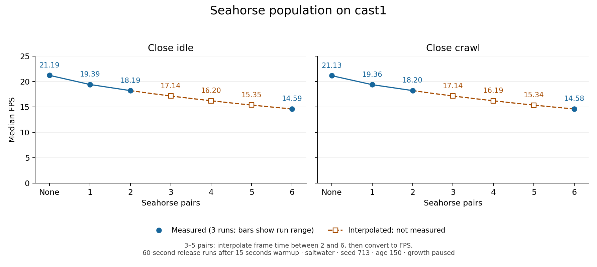

# Seahorse population cost on cast1

17 October 2026 · Wide baseline: `9f97f5dd`. Close-idle/crawl completion: `d8d215ae`.

## Wide-view measurement

Cast1 is the Chromecast HD (`chromecast-test-01`, Android 14, 32-bit app).
All APKs use the same native libraries and selector contents apart from the
planted tank's authored population settings. Each has twelve allocated
residents, six posts, the same shared mesh/atlas data and a 6 MB permanent
pool. The population setting controls visibility and behavior/deformer calls.
None also hides all six posts. Memory here is whole-process PSS; this comparison
cannot establish allocation cost per seahorse or recover the pre-seahorse app's
memory footprint. None retains the level's resident actor bookkeeping.

The fixture is saltwater, seed 713, plant age 150, growth paused, textures and
sway enabled, random entry disabled and greeting enabled. Gameplay runs in real
time with the normal wide camera, so poses differ between workload samples. Three 60-second release repeats per count follow 15 seconds
of warm-up, with count order varied. CPU sections come from a separate
instrumented repeat per count, whose APK changes only `wf_args.txt` to enable
`--frame-profile`; its presentation numbers are not pooled with release runs.

The analyzer recomputes frame intervals from raw SurfaceFlinger presentation
timestamps and rejects sampling holes, summary disagreement, less than 59 seconds
of observed coverage, wrong plant settings and current-run Forth/assert/allocation
errors. It selects only CPU windows fully contained within that run's device
presentation timestamps. Startup, warm-up and older cumulative-log windows are
excluded. Screenshots establish the scene and visible population.

## Wide-view results

Release values are medians of three run means; ranges show the three runs.
P95 is the median of each run's p95 presentation interval, not a CPU percentile.

| Pairs | Mean frame ms (run range) | FPS | p95 interval ms | PSS MiB (run range) |
|---:|---:|---:|---:|---:|
| 0 | 47.14 (47.13–47.24) | 21.22 | 50.05 | 99.0 (98.2–101.6) |
| 1 | 51.58 (51.54–51.90) | 19.39 | 66.73 | 99.3 (97.0–100.7) |
| 2 | 55.10 (55.00–55.66) | 18.15 | 66.73 | 98.2 (97.8–104.8) |
| 6 | 69.26 (69.09–69.28) | 14.44 | 83.42 | 103.6 (100.8–106.2) |

Six pairs add **22.13 ms per presented frame** over None
(**46.9% longer**, **31.9% fewer FPS**).
The extra eight residents from two to six pairs add 14.16 ms in this view.
None-to-one also includes the six posts; it is not an isolated two-fish cost.
All accepted release runs have at least 59 seconds of observed presentation
coverage and post-run thermal status 0. PSS varies by several MiB between runs
with the same population, so these values are not evidence of a precise
per-resident allocation cost.

### Main-thread CPU and rendering counters

Frame-weighted means from fully contained five-second windows in separate
instrumented runs. Each population has 11 selected windows (about 55 seconds).
Total is update + render. Director is inside update; native animation is inside
Director. Do not add overlapping columns. These are main-thread CPU times,
not presented frame times or whole-process CPU times.

| Pairs | Update ms | Director ms | Animation ms | Render ms | Total CPU ms |
|---:|---:|---:|---:|---:|---:|
| 0 | 7.79 | 6.92 | 6.16 | 34.96 | 42.76 |
| 1 | 9.40 | 8.56 | 6.57 | 37.63 | 47.03 |
| 2 | 10.85 | 10.02 | 7.01 | 39.77 | 50.62 |
| 6 | 17.03 | 16.19 | 8.84 | 47.26 | 64.30 |

Six pairs add **21.54 ms main-thread CPU**: +9.24 ms update and
+12.30 ms render. The animation group rises by 2.68 ms, already
included in Director's +9.26 ms. Its grouping includes other deformers;
this is not an isolated `DFRM` evaluator benchmark. Moving vertex placement to
a shader would leave behavior and other Director work to measure separately.

Instrumented frame periods were 1.1–2.0% above their corresponding
release medians. These are separate real-time runs, so that spread includes
run/pose variation and is not a pure instrumentation-overhead measurement.
All accepted CPU runs also have post-run thermal status 0.

| Pairs | Render actors | Draws/frame | Vertex uploads/frame | Vertex MiB/frame | Static index KiB/frame |
|---:|---:|---:|---:|---:|---:|
| 0 | 34 | 27.00 | 9.00 | 5.12 | 9.27 |
| 1 | 44 | 44.01 | 20.01 | 5.37 | 12.45 |
| 2 | 48 | 56.28 | 32.28 | 5.63 | 12.45 |
| 6 | 64 | 79.02 | 55.02 | 6.65 | 12.45 |

Whole-frame streamed vertex traffic grows by 1.53 MiB/frame from None to six pairs.
The baseline already streams 5.12 MiB/frame; opaque seahorse-body skinning cannot
remove all of this traffic. None has 18 static objects; every nonzero count has
24, including all six posts. No static bakes occur in the selected CPU windows.
All variants report 81 level objects, consistent with hiding rather than
removing residents. Full counters and selected window timestamps are in
[comparison.json](../../diagnostics/seahorse-population-cast1-20261017/comparison.json).

## What this establishes

This measures the current CPU `DFRM` seahorse implementation at None, one, two
and six pairs in wide idle. CPU `total` is update plus render on the main thread;
it excludes presentation waits and worker-thread CPU. Director and animation
sections overlap and must not be summed as independent costs. Vertex upload
bytes and static index upload bytes are separate counters. Whole-frame upload
counters also include plants, fins and other streamed geometry; they do not
measure bytes removable by GPU skinning of opaque seahorse bodies.

The six-pair default remains Will's choice. This is the baseline for the
[separate GPU-skinning experiment](../2026-10-16-gpu-skinning-chromecast-experiment.md),
which still needs explicit engine permission. It neither compares a CPU joint
rig with `DFRM` nor measures GPU skinning, hardware GPU time or Metal performance.
Close-idle/crawl measurements are recorded below. Cast2 remains unavailable
on the shared network; this does not complete every Phase 4 check.

## Close-idle and close-crawl — completed 17 October

The close campaign uses integration revision `d8d215ae`, including the later
object-picker merge, and one fresh release build for every population and view.
Its native hashes differ from the earlier wide campaign. Four fresh wide
controls measured 47.00 / 51.59 / 54.94 / 69.79 ms at None / 1 / 2 / 6 pairs,
within 0.8% of the earlier wide medians. They are single samples and are kept
separate from that earlier three-repeat baseline.

All close fixtures use the same saltwater, seed 713, age 150, paused-growth
settings described above. Each case has three independent 60-second release
runs after 15 seconds warmup, plus one separate instrumented run. Count order
rotates between release rounds. All 32 close runs and four wide controls passed
coverage, current-load settings/error and installed-APK hash checks, with
post-run thermal status 0. Every session restored the exact six-pair selector
APK and completed coordinator cleanup. No samples were rejected in this campaign.

The coordinator's deployed schema accepts idle/school, excluding its legacy
plants trace. Supported idle profiles therefore run direct-launch benchmark
assets that fix the existing urchin-following close camera. This camera clips
some seahorses at its top edge. The crawl fixture holds right inside the existing
Forth input reader; the normal easing, movement and foot-contact controller still
run. A host VM comparison matches position and velocity against held-right input
for 75 simulated seconds at 20 Hz. Device captures show the resulting camera
translation. This measures continuous crawling work, without validating remote
input delivery or pause/release rearming. Poses and view contents vary in real
time; subtracting these views does not isolate locomotion CPU cost.

Only two verified complete Forth source slots, the settings catalog and known
size/locator fields change. Frozen APK audits preserve all mesh/material/UV/DFRM
bytes and both native libraries. No engine source was modified for these tests.
[Full protocol, hashes and evidence](../../diagnostics/seahorse-close-cast1-20261017/README.md).

### Close-view release results

Medians of three run means; parentheses show the run range. P95 is a presentation
interval percentile. PSS is whole-process memory, with the same twelve allocated
residents in every population; None also hides all six posts.

| View | Pairs | Frame ms (range) | FPS | p95 ms | PSS MiB |
|---|---:|---:|---:|---:|---:|
| close-idle | 0 | 47.19 (47.02–47.37) | 21.19 | 50.05 | 97.8 |
| close-idle | 1 | 51.56 (51.48–51.70) | 19.39 | 66.73 | 99.9 |
| close-idle | 2 | 54.97 (54.82–55.00) | 18.19 | 66.73 | 101.6 |
| close-idle | 6 | 68.52 (68.43–68.62) | 14.59 | 83.42 | 102.5 |
| close-crawl | 0 | 47.33 (47.27–47.35) | 21.13 | 50.05 | 100.0 |
| close-crawl | 1 | 51.65 (51.56–51.68) | 19.36 | 66.73 | 99.7 |
| close-crawl | 2 | 54.95 (54.80–55.00) | 18.20 | 66.73 | 103.6 |
| close-crawl | 6 | 68.57 (68.42–68.86) | 14.58 | 83.42 | 106.2 |

Six pairs add **21.33 ms per presented frame in close idle** and **21.24 ms in
close crawl**, compared with None. The close-view release medians differ by
at most 0.15 ms at the measured populations; their run ranges overlap. These
samples do not resolve a separate crawling penalty.

### Close-view CPU and streamed geometry

Frame-weighted CPU means use 10–11 fully contained five-second windows per
case (about 50–55 seconds). Update + render = total main-thread CPU; Director
is nested inside update, and animation is nested inside Director. These columns
must not be summed as independent costs. Separate instrumented presentation
periods were 0.3–1.8% above their release medians, including real-time pose/run
variation as well as instrumentation.

| View | Pairs | Update ms | Director ms | Animation ms | Render ms | Total CPU ms |
|---|---:|---:|---:|---:|---:|---:|
| close-idle | 0 | 7.78 | 6.94 | 6.17 | 34.94 | 42.72 |
| close-idle | 1 | 9.44 | 8.61 | 6.60 | 37.27 | 46.70 |
| close-idle | 2 | 10.85 | 10.01 | 7.02 | 39.23 | 50.09 |
| close-idle | 6 | 16.99 | 16.16 | 8.85 | 46.41 | 63.39 |
| close-crawl | 0 | 7.96 | 7.12 | 6.18 | 35.11 | 43.07 |
| close-crawl | 1 | 9.63 | 8.77 | 6.62 | 37.37 | 47.00 |
| close-crawl | 2 | 11.01 | 10.17 | 7.01 | 39.14 | 50.15 |
| close-crawl | 6 | 17.29 | 16.43 | 8.92 | 46.60 | 63.89 |

None-to-six adds **20.67 ms main-thread CPU in close idle** (+9.21 update,
+11.47 render) and **20.82 ms in close crawl** (+9.32 update, +11.50 render).
The nested animation increases are 2.68 and 2.73 ms respectively; they include
other deformers and do not isolate a seahorse evaluator or measured GPU savings.

| View | Pairs | Render actors | Draws/frame | Vertex MiB/frame | Static index KiB/frame |
|---|---:|---:|---:|---:|---:|
| close-idle | 0 | 34 | 27.00 | 5.13 | 9.18 |
| close-idle | 1 | 44 | 40.37 | 5.39 | 12.37 |
| close-idle | 2 | 48 | 46.43 | 5.64 | 12.37 |
| close-idle | 6 | 64 | 57.70 | 6.66 | 12.37 |
| close-crawl | 0 | 34 | 27.00 | 5.13 | 9.18 |
| close-crawl | 1 | 44 | 42.20 | 5.39 | 12.36 |
| close-crawl | 2 | 48 | 46.07 | 5.64 | 12.37 |
| close-crawl | 6 | 64 | 59.38 | 6.66 | 12.36 |

All cases report 81 level objects and zero static bakes in the selected windows.
The None-to-six increase is about 1.53 MiB of whole-frame streamed vertices per
frame in either close view, including plants, fins and other geometry. These
bytes are not a measured amount removable by opaque-body GPU skinning.
Full counters, CPU windows, per-run PSS and timestamps are in
[comparison.json](../../diagnostics/seahorse-close-cast1-20261017/comparison.json).

### Graph and interpolation for 3, 4 and 5 pairs



[SVG](close-view-cost.svg) · [plot inputs and estimates](close-view-cost.json).
The hollow squares and dashed lines are estimates, not measurements. For each
view, interpolate median frame time between measured two and six pairs:
`T(n) = T(2) + (n-2) × (T(6)-T(2))/4`, then `FPS = 1000/T(n)`.
This assumes an approximately linear increase in frame time across that interval;
it does not establish confidence bounds or capture nonlinear population effects.

| Pairs (estimated) | Close-idle frame ms | Close-idle FPS | Close-crawl frame ms | Close-crawl FPS |
|---:|---:|---:|---:|---:|
| 3 | 58.36 | 17.14 | 58.36 | 17.14 |
| 4 | 61.74 | 16.20 | 61.76 | 16.19 |
| 5 | 65.13 | 15.35 | 65.17 | 15.34 |

This completes the requested cast1 close-view population baselines. Cast2 is
still unavailable on the shared network. GPU skinning, CPU-joint-rig comparisons,
Metal performance and GPU timing remain separate experiments.

## Wide-campaign rejected samples and launch failures

Round two's None capture showed the lionfish scene, not the planted tank. Its
valid timestamp coverage does not make it a usable baseline; it was excluded
and replaced by a separate None run. The original third round failed before
measurement with a coordinator plugin/foreground error. The original CPU
session completed a valid None sample, then ended with a similar failure;
its missing populations were repeated. Failure evidence and replacement
selection are retained. These records do not establish the cause of the launch
failures or certify general lifecycle stability.

## Evidence and reproduction

[Diagnostic bundle](../../diagnostics/seahorse-population-cast1-20261017/README.md)
contains frozen APK/native-library hashes, authored-setting receipts, coordinator
recipes, run summaries, raw timestamps, PSS and thermal snapshots, screenshots,
compressed logs and explicit rejected-sample/replacement records. The coordinator
owns each complete session and restores the release six-pair APK afterward.
Large text artifacts are losslessly gzipped, with uncompressed hashes recorded;
the analyzer reads either form. Temporary build outputs and duplicate downloads
are removed after merge. Service evidence can be downloaded again by job ID.

```sh
python3 scripts/analyze-seahorse-population.py \
  --evidence docs/diagnostics/seahorse-population-cast1-20261017 \
  --out docs/diagnostics/seahorse-population-cast1-20261017/comparison.json
```

Close-view reproduction and graph:

```sh
python3 scripts/analyze-seahorse-close.py \
  --evidence docs/diagnostics/seahorse-close-cast1-20261017 \
  --out docs/diagnostics/seahorse-close-cast1-20261017/comparison.json
MPLCONFIGDIR=/tmp/wf-seahorse-close-matplotlib python3 scripts/plot-seahorse-close.py \
  --comparison docs/diagnostics/seahorse-close-cast1-20261017/comparison.json \
  --out-prefix docs/plans/2026-10-16-saltwater-seahorses/close-view-cost
```
