# UI font: Atkinson Hyperlegible Next everywhere, replacing `stb_easy_font`

**Date:** 2026‑10‑17 · **Status:** approved (Will said yes to F2–F6, 2026‑10‑17); phases 0, 1, 2 and 4 implemented on branch `ui-font`; phase 3 (Chromecast) blocked · **TODO:** [T3] ui-font

## TL;DR

Every piece of engine-drawn text uses `stb_easy_font`, a tiny stroke font scaled up ×2.5 to ×9: the fishtank menu, the settings editor (chooser, form, Pick in 3D), the planted-tank HUD, the phone pairing overlay, the in-game HUD and banners, the touch button labels and the FPS counter. It reads as thin, wide-spaced pixel text (mockups 1, 3, 9).

**Replace it entirely** with **Atkinson Hyperlegible Next**, the font [`../finding-your-way`](../../../finding-your-way/game/parmenides-slice/fonts/README.md) ships: Regular and SemiBold, SIL OFL 1.1, the same pinned files byte for byte. Then **delete** `engine/vendor/stb_easy_font.h` (Will, 2026‑10‑17: "this should replace the existing font entirely (delete) and should be used on the fishtank menu and any other place the original font is used").

The engine already has a glyph-atlas text path that only per-level dialogue uses today. `bitmaptext::Catalog` loads `WFGA` bundles (atlas, metrics, kerning), and `RendererBackend::DrawGlyphs` draws them on GL and Metal. This plan bakes **one shared UI atlas** at build time, ships it in every app's `cd.iff`, and routes all eight text users through it.

## Decisions

**Made (Will, 2026‑10‑17; F2–F6 answered "yes to all"):**

| # | Decision |
|---|---|
| F1 | The font is **Atkinson Hyperlegible Next**, as finding-your-way uses it ("use same as ../finding-your-way/"). Both weights, unmodified, from the same pinned Google Fonts commit [7925f50](https://github.com/googlefonts/atkinson-hyperlegible-next/tree/7925f50f649b3813257faf2f4c0b381011f434f1/fonts/ttf). |
| F5 | **It replaces `stb_easy_font` everywhere, and `stb_easy_font` is deleted:** the fishtank menu, the settings editor, and every other place the old font draws. |
| F2 | **Engine scope approved:** the eight files under **Engine changes**, the new `ui_font` module, deleting `engine/vendor/stb_easy_font.h`, and `cd.iff` packing. |
| F3 | **Sizes:** seven variants at the 1920×1080 logical canvas: `small` Regular 28 · `body` Regular 36 · `body-bold` SemiBold 36 · `title` SemiBold 46 · `menu` Regular 56 · `menu-bold` SemiBold 56 · `display` SemiBold 80. |
| F4 | **The phone page switches too** (Phase 4): an inline subset WOFF2 of both weights in `controller.html`. |
| F6 | **A missing or invalid atlas stops start-up** with `UI_FONT unavailable: <reason>`. There is no fallback font. |

## Context: what exists today, from the code

- **Eight files draw text with `stb_easy_font`.** It emits one quad per stroke segment, and the callers scale it ×2.5 to ×9 on a 1920×1080 logical canvas:

    | File | What it draws | Scale today |
    |---|---|---|
    | `game/level_menu.cc` | the fishtank menu (and every app's level menu) | ×5 rows, ×9 title |
    | `game/runtime_property_ui.cc` | the settings form | ×2.5 |
    | `game/runtime_settings_ui.cc` | the chooser and the Pick in 3D tags | ×2.6–3.4 |
    | `game/plant_ui.cc` | the planted-tank HUD strip | small |
    | `hal/phonepad/phonepad_overlay.cc` | the phone pairing overlay (QR code, URL) | ×4–6 |
    | `gfx/gl/display.cc` | in-game HUD text, banners and headers (11 calls) | ×1–8 |
    | `gfx/gl/android_window.cc` | on-screen touch button labels | — |
    | `game/fps_overlay.cc` | the FPS counter | small |

- **The engine already has a glyph-atlas path.** `game/bitmap_text.cc` validates a `WFGA` v1 bundle: atlas size, up to 64 variants (style and pixel size), glyph metrics (36 B each, sorted), sorted kerning pairs, UTF‑8 text records, and strict bounds checks. `game/bitmap_presenter.cc:49` uploads the atlas with `rb.CreateTexture(w, h, RB_TEX_COVERAGE8, pixels)` and draws quads with `rb.DrawGlyphs(…)` on GL and Metal. `level.cc:643-653` loads it **per level** from a `DLOG` chunk, for dialogue only.
- **finding-your-way bakes at build time.** [`glyph_atlas.py`](../../../finding-your-way/game/parmenides-slice/glyph_atlas.py) rasterizes the TTFs with Pillow in a container and writes `WFGA` pixels and metrics; its runtime never touches a TTF. Its `fonts/README.md` pins Regular at `88ed5c31…` and SemiBold at `8e2fff77…` (SHA‑256). The copies used here are byte-identical.
- **Coverage:** the font maps 362 code points, including `× ± ° · – — …` and the curly quotes. It has **no arrows, check marks or triangles**, so the back arrow, ▼, padlock, gear and crosshair stay as drawn shapes, as they already are.

## Design

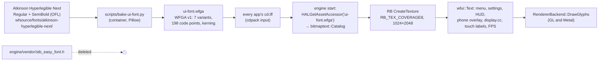

1. **Font files in the repo.** Copy both TTFs, the OFL text and a README with their SHA‑256 into `wfsource/fonts/atkinson-hyperlegible-next/`, byte-identical to finding-your-way's. That keeps the build reproducible from this repo alone.
2. **Bake.** `scripts/bake-ui-font.py` runs in `wf-linux-test` (Pillow is in the image) and writes `ui-font.wfga` with the existing `WFGA` v1 layout, so `Catalog::Load` validates it unchanged:
    - **Coverage:** printable ASCII, Latin‑1 (`U+00A0–00FF`), and `– — ‘ ’ “ ” • … −` (198 code points). An unmapped code point draws `?`.
    - **Variants:** the seven in F3.
    - **Atlas:** shelf-packed, 1024×2048, 8‑bit coverage, 2 MiB uncompressed. The prototype in the mockup bundle measured exactly this: 1,386 glyphs fit (`atlas.json`, mockup 8).
    - **Kerning:** pairs among the covered code points, from the font's kerning data, as `glyph_atlas.py` does.
    - **Deterministic:** the same inputs always give the same bytes (verification 2).
3. **Ship it.** Add `ui-font.wfga` to the `cdpack` inputs for every app bundle (`wfsource/source/game/cd.iff` and each flavour's `*-cd.iff`). It is one shared asset, not per level.
4. **Load once.** A small `wfui` module (`game/ui_font.{hp,cc}`) loads it at engine start through `HALGetAssetAccessor`, before any menu or HUD draws. It validates the bundle with `bitmaptext::Catalog::Load` and creates the texture through the active backend. It re-creates the texture when `TextureGeneration()` changes (Android context loss), exactly as `Presenter` does. A missing or invalid bundle stops start-up with `UI_FONT unavailable: <reason>` (F6).
5. **One text API for all eight users.** `wfui::Text(x, y, variant, rgba, utf8)` and `wfui::Width(variant, utf8)` lay out with the catalog's advances and kerning and emit `bitmaptext::Quad`s, which are drawn with `DrawGlyphs` after each user's rectangle pass. Positions stay in the 1920×1080 logical canvas; the quads are scaled by the surface factor, so a 720p surface samples the 1080p atlas at ⅔ scale with bilinear filtering (mockup 7). Each call site maps its old `scale` to one of the seven variants; the drawn shapes (arrows, ▼, padlock, gear, crosshair, the QR code) are unchanged.
6. **Delete `stb_easy_font`.** Remove `engine/vendor/stb_easy_font.h`, every `#include` of it, its per-user vertex buffers (`gTextBuf`, `textVertices` and so on) and `stb_easy_font_spacing`.

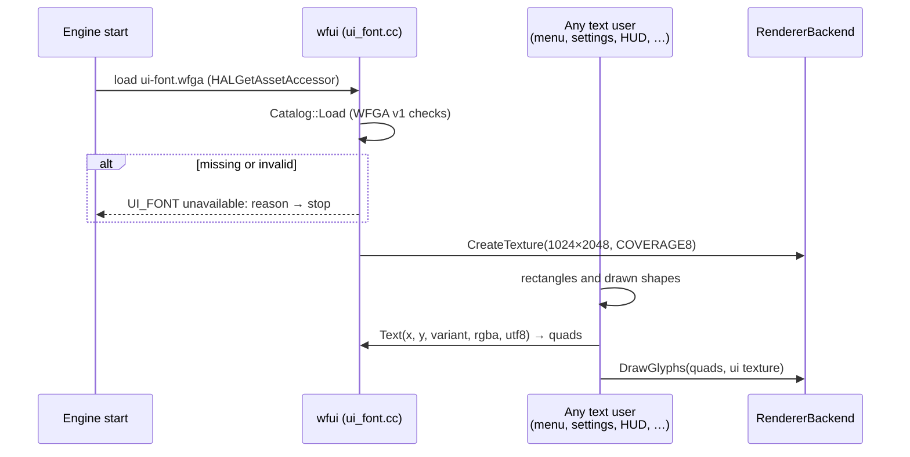

### Engine changes (F2)

| File | Change |
|---|---|
| `wfsource/source/game/ui_font.{hp,cc}` (new) | load once, texture lifetime, `Text`/`Width`, the F6 error |
| `wfsource/source/game/level_menu.cc` | the fishtank menu: `display` title, `menu` rows, `menu-bold` selected row, `body` subtitle, counter and hints |
| `wfsource/source/game/runtime_property_ui.cc` | the form: `title`, `body`, `small` |
| `wfsource/source/game/runtime_settings_ui.cc` | the chooser and pick tags: `title`, `body`, `body-bold`, `small` |
| `wfsource/source/game/plant_ui.cc` | the HUD strip: `small` |
| `wfsource/source/hal/phonepad/phonepad_overlay.cc` | the pairing overlay: `title`, `body` |
| `wfsource/source/gfx/gl/display.cc` | HUD text, banners, headers: `display`, `title`, `body`, `small` |
| `wfsource/source/gfx/gl/android_window.cc` | touch button labels: `body-bold` |
| `wfsource/source/game/fps_overlay.cc` | the FPS counter: `small` |
| `engine/vendor/stb_easy_font.h` | **deleted**, with every include |
| the app start (`main.cc` and the Android entry) | load the UI font once the asset accessor is up |
| cd.iff packing scripts | add `ui-font.wfga` |

No change to `bitmap_text.cc`, `bitmap_presenter.cc`, the `WFGA` format, or the GL and Metal backends.

### Cost

- **APK and `cd.iff`:** about +2.1 MB uncompressed per app bundle (the 2 MiB atlas, about 50 KB of metrics, and the kerning). The atlas is mostly zeros, so the APK's deflate takes it to roughly 300–450 KB. Phase 1 records the real numbers.
- **GPU memory:** one 1024×2048 R8 texture, 2 MiB, separate from the level's VRAM pages.
- **Frame time:** one quad per character replaces about 10–40 stroke quads per character, so text draws get cheaper. Phase 3 measures the menu and the HUD on Cast1.

## Mockups

[](2026-10-17-settings-editor-font/tv-form.html)

The left panels are real Chromecast 1 captures: `tv-form-screenshot.png` (J‑28f5619ea275) and `picker-chooser-screenshot.png` (J‑6922370e7eb5). The right panels are the same layout rendered by Pillow in Atkinson Hyperlegible Next at the F3 sizes, which is how the bake will rasterize it.

[](2026-10-17-settings-editor-font/states.html)

- 5: the pick-mode tags.
- 6: an out-of-range value, with its message in the error colour, and a read-only row with the padlock.
- 7: the form drawn at 1280×720 and shown 1:1, which is the 1080p atlas at ⅔ scale.
- 8: the prototype atlas.

[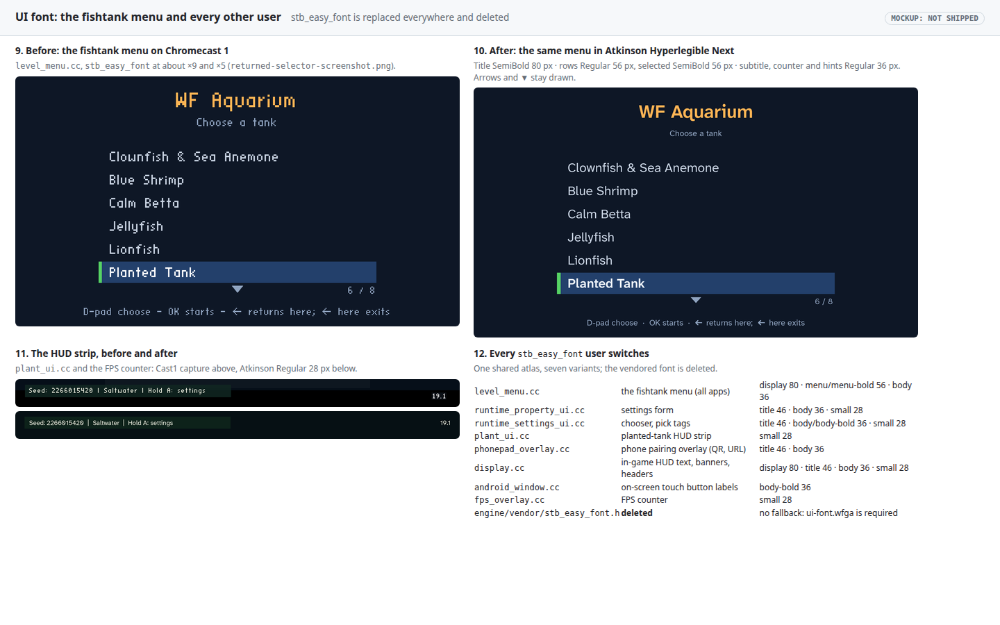](2026-10-17-settings-editor-font/menu.html)

- 9 and 10: the fishtank menu, before (a Cast1 capture) and after, at the same geometry and colours.
- 11: the planted-tank HUD strip and the FPS counter, before and after.
- 12: every `stb_easy_font` user and the variants it takes.

`build_mockups.py` regenerates all three pages, and `atlas.json` records the measured atlas.

## Phases

| Phase | Work | Engine edit | Tier |
|---|---|---|---|
| 0 | Copy the fonts with their OFL and README; write `scripts/bake-ui-font.py` and its tests (determinism, coverage, a `Catalog::Load` round trip) | no | T3 |
| 1 | `wfui` (load, texture, `Text`/`Width`, the F6 error) with a ctest; ship `ui-font.wfga` in every app's `cd.iff` | yes | T3 |
| 2 | Switch all eight users; delete `stb_easy_font`; desktop captures in the container of the menu, the settings editor, the HUD, a `display.cc` banner and the phone overlay | yes | T3 |
| 3 | Chromecast 1 and 2: `menu-back` for every app, `baseline-settings`, `baseline-picker`, `aquarium-seahorses`, with screenshots; size and frame-time numbers | no | T3 |
| 4 | The phone page (F4): inline subset WOFF2 of both weights in `controller.html` | no | T2 |

## Out of scope

- Runtime TTF rasterization. As in finding-your-way, the runtime only ever sees baked pixels and metrics.
- Scripts other than Latin. The atlas covers ASCII, Latin‑1 and common punctuation; widening it is a bake-list change.
- Dialogue text. It keeps its own per-level `DLOG` bundles, which already use the same `WFGA` path.

## Implementation notes (2026‑10‑17)

Phases 0, 1, 2 and 4 are on branch `ui-font`. Phase 3 (Chromecast) is not done: see verification 8 and 9. Where the code had to settle something the plan left open, or differs from it:

- **Where the atlas lives.** `cdpack` packs `ui-font.wfga` into every bundle it writes as a `UIFT` chunk, the **last** TOC entry, so level *n* stays entry 1 + *n* and `MENU` keeps its place. By default it reads `ui-font.wfga` beside the SHEL script (`wfsource/source/game/`, where the bake writes it and where it is committed); `--ui-font` overrides and `--no-ui-font` leaves it out (for verification 6). Every call site of `cdpack` therefore picks the font up without an edit. `FindMenu` skips the trailing `UIFT`.
- **Loading.** `wfui::LoadOrDie` runs in `PIGSMain` just before `WFGame` is constructed, which every platform and host (desktop, Android, iOS, macOS, web, `wf-edit --editor`) comes through, so one call covers them all. It reads `cd.iff`'s `UIFT` through `HALGetAssetAccessor`. A `-L` run plays no `cd.iff`, so it also accepts a bare `ui-font.wfga` asset (the web build preloads one) and, on the Linux desktop only, the source tree's committed bake (an absolute path compiled into `ui_font_engine.cc`); a `cd.iff` without the font that merely sits in a `-L` run's directory (`wflevels/cd.iff`, which the teleport tests run beside) is skipped there. In a normal run a `cd.iff` without `UIFT` is final: one `UI_FONT unavailable` line and exit 1.
- **Module split.** Layout is portable (`game/ui_font.{hp,cc}`, no engine headers) so the level-menu and phone-overlay host harnesses compile it; loading and the texture are in `game/ui_font_engine.cc`.
- **Sampling.** The `COVERAGE8` texture is `GL_NEAREST` on GL and a nearest sampler on Metal, and the plan keeps both backends unchanged, so text drawn at other than 1:1 is nearest-sampled, not bilinear as mockup 7 assumed. Glyph origins are snapped to whole pixels. At 1920×1080 (the Chromecast surfaces and the desktop captures) the atlas is 1:1. Making `COVERAGE8` linear is a one-line change per backend (the atlas already has two clear texels between glyphs); it needs Will's approval as a backend change.
- **Atlas size.** 2,770,432 bytes per bundle, not about 2.1 MB: the atlas is 2 MiB, and the kerning is 38,947 pairs (16 bytes each, about 609 KiB), every non-zero pair among the 198 code points in all seven variants as raqm measures them.
- **Variants per call site.** The settings screens keep their old geometry: each text's middle goes where the old capitals' middle was, in the variant `propertyui::variantFor` gives its old scale (×4 → title, ×3 and ×3.4 → body, ×2 to ×2.7 → small), with one-line rows centred and the Pick in 3D hint bar in small, as the mockups show. `display.cc` picks the variant whose capitals are nearest the old ones on the 1080p canvas; its banners land on title, not display, and text below small (the high-score table) is small scaled down so the rows keep their spacing. Touch labels are body-bold scaled to the old capital height.
- **`display.cc`'s HUD is compiled only with `-DDESIGNER_CHEATS=1`**, which no CMake build defines (only the legacy `engine/build_game.sh`). The HUD captures below come from a CMake build with that flag added.
- **Phone page.** The WOFF2 subsets carry no kerning: with GPOS the page is 68,466 bytes, past `tests/test_phone_controller_page.py`'s 64 KiB cap; without it, 62,855.
- **Bundles.** All eight tracked `cdpack` bundles were rebuilt by their recipes; before that, each recipe with `--no-ui-font` reproduced the committed bundle byte for byte except `wflevels/aquarium-menu-cd.iff`, which predated `aquarium_plants-standalone.iff` from `0d5e1aba` (one byte of its RPRP catalog). The rebuild picks that up. `wflevels/cd.iff` and `wflevels/cd_full.iff` are older `iffcomp` bundles that no app ships, and are unchanged.

## Verification

1. The fonts are the pinned files: `sha256sum wfsource/fonts/atkinson-hyperlegible-next/*.ttf` prints `88ed5c31a71584c7772963b02d04bef1eb7e3d2e9c8b9cb204339b1f82cf432c` (Regular) and `8e2fff779f35ac25239656bb0f3b2bd35959a2009e3dd21a12141c3b9030362b` (SemiBold).

    ```
    $ sha256sum wfsource/fonts/atkinson-hyperlegible-next/*.ttf
    88ed5c31a71584c7772963b02d04bef1eb7e3d2e9c8b9cb204339b1f82cf432c  wfsource/fonts/atkinson-hyperlegible-next/AtkinsonHyperlegibleNext-Regular.ttf
    8e2fff779f35ac25239656bb0f3b2bd35959a2009e3dd21a12141c3b9030362b  wfsource/fonts/atkinson-hyperlegible-next/AtkinsonHyperlegibleNext-SemiBold.ttf
    ```

    **PASS**

2. The bake is deterministic: `scripts/in-linux-container.sh python3 scripts/bake-ui-font.py --out /build/a.wfga && scripts/in-linux-container.sh python3 scripts/bake-ui-font.py --out /build/b.wfga && cmp build-docker/a.wfga build-docker/b.wfga` exits 0.

    ```
    /build/a.wfga: 198 code points x 7 variants = 1386 glyphs, 38947 kerning pairs, atlas 1024x2048 (1968 rows used), 2770432 bytes, sha256 e1d6ce8662f66f760d7cb6767c03ce24f96e2f5b6940c3cd5168fe26eb2ebf61
    /build/b.wfga: 198 code points x 7 variants = 1386 glyphs, 38947 kerning pairs, atlas 1024x2048 (1968 rows used), 2770432 bytes, sha256 e1d6ce8662f66f760d7cb6767c03ce24f96e2f5b6940c3cd5168fe26eb2ebf61
    exit=0
    $ cmp build-docker/a.wfga wfsource/source/game/ui-font.wfga && echo "same as the committed ui-font.wfga"
    same as the committed ui-font.wfga
    ```

    **PASS** (`tests/test_ui_font_bake.py` checks the same, plus the pins and the record order: 3 passed).

3. The bundle validates and covers the list: `ctest --test-dir build -R ui_font` passes `Catalog::Load` on `ui-font.wfga`. It also checks that every code point of the coverage list has a glyph in all seven variants, and that `U+2190` lays out as `?`.

    ```
    $ scripts/in-linux-container.sh ctest --test-dir /build/rel -R ui_font --output-on-failure -V
    7: ok    Catalog::Load accepts it
    7: ok    the atlas is 1024x2048, 8-bit coverage
    7: ok    texel (0,0) is the reserved solid texel
    7: ok    wfui::Load accepts it
    7: ok    variant small is Regular 28
    7: ok    variant body is Regular 36
    7: ok    variant body-bold is SemiBold 36
    7: ok    variant title is SemiBold 46
    7: ok    variant menu is Regular 56
    7: ok    variant menu-bold is SemiBold 56
    7: ok    variant display is SemiBold 80
    7: ok    the coverage list has 198 code points
    7: ok    every code point of the list has a glyph in all seven variants (0 missing)
    7: ok    U+2190 lays out as '?' in small
    7: ok    U+2190 lays out as '?' in body
    7: ok    U+2190 lays out as '?' in body-bold
    7: ok    U+2190 lays out as '?' in title
    7: ok    U+2190 lays out as '?' in menu
    7: ok    U+2190 lays out as '?' in menu-bold
    7: ok    U+2190 lays out as '?' in display
    7: ok    "WF Aquarium" in display: Width 494.203 px, advances plus kerning 494.203 px
    7: ok    at least one pair of "WF Aquarium" is kerned (3)
    7: ok    the glyph quads follow the same advances (one quad per visible glyph)
    7: PASS: 0 failure(s)
    1/1 Test #7: ui_font ..........................   Passed    0.03 sec
    100% tests passed, 0 tests failed out of 1
    ```

    **PASS.** The font maps 198 of the list's 200 code points: it has no `U+00AD` (soft hyphen) or `U+00B5` (micro sign), which therefore draw as `?`. The full Release suite also passed under Xvfb: `100% tests passed, 0 tests failed out of 36`.

4. Layout matches the metrics: the same ctest measures `"WF Aquarium"` in `display` as the sum of advances plus kerning from the bundle, within 0.5 px.

    ```
    7: ok    "WF Aquarium" in display: Width 494.203 px, advances plus kerning 494.203 px
    7: ok    the glyph quads follow the same advances (one quad per visible glyph)
    ```

    **PASS**

5. `stb_easy_font` is gone: `git grep -n stb_easy_font -- ':!docs'` prints nothing, and `engine/vendor/stb_easy_font.h` does not exist.

    ```
    $ git grep -n stb_easy_font -- ':!docs'
    TODO.md:8:- [T3] **UI font: Atkinson Hyperlegible Next everywhere, replacing `stb_easy_font`.** Every engine-drawn text …
    $ ls engine/vendor/stb_easy_font.h
    ls: cannot access 'engine/vendor/stb_easy_font.h': No such file or directory
    ```

    **PASS for the code; one line left in `TODO.md`.** No source, test, script or build file names it. The one match is this item's own `TODO.md` line, which goes when the item moves to Done.

6. A missing atlas fails clearly: with `ui-font.wfga` removed from a test `cd.iff`, `wf_game` exits non-zero and the log has exactly one `UI_FONT unavailable` line.

    ```
    $ cdpack wfsource/source/game/shell.fth wflevels/snowgoons-standalone.iff --no-ui-font -o build-docker/t6/cd.iff
      UIFT: none (--no-ui-font): the engine refuses this bundle
    $ (in /build/t6, under Xvfb) wf_game --menu-input=wait:60,quit
    wf_game exit=1
    1
    UI_FONT unavailable: cd.iff has no UIFT chunk (repack it with cdpack, which adds wfsource/source/game/ui-font.wfga)
    $ scripts/in-linux-container.sh … python3 -m pytest -v tests/test_ui_font_missing.py
    tests/test_ui_font_missing.py::test_a_bundle_without_the_font_stops_start_up PASSED [ 50%]
    tests/test_ui_font_missing.py::test_the_same_bundle_with_the_font_starts PASSED [100%]
    ```

    **PASS**

7. Desktop screenshots, Release build in the container under Xvfb: the fishtank menu, the settings chooser and form, the pick tags, an out-of-range value, the planted-tank HUD, a `display.cc` banner and the phone pairing overlay. Each one is in Atkinson and keeps its layout.

    ```
    $ scripts/in-linux-container.sh <Xvfb 1920x1080> python3 tests/ui_font_screenshots.py --out /build/shots
    captured /build/shots/menu-fishtank.png
    captured /build/shots/planted-hud.png
    captured /build/shots/chooser.png
    captured /build/shots/pick-tags.png
    captured /build/shots/form.png
    captured /build/shots/form-error.png
    captured /build/shots/hud-banner.png      (--only hud, a -DDESIGNER_CHEATS=1 build)
    captured /build/shots/hud-game-over.png   (--only hud, a -DDESIGNER_CHEATS=1 build)
    ```

    The fishtank menu, cursor on Planted Tank:
    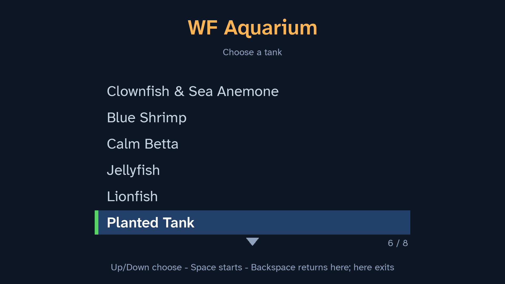

    The chooser, the form and Pick in 3D's tag:
    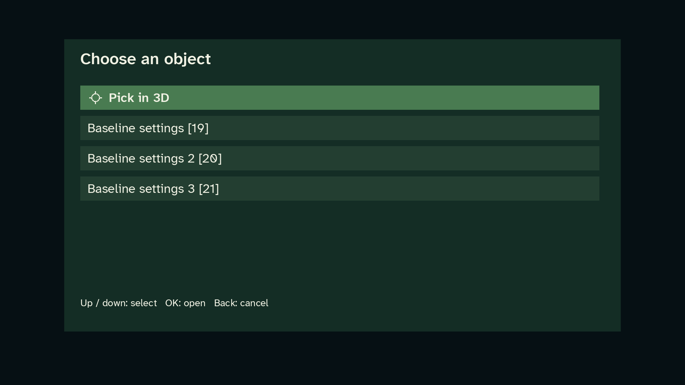
    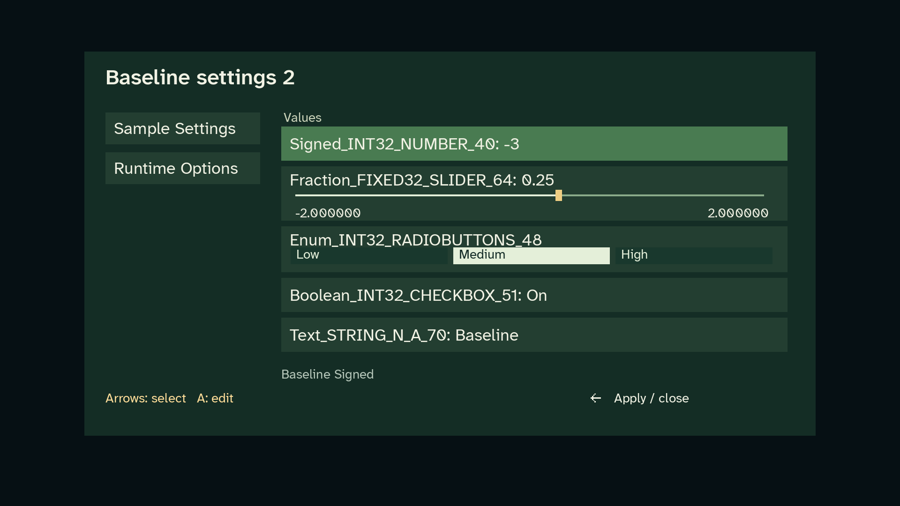
    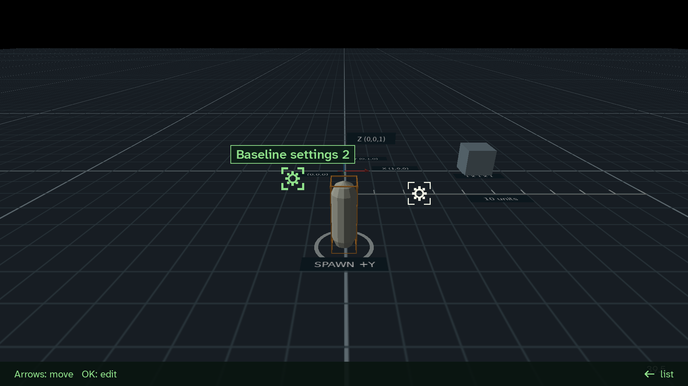

    An error line (A on a text field with no browser connected):
    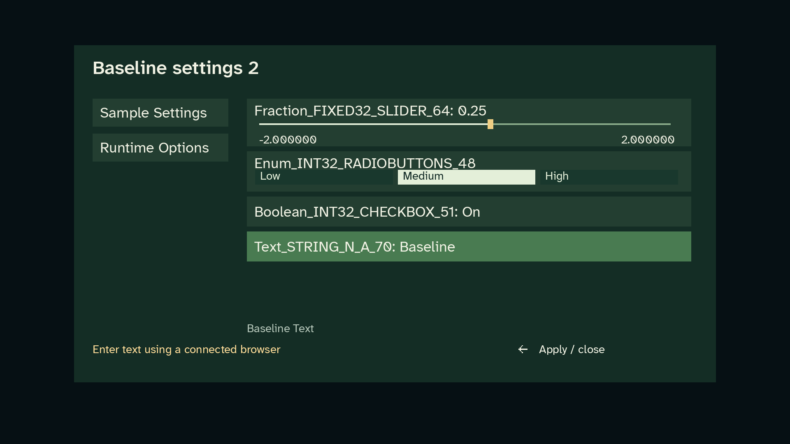

    The planted-tank HUD strip and the FPS counter:
    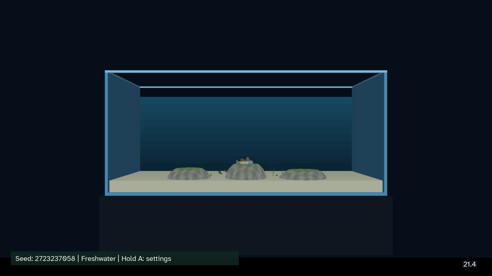

    `display.cc`: the launch banner with the position block and minimap letters, and GAME OVER with the high-score table:
    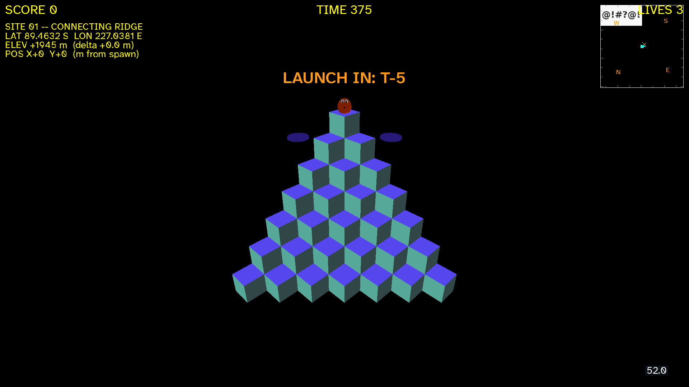
    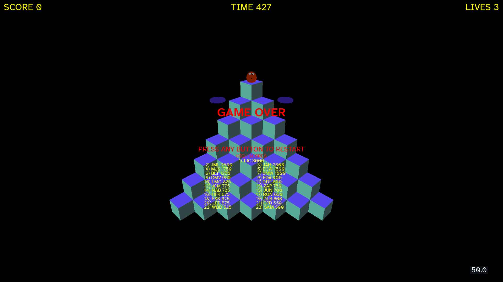

    The phone pairing overlay, composited by `tests/test_phone_overlay.py` from the overlay's own rectangles and glyph quads over the atlas:
    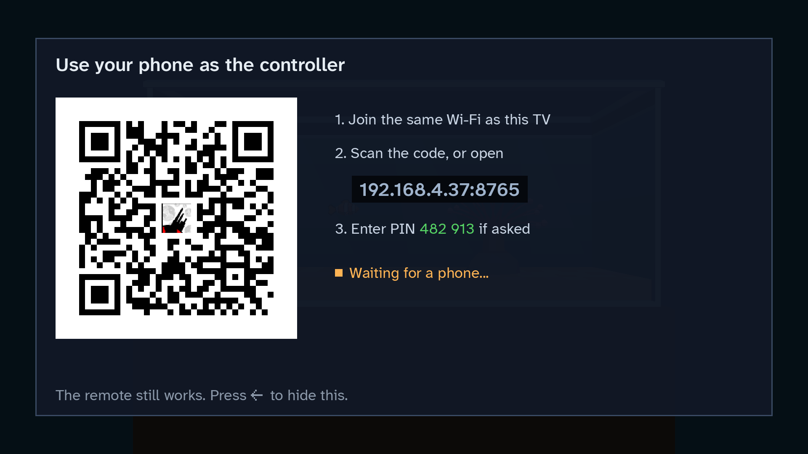

    **PASS with two gaps.** (a) The out-of-range message is not captured: on the desktop a value can only be typed through a connected browser or phone, which `wf_game` on Linux does not serve, so the capture shows the same footer error line with the message the desktop can reach. (b) The phone pairing overlay is drawn only by the Android TV app; the picture above is the host-test composite, not a GL capture. Both are covered on the device in step 8.

8. Chromecast 1 and Chromecast 2, through the coordinator: `menu-back` for every app, `baseline-settings`, `baseline-picker` and `aquarium-seahorses` pass with the new APKs, with screenshots under `docs/diagnostics/`.

    ```
    $ task chromecast:devices
    chromecast-test-01: recovery-required; Chromecast HD; serial 2628105GN0GT7C; Android 14; …
    chromecast-test-02: ready; Chromecast; serial 26031HFDD67QH7; Android 12; …
    $ ./gradlew --no-daemon -q :app:assembleAquariumRelease
      fatal error: error in backend: IO failure on output stream: No space left on device
    BUILD FAILED in 10m 8s
    ```

    **FAIL: not run.** The root file system ran out of space during the APK build (0 bytes free at one point; 1.5 GB at the end of this session), so no APK was built and no job was submitted. Cast1 was `recovery-required` (an automatic re-add failed with a plugin error and needs an administrator re-add); Cast2 was `ready` with another owner's jobs queued.

9. Cost recorded: `cd.iff` and APK size before and after, and Cast1 frame time on the fishtank menu and the planted tank before and after (three runs each).

    ```
    bundle                          before      after    delta
    wfsource/source/game/cd.iff    1931264    4702208  +2770944
    wflevels/aquarium-cd.iff        188416    2959360  +2770944
    wflevels/aquarium-menu-cd.iff  4130816    6901760  +2770944
    wflevels/condo-cd.iff          2435072    5206016  +2770944
    wflevels/smb-cd.iff             577536    3348480  +2770944
    wflevels/snowgoons-cd.iff       172032    2942976  +2770944
    wflevels/qbert-cd.iff           370688    3141632  +2770944
    wflevels/smb-menu-cd.iff        579584    3350528  +2770944
    ```

    **FAIL: `cd.iff` sizes only.** The APK sizes and the Cast1 frame times need step 8's APKs.

10. Mockups rebuild cleanly: `python3 docs/plans/2026-10-17-settings-editor-font/build_mockups.py` reports no errors, and every file is under 512 KB.

    ```
    $ python3 docs/plans/2026-10-17-settings-editor-font/build_mockups.py
    tv-form.html 161 KB
    states.html 192 KB
    menu.html 102 KB
    {"codepoints": 198, "glyphs": 1386, "atlas": [1024, 2048]}
    exit=0
    407 atlas.json · 18573 build_mockups.py · 105175 menu.html · 179640 menu.png · 196947 states.html · 300473 states.png · 165824 tv-form.html · 170791 tv-form.png
    $ git status --short docs/plans/2026-10-17-settings-editor-font/
    (nothing: the rebuild reproduces the committed files)
    ```

    **PASS**
