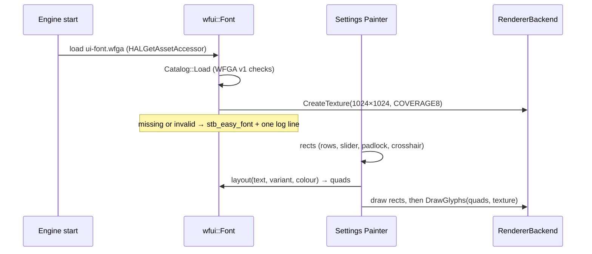
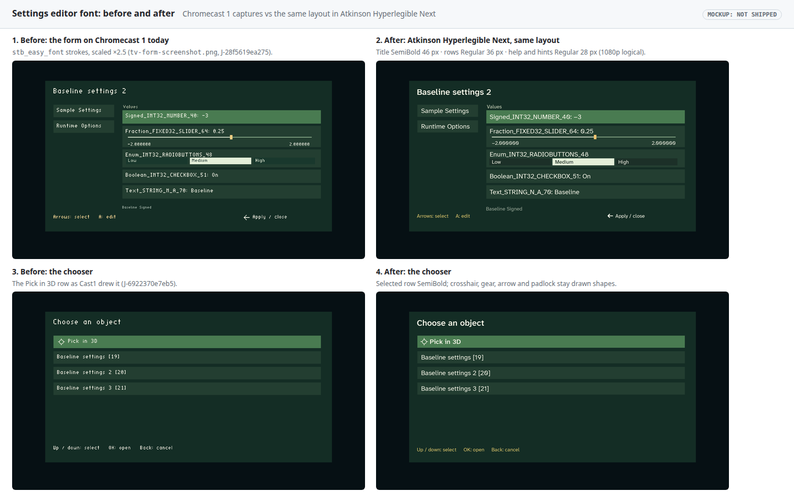
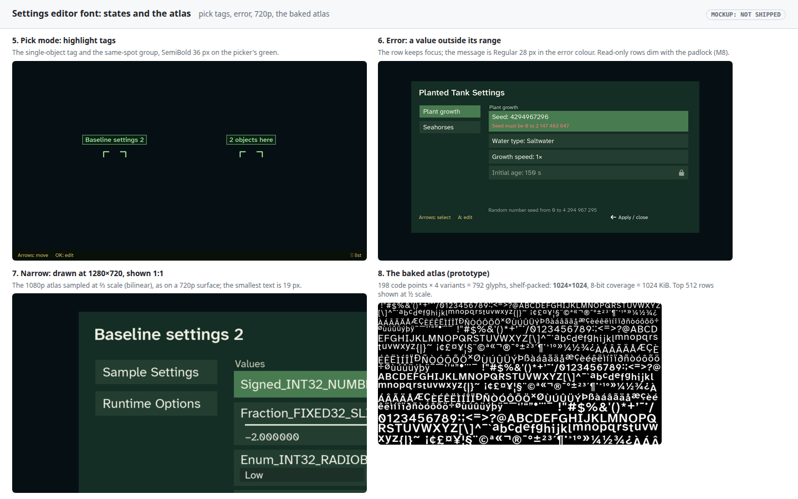

# Settings editor font: Atkinson Hyperlegible Next, as in finding-your-way

**Date:** 2026‑10‑17 · **Status:** proposal; needs Will's go-ahead on the open decisions · **TODO:** [T3] settings-editor-font

## TL;DR

The TV settings editor (the chooser, the form, Pick in 3D) draws every letter with `stb_easy_font`, a tiny stroke font scaled up about ×2.5. It reads as thin, wide-spaced pixel text (mockup 1). Switch it to **Atkinson Hyperlegible Next**, the font [`../finding-your-way`](../../../finding-your-way/game/parmenides-slice/fonts/README.md) ships: Regular and SemiBold, SIL OFL 1.1, the same pinned files byte for byte.

The engine already has everything needed except the wiring. `bitmaptext::Catalog` loads `WFGA` glyph bundles (atlas, metrics, kerning), and `bitmaptext::Presenter` uploads the atlas as an 8‑bit coverage texture and draws it with `RendererBackend::DrawGlyphs`. Today only per-level dialogue uses it. This plan bakes one shared UI atlas at build time, puts it in every app's `cd.iff`, and has the settings editor's `Painter` lay out text from it instead of `stb_easy_font`.

## Decisions

**Made (Will, 2026‑10‑17):**

| # | Decision |
|---|---|
| F1 | The font is **Atkinson Hyperlegible Next**, the one finding-your-way uses ("use same as ../finding-your-way/"). Both weights, unmodified, from the same pinned Google Fonts commit [7925f50](https://github.com/googlefonts/atkinson-hyperlegible-next/tree/7925f50f649b3813257faf2f4c0b381011f434f1/fonts/ttf). |

**Open (recommendation first):**

| # | Question | Recommendation |
|---|---|---|
| F2 | Engine permission | This changes engine code: `runtime_settings_ui.cc`, `runtime_property_ui.cc`, a small UI-font loader, and the `cd.iff` packing. Confirm the scope under **Engine changes**. |
| F3 | Sizes at the 1920×1080 logical canvas | Title **SemiBold 46 px**, rows **Regular 36 px**, the selected row and pick tags **SemiBold 36 px**, help and hints **Regular 28 px** (mockups 2, 4–7). |
| F4 | The phone page too? | **Yes, in Phase 3.** `controller.html` uses `system-ui`. Embed a subset WOFF2 of the same two weights (about 25 KB each, inline), so the TV and the phone match. |
| F5 | The other `stb_easy_font` users | **Not now.** The level menu, the plant HUD (`Seed: … \| Saltwater \| Hold A: settings`), the FPS overlay and the phone overlay keep it. Once the shared atlas exists they are a one-line switch each; that is a follow-up item. |

## Context: what exists today, from the code

- **The editor draws text from strokes.** `runtime_property_ui.cc:13` (the form) and `runtime_settings_ui.cc:29-30` (the chooser and the pick tags) call `stb_easy_font_print`, which emits one quad per stroke segment, and scale it by 2.5–3. Every other shape (rows, slider, padlock, crosshair, gear, left arrow) is a rectangle from the same `Painter`. The layout uses a 1920×1080 logical canvas scaled by `sx, sy` to the surface.
- **The engine already has a glyph-atlas text path.** `game/bitmap_text.cc` validates a `WFGA` v1 bundle: atlas size, up to 64 variants (style and pixel size), glyph metrics (36 B each, sorted by variant and code point), sorted kerning pairs, UTF‑8 text records, and strict bounds checks. `game/bitmap_presenter.cc:49` uploads the atlas with `rb.CreateTexture(w, h, RB_TEX_COVERAGE8, pixels)` and draws quads with `rb.DrawGlyphs(…)` on GL and Metal. `level.cc:643-653` loads it **per level** from a `DLOG` chunk for dialogue, so nothing loads it for menus.
- **finding-your-way bakes at build time.** [`glyph_atlas.py`](../../../finding-your-way/game/parmenides-slice/glyph_atlas.py) rasterizes the TTFs with Pillow in a container and writes `WFGA` pixels plus metrics; its runtime never touches a TTF. Its `fonts/README.md` pins the two files: Regular `88ed5c31…`, SemiBold `8e2fff77…` (SHA‑256). They are byte-identical to the copies checked here.
- **Coverage:** the font maps 362 code points, including `× ± ° · – — …` and the curly quotes. It has **no arrows, check marks or triangles**, so the left arrow, padlock, gear and crosshair stay as drawn shapes.

## Design

```mermaid
flowchart LR
  TTF["Atkinson Hyperlegible Next<br/>Regular + SemiBold (OFL)<br/>wfsource/fonts/atkinson-hyperlegible-next/"] --> BAKE["scripts/bake-ui-font.py<br/>(container, Pillow)"]
  BAKE --> WFGA["ui-font.wfga<br/>WFGA v1: 4 variants,<br/>198 code points, kerning"]
  WFGA --> CD["every app's cd.iff<br/>(cdpack input)"]
  CD --> LOAD["engine start:<br/>HALGetAssetAccessor('ui-font.wfga')<br/>→ bitmaptext::Catalog"]
  LOAD --> TEX["RB CreateTexture<br/>RB_TEX_COVERAGE8, 1024×1024"]
  TEX --> UI["settings editor Painter::text<br/>→ glyph quads"]
  UI --> DRAW["RendererBackend::DrawGlyphs<br/>(GL and Metal)"]
```

1. **Font files in the repo.** Copy both TTFs, the OFL text and a README with their SHA‑256 into `wfsource/fonts/atkinson-hyperlegible-next/`, byte-identical to finding-your-way's. That keeps the build reproducible from this repo alone.
2. **Bake.** `scripts/bake-ui-font.py` runs in `wf-linux-test` (Pillow is in the image) and writes `ui-font.wfga` with the existing `WFGA` v1 layout, so the existing `Catalog::Load` validates it unchanged:
    - **Coverage:** printable ASCII, Latin‑1 (`U+00A0–00FF`), and `– — ‘ ’ “ ” • … −` (198 code points). An unmapped code point draws `?`.
    - **Variants (F3):** `small` Regular 28, `body` Regular 36, `body-bold` SemiBold 36, `title` SemiBold 46.
    - **Atlas:** shelf-packed, 1024×1024, 8‑bit coverage, about 1 MiB uncompressed. The prototype in the mockup bundle measured exactly this: 792 glyphs fit, top half shown in mockup 8.
    - **Kerning:** pairs among the covered code points, from the font's `kern`/`GPOS` data, as `glyph_atlas.py` does.
    - Deterministic: the same inputs always give the same bytes (verification 2).
3. **Ship it.** Add `ui-font.wfga` to the `cdpack` inputs for every app bundle (`wfsource/source/game/cd.iff` and each flavour's `*-cd.iff`). It is one shared asset, not per level.
4. **Load once.** A small `wfui::Font` at engine start reads it through `HALGetAssetAccessor`, validates it with `bitmaptext::Catalog::Load`, and creates the texture through the active backend. It re-creates the texture when `TextureGeneration()` changes (context loss on Android), exactly as `Presenter` does.
5. **Draw.** `Painter::text` and `Painter::width` (in both UI files) lay out UTF‑8 with the catalog's advances and kerning, emit `bitmaptext::Quad`s tinted per colour, and draw them with `DrawGlyphs` after the rectangle pass. Layout positions stay in the 1920×1080 logical canvas; the quads are scaled by `sx, sy`, so a 720p surface samples the 1080p atlas at ⅔ scale with bilinear filtering (mockup 7).
6. **Fallback.** If `ui-font.wfga` is missing (an old `cd.iff`) or fails validation, the editor keeps `stb_easy_font` and logs one line, `UI_FONT unavailable: <reason>; using the built-in font`. A missing font must never stop the settings editor working.

### Engine changes (F2)

| File | Change |
|---|---|
| `wfsource/source/game/runtime_settings_ui.cc` | `Painter::text`/`width` use `wfui::Font`; the pick tags use `body-bold` |
| `wfsource/source/game/runtime_property_ui.cc` | the form's `text` lambda uses `wfui::Font`; title, rows, help and hints take the F3 variants |
| `wfsource/source/game/ui_font.{hp,cc}` (new) | load once, texture lifetime, layout to quads, fallback |
| `wfsource/source/game/main.cc` (or the app start) | load the UI font after the asset accessor is up |
| cd.iff packing scripts | add `ui-font.wfga` |

No change to `bitmap_text.cc`, `bitmap_presenter.cc`, the `WFGA` format, or the GL and Metal backends.

### Cost

- **APK and `cd.iff`:** about +1.1 MB uncompressed per app bundle (1 MiB atlas + about 30 KB metrics + kerning). The atlas is mostly zeros, so the APK's deflate brings it to roughly 150–250 KB. Phase 1 records the real numbers.
- **GPU memory:** one 1024×1024 R8 texture, 1 MiB, separate from the level's VRAM pages.
- **Frame time:** the editor draws only while it is open. Glyph quads replace about 10–40 stroke quads per character with one quad per character, so the draw count goes down. Phase 2 measures it on Cast1.

## Mockups

The left panels are real Chromecast 1 captures (`tv-form-screenshot.png`, J‑28f5619ea275; `picker-chooser-screenshot.png`, J‑6922370e7eb5). The right panels are the same layout rendered by Pillow in Atkinson Hyperlegible Next at the F3 sizes, which is how the bake will rasterize it.

5: the pick-mode tags. 6: an out-of-range value, with its message in the error colour, and a read-only row with the padlock. 7: the form drawn at 1280×720 and shown 1:1, so the 1080p atlas at ⅔ scale. 8: the prototype atlas. `build_mockups.py` regenerates everything; `atlas.json` records the measured atlas size.

## Phases

| Phase | Work | Engine edit | Tier |
|---|---|---|---|
| 0 | Copy the fonts with their OFL and README; write `scripts/bake-ui-font.py` and its tests (determinism, coverage, a `Catalog::Load` round trip) | no | T3 |
| 1 | `wfui::Font` (load, texture, layout, fallback) with a ctest; ship `ui-font.wfga` in every app's `cd.iff` | yes | T3 |
| 2 | Switch the form, the chooser and the pick tags; desktop captures in the container; Cast1 and Cast2 checks (`baseline-settings`, `baseline-picker`, `aquarium-seahorses`) and screenshots | yes | T3 |
| 3 | The phone page (F4): inline subset WOFF2 of both weights in `controller.html` | no | T2 |

## Out of scope

- The level menu, the plant HUD, the FPS overlay and the phone overlay (F5). Each becomes a small follow-up once the atlas exists.
- Runtime TTF rasterization. As in finding-your-way, the runtime only ever sees baked pixels and metrics.
- Scripts other than Latin. The atlas covers ASCII, Latin‑1 and common punctuation; widening it is a bake-list change.

## Verification

1. The fonts are the pinned files: `sha256sum wfsource/fonts/atkinson-hyperlegible-next/*.ttf` prints `88ed5c31a71584c7772963b02d04bef1eb7e3d2e9c8b9cb204339b1f82cf432c` (Regular) and `8e2fff779f35ac25239656bb0f3b2bd35959a2009e3dd21a12141c3b9030362b` (SemiBold).
2. The bake is deterministic: `scripts/in-linux-container.sh python3 scripts/bake-ui-font.py --out /build/a.wfga && scripts/in-linux-container.sh python3 scripts/bake-ui-font.py --out /build/b.wfga && cmp build-docker/a.wfga build-docker/b.wfga` exits 0.
3. The bundle validates and covers the list: `ctest --test-dir build -R ui_font` passes `Catalog::Load` on `ui-font.wfga`. It also checks that every code point of the coverage list has a glyph in all four variants, and that `U+2190` lays out as `?`.
4. Layout matches the metrics: the same ctest measures `"Baseline settings 2"` in `title` as the sum of advances plus kerning from the bundle, within 0.5 px.
5. The fallback works: with `ui-font.wfga` removed from a test `cd.iff`, the settings editor opens with `stb_easy_font` and the log has exactly one `UI_FONT unavailable` line.
6. Desktop screenshots, baseline level, Release build in the container under Xvfb: the chooser, the form, the pick tags and an out-of-range value. Each matches its mockup's layout, in Atkinson.
7. Chromecast 1 and Chromecast 2, through the coordinator: `baseline-settings`, `baseline-picker` and `aquarium-seahorses` pass with the new APKs, with screenshots under `docs/diagnostics/`.
8. Cost recorded: `cd.iff` and APK size before and after, and Cast1 frame time with the form open before and after (three runs each).
9. Mockups rebuild cleanly: `python3 docs/plans/2026-10-17-settings-editor-font/build_mockups.py` reports no errors, and every file is under 512 KB.
