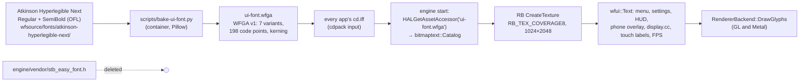
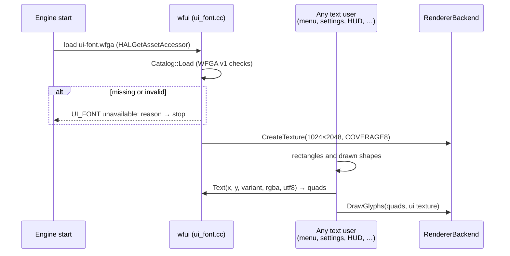

# UI font: Atkinson Hyperlegible Next everywhere, replacing `stb_easy_font`

**Date:** 2026‑10‑17 · **Status:** proposal; needs Will's go-ahead on the open decisions · **TODO:** [T3] ui-font

## TL;DR

Every piece of engine-drawn text uses `stb_easy_font`, a tiny stroke font scaled up ×2.5 to ×9: the fishtank menu, the settings editor (chooser, form, Pick in 3D), the planted-tank HUD, the phone pairing overlay, the in-game HUD and banners, the touch button labels and the FPS counter. It reads as thin, wide-spaced pixel text (mockups 1, 3, 9).

**Replace it entirely** with **Atkinson Hyperlegible Next**, the font [`../finding-your-way`](../../../finding-your-way/game/parmenides-slice/fonts/README.md) ships: Regular and SemiBold, SIL OFL 1.1, the same pinned files byte for byte. Then **delete** `engine/vendor/stb_easy_font.h` (Will, 2026‑10‑17: "this should replace the existing font entirely (delete) and should be used on the fishtank menu and any other place the original font is used").

The engine already has a glyph-atlas text path that only per-level dialogue uses today. `bitmaptext::Catalog` loads `WFGA` bundles (atlas, metrics, kerning), and `RendererBackend::DrawGlyphs` draws them on GL and Metal. This plan bakes **one shared UI atlas** at build time, ships it in every app's `cd.iff`, and routes all eight text users through it.

## Decisions

**Made (Will, 2026‑10‑17):**

| # | Decision |
|---|---|
| F1 | The font is **Atkinson Hyperlegible Next**, as finding-your-way uses it ("use same as ../finding-your-way/"). Both weights, unmodified, from the same pinned Google Fonts commit [7925f50](https://github.com/googlefonts/atkinson-hyperlegible-next/tree/7925f50f649b3813257faf2f4c0b381011f434f1/fonts/ttf). |
| F5 | **It replaces `stb_easy_font` everywhere, and `stb_easy_font` is deleted:** the fishtank menu, the settings editor, and every other place the old font draws. |

**Open (recommendation first):**

| # | Question | Recommendation |
|---|---|---|
| F2 | Engine permission | This changes engine code in the eight files under **Engine changes**, adds a small UI-font module, deletes the vendored header and changes `cd.iff` packing. Confirm the scope. |
| F3 | Sizes at the 1920×1080 logical canvas | Seven variants (mockups 2, 4–7, 10, 11): `small` Regular 28 · `body` Regular 36 · `body-bold` SemiBold 36 · `title` SemiBold 46 · `menu` Regular 56 · `menu-bold` SemiBold 56 · `display` SemiBold 80. Each call site keeps roughly today's apparent size. |
| F4 | The phone page too? | **Yes, in Phase 4.** `controller.html` uses `system-ui`. Embed a subset WOFF2 of the same two weights (about 25 KB each, inline), so the TV and the phone match. |
| F6 | What happens if the atlas is missing | **The engine stops at start-up with a clear error** (`UI_FONT unavailable: <reason>`), like a bad dialogue bundle (`BITMAP_TEXT …`) does today. With `stb_easy_font` deleted there is no font to fall back to, and every bundle is rebuilt in this change, so a missing atlas is a packaging bug. |

## Context: what exists today, from the code

- **Eight files draw text with `stb_easy_font`.** It emits one quad per stroke segment, and the callers scale it ×2.5 to ×9 on a 1920×1080 logical canvas:

    | File | What it draws | Scale today |
    |---|---|---|
    | `game/level_menu.cc` | the fishtank menu (and every app's level menu) | ×5 rows, ×9 title |
    | `game/runtime_property_ui.cc` | the settings form | ×2.5 |
    | `game/runtime_settings_ui.cc` | the chooser and the Pick in 3D tags | ×2.6–3.4 |
    | `game/plant_ui.cc` | the planted-tank HUD strip | small |
    | `hal/phonepad/phonepad_overlay.cc` | the phone pairing overlay (QR code, URL) | ×4–6 |
    | `gfx/gl/display.cc` | in-game HUD text, banners and headers (11 calls) | ×1–8 |
    | `gfx/gl/android_window.cc` | on-screen touch button labels | — |
    | `game/fps_overlay.cc` | the FPS counter | small |

- **The engine already has a glyph-atlas path.** `game/bitmap_text.cc` validates a `WFGA` v1 bundle: atlas size, up to 64 variants (style and pixel size), glyph metrics (36 B each, sorted), sorted kerning pairs, UTF‑8 text records, and strict bounds checks. `game/bitmap_presenter.cc:49` uploads the atlas with `rb.CreateTexture(w, h, RB_TEX_COVERAGE8, pixels)` and draws quads with `rb.DrawGlyphs(…)` on GL and Metal. `level.cc:643-653` loads it **per level** from a `DLOG` chunk, for dialogue only.
- **finding-your-way bakes at build time.** [`glyph_atlas.py`](../../../finding-your-way/game/parmenides-slice/glyph_atlas.py) rasterizes the TTFs with Pillow in a container and writes `WFGA` pixels and metrics; its runtime never touches a TTF. Its `fonts/README.md` pins Regular at `88ed5c31…` and SemiBold at `8e2fff77…` (SHA‑256). The copies used here are byte-identical.
- **Coverage:** the font maps 362 code points, including `× ± ° · – — …` and the curly quotes. It has **no arrows, check marks or triangles**, so the back arrow, ▼, padlock, gear and crosshair stay as drawn shapes, as they already are.

## Design

1. **Font files in the repo.** Copy both TTFs, the OFL text and a README with their SHA‑256 into `wfsource/fonts/atkinson-hyperlegible-next/`, byte-identical to finding-your-way's. That keeps the build reproducible from this repo alone.
2. **Bake.** `scripts/bake-ui-font.py` runs in `wf-linux-test` (Pillow is in the image) and writes `ui-font.wfga` with the existing `WFGA` v1 layout, so `Catalog::Load` validates it unchanged:
    - **Coverage:** printable ASCII, Latin‑1 (`U+00A0–00FF`), and `– — ‘ ’ “ ” • … −` (198 code points). An unmapped code point draws `?`.
    - **Variants:** the seven in F3.
    - **Atlas:** shelf-packed, 1024×2048, 8‑bit coverage, 2 MiB uncompressed. The prototype in the mockup bundle measured exactly this: 1,386 glyphs fit (`atlas.json`, mockup 8).
    - **Kerning:** pairs among the covered code points, from the font's kerning data, as `glyph_atlas.py` does.
    - **Deterministic:** the same inputs always give the same bytes (verification 2).
3. **Ship it.** Add `ui-font.wfga` to the `cdpack` inputs for every app bundle (`wfsource/source/game/cd.iff` and each flavour's `*-cd.iff`). It is one shared asset, not per level.
4. **Load once.** A small `wfui` module (`game/ui_font.{hp,cc}`) loads it at engine start through `HALGetAssetAccessor`, before any menu or HUD draws. It validates the bundle with `bitmaptext::Catalog::Load` and creates the texture through the active backend. It re-creates the texture when `TextureGeneration()` changes (Android context loss), exactly as `Presenter` does. A missing or invalid bundle stops start-up with `UI_FONT unavailable: <reason>` (F6).
5. **One text API for all eight users.** `wfui::Text(x, y, variant, rgba, utf8)` and `wfui::Width(variant, utf8)` lay out with the catalog's advances and kerning and emit `bitmaptext::Quad`s, which are drawn with `DrawGlyphs` after each user's rectangle pass. Positions stay in the 1920×1080 logical canvas; the quads are scaled by the surface factor, so a 720p surface samples the 1080p atlas at ⅔ scale with bilinear filtering (mockup 7). Each call site maps its old `scale` to one of the seven variants; the drawn shapes (arrows, ▼, padlock, gear, crosshair, the QR code) are unchanged.
6. **Delete `stb_easy_font`.** Remove `engine/vendor/stb_easy_font.h`, every `#include` of it, its per-user vertex buffers (`gTextBuf`, `textVertices` and so on) and `stb_easy_font_spacing`.

### Engine changes (F2)

| File | Change |
|---|---|
| `wfsource/source/game/ui_font.{hp,cc}` (new) | load once, texture lifetime, `Text`/`Width`, the F6 error |
| `wfsource/source/game/level_menu.cc` | the fishtank menu: `display` title, `menu` rows, `menu-bold` selected row, `body` subtitle, counter and hints |
| `wfsource/source/game/runtime_property_ui.cc` | the form: `title`, `body`, `small` |
| `wfsource/source/game/runtime_settings_ui.cc` | the chooser and pick tags: `title`, `body`, `body-bold`, `small` |
| `wfsource/source/game/plant_ui.cc` | the HUD strip: `small` |
| `wfsource/source/hal/phonepad/phonepad_overlay.cc` | the pairing overlay: `title`, `body` |
| `wfsource/source/gfx/gl/display.cc` | HUD text, banners, headers: `display`, `title`, `body`, `small` |
| `wfsource/source/gfx/gl/android_window.cc` | touch button labels: `body-bold` |
| `wfsource/source/game/fps_overlay.cc` | the FPS counter: `small` |
| `engine/vendor/stb_easy_font.h` | **deleted**, with every include |
| the app start (`main.cc` and the Android entry) | load the UI font once the asset accessor is up |
| cd.iff packing scripts | add `ui-font.wfga` |

No change to `bitmap_text.cc`, `bitmap_presenter.cc`, the `WFGA` format, or the GL and Metal backends.

### Cost

- **APK and `cd.iff`:** about +2.1 MB uncompressed per app bundle (the 2 MiB atlas, about 50 KB of metrics, and the kerning). The atlas is mostly zeros, so the APK's deflate takes it to roughly 300–450 KB. Phase 1 records the real numbers.
- **GPU memory:** one 1024×2048 R8 texture, 2 MiB, separate from the level's VRAM pages.
- **Frame time:** one quad per character replaces about 10–40 stroke quads per character, so text draws get cheaper. Phase 3 measures the menu and the HUD on Cast1.

## Mockups

The left panels are real Chromecast 1 captures: `tv-form-screenshot.png` (J‑28f5619ea275) and `picker-chooser-screenshot.png` (J‑6922370e7eb5). The right panels are the same layout rendered by Pillow in Atkinson Hyperlegible Next at the F3 sizes, which is how the bake will rasterize it.

- 5: the pick-mode tags.
- 6: an out-of-range value, with its message in the error colour, and a read-only row with the padlock.
- 7: the form drawn at 1280×720 and shown 1:1, which is the 1080p atlas at ⅔ scale.
- 8: the prototype atlas.

- 9 and 10: the fishtank menu, before (a Cast1 capture) and after, at the same geometry and colours.
- 11: the planted-tank HUD strip and the FPS counter, before and after.
- 12: every `stb_easy_font` user and the variants it takes.

`build_mockups.py` regenerates all three pages, and `atlas.json` records the measured atlas.

## Phases

| Phase | Work | Engine edit | Tier |
|---|---|---|---|
| 0 | Copy the fonts with their OFL and README; write `scripts/bake-ui-font.py` and its tests (determinism, coverage, a `Catalog::Load` round trip) | no | T3 |
| 1 | `wfui` (load, texture, `Text`/`Width`, the F6 error) with a ctest; ship `ui-font.wfga` in every app's `cd.iff` | yes | T3 |
| 2 | Switch all eight users; delete `stb_easy_font`; desktop captures in the container of the menu, the settings editor, the HUD, a `display.cc` banner and the phone overlay | yes | T3 |
| 3 | Chromecast 1 and 2: `menu-back` for every app, `baseline-settings`, `baseline-picker`, `aquarium-seahorses`, with screenshots; size and frame-time numbers | no | T3 |
| 4 | The phone page (F4): inline subset WOFF2 of both weights in `controller.html` | no | T2 |

## Out of scope

- Runtime TTF rasterization. As in finding-your-way, the runtime only ever sees baked pixels and metrics.
- Scripts other than Latin. The atlas covers ASCII, Latin‑1 and common punctuation; widening it is a bake-list change.
- Dialogue text. It keeps its own per-level `DLOG` bundles, which already use the same `WFGA` path.

## Verification

1. The fonts are the pinned files: `sha256sum wfsource/fonts/atkinson-hyperlegible-next/*.ttf` prints `88ed5c31a71584c7772963b02d04bef1eb7e3d2e9c8b9cb204339b1f82cf432c` (Regular) and `8e2fff779f35ac25239656bb0f3b2bd35959a2009e3dd21a12141c3b9030362b` (SemiBold).
2. The bake is deterministic: `scripts/in-linux-container.sh python3 scripts/bake-ui-font.py --out /build/a.wfga && scripts/in-linux-container.sh python3 scripts/bake-ui-font.py --out /build/b.wfga && cmp build-docker/a.wfga build-docker/b.wfga` exits 0.
3. The bundle validates and covers the list: `ctest --test-dir build -R ui_font` passes `Catalog::Load` on `ui-font.wfga`. It also checks that every code point of the coverage list has a glyph in all seven variants, and that `U+2190` lays out as `?`.
4. Layout matches the metrics: the same ctest measures `"WF Aquarium"` in `display` as the sum of advances plus kerning from the bundle, within 0.5 px.
5. `stb_easy_font` is gone: `git grep -n stb_easy_font -- ':!docs'` prints nothing, and `engine/vendor/stb_easy_font.h` does not exist.
6. A missing atlas fails clearly: with `ui-font.wfga` removed from a test `cd.iff`, `wf_game` exits non-zero and the log has exactly one `UI_FONT unavailable` line.
7. Desktop screenshots, Release build in the container under Xvfb: the fishtank menu, the settings chooser and form, the pick tags, an out-of-range value, the planted-tank HUD, a `display.cc` banner and the phone pairing overlay. Each one is in Atkinson and keeps its layout.
8. Chromecast 1 and Chromecast 2, through the coordinator: `menu-back` for every app, `baseline-settings`, `baseline-picker` and `aquarium-seahorses` pass with the new APKs, with screenshots under `docs/diagnostics/`.
9. Cost recorded: `cd.iff` and APK size before and after, and Cast1 frame time on the fishtank menu and the planted tank before and after (three runs each).
10. Mockups rebuild cleanly: `python3 docs/plans/2026-10-17-settings-editor-font/build_mockups.py` reports no errors, and every file is under 512 KB.
