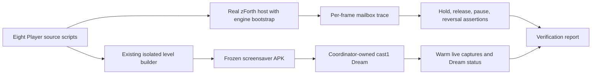

# Aquarium screensaver Player input verification

Date: 2026-10-18. Status: complete on 2026-10-19. The [local zForth verification and two warm cast1 captures](../diagnostics/screensaver-input-verification-2026-10-18/README.md) passed.

## Question and scope

Verify that every live screensaver Player holds a direction across frames, releases it at a tank-specific bound, pauses, and then drives the return leg. The Clownfish and Tiger Barbs Players write direct movement mailboxes; the other six write joystick masks that their existing controllers consume. A TV remote press is a different input path and can wake or dismiss a Dream, so remote key injection would not establish this behavior.

The installed production APK is `/tmp/aquarium-live-screensaver-99fdfce1.apk` (SHA-256 `99fdfce1cde44b45f6037aa4048dfb348b18929847feb4bf567acf9490317a94`). Its tank preference was restored to Random. The [nine archived launcher videos](../diagnostics/aquarium-screensaver-video-archive-2026-10-18/index.html) show live motion, and [later cast1 Dream captures](../diagnostics/screensaver-post-video-review-dream-cast1-2026-10-18/README.md) show Jellyfish at different positions. Neither artifact directly measures the generated hold/release values. The first Dream captures were black even though Will saw the aquarium on the TV; their cause is still unknown.

No World Foundry engine edit is authorized or needed for this verification. This plan uses the existing zForth host and coordinator. If a result calls for engine code changes, describe the proposed change and obtain Will's explicit permission before editing it.

## Evidence chain

The Forth trace establishes the generated input. The TV evidence establishes that the packaged Dream runs and visibly moves over time. Keep those claims separate in the report.

## 1. Exercise the actual Player scripts

Add a focused test using `docs/reference/swarming-poster/zfhost.py` and `zf_host.c`, as existing Forth tests do. Load each `screensaver_player.fth` or aquarium screensaver source unchanged into the engine's zForth bootstrap. Stub only the engine's mailbox indexes and the surrounding canonical controller words needed to compile the two direct-movement Players. Read the actual output mailboxes after each `ss-drive` or `aq-screen-input` call. Run in both floating and fixed mailbox modes if the existing test fixture supports them.

| Player group | Output to inspect | Required sequence |
| --- | --- | --- |
| Blue Shrimp, Betta, Jellyfish, Lionfish, Planted Urchin | mailbox `760` | Right remains held on consecutive frames; near the positive bound it becomes zero; pause stays zero; the return leg holds Left. |
| Arowana | mailbox `780` | Same sequence, using private state mailboxes `781` and `782`; no alias with its canonical `760..775` range. |
| Clownfish, Tiger Barbs | `aq-dx`, `aq-dy`, `aq-dz` private mailboxes | Positive movement persists; reaching the target zeroes the movement axes and starts a pause; the next leg has the opposite X sign. |

For all eight, test a frame whose delta time is smaller than the pause, the frame that expires the pause, and a return frame. Assert that the Forth data and return stacks remain balanced after repeated ticks. Check vertical bits or axes at low and high Z, and the two Y controls used by Blue Shrimp and Planted Urchin. Test the compiled variant mapping by verifying that each generated Player block contains the expected driver and that `TankChoice.IDS` matches the bundle order. These assertions should fail for a missing release, a reversed direction, an overlapping mailbox, or a wrong tank-to-script substitution.

Save a concise machine-readable trace and test result under `docs/diagnostics/`; record each tank ID, source revision, mailbox values and frame cases. Do not change the canonical gameplay `.lev` files.

## 2. Verify the live Dream on cast1

Check `task chromecast:queue` before submitting. At planning time cast1 is occupied by another owner's Parmenides job with a queued check behind it; cast2 has a personal reservation. Wait for cast1 to become available and respect both owners. Use only `task chromecast:*`; no raw ADB or separate device control.

1. Confirm the frozen APK hash and the selected Aquarium Dream. Avoid reinstalling if readback already confirms this exact APK. Keep Random as the saved preference.
2. Let the Dream start naturally or use the coordinator's `screensaver-trigger` workflow in one owned session. Note the workflow's selected and observed DreamService fields. An immediate black screenshot is inconclusive; do not classify the display as black from that frame.
3. After the Dream has had time to render, take coordinator `capture` jobs at least 60 seconds apart without launching an app or sending remote input. Confirm the tank remains the same within that Dream start and its subject or camera moves. Use a coordinator read of Dream running state near the captures. If the first capture is black, take a later capture before drawing a conclusion.
4. Download receipts, screenshots and any status observations to one dated diagnostic directory. Record job IDs, capture times, observed Dream component and which visual changes can actually be seen. Restore or verify the original foreground/settings only if a workflow changed them; confirm cast1 returns to ready. Leave cast2 untouched while reserved.

The coordinator's current Dream trigger and capture workflows do not expose internal Player mailbox values. The Forth trace is therefore the direct hold/release evidence; the cast1 session checks the packaged behavior and the native Dream, including motion beyond the old 33.87-second movie duration.

## Completion criteria

- All eight actual Player sources execute in the zForth harness and pass hold, zero/release, pause and reversal cases; each script's relevant vertical or Y correction passes.
- Generated variants and bundle order still match the eight stable tank IDs, and canonical gameplay levels remain unchanged.
- A live Aquarium Dream is observed on cast1, with two warm captures at least 60 seconds apart showing the same tank and visible motion; the coordinator has returned cast1 to ready.
- The diagnostic report distinguishes measured input values, visible motion, and unresolved screenshot-capture behavior. Any failing tank gets a precise script-level fix and the focused checks are rerun before considering another APK.
