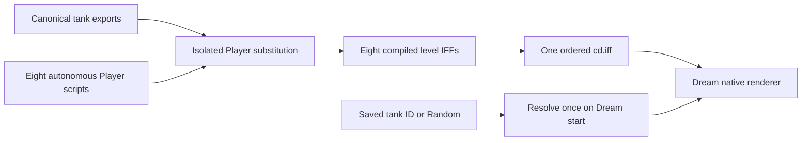
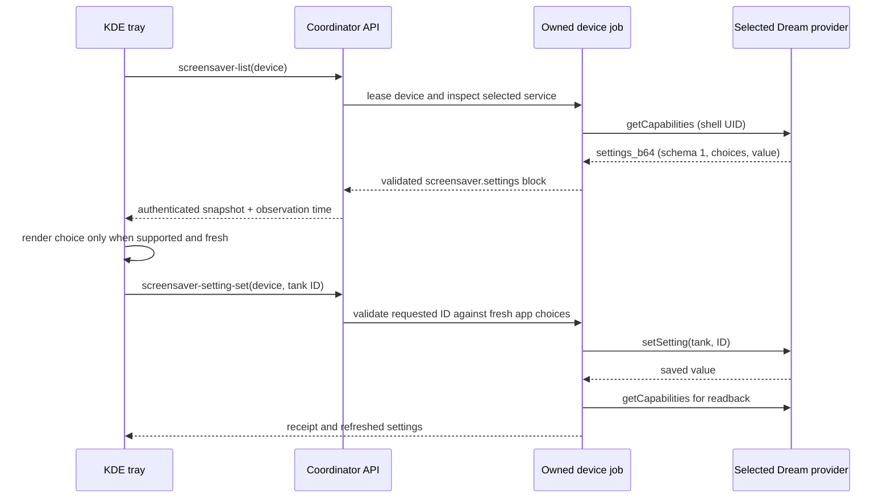

# Aquarium screensaver: live tank players and tray settings

Date: 2026-10-18. Status: implemented; live startup, all eight level renders, and nine one-minute cast1 videos archived.

## Outcome

The Dream runs the World Foundry level renderer with an autonomous Player script for each of the eight aquarium tanks. The selected tank is fixed for one Dream session. **Random** chooses one of the eight when the Dream starts. The KDE system tray offers the settings actually supported by the selected Dream, including the aquarium tank choice, through coordinator-owned device jobs.

The old video Dream has been replaced by the live host and ordered tank bundle. The launcher and Dream use the same renderer. No World Foundry engine code was changed; any future engine change still requires Will's explicit permission.

## Current state

- The video Dream was replaced by a native World Foundry Dream host. The final debug APK was installed on cast1 and cast2 with SHA-256 `99fdfce1cde44b45f6037aa4048dfb348b18929847feb4bf567acf9490317a94`.
- The original gameplay `.lev` files remain the source of truth. `scripts/build-aquarium-screensaver-levels.py` creates isolated `_screensaver` variants; each replaces only its Player script and compiles into `aquarium-screensaver-cd.iff` in a fixed eight-level order.
- `../chromecast-coordinator/scripts/wf_device/tray_qt.py` now renders the tank combo from the validated `content_settings` block. The dedicated `screensaver-setting-set` workflow saves a selected tank and verifies readback.
- The app's shell-only `TankSettingsProvider` publishes a versioned `getCapabilities` response and accepts `setSetting`.
- Cast2 Dream activation and screenshots succeeded for Jellyfish (J‑3e70e8bc5cb0), Lionfish (J‑28a1a4a0f5bb), and Planted Urchin (J‑2b7f3b696245). Clownfish, Blue Shrimp, and Betta passed cast2 launcher renderer checks; Arowana and Tiger Barbs passed on cast1. Arowana natural activation on cast2 timed out twice without a new Dream start, while its renderer passed on cast1.
- Cast1 recorded a fixed Clownfish run in J‑db4eacea69b0: the 41.7-second captured clip shows the fish beside the anemone at 1 second, crossing the open tank at 20 seconds, and turning near the left wall at 39 seconds. The job requested a 45-second recording; Android's resulting media duration is 41.7 seconds. The recording workflow launches the fullscreen activity; the Dream activation checks above are separate. Cast1's saved tank choice was restored to **Random** and verified by J‑05aea5825263. A separate Random run, J‑7b4df2e93c9e, selected Arowana and recorded its live render for 42.4 seconds.
- [The video archive](../diagnostics/aquarium-screensaver-video-archive-2026-10-18/index.html) contains nine H.264 clips longer than 60 seconds: one for each tank and separate freshwater and saltwater Planted Tank captures. Each clip has a poster, source job ID, APK checksum, duration, and media checksum in its manifest. Four coordinator record jobs reported `recovery-required` after saving complete media; this is recorded in the archive. The footage uses the fullscreen launcher; it does not add a long-duration natural Dream check. Cast1's production APK and **Random** choice were restored and verified afterward.

## Tank bundle and player

| Bundle index | Stable tank ID | Tray label | Player source |
| ---: | --- | --- | --- |
| 0 | `aquarium` | Clownfish | `wflevels/aquarium/aquarium_screensaver.fth` |
| 1 | `aquarium_blue_shrimp` | Blue Shrimp | `wflevels/aquarium_blue_shrimp/screensaver_player.fth` |
| 2 | `aquarium_betta` | Betta | `wflevels/aquarium_betta/screensaver_player.fth` |
| 3 | `aquarium_jellyfish` | Jellyfish | `wflevels/aquarium_jellyfish/screensaver_player.fth` |
| 4 | `aquarium_lionfish` | Lionfish | `wflevels/aquarium_lionfish/screensaver_player.fth` |
| 5 | `aquarium_plants` | Planted Urchin | `wflevels/aquarium_plants/screensaver_player.fth` |
| 6 | `aquarium_arowana` | Arowana | `wflevels/aquarium_arowana/screensaver_player.fth` |
| 7 | `aquarium_tiger_barbs` | Tiger Barbs | `wflevels/aquarium/tiger_barbs_screensaver.fth` |

The build checks that each canonical Player entry and joystick source matches the expected form before replacement. Each script drives the existing steering logic with held and released directional masks or the tank's direct movement mailboxes. It pauses and turns at tank-specific bounds. Its controller should not call the video renderer or depend on prerecorded frames. Build order is the contract between tank ID and native level index; verify this mapping in a test before packaging.



## How the tray discovers settings

The tray has no hardcoded tank list. The coordinator has a reviewed mapping for the installed World Foundry Dream package to its settings provider, queries that provider under its device lease, and returns a validated `content_settings` block in `screensaver-list` and the authenticated device snapshot. The tray renders the setting ID, label, selected value, and options from that block. Other Dream packages show no aquarium control. The app also declares its settings authority in DreamService manifest metadata; this first coordinator implementation uses the reviewed package/authority mapping rather than parsing that metadata from Android's package dump.

**Discovery and validation**

1. `screensaver-list` enumerates installed DreamServices and reads the currently selected component. If it is not installed, the tray shows the error and no content controls.
2. For that selected service, require the installed `org.worldfoundry.screensaver` package and use only the reviewed `org.worldfoundry.screensaver.settings` authority. This is a package-specific adapter, not unrestricted provider discovery. Its DreamService manifest carries the same authority as documentation for the app contract.
3. In the same owned session, call `content://org.worldfoundry.screensaver.settings` method `getCapabilities`. The provider checks `Binder.getCallingUid()` for `SHELL_UID` or its own UID. It returns one ASCII-safe base64-encoded UTF-8 JSON document, `settings_b64`, so Android's `content call` text formatting cannot corrupt commas, spaces, or arrays. Limit its encoded size and reject invalid base64/JSON.
4. Validate schema version, setting IDs, types, labels, selected values, and uniqueness. For version 1, accept one `choice` control with ID `tank`, options from the app, and selected value. Unknown types or versions are shown as “Settings unavailable” with a reason. The coordinator does not guess a default or turn missing data into Random.
5. Include the normalized block in the timestamped `screensaver-list` observation and device snapshot. Each Refresh runs a new owned read job. When another provider is selected, discard the old aquarium settings immediately; do not show them under the new provider.

Example capability document after decoding `settings_b64` (abbreviated here; all eight tanks appear in the real response):

```json
{
  "schema": 1,
  "settings": [
    {
      "id": "tank",
      "type": "choice",
      "label": "Tank",
      "value": "random",
      "options": [
        {"id": "random", "label": "Random"},
        {"id": "aquarium", "label": "Clownfish"},
        {"id": "aquarium_betta", "label": "Betta"}
      ]
    }
  ]
}
```

`Random` is a saved preference, while the Dream resolves it to a specific tank once in `onDreamingStarted()`. The tray displays **Random** as the preference; a running-state detail can display the resolved tank only if the app exposes a separate read-only session observation. It must not replace the saved preference with the resolved value.



**Save workflow:** Add a dedicated `screensaver-setting-set` schema with `setting_id` and `value`, not an arbitrary `content` command. Require a fresh selected Dream, matching package/authority, and membership in the freshly queried options. Call the provider's `setSetting`; read capabilities again and require the requested value. Record old/new values and the selected component in the job receipt. A setting change affects the next Dream start; it does not silently restart a running Dream. A reservation, maintenance state, stale selection, failed read, or changed provider disables Save.

**Other Dreams:** A provider without the metadata contract continues to show the existing system settings only. The UI states “This screensaver does not expose content settings.” An unreadable or incompatible contract shows “Content settings unavailable” and a refresh action, without a writable control. This keeps the tray generic while allowing reviewed app-specific controls.

## GUI mockups

These are layout targets, not screenshots. The [browser mockup](2026-10-18-aquarium-screensaver-player-and-tray-settings/mockups.html) shows the same states at desktop width.

```text
┌ Screensaver · chromecast-test-02 ─────────────────────────────────────────┐
│ Selected: World Foundry Aquarium     Running: Aquarium [observed 19:42] │
│ Provider: [World Foundry Aquarium                         ▾] [Select]    │
│ System settings                                                        │
│   ☑ Enable screensaver       ☑ Activate on sleep                        │
│   Idle timeout [ 6 min ▾]                           [Save system]        │
│ Aquarium settings · from installed app · observed 19:42                 │
│   Tank         [Random ▾]      Chooses one tank at each start            │
│                              [Save tank]                                │
│ [Refresh status] [Install…] [Trigger…]  Job: J‑0692359b671d            │
└──────────────────────────────────────────────────────────────────────────┘
```

```text
┌ Screensaver · chromecast-test-02 ─────────────────────────────────────────┐
│ Selected: Google TV Ambient          Running: Unknown · stale           │
│ System settings: Enabled · on sleep · 6 min                               │
│ Content settings: This screensaver does not expose content settings.    │
│ [Refresh status] [Select provider] [Trigger… disabled]                  │
└──────────────────────────────────────────────────────────────────────────┘
```

The provider combo continues to come from registered DreamServices. Tank options come only from the validated capability response. Keep system Save and app setting Save distinct so one failed operation cannot misreport the other as saved. Show the selected value, observation time, job progress, and a clear next-start note. Accepted coordinator job IDs render with nonbreaking hyphens in prose and GUI labels; executable identifiers remain ASCII.

## Implementation sequence

1. Finish the eight Player scripts and the ordered `cd.iff` packaging. Check mailbox ranges, stack balance, direction sign, and held/released input in a Forth harness. Verify game levels were not modified.
2. Finish the Dream native host and launcher integration. The Dream owns a Surface and render thread, picks the tank once, loads the bundled level by index, and stops cleanly when detached. Keep a separate Dream process if engine globals cannot be reinitialized safely. Remove the video asset and playback classes after live rendering is verified.
3. Replace the draft provider methods with the versioned `getCapabilities`/`setSetting` contract, manifest metadata, UID check, and size limit. Verify random selection distribution and that saved choices survive process restarts.
4. Extend coordinator schema, workflow routing, CLI/Taskfile command, authenticated snapshot, and tests. All device reads and writes stay inside the coordinator lease. Do not add tray-side ADB or direct app calls.
5. Extend `ScreensaverDialog` with a dynamic content section driven by normalized capabilities, plus disabled, stale, unsupported, and save-in-progress states. Add offscreen Qt tests for two providers and option changes; keep HTML/JSON dashboard representations aligned if they show this block.
6. Build/freeze the APK, check `task chromecast:queue`, and use coordinator-owned install, inspect, setting and Dream jobs on cast2 when free. Capture screenshots and job evidence for every tank, Random across several Dream starts, and held/released motion. Confirm a DreamService is active in `dumpsys dreams`; a launcher view alone is insufficient.

## Acceptance checks

- Every tank renders live for longer than the former 33.87-second loop, continues moving, and respects level bounds. Its Player generates input without a prerecorded movie.
- A fixed tank setting always starts that tank. Random selects one of all eight at each Dream start and does not switch while that Dream runs.
- The tray obtains IDs, labels, and current selection from the selected app's capabilities. Changing providers removes the old controls. Unsupported, stale, and unreadable states remain explicit.
- A Save produces an owned coordinator receipt and verified readback; the next Dream uses the saved choice. Reservations and maintenance block interaction.
- APK and device evidence cover cast2 WebView/Chromium 91 constraints where web code is involved, plus held/released directional input on the actual Chromecast. No direct ADB is used.

## Permission boundary

No World Foundry engine code or shared engine build definitions were edited. The native host uses an app-specific CMake hook and existing engine launch switches. Coordinator deployment was approved explicitly and completed through the reviewed maintenance helper. The final coordinator release preserved its recovery journal and resumed the queue.
