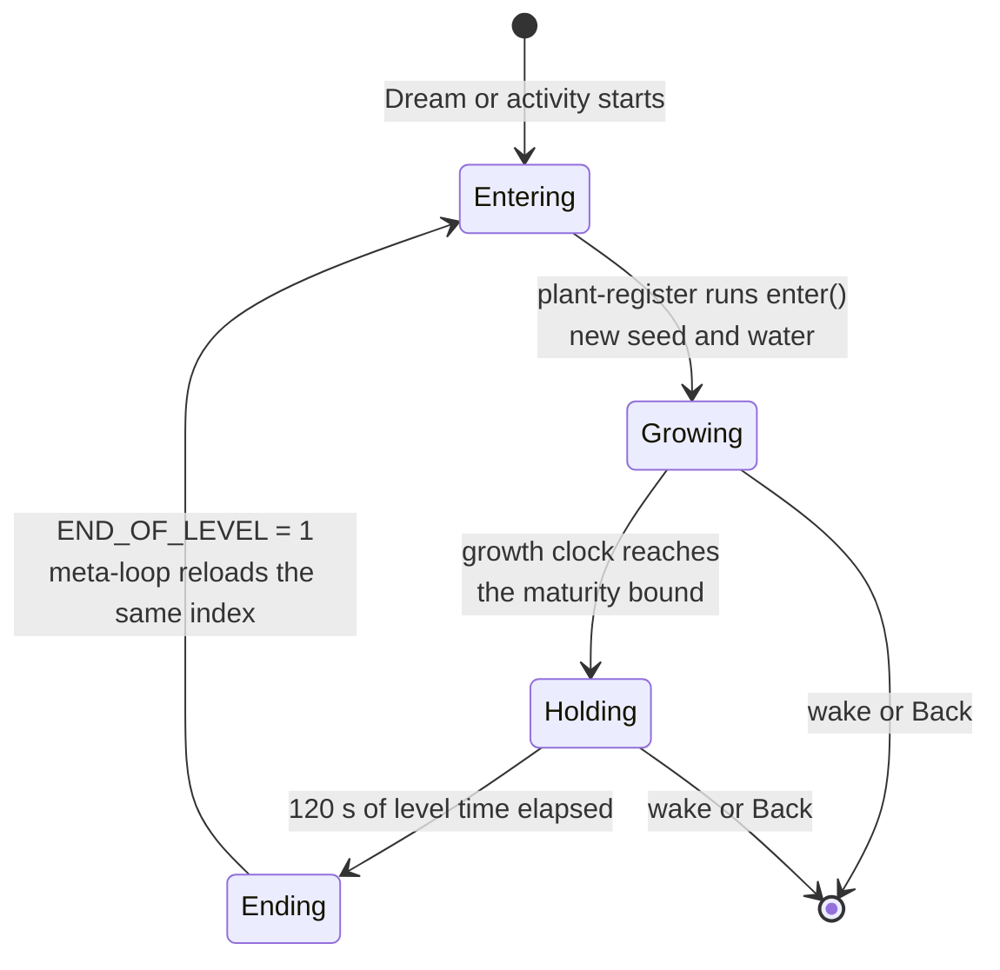
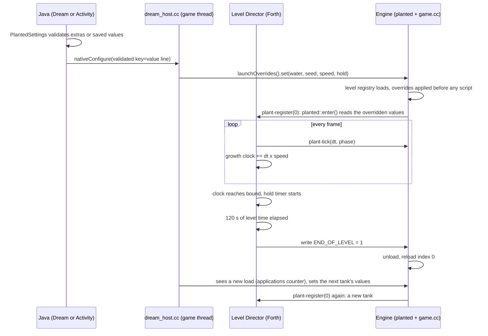
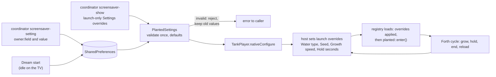
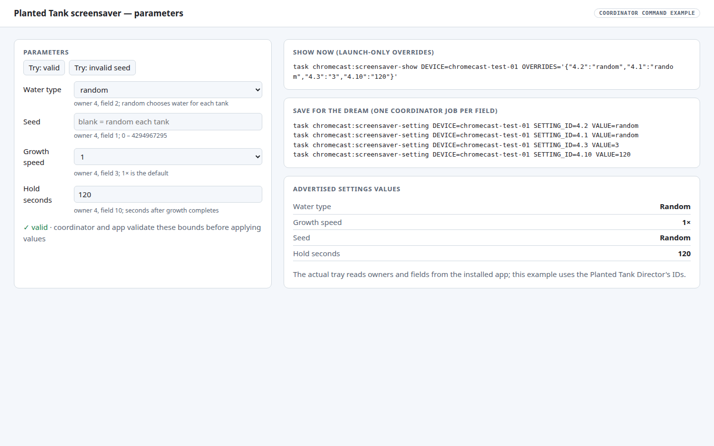
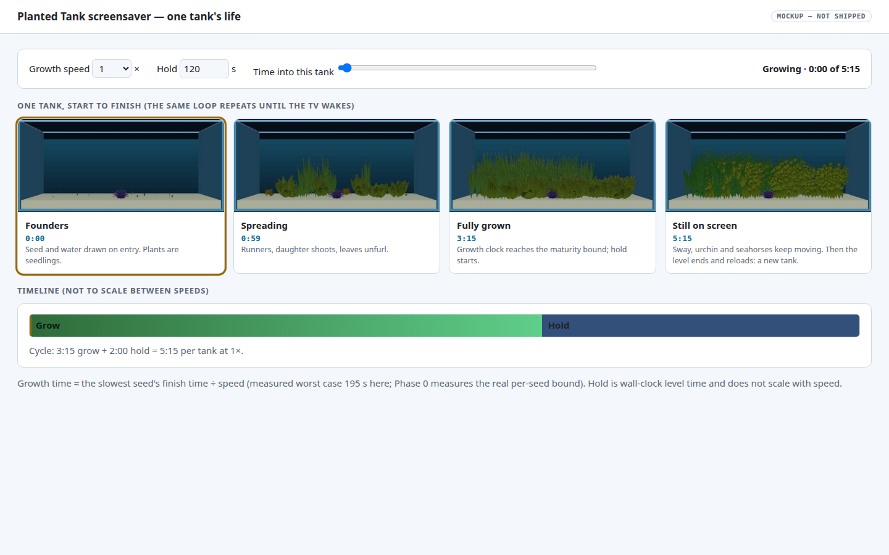
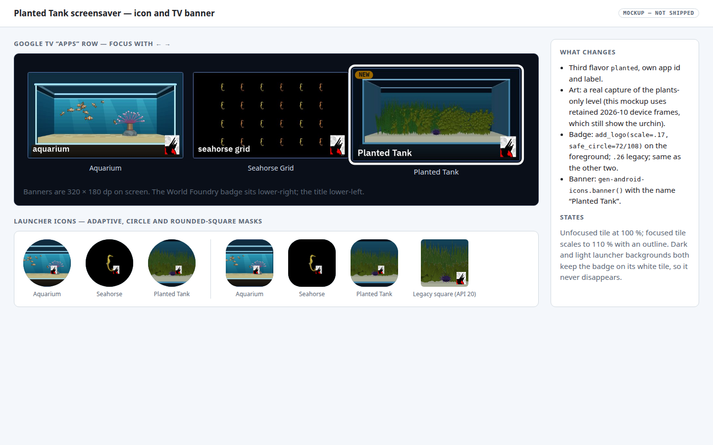

# Planted Tank screensaver

Date: 2026‑10‑21. Status (2026‑10‑22): **Phases 0–4b implemented; offline checks pass; coordinator deployed; Phase 5 awaits device availability.** Decisions made with Will on 2026‑10‑21: a generic launch-override seam (approved), `hold` as a parameter, and **plants only: no urchin, no goby, no seahorses.**

## Context

`android/screensaver` now builds three apps: **Aquarium** (eight tanks, one drawn per Dream start), **Seahorse Grid** (its own one-level bundle), and **Planted Tank** (plants only, no animals). Planted Tank grows from seedlings to a full canopy, stays up for two minutes, then starts a different tank. Its icon and TV banner carry the World Foundry badge. Planted Tank device verification remains pending.

What is true today:

- The planted tank is already a growing ecosystem. `planted::enter()` draws a fresh seed on every level entry, plants grow from founders, and growth finishes on its own. The older clumps plan said "about 117–144 growth seconds", from a few seeds; the Phase 0 sweep of 200 seeds measured **103 s to 193 s** ([results](2026-10-21-planted-tank-screensaver/spikes/maturity-sweep.md)). The engine clamps the growth age at 240 s (`wfsource/source/game/plant_settings.h`, `tick`).
- "Fully grown" has an exact definition per seed: each `plantgrowth::Vertex` carries `birth` and `duration`, and a vertex is full size at `age ≥ birth + duration` (`plant_growth.h`, `deformedWave`). A tank is complete at the maximum of that over all its vertices.
- A Dream has **no command line**. The old `--plant-seed`, `--plant-water` and `--plant-speed` switches were deliberately **removed** ([command-line-switches.md](../command-line-switches.md#baseline-runtime-options)); plant values now come from the level's cooked `PlantedTankSettings` catalog, and "no replacement launch aliases" are provided. Parameters therefore have to arrive another way (see **Parameters**).
- **The level can end itself.** A level writing mailbox `END_OF_LEVEL` (1905) = 1 ends it, and the `cd.iff` meta-loop in `game.cc` reloads. On the Dream the next level is forced to the app's own index (`_overrideLevelNum`, `game.cc:300`), so `LEVEL_TO_RUN` (5000) is not even consulted; it matters only for the desktop `task run`. Only `_desiredLevelNum` survives a reload: **a level's own mailboxes, including 6000 and up, are new each time** (S1/S2 corrected the troubleshooting doc on this). Never write 0 to `END_OF_LEVEL`. The planted level calls `plant-register`, which calls `planted::enter()`, on every load, so a reload **is** a new tank.
- The engine-side growth age and speed are native state. Forth cannot read them; it only passes the frame `dt` to `plant-tick`. So the level needs **its own clock**, which Will also suggested.
- The screensaver host (`android/screensaver/src/main/cpp/dream_host.cc`) owns `WFAndroidPumpEvents()`, which the engine calls on the game thread once per frame. It now clears the engine drawer and pumps the planted bridge there, so the host handles each reload without a further engine edit.
- A pending TODO item says the cooked planted levels carry the **seahorse actor‑30 crash**. This plan is not affected, because the screensaver level has no animals; the item stays open for the Aquarium app.

## Approach

**One sentence:** a third flavor, `planted`, that plays a plants-only variant of the planted-tank level through a Forth Director that ends and reloads the level when the tank is grown and has been shown for two minutes, with parameters validated in Java and handed to the engine through a new generic **launch-override table**.

| # | Decision | Choice | Why / what was rejected |
|---|---|---|---|
| 1 | App shape | Flavor `planted` in `android/screensaver`, id `org.worldfoundry.plantedtank`, label "World Foundry Planted Tank Screensaver", sharing `TankPlayer` and the `wf_dream` library | Same pattern as Seahorse Grid; shared engine code and CMake stay unchanged. Rejected: a ninth Aquarium choice (no growth cycle, no own icon, shares one preference). |
| 2 | Who runs the cycle | **The level**, in Forth, writing `END_OF_LEVEL` = 1 | Needs no native or Java timer and no engine edit; reload already re-runs `enter()`. Rejected: native `planted::regenerate()` from the host (needs the same staging plus a mid-level mesh swap; reload is the path the engine already tests). |
| 3 | "Grown" | Level-side **growth clock** ≥ a measured **maturity bound** | Forth cannot see native age. The clock mirrors `tick`: add `dt × speed`, with `dt > 0.2 s` counted as 0. A conservative bound only lengthens the hold; it never cuts a tank short. |
| 4 | "Keep onscreen 2 minutes" | Level time (`TIME`), starting at the moment the growth clock reaches the bound; default **120 s**, independent of speed | Wall-clock by construction; the plants keep swaying. |
| 5 | Parameters | Java validates once; the host sets the values in a new, generic **launch-override table** in the `wfprops` registry (engine edit **approved 2026‑10‑21**). The engine applies it whenever a level's registry loads, before any script runs | S1/S2 found host staging into `planted::state()` workable but fragile: two conditions, a frame-1 gap, and it dies with the OAS migration. The table is keyed by schema and field name, so any settings owner can use it. |
| 6 | Default growth speed | **1×** | As asked. |
| 7 | Next tank | Reload only; the Dream forces its own index, and `LEVEL_TO_RUN` = 0 is written only for the desktop run | One level in the bundle; S1 traced the reload at `game.cc:421-444` and `300-301`. |
| 8 | Animals | **None.** The variant has no urchin, goby or seahorses | Will's call. Removes the seahorse parameter, the actor‑30 dependency and the animal cost; how to remove them is Spike S4. |

### The cycle, as a state machine



### One tank, in order



### The flow from a command to a tank



## Parameters

An Android Dream receives parameters through **activity extras** for an immediate run and a shell-only **settings provider** for what the idle Dream will use. The shared coordinator owns both routes on the test TVs. Both feed the app's validator, so a bad value gets the same rejection everywhere. **Decision (Will, 2026‑10‑21, clarified 2026‑10‑22):** handle the level's existing Settings objects generically. The planted screensaver has one `PlantedTankSettings` catalog owner (Director). Baseline's original two placed Settings objects (`SampleSettings` and `SampleSettings2`) were joined by `SampleSettings3` for the 3D picker; all three now use the OAS type `Settings`, rather than a name tied to the Baseline level. The APK must enumerate owners and their compiled OAD-derived catalog schemas, retaining owner identity so multiple objects of the same type do not collapse into one form. It generates and serves a bounded capabilities document with owner/type/field identity, presentation, allowed values and current values. The coordinator discovers that document through the app's declared provider, validates its generic schema, renders each supported field according to the OAD show-as modifier, submits a field/value update, and checks the readback. No coordinator branch or tray widget is keyed to Planted Tank, `water`, `speed`, `hold`, or the Aquarium `tank` field. Package admission remains a separate allowlist decision; it does not define the settings fields.

Phase 4b uses `gen-settings-capabilities.py` to enumerate every catalog Settings owner and its fields from the compiled OAD data. Its schema 2 document keeps owner identity and supports choices, checkboxes, bounded numbers and text. The provider maps this metadata to the app's current values and validates writes. At the APK boundary it removes Paused from `Growth speed` because a paused tank cannot finish, and adds the app's `water=random` policy. The coordinator reads the declared provider, validates this bounded document, renders generic controls in the tray and verifies each write by reading it back. Baseline's three current owners are covered by a catalog test. The two-ABI APK build, Planted offline tests and full coordinator suite pass; the shared coordinator was deployed under maintenance, and device verification remains pending. This contract uses the existing catalogs and has no dependency on the object editing migration.

| Key | Values | Default | Reaches the engine through | Runtime in v1 |
|---|---|---|---|---|
| `water` | `freshwater`, `saltwater`, `random` (aliases `fresh`, `salt`) | `random` | override of `Water type` (field 2) | yes |
| `seed` | whole number 0 to 4294967295 | random per tank | overrides of `Seed` (1) and `Random seed on entry` (7) = off | yes |
| `speed` | 0.25, 0.5, 1, 2, 4, 8 (paused is rejected: the tank could never finish) | `1` | override of `Growth speed` (3); the Forth clock reads it back with `property@` | yes |
| `hold` | 0 to 86400 s | `120` | override of a new `Hold seconds` field in the variant's own `settings.oas` | yes |
| `age`, `textures`, `sway` | developer keys; `age` 0 to 240 s | `0`, `true`, `true` | overrides of fields 4, 5 and 6 (the table may override read-only fields) | yes, hidden from the tray |

**Sequences are reproducible.** With a fixed `seed`, tank 0 uses it exactly and tank *k* uses a documented 32-bit mix of `(seed, k)`; with `water=random` the water of each tank comes from the same mix. Replaying a command replays the whole run (a fixed seed that repeated the identical tank every cycle would be dull, so later tanks derive from it). With no seed, the engine's own `freshSeed()` runs per tank and the host sets nothing per tank. To set the next tank's values in time, the table keeps an **`applications()` counter** that rises each time a registry load applies it; the host watches it from `WFAndroidPumpEvents`. Java and the host share one test vector for the mix.

```text
task chromecast:screensaver-show DEVICE=chromecast-test-01 OVERRIDES='{"4.2":"1","4.1":"713","4.3":"4"}'
task chromecast:screensaver-setting DEVICE=chromecast-test-01 SETTING_ID=4.2 VALUE=1
```

[](2026-10-21-planted-tank-screensaver/parameters.html)

The page opens on the defaults and shows coordinator commands for one-run overrides or saved Dream values. Choose **Try: invalid seed** to see the rejected state, where no command is produced and previous settings stay in force. [Open the interactive command builder](2026-10-21-planted-tank-screensaver/parameters.html).

## Lifecycle and timing

[](2026-10-21-planted-tank-screensaver/dream-lifecycle.html)

At 1× a cycle is the maturity bound (**195 s**, measured) plus the 120 s hold, about 5 min 15 s per tank. A median tank (about 135 to 141 s) is fully grown 55 to 60 s before the bound, so it shows for roughly three minutes. A per-seed bound would remove that slack; see Spike S2. At 0.25× growth takes four times as long; at 8× about 18 s; the hold stays 120 s. [Open the interactive timeline](2026-10-21-planted-tank-screensaver/dream-lifecycle.html) and change the speed.

**Frames and performance.** Growth ignores frames longer than 0.2 s, so it needs more than 5 FPS to run at 1×. The retained cast1 wide-view figure with plants, urchin and no seahorses is 21 FPS ([seahorse plan](2026-10-16-saltwater-seahorses.md)); a plants-only level has less to draw, so it should do at least as well, and Phase 5 measures it.

**Framing.** In the retained captures the tank fills about 57% of the frame width and 45% of its height, with the rest dark. A screensaver should fill the TV, so Phase 1 moves the variant's camera in (target: tank at least 85% of the width, nothing cropped). This is a level-only change in the variant builder.

## Icon and banner

[](2026-10-21-planted-tank-screensaver/icon-and-banner.html)

Both use the badge pipeline that Aquarium and Seahorse Grid already use: `gen-screensaver-android-icons.py` calls `add_logo()` (scale 0.17 on the adaptive foreground, inside the 72/108 safe zone; 0.26 on the legacy square; 0.24 on the round icon) and `gen-android-icons.banner()` for the 640 × 360 banner with the name lower-left and the badge lower-right. The mockup above was built by running those functions on retained device frames, so the badge position and size are the real ones. **Production art is in** (`c181ce6a`): a fresh capture of the plants-only level, saltwater, seed 713, committed as `android/screensaver/art-src/planted-tank-frame.png` the way `seahorse-grid-frame.png` is. The generator gains a third art source and writes `src/planted/res/`.

## Work phases

Tiers are dispatch inputs (ranking is done inline, never delegated). Torn calls took the higher tier.

| Phase | Work | Tier | Reason |
|---|---|---|---|
| ~~0a~~ | ~~Re-cook the planted levels for the actor‑30 fix~~ **Not needed:** no seahorses in this level (the TODO item stays open for the Aquarium) | T3 | n/a |
| ~~0b~~ | ~~**Spike S1:** staging window~~ **Done:** safe with conditions, no engine edit ([S1‑S2](2026-10-21-planted-tank-screensaver/spikes/S1‑S2.md)) | T4 | unknown territory, now resolved |
| ~~0c~~ | ~~**Spike S2:** what Forth can read~~ **Done:** speed is readable; hold needs a new field and a host write | T4 | same |
| ~~0d~~ | ~~**Spike S3:** where is the seed/settings strip drawn, and can the variant drop it? Which camera gives the 85% framing?~~ **Done** | T3 | bounded search plus a level edit |
| ~~0e~~ | ~~Maturity sweep over 200 seeds in both waters~~ **Done** (`f793c3d1`): bound 195 s | T2 | one harness, known formula |
| ~~0f~~ | ~~**Spike S4:** plants-only variant~~ **Done:** a generator flag, not a text strip ([S4](2026-10-21-planted-tank-screensaver/spikes/S4.md)) | T3 | bounded investigation |
| ~~1~~ | ~~Level variant~~ **Done** (`494ed19e`): `ANIMALS` flag in `generate.py`; `wflevels/planted_tank_screensaver/` (30 actors, wide camera at y -8.25, fog 5.76 / 28.8, `PERM` 1 MB, `ROOM` 24 MB); the catalog attached (`Hold seconds` id 10, no Seahorses or Greeting); the Director cycle in `planted_cycle.fth`; `build-aquarium-screensaver-levels.py planted`; zForth simulation and desktop engine cycles pass. **Device run pending.** | T3 | multi-file against this plan |
| ~~2a~~ | ~~Java: `PlantedConfig`, `PlantedSettings`, provider, activity, Dream, manifest, strings, `TankPlayer.configure`~~ **Done** (`8876f6cd`): 116 checks pass; the three-flavor Java compile passes. The `planted` block in `build.gradle.kts` is in the working tree but **uncommitted** because it overlaps Will's uncommitted flavor block | T2 | one module, clear spec |
| ~~2c~~ | ~~Engine: the launch-override table~~ **Done** (`f3c3ff16`, approved by Will 2026‑10‑21): `wfprops::LaunchOverrides` with the `applications()` counter, one hook line in `level.cc`, the `--property=` desktop flag, `task test-launch-overrides`. Verified end to end on a real level in the container | T3 | design settled in S1‑S2 |
| ~~2b~~ | ~~Native host~~ **Done** (`eea849fe`): `planted_bridge.cc/.h` (parsing, defaults, `mix32`, the tank sequencer and the counter watcher, free of Android and engine includes), the JNI `nativeConfigure`, first-tank overrides before `HALStart`, per-tank overrides from the pump. 113 unit checks pass (`task test-planted-bridge`); the Planted APK now builds and links for **both arm64-v8a and armeabi-v7a**. **Device run pending.** | T3 | uses the new table; no engine state touched |
| ~~3~~ | ~~Icon and banner with the badge~~ **Done** (`d79cabcf`, then final art in `c181ce6a`): a real capture of the plants-only level (saltwater, seed 713, `Initial age` 194, 1920×1080 under Xvfb, seed strip and FPS counter masked, resized to 1280×720), the icon crop `(430, 200, 790, 560)`, 13 icon tests pass. Desktop software-GL render, not a device capture. `gen-screensaver-android-icons.py` is Will's untracked file and carries the edit uncommitted | T2 | follows the existing Seahorse recipe |
| ~~4a~~ | ~~`task` entries, coordinator guide section, README~~ **Done** (`3d56263d`): `build-planted-level`, `build-planted-apk` (both ABIs), `test-planted-screensaver`; offline build and test tasks pass | T1 | recipes |
| 4b | **Generic `Settings` class support in the coordinator and APK contract.** Implemented and offline verified: the coordinator discovers the selected app's declared settings provider, validates bounded OAD-derived owner/field metadata, renders supported show-as types, writes any advertised field and verifies readback without app-specific settings branches. Declarative package admission for `org.worldfoundry.plantedtank`, generic Dream preview and launch parameters, and the screensaver `capture()` log boundary are included. The APK catalog/provider supports the generic field contract. **Shared coordinator deployed; device verification pending.** | T5 | cross-repository contract and shared infrastructure; device runs use `task chromecast:*` |
| 5 | **Pending device availability:** install the frozen two-ABI APK, verify generic Settings and launch overrides, then check cycle timing, framing, a 50-tank soak and natural idle through the coordinator | T3 | procedure with judgment about results |

Phase 2c comes before 2b. **Will approved the generic seam on 2026‑10‑21** (earlier: "i'd want it to be more generic than just plant settings"; answer to the build-it question: "generic"). I took "generic" to mean the data table, not the 5-line host callback. S4 may change Phase 1.

## Spike results

**0e, maturity sweep (done, `f793c3d1`, [write-up](2026-10-21-planted-tank-screensaver/spikes/maturity-sweep.md)).** `task test-plant-maturity` runs seeds 0 to 199 in both waters inside `wf-linux-test:local`. Freshwater finishes between 103.5 and 187.8 s (median 135.3), saltwater between 107.5 and 193.3 s (median 141.2); worst seed is 48 in both. Nothing nears the 240 s clamp, and seed 713 repeats identically. **Bound: 195 s.** It covers 200 seeds, not all 2³², so the level never compares against the clamp itself.

**S3, strip and framing (done, [write-up](2026-10-21-planted-tank-screensaver/spikes/S3.md)).** Two of its findings change the plan; I re-checked both against the source.

- **The seed strip cannot be removed without an engine edit.** The engine draws it every frame while a tank is active (`wfsource/source/game/plant_ui.cc:12`). No catalog field, object flag, Director script or mailbox controls it, and growth needs the same `active` flag. The screensaver's own HUD switch does not reach it: `WFAndroidSetHudEnabled(0)` removes only the touch controls and the FPS counter, because the Android overlay drawer ignores that flag (`android_window.cc:502`, per the spike). **The shipped Aquarium Dream already shows this strip** on its Planted choice, with "Hold A: settings" text on a Dream that takes no input. S3's smallest fix is a plant-specific `label` flag in `plant_settings.h` and `plant_ui.cc` (three lines). Following Will's "more generic" direction, my proposal is instead to make the Android overlay drawer **respect the existing `gHudEnabled` switch**, which the screensaver host already sets to 0: one generic change that fixes both apps and adds no plant-specific state. It needs Will's approval; until then the plan has no `label` parameter and the strip stays on. **Resolved 2026‑10‑21, with no engine edit.** Will approved the `gHudEnabled` change, but tracing it showed that `native_app_entry.cc` already sets that flag to 0 on every TV build, so honouring it in the drawer would also hide the TV level selector and settings panels. Instead the strip is drawn only while `levelmenu::Drawer()` is set (`display.cc:1280`), and the Dream host owns `WFAndroidPumpEvents()`, so `dream_host.cc` now clears the drawer every frame. This hides the engine overlay in every passive host, fixes the shipped Aquarium and Seahorse Dreams too, and a null drawer already falls back to starting level 0 (`game.cc`). Guard: `tests/test_screensaver_overlay.py` (3 tests pass). The two-ABI APK now compiles; device capture remains pending.
- **Framing is a text substitution, as hoped.** The wide camera sits at `y = -12`. Moving it to `y = -8.25` (same x, z and look-at) makes the tank 90.0% of the frame width and 71.3% of its height at 16:9, with a 5% margin each side and nothing cropped; the 85% limit is `y = -8.638`. The model reproduces the device capture (predicted 57.4% × 45.5%, measured 57.4% × 45.4%). The builder replaces `-12.0000000000000000(1.15.16)` in the `cs_wide` and `Camera` blocks (`aquarium_plants.lev` lines 130 and 655, the only hits) and asserts one hit per block; leaving `Camera` unchanged would add a one-second pan on start. Moving in removes some fog (start distance 9), so scale both fog distances by about 0.64 to keep today's look. The camera field of view is ignored by the engine (fixed 60° vertical), so position is the only lever. TV overscan above about 5% would clip the walls, so Phase 1 takes a device capture to confirm.
- **Smaller facts.** The screensaver stays on the wide camera, since only a native tap switches cameras and the Dreams take no input; `PlantedTankActivity` must not add an input path. The level has no QR code or pairing prompt.

**S4, plants-only variant (done, [write-up](2026-10-21-planted-tank-screensaver/spikes/S4.md), read from source).**

- **Use a generator flag.** No animal switch exists: `KIND=='plants'` always builds the urchin, the goby, 12 seahorses, posts and rocks (`generate.py:209-218, 242-287, 316-319`); only the water type chooses urchin or goby, at runtime. A text strip is unsafe: actor indices follow `.lev` order and the scripts bake them in as numbers (`0 69 plant-register`, `tk-cam-close 81`), so removing animals moves the plant chunks from 69‑76 to 18‑25 and `cs_close` from 81 to 30, and **a wrong index fails silently** (`plant-step` skips out-of-range actors).
- **A Player object is required:** `Level::reset()` asserts on it. Keep an invisible hull with a script that only writes `0 INDEXOF_INPUT`, as the other tanks do. No camera follows the Player in the level data; only Forth moves the close camera, which a Dream never selects.
- **Finding at the time of S4: the Aquarium screensaver variant had no settings catalog.** `aquarium_plants-standalone.iff` held `PlantedTankSettings` and two `RPRP` tags; the screensaver variant and bundle held none. The Aquarium Dream's Planted choice therefore used hard-coded freshwater defaults. The separate build-script fix now attaches that catalog; device verification of the rebuilt Aquarium APK remains pending.
- **Memory:** keep the 24 MB `ROOM` pool (it is for the plants); `PERM` (6 MB, grown for seahorse rigs) can drop to about 1 MB, measured in Phase 5. Remove the Seahorses and Greeting fields rather than cooking them to 0, and do not use `plant_settings_catalog.py` on this variant (it is hard-wired to `aquarium_plants`).
- **Framing becomes config:** `generate.py:368` honours `C.WIDE_CAMERA` only for the arowana, so Phase 1 widens that condition. S3's text substitution on the generated `.lev` remains a fallback.

**S1 and S2, staging and Forth reads (done, [write-up](2026-10-21-planted-tank-screensaver/spikes/S1‑S2.md), read from source, nothing run).**

- **S1: SAFE-WITH-CONDITIONS, no engine edit.** (Kept as the fallback; the approved seam below supersedes it.) On reload the engine calls `planted::leave()` (`game.cc:421`), then `PageFlip` twice (`game.cc:429-430`), then destroys the level. `PageFlip` runs `WFAndroidPumpEvents`, so the host's pump fires twice with `active` false and before the next `enter()`, never during `LoadLevel`, all on the one game thread. Conditions: stage only while `!active && !explicitSeed`, and stage the **first** tank in `nativeRun` before `HALStart`, because the first pump comes after frame 1 has already run `enter()`.
- **S2:** speed is readable from Forth with `property@`. Hold has no catalog field, so it gets a new field in the variant's own `settings.oas` (level data, not engine), written by the host from frame 2 of each tank. **No host code can run between the registry load and the Director's first tick**, so anything Forth needs on frame 1 is cooked or staged through `state()`; the launch-override table closes that gap, because it applies before any script runs. There is no tank count and no `cycles` parameter: the loop runs until the TV wakes, and tests count tanks from the log.
- **`TIME` (1906) is the level clock** and `DELTA_TIME` (1907) the frame delta; both restart at 0 on each reload, so they time a tank but cannot count tanks.
- **The Dream always reloads its own TOC index,** so only `END_OF_LEVEL = 1` is needed on device.
- **Residual risks of host staging (all removed by the table):** the host and engine sharing one `planted::state()`, dependence on the current `UnloadLevel` order, and the loss of the mechanism when the OAS migration retires `planted::State`.
- **Generic seam: approved and now Phase 2c.** A launch-override table in the `wfprops` registry (about 60 engine lines plus tests, an optional desktop `--property=` flag, and an `applications()` counter added to S1/S2's design), applied at `level.cc:613-615` before `activeRegistry()` is set. It removes S1's conditions and the frame-1 gap, survives the OAS migration (keyed by name, not RP01 id), and lets any settings owner use it.

## Out of scope

- A desktop (Linux or macOS) screen saver; this is the Android TV Dream.
- Seed entry in the coordinator tray: schema 1 carries choices only today; the seed stays on the command line.
- A cross-fade between tanks. The reload shows the engine's normal load gap; Phase 5 measures it and an overlay fade (Java-side, no engine edit) is a follow-up if it looks rough.
- An exact "plant is mature" engine word. The Forth clock plus a measured bound is enough; an exact word would need an engine edit.
- Audio, as for Seahorse Grid.
- Public distribution and signing, unchanged from the [aquarium plan](2026-10-17-aquarium-screensaver.md).

## Risks

- **The growth clock drifts from the native age** if `tick`'s rules change. Mitigation: the Forth clock copies `dt` clamping and speed values from `plant_settings.h`, and a test fails when `speedValue` or the 0.2 s clamp changes.
- **Reload cost and leaks.** Each reload rebuilds the plant meshes. The clumps plan measured repeated entries steady in one process (PSS spread under 4 MiB); the soak in Phase 5 repeats that for this build.
- **The engine edit affects every level's load path.** Mitigation: the table is empty unless a host sets it, so other apps are unchanged; it is one line in `level.cc`; unit tests cover apply, validation reject, read-only override, unknown key and repeated loads. It is keyed by name, so it moves to OAS unchanged ([runtime object editing](2026-10-16-runtime-object-editing.md)).
- **Device availability.** Both test TVs needed local setup after the 2026‑10‑22 coordinator deployment, and Will reported neither available today. Phase 5 waits for a device; submit the frozen APK through `task chromecast:*`, never raw `adb` against a shared TV.

## Verification

Build, level and test steps run in the project's containers (`wf-blender:local` for the level via `scripts/level-build.sh`); device steps go through the coordinator. Results are recorded below each step when the work lands.

1. **Parameter validation.** `javac` and `java` of `PlantedConfigTest` in the JDK container (`wf-tv-media-phase0-jdk:local`; JUnit is not in the offline Gradle cache, so there is no `testPlantedDebugUnitTest`) pass every table row's accepted and rejected values, alias spellings, the speed index mapping, unknown keys and "paused rejected". The host's seed-mix vector is tested with Phase 2b.
2. **Maturity bound.** `task test-plant-maturity` prints the maximum `birth + duration` over 200 seeds × both waters, and it is below 240 s; the bound used in the level is at least that.
3. **Bundle and level.** `python3 scripts/build-aquarium-screensaver-levels.py planted` writes `wflevels/planted-screensaver-cd.iff` with exactly one level whose settings catalog is present (`PlantedTankSettings`, `Hold seconds`, no Seahorses or Greeting); `python3 -m pytest tests/test_planted_screensaver.py` checks the bundle order, that the other two bundles are unchanged (compare their hashes before and after), that the Director writes `END_OF_LEVEL` = 1 and never 0, and that **generating `aquarium_plants` with HEAD's generator and with the new one gives identical output** (the committed `aquarium_plants.lev` itself is stale, so a diff against it cannot pass: it lacks the whitespace stripping and the seahorse comment block from `6da2c013`).
4. **Cycle on the desktop engine.** Run the bundle at speed 8 with hold 5, and stop it after three tanks (`task build-cd-iff`, `task run`, in the container). The log shows three `PLANTS settings-source=… seed=` lines with three different seeds, and the gaps between them match grow plus hold within 3 s. The desktop run has no positional level argument, so it reads its parameters from cooked defaults (`configure_cd`) unless the optional `--property=` flag exists.

    ```
    $ scripts/planted-cycle-desktop-run.sh   # in wf-linux-test:local; the bundle runs through the cd.iff meta-loop, not -L
      --property='PlantedTankSettings.Growth speed=6' --property='PlantedTankSettings.Hold seconds=5'   (300 s)
        0.94 PLANTS settings-source=RPRP seed=1439368646 water=freshwater age=0 speed=6 ... random_entry=1
       52.51 PLANTS ... seed=496670864  ...
      104.37 PLANTS ... seed=1747303074 ...
      142.75 PLANTS ... seed=3772828327 ...     (8 Level Loaded lines, 8 different seeds, 7 reloads)
    tank 0->1  wall 51.57 s  level time 31.0 s
    tank 3->4  wall 36.26 s  level time 30.1 s    (expected 24.4 + 5 = 29.4 s)
    no crash, assert or rejected override; ENGINE-EXIT rc=124 (the timeout)
    ```

    **PASS** — the Director ends the level, the meta-loop reloads index 0, and every reload draws a new seed. Level time per tank is 29.7 to 31.0 s against 29.4 s expected, inside the 3 s tolerance. **Wall time is longer** (34 to 52 s) because the engine caps a simulated frame at 0.1 s and this container renders 2 to 12 FPS in software GL; level time is what the growth clock and hold use, so on a device above 10 FPS the two agree. Run with `-ppe` and `--frame-profile`; logs are in `/home/will/tmp/planted-verify/`.
    Without overrides the level starts on the cooked defaults (speed 1×), stays up for 20 s with one load, and with `Initial age=194` a tank lasts 120.7 to 120.9 s of level time: the default hold is 120 s.
    Wrong keys (`Growth speedd=6`, `Growth speed=9`) log `PROPERTIES launch-override rejected: ...` and keep the cooked values.
    Reload cost: `level-load` takes 0.15 to 0.20 s; RSS rises from 166.8 to 174.4 MB over six reloads and flattens (short runs cannot show a leak; the device soak is step 9).
5. **Fixed-seed replay.** Repeat step 4 with `--el seed 713`: the same three seeds and waters both times, and tank 0 is seed 713.

    ```
    $ ... --property='PlantedTankSettings.Seed=713' --property='PlantedTankSettings.Random seed on entry=0' ...  (170 s)
        0.68 PLANTS settings-source=RPRP seed=713 water=freshwater ... random_entry=0
       35.31 PLANTS ... seed=713 ...
       69.26 PLANTS ... seed=713 ...
      103.60 PLANTS ... seed=713 ...
      138.12 PLANTS ... seed=713 ...     (PLANTS generation=1..5: identical, vertices=82888 triangles=53024)
    ```

    **PASS** — every tank reports seed 713 with identical geometry. On the desktop the same seed repeats on each reload, as expected; the per-tank derived seeds (`mix32`) are the Android host's job (step 7). Note the step's `--el seed 713` is Android `am start` syntax; the desktop equivalent is the `--property=` pair above.
6. **APK build.** `cd android && ./gradlew :screensaver:assemblePlantedDebug :screensaver:assembleAquariumDebug :screensaver:assembleSeahorseDebug --offline` succeeds, and the Aquarium and Seahorse APKs are byte-identical in their level bundles to before.

    ```
    $ ./gradlew :screensaver:assemblePlantedDebug :screensaver:assembleAquariumDebug :screensaver:assembleSeahorseDebug --offline
    > Task :screensaver:buildCMakeDebug[arm64-v8a][wf_dream]
    > Task :screensaver:buildCMakeDebug[armeabi-v7a][wf_dream]
    BUILD SUCCESSFUL in 1m 31s                      (no compiler warning in planted_bridge.* or dream_host.cc)
    planted:  lib/arm64-v8a/libwf_dream.so 8397056, lib/armeabi-v7a/libwf_dream.so 5762480 (ELF 32-bit ARM EABI5, NDK r26c),
              assets/cd.iff bf22945a…afcba (= wflevels/planted-screensaver-cd.iff), assets/planted-settings.json e86e73fe…
    assets/cd.iff sha256           before (APKs of 2026-10-19 21:18)   now
      seahorse                     a27017c3…fb94b                     a27017c3…fb94b   identical
      aquarium                     1928ecac…bcdd7                     9c813b9f…b6c6    differs, = wflevels/aquarium-screensaver-cd.iff (rebuilt 2026-10-21 19:12, +2048 bytes)
    frozen: planted-tank-debug.apk 1515224f…28ff, aquarium-debug.apk 3c54d01f…f853, seahorse-debug.apk 4755c65f…bc18
    ```

    **PASS** for the build: all three flavors build for both ABIs, and the 32-bit `libwf_dream.so` with `planted_bridge.cc` compiles and links with no change. The Seahorse bundle is byte-identical. The Aquarium bundle **is not** identical to the 2026‑10‑19 APK, by design: it is the bundle rebuilt today with the Planted settings catalog (the separate Aquarium TODO), and the APK carries exactly that rebuilt file. Build log and frozen APKs: `/home/will/tmp/planted-verify/phase5/`. A newer generic-Settings two-ABI Planted candidate was frozen on 2026‑10‑22 at `/tmp/planted-generic-settings-2026-10-22.apk` (SHA-256 `e6a3a6ebd6695be26b388dc796b2eb8c538f4970736fbcfbeab610c9f6b1a8cc`); this is the candidate for Phase 5.
7. **Parameters on a device.** Install the frozen candidate through the coordinator, then use `task chromecast:screensaver-show DEVICE=chromecast-test-01 OVERRIDES='{"4.2":"1","4.1":"713"}'` to check a one-run saltwater tank with seed 713. Check that an invalid seed (`4294967296`) is rejected without changing saved settings. Save saltwater with `task chromecast:screensaver-setting DEVICE=chromecast-test-01 SETTING_ID=4.2 VALUE=1`, then read back the advertised Settings values through the coordinator.

    ```
    $ task chromecast:submit WORKFLOW=install DEVICE=chromecast-test-01 -- /home/will/tmp/planted-verify/phase5/frozen/planted-tank-debug.apk
    chromecast: APK package is not registered: org.worldfoundry.plantedtank
    task: Failed to run task "chromecast:submit": exit status 1
    ```

    **NOT RUN on the deployed release — device unavailable.** The rejection above is historical evidence from before Phase 4b ([transcript](2026-10-21-planted-tank-screensaver/phase5/install-cast1-rejected.txt)). The deployed coordinator now admits `org.worldfoundry.plantedtank`, reads its declared Settings provider, accepts owner/field writes and launch-only overrides, and handles its Dream. Use the coordinator workflows shown under **Parameters** when a test TV is available.
8. **Default timing at 1×.** One uninterrupted cycle on a device: reload-to-reload equals the bound plus 120 s within 5 s.

    **NOT RUN — device unavailable.** The device frame rate during a planted tank is not measured either, so whether level time equals wall time on the TV (it does only above 10 FPS) is still open.
9. **Soak.** 50 tanks at 8× with hold 5 on a device: the same process id throughout, no crash, and PSS spread under 4 MiB after warm-up.

    **NOT RUN — device unavailable.** The coordinator can now set `speed` and `hold` through the advertised Settings fields; `PERM` 1 MB is not yet checked on a device.
10. **Icon and banner.** `python3 scripts/gen-screensaver-android-icons.py` writes the planted resources; the pixel test finds the badge lower-right in the banner and inside the safe circle of the foreground; the Apps row capture shows the banner.

    ```
    $ docker run --rm --ulimit core=0 --memory 4g -v "$PWD":/src:ro wf-linux-test:local … python3 -m pytest -q tests/test_seahorse_grid_level.py \
        tests/test_aquarium_screensaver_catalog.py tests/test_aquarium_screensaver_input.py tests/test_planted_screensaver.py \
        tests/test_planted_icons.py tests/test_screensaver_overlay.py tests/test_planted_capabilities.py
    97 passed in 14.36s
    ```

    **PASS** for the pixel test (`tests/test_planted_icons.py`, on the committed resources; the generator was not re-run). **NOT RUN** for the Apps row capture: no device was available after Phase 4b deployment.
11. **Natural idle.** `task chromecast:submit … APP=plantedtank WORKFLOW=dream-check` captures a growing tank in the real Dream.

    **NOT RUN — device unavailable.** The deployed coordinator now registers the Planted Dream and `dream-check` uses the registered Dream component and generic Dream condition handling. Its natural idle behavior still needs device evidence.
12. **No regression.** The existing screensaver tests (`tests/test_seahorse_grid_level.py`, the aquarium bundle-order check) still pass.

    ```
    pytest (step 10 command): 97 passed, including test_seahorse_grid_level.py and the bundle-order check in test_aquarium_screensaver_input.py
    $ task chromecast:check DEVICE=chromecast-test-02 ASYNC=true -- …/frozen/aquarium-debug.apk …/frozen/seahorse-debug.apk
    B-a9549752e4e6
    ║ 1 ║ screensaver          ║ chromecast-test-02 ║ J‑6c0a59d33db1 ║ 3c54d01fb97c ║ recovery-required ║ plugin-error ║
    ║ 2 ║ seahorse-screensaver ║ chromecast-test-02 ║ J‑05b73654e06d ║ 4755c65f0269 ║ completed         ║              ║
    J-6c0a59d33db1 cleanup: restored (automatic recovery J-eedb6378e165 completed); cast2 back to ready
    wf.log of J-6c0a59d33db1: ASSERTION FAILED blocks dated 2026-10-18T01:52Z..01:54Z ("512x256 texture does not fit its 256x256 VRAM slot");
                              0 asserts after this run's "Opening cd.iff" (2026-10-21T14:46:59Z; job started 14:46:35Z)
    ```

    **PASS for the tests. On the device, Seahorse PASS; Aquarium launches and renders, but its check was recorded as FAIL before the Phase 4b coordinator release.** Both apps start and draw on cast2: [Aquarium](2026-10-21-planted-tank-screensaver/phase5/cast2-aquarium-check.png) shows the clownfish tank with no seed strip, and [Seahorse](2026-10-21-planted-tank-screensaver/phase5/cast2-seahorse-check.png) shows the 6 × 4 grid. The Aquarium `plugin-error` came from the old check's log scan (`operations.py` `capture()`). It read the last 4 MB of `wf.log` after the last `=== wf_game android_main` marker. The screensaver host never writes that marker, so the scan covered three days of earlier runs and tripped on asserts from 2026‑10‑18. This run logged none. Phase 4b fixed the screensaver log boundary; a device rerun is still needed. The installs replaced cast2's Aquarium (`3d09d225…` → `3c54d01f…`) and Seahorse Grid (`b1d3f5ae…` → `4755c65f…`) with these builds. `tests/test_aquarium_android.py` was not run: `wf-linux-test:local` has no `yaml` module. Evidence: `/home/will/tmp/planted-verify/phase5/regress-evidence/`.
13. **Launch-override table.** `task test-launch-overrides` (new, in the container) passes the unit tests; with the table empty, the existing runtime-property and level tests still pass unchanged.

    ```
    $ task test-launch-overrides
    rejected: PlantedTankSettings.Growth speed=9: Value is outside the field range
    launch_overrides_test: PASS

    $ wf_game aquarium_plants-standalone.iff --frame-step-smoke=3 --cycles=2 --property=PlantedTankSettings.Seed=777 \
        --property="PlantedTankSettings.Random seed on entry=0" --property="PlantedTankSettings.Growth speed=6" \
        --property="PlantedTankSettings.Water type=1"
    PLANTS settings-source=RPRP seed=777 water=saltwater age=0 speed=6 textures=1 sway=1 random_entry=0 selector_override=0
    PLANTS settings-source=RPRP seed=777 water=saltwater age=0 speed=6 textures=1 sway=1 random_entry=0 selector_override=0
    ```

    **PASS** — the table changes a real level at load, on both loads, and bad values are rejected and logged without a crash. With the table empty, the existing runtime-property tests give the same result before and after: one failure, `test_removed_engine_switches_fail_explicitly`, that was already failing because the host-built `wf_game` needs a newer glibc than the container has. Thread safety was only smoke-tested (ThreadSanitizer cannot run in this container).
    Source: the Phase 2c report; the overrides were applied through the desktop flag in `wf_game` rebuilt in `wf-linux-test:local`.
14. **Plants only.** The built level's actor map contains no urchin, goby or seahorse object, and a device capture shows plants and the tank only.

    **PASS for the actor map** (`tests/test_planted_screensaver.py`, in the 97 passed of step 10: no `urchin|goby|seahorse|rainbow|rock` actor; the only `.lev` hits are the generated Forth constants). **NOT RUN for the device capture and the overscan check**: no test TV was available after Phase 4b deployment.

Results: _pending._

## Decisions

Made with Will on 2026‑10‑21:

1. **Seam:** generic launch-override table, approved (Phase 2c).
2. **Hold:** a parameter, default 120 s.
3. **Animals:** none; plants only.

Still open: nothing blocking. If a fixed `seed` should repeat the identical tank every cycle instead of deriving later tanks from it, say so; the plan derives them.
