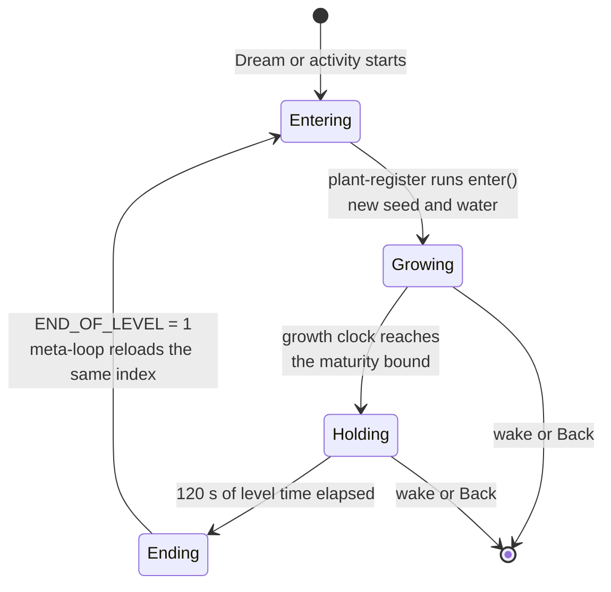
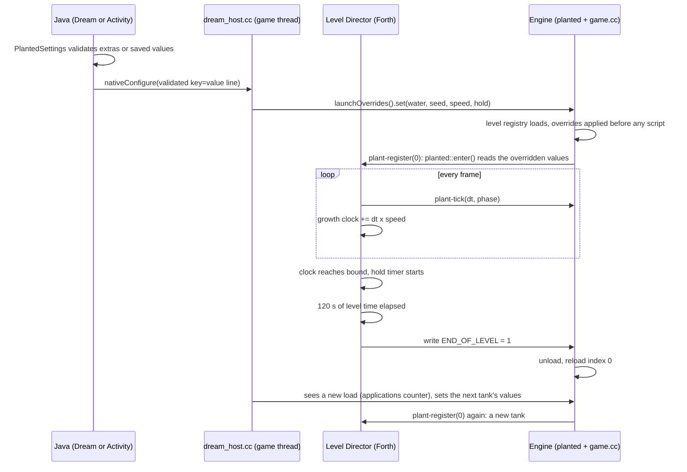
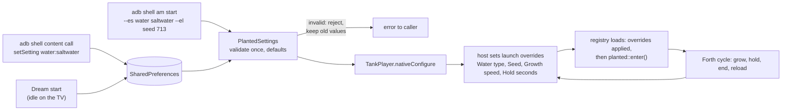

# Planted Tank screensaver

Date: 2026‑10‑21. Status: **Phase 0 done; build phases not started.** Decisions made with Will on 2026‑10‑21: a generic launch-override seam (approved), `hold` as a parameter, and **plants only: no urchin, no goby, no seahorses.** Claims about existing code were read from the tree; nothing is built or run yet.

## Context

Two screensaver apps ship from `android/screensaver`: **Aquarium** (eight tanks, one drawn per Dream start) and **Seahorse Grid** (its own flavor, own icon, own one-level bundle). Will wants a third: **the planted tank on its own, with plants only and no animals**, growing from seedlings to a full canopy, staying up for two minutes, then starting a different tank. The icon and the TV banner both carry the World Foundry badge, like the other two.

What is true today:

- The planted tank is already a growing ecosystem. `planted::enter()` draws a fresh seed on every level entry, plants grow from founders, and growth finishes on its own. The older clumps plan said "about 117–144 growth seconds", from a few seeds; the Phase 0 sweep of 200 seeds measured **103 s to 193 s** ([results](2026-10-21-planted-tank-screensaver/spikes/maturity-sweep.md)). The engine clamps the growth age at 240 s (`wfsource/source/game/plant_settings.h`, `tick`).
- "Fully grown" has an exact definition per seed: each `plantgrowth::Vertex` carries `birth` and `duration`, and a vertex is full size at `age ≥ birth + duration` (`plant_growth.h`, `deformedWave`). A tank is complete at the maximum of that over all its vertices.
- A Dream has **no command line**. The old `--plant-seed`, `--plant-water` and `--plant-speed` switches were deliberately **removed** ([command-line-switches.md](../command-line-switches.md#baseline-runtime-options)); plant values now come from the level's cooked `PlantedTankSettings` catalog, and "no replacement launch aliases" are provided. Parameters therefore have to arrive another way (see **Parameters**).
- **The level can end itself.** A level writing mailbox `END_OF_LEVEL` (1905) = 1 ends it, and the `cd.iff` meta-loop in `game.cc` reloads. On the Dream the next level is forced to the app's own index (`_overrideLevelNum`, `game.cc:300`), so `LEVEL_TO_RUN` (5000) is not even consulted; it matters only for the desktop `task run`. Only `_desiredLevelNum` survives a reload: **a level's own mailboxes, including 6000 and up, are new each time** (S1/S2 corrected the troubleshooting doc on this). Never write 0 to `END_OF_LEVEL`. The planted level calls `plant-register`, which calls `planted::enter()`, on every load, so a reload **is** a new tank.
- The engine-side growth age and speed are native state. Forth cannot read them; it only passes the frame `dt` to `plant-tick`. So the level needs **its own clock**, which Will also suggested.
- The screensaver host (`android/screensaver/src/main/cpp/dream_host.cc`) owns `WFAndroidPumpEvents()`, which the engine calls on the game thread once per frame. Today it is empty. That is a per-frame, race-free place for host code to run, with no engine edit.
- A pending TODO item says the cooked planted levels carry the **seahorse actor‑30 crash**. This plan is not affected, because the screensaver level has no animals; the item stays open for the Aquarium app.

## Approach

**One sentence:** a third flavor, `planted`, that plays a plants-only variant of the planted-tank level through a Forth Director that ends and reloads the level when the tank is grown and has been shown for two minutes, with parameters validated in Java and handed to the engine through a new generic **launch-override table**.

| # | Decision | Choice | Why / what was rejected |
|---|---|---|---|
| 1 | App shape | Flavor `planted` in `android/screensaver`, id `org.worldfoundry.plantedtank`, label "World Foundry Planted Tank Screensaver", sharing `TankPlayer` and the `wf_dream` library | Same pattern as Seahorse Grid; shared engine code and CMake stay unchanged. Rejected: a ninth Aquarium choice (no growth cycle, no own icon, shares one preference). |
| 2 | Who runs the cycle | **The level**, in Forth, writing `END_OF_LEVEL` = 1 | Needs no native or Java timer and no engine edit; reload already re-runs `enter()`. Rejected: native `planted::regenerate()` from the host (needs the same staging plus a mid-level mesh swap; reload is the path the engine already tests). |
| 3 | "Grown" | Level-side **growth clock** ≥ a measured **maturity bound** | Forth cannot see native age. The clock mirrors `tick`: add `dt × speed`, with `dt > 0.2 s` counted as 0. A conservative bound only lengthens the hold; it never cuts a tank short. |
| 4 | "Keep onscreen 2 minutes" | Level time (`TIME`), starting at the moment the growth clock reaches the bound; default **120 s**, independent of speed | Wall-clock by construction; the plants keep swaying. |
| 5 | Parameters | Java validates once; the host sets the values in a new, generic **launch-override table** in the `wfprops` registry (engine edit **approved 2026‑10‑21**). The engine applies it whenever a level's registry loads, before any script runs | S1/S2 found host staging into `planted::state()` workable but fragile: two conditions, a frame-1 gap, and it dies with the OAS migration. The table is keyed by schema and field name, so any settings owner can use it. |
| 6 | Default growth speed | **1×** | As asked. |
| 7 | Next tank | Reload only; the Dream forces its own index, and `LEVEL_TO_RUN` = 0 is written only for the desktop run | One level in the bundle; S1 traced the reload at `game.cc:421-444` and `300-301`. |
| 8 | Animals | **None.** The variant has no urchin, goby or seahorses | Will's call. Removes the seahorse parameter, the actor‑30 dependency and the animal cost; how to remove them is Spike S4. |

### The cycle, as a state machine



### One tank, in order



### The flow from a command to a tank



## Parameters

The "command line" of an Android Dream is `adb`: **activity extras** for an immediate run, and the **settings provider** (the same shell-only `content call` contract `TankSettingsProvider` uses today) for what the idle Dream will use. Both feed one validator, `PlantedSettings`, so a bad value gets the same rejection everywhere. The coordinator tray gets the choice-type settings through `getCapabilities` (schema 1, as today); the seed is command-line only.

| Key | Values | Default | Reaches the engine through | Runtime in v1 |
|---|---|---|---|---|
| `water` | `freshwater`, `saltwater`, `random` (aliases `fresh`, `salt`) | `random` | override of `Water type` (field 2) | yes |
| `seed` | whole number 0 to 4294967295 | random per tank | overrides of `Seed` (1) and `Random seed on entry` (7) = off | yes |
| `speed` | 0.25, 0.5, 1, 2, 4, 8 (paused is rejected: the tank could never finish) | `1` | override of `Growth speed` (3); the Forth clock reads it back with `property@` | yes |
| `hold` | 0 to 86400 s | `120` | override of a new `Hold seconds` field in the variant's own `settings.oas` | yes |
| `age`, `textures`, `sway` | developer keys; `age` 0 to 240 s | `0`, `true`, `true` | overrides of fields 4, 5 and 6 (the table may override read-only fields) | yes, hidden from the tray |

**Sequences are reproducible.** With a fixed `seed`, tank 0 uses it exactly and tank *k* uses a documented 32-bit mix of `(seed, k)`; with `water=random` the water of each tank comes from the same mix. Replaying a command replays the whole run (a fixed seed that repeated the identical tank every cycle would be dull, so later tanks derive from it). With no seed, the engine's own `freshSeed()` runs per tank and the host sets nothing per tank. To set the next tank's values in time, the table keeps an **`applications()` counter** that rises each time a registry load applies it; the host watches it from `WFAndroidPumpEvents`. Java and the host share one test vector for the mix.

```text
adb shell am start -n org.worldfoundry.plantedtank/.PlantedTankActivity \
    --es water saltwater --el seed 713 --ef speed 2
adb shell content call --uri content://org.worldfoundry.plantedtank.settings \
    --method setSetting --arg water:saltwater
```

[](2026-10-21-planted-tank-screensaver/parameters.html)

The page opens on the defaults; the thumbnail shows the **rejected** state, where nothing is sent and the previous settings stay in force. [Open the interactive command builder](2026-10-21-planted-tank-screensaver/parameters.html).

## Lifecycle and timing

[](2026-10-21-planted-tank-screensaver/dream-lifecycle.html)

At 1× a cycle is the maturity bound (**195 s**, measured) plus the 120 s hold, about 5 min 15 s per tank. A median tank (about 135 to 141 s) is fully grown 55 to 60 s before the bound, so it shows for roughly three minutes. A per-seed bound would remove that slack; see Spike S2. At 0.25× growth takes four times as long; at 8× about 18 s; the hold stays 120 s. [Open the interactive timeline](2026-10-21-planted-tank-screensaver/dream-lifecycle.html) and change the speed.

**Frames and performance.** Growth ignores frames longer than 0.2 s, so it needs more than 5 FPS to run at 1×. The retained cast1 wide-view figure with plants, urchin and no seahorses is 21 FPS ([seahorse plan](2026-10-16-saltwater-seahorses.md)); a plants-only level has less to draw, so it should do at least as well, and Phase 5 measures it.

**Framing.** In the retained captures the tank fills about 57% of the frame width and 45% of its height, with the rest dark. A screensaver should fill the TV, so Phase 1 moves the variant's camera in (target: tank at least 85% of the width, nothing cropped). This is a level-only change in the variant builder.

## Icon and banner

[](2026-10-21-planted-tank-screensaver/icon-and-banner.html)

Both use the badge pipeline that Aquarium and Seahorse Grid already use: `gen-screensaver-android-icons.py` calls `add_logo()` (scale 0.17 on the adaptive foreground, inside the 72/108 safe zone; 0.26 on the legacy square; 0.24 on the round icon) and `gen-android-icons.banner()` for the 640 × 360 banner with the name lower-left and the badge lower-right. The mockup above was built by running those functions on retained device frames, so the badge position and size are the real ones. Production art is a fresh capture of the new level (plants only, no HUD, either water type, to be chosen in Phase 3; the mockup frames still show the urchin), committed as `android/screensaver/art-src/planted-tank-frame.png` the way `seahorse-grid-frame.png` is. The generator gains a third art source and writes `src/planted/res/`.

## Work phases

Tiers are dispatch inputs (ranking is done inline, never delegated). Torn calls took the higher tier.

| Phase | Work | Tier | Reason |
|---|---|---|---|
| ~~0a~~ | ~~Re-cook the planted levels for the actor‑30 fix~~ **Not needed:** no seahorses in this level (the TODO item stays open for the Aquarium) | T3 | n/a |
| ~~0b~~ | ~~**Spike S1:** staging window~~ **Done:** safe with conditions, no engine edit ([S1‑S2](2026-10-21-planted-tank-screensaver/spikes/S1‑S2.md)) | T4 | unknown territory, now resolved |
| ~~0c~~ | ~~**Spike S2:** what Forth can read~~ **Done:** speed is readable; hold needs a new field and a host write | T4 | same |
| ~~0d~~ | ~~**Spike S3:** where is the seed/settings strip drawn, and can the variant drop it? Which camera gives the 85% framing?~~ **Done** | T3 | bounded search plus a level edit |
| ~~0e~~ | ~~Maturity sweep over 200 seeds in both waters~~ **Done** (`f793c3d1`): bound 195 s | T2 | one harness, known formula |
| 0f | **Spike S4:** how to build a plants-only variant: remove the urchin, goby and seahorse actors (a generator flag in `generate.py`/`config.py`, or a text strip in the variant builder), and what the Director, Player and cameras still need | T3 | bounded investigation; the answer shapes Phase 1 |
| 1 | Level variant: build `planted_tank_screensaver` as a plants-only variant (per S4), Director cycle script (growth clock, hold, mailboxes), framing, fog, the new `Hold seconds` field | T3 | multi-file against this plan |
| 2a | Java: `PlantedSettings`, activity, Dream, provider, manifest, strings, Gradle flavor | T2 | one module, clear spec |
| 2c | **Engine: the launch-override table** in `engine/runtime_properties.*` (about 60 lines), one line at `level.cc:613`, the `applications()` counter, an optional desktop `--property=Schema.Key=Value` flag, and unit tests | T3 | design settled in S1‑S2; approved by Will 2026‑10‑21; touches engine code, so it is tested and reviewed before use |
| 2b | Native host: `nativeConfigure`, first-tank overrides before `HALStart`, per-tank overrides from the pump using the `applications()` counter, in one file (`planted_bridge.cc`) | T3 | uses the new table; no engine state touched, so no game-thread hazards |
| 3 | Capture script, art, `gen-screensaver-android-icons.py` third source, tests for badge and files | T2 | follows the existing Seahorse recipe |
| 4 | `task` entries, bundle builder mode, README, device-coordinator doc, TODO | T1 | recipes |
| 5 | Device verification, soak, natural-idle check through the coordinator | T3 | procedure with judgment about results |

Phase 2c comes before 2b. **Will approved the generic seam on 2026‑10‑21** (earlier: "i'd want it to be more generic than just plant settings"; answer to the build-it question: "generic"). I took "generic" to mean the data table, not the 5-line host callback. S4 may change Phase 1.

## Spike results

**0e, maturity sweep (done, `f793c3d1`, [write-up](2026-10-21-planted-tank-screensaver/spikes/maturity-sweep.md)).** `task test-plant-maturity` runs seeds 0 to 199 in both waters inside `wf-linux-test:local`. Freshwater finishes between 103.5 and 187.8 s (median 135.3), saltwater between 107.5 and 193.3 s (median 141.2); worst seed is 48 in both. Nothing nears the 240 s clamp, and seed 713 repeats identically. **Bound: 195 s.** It covers 200 seeds, not all 2³², so the level never compares against the clamp itself.

**S3, strip and framing (done, [write-up](2026-10-21-planted-tank-screensaver/spikes/S3.md)).** Two of its findings change the plan; I re-checked both against the source.

- **The seed strip cannot be removed without an engine edit.** The engine draws it every frame while a tank is active (`wfsource/source/game/plant_ui.cc:12`). No catalog field, object flag, Director script or mailbox controls it, and growth needs the same `active` flag. The screensaver's own HUD switch does not reach it: `WFAndroidSetHudEnabled(0)` removes only the touch controls and the FPS counter, because the Android overlay drawer ignores that flag (`android_window.cc:502`, per the spike). **The shipped Aquarium Dream already shows this strip** on its Planted choice, with "Hold A: settings" text on a Dream that takes no input. S3's smallest fix is a plant-specific `label` flag in `plant_settings.h` and `plant_ui.cc` (three lines). Following Will's "more generic" direction, my proposal is instead to make the Android overlay drawer **respect the existing `gHudEnabled` switch**, which the screensaver host already sets to 0: one generic change that fixes both apps and adds no plant-specific state. It needs Will's approval; until then the plan has no `label` parameter and the strip stays on. **Resolved 2026‑10‑21, with no engine edit.** Will approved the `gHudEnabled` change, but tracing it showed that `native_app_entry.cc` already sets that flag to 0 on every TV build, so honouring it in the drawer would also hide the TV level selector and settings panels. Instead the strip is drawn only while `levelmenu::Drawer()` is set (`display.cc:1280`), and the Dream host owns `WFAndroidPumpEvents()`, so `dream_host.cc` now clears the drawer every frame. This hides the engine overlay in every passive host, fixes the shipped Aquarium and Seahorse Dreams too, and a null drawer already falls back to starting level 0 (`game.cc`). Guard: `tests/test_screensaver_overlay.py` (3 tests pass). **Not yet compiled or seen on a device**; the next APK build and Phase 1 capture confirm it.
- **Framing is a text substitution, as hoped.** The wide camera sits at `y = -12`. Moving it to `y = -8.25` (same x, z and look-at) makes the tank 90.0% of the frame width and 71.3% of its height at 16:9, with a 5% margin each side and nothing cropped; the 85% limit is `y = -8.638`. The model reproduces the device capture (predicted 57.4% × 45.5%, measured 57.4% × 45.4%). The builder replaces `-12.0000000000000000(1.15.16)` in the `cs_wide` and `Camera` blocks (`aquarium_plants.lev` lines 130 and 655, the only hits) and asserts one hit per block; leaving `Camera` unchanged would add a one-second pan on start. Moving in removes some fog (start distance 9), so scale both fog distances by about 0.64 to keep today's look. The camera field of view is ignored by the engine (fixed 60° vertical), so position is the only lever. TV overscan above about 5% would clip the walls, so Phase 1 takes a device capture to confirm.
- **Smaller facts.** The screensaver stays on the wide camera, since only a native tap switches cameras and the Dreams take no input; `PlantedTankActivity` must not add an input path. The level has no QR code or pairing prompt.

**S1 and S2, staging and Forth reads (done, [write-up](2026-10-21-planted-tank-screensaver/spikes/S1‑S2.md), read from source, nothing run).**

- **S1: SAFE-WITH-CONDITIONS, no engine edit.** (Kept as the fallback; the approved seam below supersedes it.) On reload the engine calls `planted::leave()` (`game.cc:421`), then `PageFlip` twice (`game.cc:429-430`), then destroys the level. `PageFlip` runs `WFAndroidPumpEvents`, so the host's pump fires twice with `active` false and before the next `enter()`, never during `LoadLevel`, all on the one game thread. Conditions: stage only while `!active && !explicitSeed`, and stage the **first** tank in `nativeRun` before `HALStart`, because the first pump comes after frame 1 has already run `enter()`.
- **S2:** speed is readable from Forth with `property@`. Hold has no catalog field, so it gets a new field in the variant's own `settings.oas` (level data, not engine), written by the host from frame 2 of each tank. **No host code can run between the registry load and the Director's first tick**, so anything Forth needs on frame 1 is cooked or staged through `state()`; the launch-override table closes that gap, because it applies before any script runs. There is no tank count and no `cycles` parameter: the loop runs until the TV wakes, and tests count tanks from the log.
- **`TIME` (1906) is the level clock** and `DELTA_TIME` (1907) the frame delta; both restart at 0 on each reload, so they time a tank but cannot count tanks.
- **The Dream always reloads its own TOC index,** so only `END_OF_LEVEL = 1` is needed on device.
- **Residual risks of host staging (all removed by the table):** the host and engine sharing one `planted::state()`, dependence on the current `UnloadLevel` order, and the loss of the mechanism when the OAS migration retires `planted::State`.
- **Generic seam: approved and now Phase 2c.** A launch-override table in the `wfprops` registry (about 60 engine lines plus tests, an optional desktop `--property=` flag, and an `applications()` counter added to S1/S2's design), applied at `level.cc:613-615` before `activeRegistry()` is set. It removes S1's conditions and the frame-1 gap, survives the OAS migration (keyed by name, not RP01 id), and lets any settings owner use it.

## Out of scope

- A desktop (Linux or macOS) screen saver; this is the Android TV Dream.
- Seed entry in the coordinator tray: schema 1 carries choices only today; the seed stays on the command line.
- A cross-fade between tanks. The reload shows the engine's normal load gap; Phase 5 measures it and an overlay fade (Java-side, no engine edit) is a follow-up if it looks rough.
- An exact "plant is mature" engine word. The Forth clock plus a measured bound is enough; an exact word would need an engine edit.
- Audio, as for Seahorse Grid.
- Public distribution and signing, unchanged from the [aquarium plan](2026-10-17-aquarium-screensaver.md).

## Risks

- **The growth clock drifts from the native age** if `tick`'s rules change. Mitigation: the Forth clock copies `dt` clamping and speed values from `plant_settings.h`, and a test fails when `speedValue` or the 0.2 s clamp changes.
- **Reload cost and leaks.** Each reload rebuilds the plant meshes. The clumps plan measured repeated entries steady in one process (PSS spread under 4 MiB); the soak in Phase 5 repeats that for this build.
- **The engine edit affects every level's load path.** Mitigation: the table is empty unless a host sets it, so other apps are unchanged; it is one line in `level.cc`; unit tests cover apply, validation reject, read-only override, unknown key and repeated loads. It is keyed by name, so it moves to OAS unchanged ([runtime object editing](2026-10-16-runtime-object-editing.md)).
- **Device availability.** Cast1 is `recovery-required` and cast2 `needs-local-setup` as of 2026‑10‑19; Phase 5 waits for the coordinator, and the frozen APK is submitted through `task chromecast:*`, never raw `adb` against a held device.

## Verification

Build, level and test steps run in the project's containers (`wf-blender:local` for the level via `scripts/level-build.sh`); device steps go through the coordinator. Results are recorded below each step when the work lands.

1. **Parameter validation.** `./gradlew :screensaver:testPlantedDebugUnitTest --offline` passes the vectors: every table row's accepted and rejected values, alias spellings, the seed-mix vector shared with the native test, and "paused rejected".
2. **Maturity bound.** `task test-plant-maturity` prints the maximum `birth + duration` over 200 seeds × both waters, and it is below 240 s; the bound used in the level is at least that.
3. **Bundle and level.** `python3 scripts/build-aquarium-screensaver-levels.py planted` writes `wflevels/planted-screensaver-cd.iff` with exactly one level; `python3 -m pytest tests/test_planted_screensaver.py` checks the bundle order, that the other two bundles are unchanged, and that the Director contains the mailbox writes.
4. **Cycle on the desktop engine.** Run the bundle at speed 8 with hold 5, and stop it after three tanks (`task build-cd-iff`, `task run`, in the container). The log shows three `PLANTS settings-source=… seed=` lines with three different seeds, and the gaps between them match grow plus hold within 3 s. The desktop run has no positional level argument, so it reads its parameters from cooked defaults (`configure_cd`) unless the optional `--property=` flag exists.
5. **Fixed-seed replay.** Repeat step 4 with `--el seed 713`: the same three seeds and waters both times, and tank 0 is seed 713.
6. **APK build.** `cd android && ./gradlew :screensaver:assemblePlantedDebug :screensaver:assembleAquariumDebug :screensaver:assembleSeahorseDebug --offline` succeeds, and the Aquarium and Seahorse APKs are byte-identical in their level bundles to before.
7. **Parameters on a device.** Through the coordinator: `am start` with `water=saltwater seed=713` logs `seed=713 water=saltwater`; an invalid seed (`4294967296`) is rejected with a message and changes nothing; `content call … setSetting water:saltwater` then `getCapabilities` returns the new value, base64-decoded.
8. **Default timing at 1×.** One uninterrupted cycle on a device: reload-to-reload equals the bound plus 120 s within 5 s.
9. **Soak.** 50 tanks at 8× with hold 5 on a device: the same process id throughout, no crash, and PSS spread under 4 MiB after warm-up.
10. **Icon and banner.** `python3 scripts/gen-screensaver-android-icons.py` writes the planted resources; the pixel test finds the badge lower-right in the banner and inside the safe circle of the foreground; the Apps row capture shows the banner.
11. **Natural idle.** `task chromecast:submit … APP=plantedtank WORKFLOW=dream-check` captures a growing tank in the real Dream.
12. **No regression.** The existing screensaver tests (`tests/test_seahorse_grid_level.py`, the aquarium bundle-order check) still pass.
13. **Launch-override table.** `task test-launch-overrides` (new, in the container) passes the unit tests; with the table empty, the existing runtime-property and level tests still pass unchanged.
14. **Plants only.** The built level's actor map contains no urchin, goby or seahorse object, and a device capture shows plants and the tank only.

Results: _pending._

## Decisions

Made with Will on 2026‑10‑21:

1. **Seam:** generic launch-override table, approved (Phase 2c).
2. **Hold:** a parameter, default 120 s.
3. **Animals:** none; plants only.

Still open: nothing blocking. If a fixed `seed` should repeat the identical tank every cycle instead of deriving later tanks from it, say so; the plan derives them.
