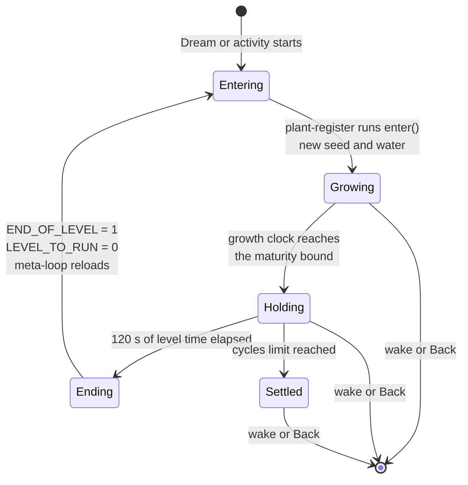
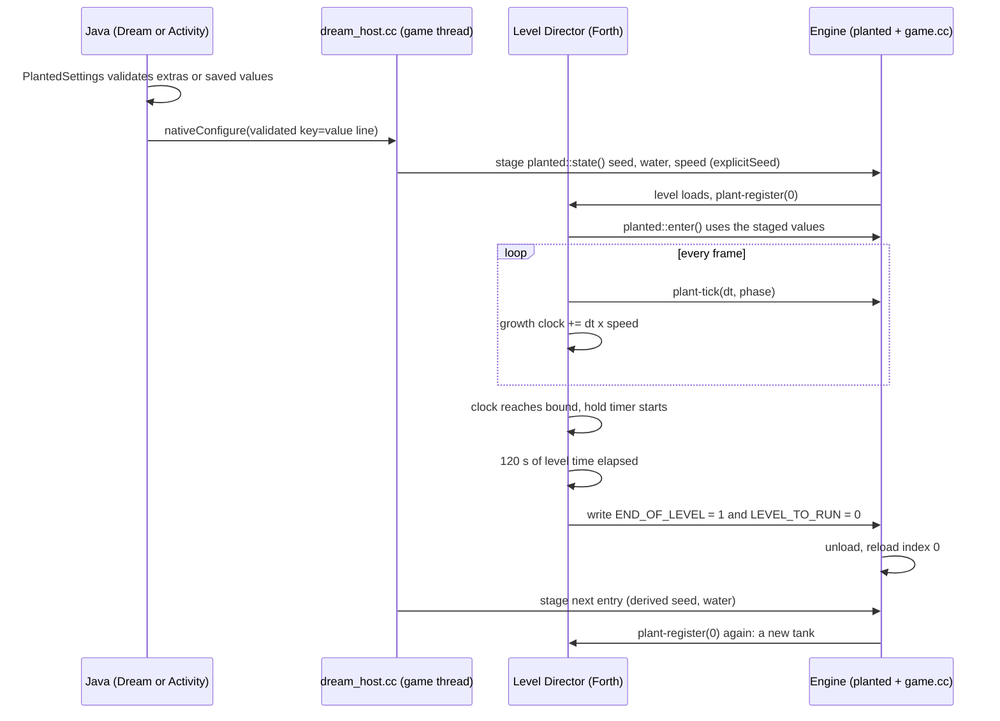
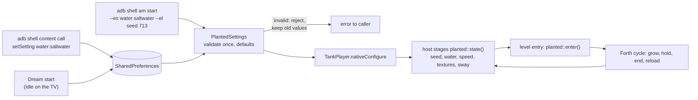

# Planted Tank screensaver

Date: 2026‑10‑21. Status: **plan, not started.** Nothing is built; every claim about existing code below was read from the tree today, and the unknowns are named as spikes in Phase 0.

## Context

Two screensaver apps ship from `android/screensaver`: **Aquarium** (eight tanks, one drawn per Dream start) and **Seahorse Grid** (its own flavor, own icon, own one-level bundle). Will wants a third: **the planted tank on its own**, growing from seedlings to a full canopy, staying up for two minutes, then starting a different tank. The icon and the TV banner both carry the World Foundry badge, like the other two.

What is true today:

- The planted tank is already a growing ecosystem. `planted::enter()` draws a fresh seed on every level entry, plants grow from founders, and growth finishes on its own. The older clumps plan said "about 117–144 growth seconds", from a few seeds; the Phase 0 sweep of 200 seeds measured **103 s to 193 s** ([results](2026-10-21-planted-tank-screensaver/spikes/maturity-sweep.md)). The engine clamps the growth age at 240 s (`wfsource/source/game/plant_settings.h`, `tick`).
- "Fully grown" has an exact definition per seed: each `plantgrowth::Vertex` carries `birth` and `duration`, and a vertex is full size at `age ≥ birth + duration` (`plant_growth.h`, `deformedWave`). A tank is complete at the maximum of that over all its vertices.
- A Dream has **no command line**. The old `--plant-seed`, `--plant-water` and `--plant-speed` switches were deliberately **removed** ([command-line-switches.md](../command-line-switches.md#baseline-runtime-options)); plant values now come from the level's cooked `PlantedTankSettings` catalog, and "no replacement launch aliases" are provided. Parameters therefore have to arrive another way (see **Parameters**).
- **The level can end itself and name what loads next.** A level writing mailbox `END_OF_LEVEL` (1905) = 1 ends; `LEVEL_TO_RUN` (5000) = *n* chooses the next TOC entry. The `cd.iff` meta-loop in `game.cc` reloads it, and the value persists across the reload ([level-design-troubleshooting.md](../level-design-troubleshooting.md#flag--next-level-transition-and-verifying-it-headlessly)). Will pointed this out, and it is the spine of this plan. The planted level calls `plant-register`, which calls `planted::enter()`, on every load, so a reload **is** a new tank.
- The engine-side growth age and speed are native state. Forth cannot read them; it only passes the frame `dt` to `plant-tick`. So the level needs **its own clock**, which Will also suggested.
- The screensaver host (`android/screensaver/src/main/cpp/dream_host.cc`) owns `WFAndroidPumpEvents()`, which the engine calls on the game thread once per frame. Today it is empty. That is a per-frame, race-free place for host code to run, with no engine edit.
- A pending TODO item says the cooked planted levels still carry the **seahorse actor‑30 crash** (6–8 s after launch) until they are re-cooked. This plan depends on that fix.

## Approach

**One sentence:** a third flavor, `planted`, that plays the existing planted-tank level through a Forth Director that ends and reloads the level when the tank is grown and has been shown for two minutes, with parameters validated in Java and staged into the engine's existing `explicitSeed` entry path.

| # | Decision | Choice | Why / what was rejected |
|---|---|---|---|
| 1 | App shape | Flavor `planted` in `android/screensaver`, id `org.worldfoundry.plantedtank`, label "World Foundry Planted Tank Screensaver", sharing `TankPlayer` and the `wf_dream` library | Same pattern as Seahorse Grid; shared engine code and CMake stay unchanged. Rejected: a ninth Aquarium choice (no growth cycle, no own icon, shares one preference). |
| 2 | Who runs the cycle | **The level**, in Forth, using `END_OF_LEVEL` and `LEVEL_TO_RUN` | Needs no native or Java timer and no engine edit; reload already re-runs `enter()`. Rejected: native `planted::regenerate()` from the host (needs the same staging plus a mid-level mesh swap; reload is the path the engine already tests). |
| 3 | "Grown" | Level-side **growth clock** ≥ a measured **maturity bound** | Forth cannot see native age. The clock mirrors `tick`: add `dt × speed`, with `dt > 0.2 s` counted as 0. A conservative bound only lengthens the hold; it never cuts a tank short. |
| 4 | "Keep onscreen 2 minutes" | Level time (`TIME`), starting at the moment the growth clock reaches the bound; default **120 s**, independent of speed | Wall-clock by construction; sway, urchin and seahorses keep moving. |
| 5 | Parameters | Java validates once; the host stages them into `planted::state()` before each entry | Uses the engine's existing `explicitSeed` path in `enter()`; the engine stays untouched unless Spike S1 fails. |
| 6 | Default growth speed | **1×** | As asked. |
| 7 | Next tank | `LEVEL_TO_RUN` = 0 (the bundle has exactly one level), then reload | The meta-loop treats the last level as "loop to index 0". |

### The cycle, as a state machine



### One tank, in order



### The flow from a command to a tank



## Parameters

The "command line" of an Android Dream is `adb`: **activity extras** for an immediate run, and the **settings provider** (the same shell-only `content call` contract `TankSettingsProvider` uses today) for what the idle Dream will use. Both feed one validator, `PlantedSettings`, so a bad value gets the same rejection everywhere. The coordinator tray gets the choice-type settings through `getCapabilities` (schema 1, as today); the seed is command-line only.

| Key | Values | Default | Reaches the engine through | Runtime in v1 |
|---|---|---|---|---|
| `water` | `freshwater`, `saltwater`, `random` (aliases `fresh`, `salt`) | `random` | staged `planted::state().salt` | yes |
| `seed` | whole number 0 to 4294967295 | random per tank | staged `state().seed`, `explicitSeed` | yes |
| `speed` | 0.25, 0.5, 1, 2, 4, 8 (paused is rejected: the tank could never finish) | `1` | staged `state().speed` index; mirrored by the Forth clock | yes |
| `hold` | 0 to 86400 s | `120` | Forth hold timer | cooked default in v1; runtime if Spike S2 finds a read path |
| `seahorses` | 0 to 6 (saltwater only) | `6` | catalog field 8 | cooked default in v1; runtime if S2 allows |
| `label` | true or false | `false` | the seed strip is engine-drawn, so this needs an engine edit (see **Spike results**) | **not in v1** unless Will approves the edit |
| `cycles` | 0 (unlimited) or *n* | `0` | Forth cycle counter | cooked default in v1 |
| `age`, `textures`, `sway` | developer keys; `age` 0 to 240 s | `0`, `true`, `true` | staged `state().initialAge`, `textures`, `sway` | yes, hidden from the tray |

**Sequences are reproducible.** With a fixed `seed`, tank 0 uses it exactly and tank *k* uses a documented 32-bit mix of `(seed, k)`; with `water=random` the water of each tank comes from the same mix. Replaying a command replays the whole run. With no seed, the engine's own `freshSeed()` runs per tank. Java and the native host share one test vector for the mix.

```text
adb shell am start -n org.worldfoundry.plantedtank/.PlantedTankActivity \
    --es water saltwater --el seed 713 --ef speed 2
adb shell content call --uri content://org.worldfoundry.plantedtank.settings \
    --method setSetting --arg water:saltwater
```

[](2026-10-21-planted-tank-screensaver/parameters.html)

The page opens on the defaults; the thumbnail shows the **rejected** state, where nothing is sent and the previous settings stay in force. [Open the interactive command builder](2026-10-21-planted-tank-screensaver/parameters.html).

## Lifecycle and timing

[](2026-10-21-planted-tank-screensaver/dream-lifecycle.html)

At 1× a cycle is the maturity bound (**195 s**, measured) plus the 120 s hold, about 5 min 15 s per tank. A median tank (about 135 to 141 s) is fully grown 55 to 60 s before the bound, so it shows for roughly three minutes. A per-seed bound would remove that slack; see Spike S2. At 0.25× growth takes four times as long; at 8× about 18 s; the hold stays 120 s. [Open the interactive timeline](2026-10-21-planted-tank-screensaver/dream-lifecycle.html) and change the speed.

**Frames and performance.** Growth ignores frames longer than 0.2 s, so it needs more than 5 FPS to run at 1×. The retained cast1 numbers are 21 FPS (no seahorses) and 14 FPS (six pairs) for the wide view ([seahorse plan](2026-10-16-saltwater-seahorses.md)), which is fine for this. The default of six pairs costs about a third of the frame rate; it stays the default until Phase 5 measures the screensaver build.

**Framing.** In the retained captures the tank fills about 57% of the frame width and 45% of its height, with the rest dark. A screensaver should fill the TV, so Phase 1 moves the variant's camera in (target: tank at least 85% of the width, nothing cropped). This is a level-only change in the variant builder.

## Icon and banner

[](2026-10-21-planted-tank-screensaver/icon-and-banner.html)

Both use the badge pipeline that Aquarium and Seahorse Grid already use: `gen-screensaver-android-icons.py` calls `add_logo()` (scale 0.17 on the adaptive foreground, inside the 72/108 safe zone; 0.26 on the legacy square; 0.24 on the round icon) and `gen-android-icons.banner()` for the 640 × 360 banner with the name lower-left and the badge lower-right. The mockup above was built by running those functions on retained device frames, so the badge position and size are the real ones. Production art is a fresh capture of the new level (no HUD, saltwater with seahorses or a grown freshwater tank, to be chosen in Phase 3), committed as `android/screensaver/art-src/planted-tank-frame.png` the way `seahorse-grid-frame.png` is. The generator gains a third art source and writes `src/planted/res/`.

## Work phases

Tiers are dispatch inputs (ranking is done inline, never delegated). Torn calls took the higher tier.

| Phase | Work | Tier | Reason |
|---|---|---|---|
| 0a | Re-cook the planted levels for the actor‑30 fix (existing TODO item) | T3 | settled plan, multi-step build |
| 0b | **Spike S1:** can the host stage `planted::state()` safely between `leave()` and the next `enter()`? Check where `WFAndroidPumpEvents` runs during a reload and whether `explicitSeed` survives it | T4 | unknown root cause territory; a wrong answer changes the design |
| 0c | **Spike S2:** can Forth read the staged speed, hold, seahorses and cycles (the generic instance-property read in `scripting_zforth.cc`), or must they be cooked? | T4 | same |
| ~~0d~~ | ~~**Spike S3:** where is the seed/settings strip drawn, and can the variant drop it? Which camera gives the 85% framing?~~ **Done** | T3 | bounded search plus a level edit |
| ~~0e~~ | ~~Maturity sweep over 200 seeds in both waters~~ **Done** (`f793c3d1`): bound 195 s | T2 | one harness, known formula |
| 1 | Level variant: build `planted_tank_screensaver` from `aquarium_plants`, Director cycle script (growth clock, hold, mailboxes), framing, no strip | T3 | multi-file against this plan |
| 2a | Java: `PlantedSettings`, activity, Dream, provider, manifest, strings, Gradle flavor | T2 | one module, clear spec |
| 2b | Native: `nativeConfigure` and the staging adapter in one file (`planted_bridge.cc`) | T4 | touches engine state from the game thread; one file so the later OAS/OAD migration, which retires `planted::State`, changes one place |
| 3 | Capture script, art, `gen-screensaver-android-icons.py` third source, tests for badge and files | T2 | follows the existing Seahorse recipe |
| 4 | `task` entries, bundle builder mode, README, device-coordinator doc, TODO | T1 | recipes |
| 5 | Device verification, soak, natural-idle check through the coordinator | T3 | procedure with judgment about results |

Spikes S1 to S3 run first and may change Phases 1, 2a and 2b. If S1 shows staging cannot be made safe, **stop and ask Will** for permission to add an engine seam. **The seam must be generic, not plant-specific** (Will, 2026‑10‑21: "i'd want it to be more generic than just plant settings"): a launch-override layer in the `wfprops` runtime property registry that lets a host set any owner's field before level entry, so any settings owner can use it. A `planted::Launch` struct is rejected. Engine edits still need his explicit say-so; the plan does not assume it.

## Spike results

**0e, maturity sweep (done, `f793c3d1`, [write-up](2026-10-21-planted-tank-screensaver/spikes/maturity-sweep.md)).** `task test-plant-maturity` runs seeds 0 to 199 in both waters inside `wf-linux-test:local`. Freshwater finishes between 103.5 and 187.8 s (median 135.3), saltwater between 107.5 and 193.3 s (median 141.2); worst seed is 48 in both. Nothing nears the 240 s clamp, and seed 713 repeats identically. **Bound: 195 s.** It covers 200 seeds, not all 2³², so the level never compares against the clamp itself.

**S3, strip and framing (done, [write-up](2026-10-21-planted-tank-screensaver/spikes/S3.md)).** Two of its findings change the plan; I re-checked both against the source.

- **The seed strip cannot be removed without an engine edit.** The engine draws it every frame while a tank is active (`wfsource/source/game/plant_ui.cc:12`). No catalog field, object flag, Director script or mailbox controls it, and growth needs the same `active` flag. The screensaver's own HUD switch does not reach it: `WFAndroidSetHudEnabled(0)` removes only the touch controls and the FPS counter, because the Android overlay drawer ignores that flag (`android_window.cc:502`, per the spike). **The shipped Aquarium Dream already shows this strip** on its Planted choice, with "Hold A: settings" text on a Dream that takes no input. S3's smallest fix is a plant-specific `label` flag in `plant_settings.h` and `plant_ui.cc` (three lines). Following Will's "more generic" direction, my proposal is instead to make the Android overlay drawer **respect the existing `gHudEnabled` switch**, which the screensaver host already sets to 0: one generic change that fixes both apps and adds no plant-specific state. It needs Will's approval; until then the plan has no `label` parameter and the strip stays on.
- **Framing is a text substitution, as hoped.** The wide camera sits at `y = -12`. Moving it to `y = -8.25` (same x, z and look-at) makes the tank 90.0% of the frame width and 71.3% of its height at 16:9, with a 5% margin each side and nothing cropped; the 85% limit is `y = -8.638`. The model reproduces the device capture (predicted 57.4% × 45.5%, measured 57.4% × 45.4%). The builder replaces `-12.0000000000000000(1.15.16)` in the `cs_wide` and `Camera` blocks (`aquarium_plants.lev` lines 130 and 655, the only hits) and asserts one hit per block; leaving `Camera` unchanged would add a one-second pan on start. Moving in removes some fog (start distance 9), so scale both fog distances by about 0.64 to keep today's look. The camera field of view is ignored by the engine (fixed 60° vertical), so position is the only lever. TV overscan above about 5% would clip the walls, so Phase 1 takes a device capture to confirm.
- **Smaller facts.** The screensaver stays on the wide camera, since only a native tap switches cameras and the Dreams take no input; `PlantedTankActivity` must not add an input path. In freshwater the goby also follows `ss-drive`, so Phase 5 checks it. The level has no QR code or pairing prompt.

**S1 and S2 (staging and Forth reads)** are still running; results go here when the agent reports.

## Out of scope

- A desktop (Linux or macOS) screen saver; this is the Android TV Dream.
- Seed entry in the coordinator tray: schema 1 carries choices only today; the seed stays on the command line.
- A cross-fade between tanks. The reload shows the engine's normal load gap; Phase 5 measures it and an overlay fade (Java-side, no engine edit) is a follow-up if it looks rough.
- An exact "plant is mature" engine word. The Forth clock plus a measured bound is enough; an exact word would need an engine edit.
- Audio, as for Seahorse Grid.
- Public distribution and signing, unchanged from the [aquarium plan](2026-10-17-aquarium-screensaver.md).

## Risks

- **The growth clock drifts from the native age** if `tick`'s rules change. Mitigation: the Forth clock copies `dt` clamping and speed values from `plant_settings.h`, and a test fails when `speedValue` or the 0.2 s clamp changes.
- **Reload cost and leaks.** Each reload rebuilds the plant meshes. The clumps plan measured repeated entries steady in one process (PSS spread under 4 MiB); the soak in Phase 5 repeats that for this build.
- **OAS/OAD migration** ([runtime object editing](2026-10-16-runtime-object-editing.md)) retires `planted::State`. The bridge is one file for that reason.
- **Device availability.** Cast1 is `recovery-required` and cast2 `needs-local-setup` as of 2026‑10‑19; Phase 5 waits for the coordinator, and the frozen APK is submitted through `task chromecast:*`, never raw `adb` against a held device.

## Verification

Build, level and test steps run in the project's containers (`wf-blender:local` for the level via `scripts/level-build.sh`); device steps go through the coordinator. Results are recorded below each step when the work lands.

1. **Parameter validation.** `./gradlew :screensaver:testPlantedDebugUnitTest --offline` passes the vectors: every table row's accepted and rejected values, alias spellings, the seed-mix vector shared with the native test, and "paused rejected".
2. **Maturity bound.** `task test-plant-maturity` prints the maximum `birth + duration` over 200 seeds × both waters, and it is below 240 s; the bound used in the level is at least that.
3. **Bundle and level.** `python3 scripts/build-aquarium-screensaver-levels.py planted` writes `wflevels/planted-screensaver-cd.iff` with exactly one level; `python3 -m pytest tests/test_planted_screensaver.py` checks the bundle order, that the other two bundles are unchanged, and that the Director contains the mailbox writes.
4. **Cycle on the desktop engine.** Run the bundle at speed 8 with hold 5 and cycles 3 (`task build-cd-iff`, `task run`, in the container). The log shows three `PLANTS settings-source=… seed=` lines with three different seeds, and the gaps between them match grow plus hold within 3 s.
5. **Fixed-seed replay.** Repeat step 4 with `--el seed 713`: the same three seeds and waters both times, and tank 0 is seed 713.
6. **APK build.** `cd android && ./gradlew :screensaver:assemblePlantedDebug :screensaver:assembleAquariumDebug :screensaver:assembleSeahorseDebug --offline` succeeds, and the Aquarium and Seahorse APKs are byte-identical in their level bundles to before.
7. **Parameters on a device.** Through the coordinator: `am start` with `water=saltwater seed=713` logs `seed=713 water=saltwater`; an invalid seed (`4294967296`) is rejected with a message and changes nothing; `content call … setSetting water:saltwater` then `getCapabilities` returns the new value, base64-decoded.
8. **Default timing at 1×.** One uninterrupted cycle on a device: reload-to-reload equals the bound plus 120 s within 5 s.
9. **Soak.** 50 cycles at 8× with hold 5 on a device: the same process id throughout, no crash, and PSS spread under 4 MiB after warm-up.
10. **Icon and banner.** `python3 scripts/gen-screensaver-android-icons.py` writes the planted resources; the pixel test finds the badge lower-right in the banner and inside the safe circle of the foreground; the Apps row capture shows the banner.
11. **Natural idle.** `task chromecast:submit … APP=plantedtank WORKFLOW=dream-check` captures a growing tank in the real Dream.
12. **No regression.** The existing screensaver tests (`tests/test_seahorse_grid_level.py`, the aquarium bundle-order check) still pass.

Results: _pending._

## Open decisions for Will

1. **Engine edits, both generic.** (a) The overlay drawer respects `gHudEnabled`, so the screensaver can hide the seed strip (and the shipped Aquarium stops showing it); about three lines in the Android window layer. (b) Only if S1 fails: a launch-override layer in the `wfprops` registry (design in `spikes/S1‑S2.md`). Will has asked that seams be generic; no edit is approved yet.
2. **Seahorse default.** Six pairs costs about a third of the frame rate. Keep six, or default to fewer for the Dream?
3. **Urchin.** The planted level has the sea urchin on an autonomous route (`screensaver_player.fth`). This plan keeps it. Say so if the screensaver should be plants and seahorses only.
