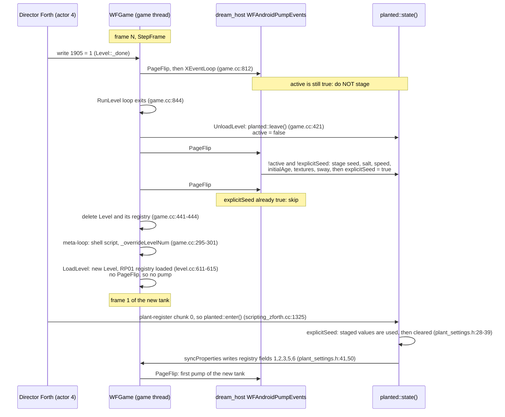

# Spikes S1 and S2: staging window and Forth reads

Date: 2026‑10‑21. Plan: [Planted Tank screensaver](../../2026-10-21-planted-tank-screensaver.md), Phase 0 rows 0b and 0c. Source read at `4266a44c`. Nothing was built or run: the root disk was full (0 bytes free) when the spike started, and every question here is answered by straight-line code, so reading was enough. The one claim that needs a device log is marked under **Residual risk**.

**Implementation update (2026‑10‑22):** Will approved and the engine now uses the generic launch-override table described below. This spike preserves the names and conclusions from its source snapshot: `BaselineSettings` was renamed to the OAS type `Settings`, and `wfoptions::install` / `registerBaseline` became `registerRuntimeOptions`. The planted APK is built and the shared coordinator is deployed; device verification is still pending.

## Verdicts

| Spike | Verdict | One line |
|---|---|---|
| **S1** | **SAFE‑WITH‑CONDITIONS** (no engine edit) | `WFAndroidPumpEvents` runs twice on the game thread after `planted::leave()` and before the Level is destroyed (`game.cc:421`, `429-430`), and never during `LoadLevel`. Staging `planted::state()` there, guarded by `!active && !explicitSeed`, is race‑free. The first tank must be staged before `HALStart`. |
| **S2** | **Mixed** | Speed and seahorses: Forth can read them now (`property@`). Hold, label and cycles have no catalog field. Cycles also **cannot be counted by Forth**, because every level mailbox, including `6000+`, is new on each reload. The host can write registry values only **from frame 2 of each tank onward**: no host hook runs between the registry load and the Director's first tick. |

The user asked for a generic option as well, so it has its own section: [Generic seam design](#generic-seam-design). That is a **launch‑override layer** in the `wfprops` registry, about 60 engine lines. It removes both S1 conditions and the frame‑1 gap in S2. It is **not** needed to ship v1, and it needs Will's permission.

## S1: can the host stage `planted::state()` between `leave()` and `enter()`?

### The reload sequence, as traced



### (1) Is a host hook called between `leave()` and the next `enter()`? On which thread? Can it fire mid‑load?

**Yes, twice per reload.**

- `WFGame::UnloadLevel` calls `planted::leave()` first (`wfsource/source/game/game.cc:421`). It then calls `_display->PageFlip()` twice (`game.cc:429-430`), and only after that destroys the Level (`game.cc:441-444`).
- `Display::PageFlip` (`wfsource/source/gfx/gl/display.cc:1175`) calls `XEventLoop()` at `display.cc:1200`, before any early return, on Linux and Android.
- On Android, `XEventLoop()` is `WFAndroidPumpEvents()` (`wfsource/source/gfx/gl/android_window.cc:230-233`).
- The Dream supplies that symbol (`android/screensaver/src/main/cpp/dream_host.cc:71`, empty today). `native_app_entry.cc`, which defines the NativeActivity version, is a platform‑shell source compiled into `wf_game` and not into `wfengine` (`CMakeLists.txt:877-887`). `wf_dream` therefore links only the host's version (`android/screensaver/dream-target.cmake:1-3`).

**Thread.** Everything runs on one thread, the Java thread `"aquarium-player"`:

- `TankPlayer.java:70-77` starts it, and it calls `nativeRun`.
- `nativeRun` calls `HALStart` synchronously (`dream_host.cc:130`).
- `HALStart` calls `PIGSMain` directly (`wfsource/source/hal/hal.cc:86`).
- The game loop, the Forth VM, `planted::*` and the pump all run on this thread. Host code in the pump needs no lock to touch engine state.

**Mid‑load: no.**

- `LoadLevel` (`game.cc:350-414`) contains no `PageFlip`, and neither does `level.cc`. The only callers are `game.cc:429`, `game.cc:430`, `game.cc:812` and `game.cc:1014` (the level menu), plus the `Display` destructor at `display.cc:827-829`.
- The only other pump caller is the suspended branch of `StepFrame` (`game.cc:621-636`, which calls `HALPumpSuspendedEvents` and then `WFAndroidPumpEvents` through `wfsource/source/hal/android/lifecycle.cc:60-67`). It runs instead of `update`, so it can fire before the new tank's first `enter()`. That is harmless: `active` is false there, and the `explicitSeed` guard makes staging idempotent.

**The first tank is the exception.** The first pump of the process comes *after* frame 1's `update`, which already ran `enter()` with catalog values. The host must stage the first tank in `nativeRun` **before `HALStart`** (`dream_host.cc:130`). That code is on the same thread, and `state()` is a lazily built function‑local static (`plant_settings.h:19`), so this is safe.

### (2) Can the host stage ahead while the current tank is live?

**Only for `explicitSeed`, and that buys nothing. The other fields are read live:**

| Field | Live reader |
|---|---|
| `speed` | `planted::tick` growth rate (`plant_settings.h:86`), `syncProperties` (`:50`) |
| `seed`, `salt` | the native HUD strip text (`wfsource/source/game/plant_ui.cc:12-14`), `syncProperties` (`:50`), the commit comparison (`:66`) |
| `textures`, `sway` | `plant-step` passes them to `SetPlantGeometry` every frame (`engine/stubs/scripting_zforth.cc:1333-1334`) |
| `initialAge` | read only at `enter()` (`:39`) and by the selector commit (`:72`) |
| `explicitSeed` | read only by `enter()` (`:28`); written by `enter()` (`:39`) and the selector commit (`:73`) |

So **stage only when `state().active` is false**. Keep the next tank's values in host‑side storage until then. The window is exact: `leave()` sets `active = false` (`plant_settings.h:44`), and `enter()` sets it to true (`:28`).

**Detecting a tank change.** `state().generation` increments on every `enter()`, through `regenerate()` (`plant_settings.h:24`), and on a settings‑form Regenerate. A host that needs to act "once per new tank", for example the S2 registry writes below, should compare `generation` with its last value in the pump. It should not compare `activeRegistry()` pointers: `HALLmalloc` is a bump allocator, so a new Level can reuse the old address.

### (3) Does anything reset `state()` or the registry on reload?

- **`state()`: only `leave()` touches it.** `leave()` clears `active`, `selector`, `actors`, `shoots` and `chunks` (`plant_settings.h:44`). It leaves `seed`, `salt`, `speed`, `initialAge`, `textures`, `sway` and `explicitSeed` alone, so values staged after `leave()` survive until `enter()`.
- The only other writers of `state()` are the level menu (`selector` at `game.cc:982` and `game.cc:1018`, menu bundles only) and the settings‑form commit (`plant_settings.h:63-75`). A Dream gets no form input.
- **The registry is per Level and rebuilt from the cooked bytes on every load.** `Level::_runtimeProperties` (`level.hp:303`) is loaded from the level's `RPRP` (`level.cc:611`) and becomes `activeRegistry()` at `level.cc:615`. The destructor clears it at `level.cc:880`.
- **A host write to the registry never survives a reload.** That is why staging goes through `planted::state()` and not the registry.

### (4) Does a one‑level `cd.iff` reload index 0 safely?

**Yes. On the Dream, `LEVEL_TO_RUN` is not even consulted.**

- `nativeRun` passes the TOC index as a positional argument (`dream_host.cc:118-127`).
- `main.cc:542-544` turns it into `nStartingLevel`, and `WFGame` stores that as `_overrideLevelNum` (`game.cc:106`).
- Every meta‑loop pass then forces `_desiredLevelNum = _overrideLevelNum` (`game.cc:300-301`), so the Dream always reloads its own index. The planted flavor must pass index 0, and `nativeRun` accepts 0 to 8 (`dream_host.cc:101`).
- Writing `5000 = 0` is still right for the desktop `task run`, which has no positional argument and so `_overrideLevelNum = -1`. There, a level write routes through `GameMailboxes::WriteMailbox` and `WFGame::WriteSystemMailbox` to `_desiredLevelNum` (`game.cc:1164`).

**TOC bounds.** `GetTOCEntry(GAMEFILE_LEVELSTART + 0)`, that is entry 1 (`game.cc:323`), is checked by `assert(index < _tocEntries)` (`wfsource/source/iff/disktoc.hpi:48-54`). With a script chunk plus one level, the TOC has 2 entries, so the index is valid.

**Mailbox 1905 after reload.** It reads `Level::_done`, a per‑Level member initialised to `false` (`level.cc:525`, `level.cc:1840-1841`). A new Level always starts "not done".

**Correction to [level-design-troubleshooting.md](../../../level-design-troubleshooting.md#flag--next-level-transition-and-verifying-it-headlessly): mailbox 6000 does not persist for a level.**

- Two different `GameMailboxes` instances exist.
- The shell's instance lives across the meta‑loop (`game.cc:285`). `shell.fth`'s `6000` guard runs against it (`wfsource/source/game/shell.fth:2-4`).
- Each **level** gets a fresh `GameMailboxes` (`game.cc:361`), deleted in `UnloadLevel` (`game.cc:443`), and storage is per instance (`wfsource/source/mailbox/mailbox.hp:91-93`, `mailbox.cc:74`).
- So a level's writes to `6000+` (`PERSISTENT_USER_START`, `mailbox.inc:302`) are lost on reload. Only `_desiredLevelNum` (5000) persists.
- This matters for **cycles** (S2).

**Pitfall: never write 0 to `END_OF_LEVEL`.** In `Level::WriteSystemMailbox`, the `END_OF_LEVEL` case falls through to `CAMSHOT` when the value is false (`level.cc:1807-1817`). Writing 0 to 1905 sets `_camShotMailBox` to 0, which is project‑review item 48. The Director should write only `1`.

**Other per‑load work, already exercised by existing reloads:** music (`game.cc:386-394`), SFX (`game.cc:398-404`, which no‑op on Android), and the REST and debug servers (`game.cc:409-413`, `432-435`). SMB's death reload and `SmokeRunFrameStep` (`game.cc:460`) already repeat `LoadLevel` and `UnloadLevel`. Long‑run memory is still for the plan's soak test (step 9).

### (5) Other seams that need no engine edit

- **The host can write a level mailbox** from the pump through `theLevel` (`level.hp:111`, set at `level.cc:582`, cleared at `level.cc:1023`), with `theLevel->GetMailboxes().WriteMailbox(n, Scalar)`. That needs `level.hp`, which pulls in a large part of the engine, and it starts working only at frame 2, like the registry below.
- **The host can write the registry** from the pump through `wfprops::activeRegistry()` (`engine/runtime_properties.hpp:55`). It finds the object with `->schema("PlantedTankSettings")` and writes with `->set(actor, field, value, error)`. `set` validates the value and refuses read‑only fields (`engine/runtime_properties.cpp:52`). The header is light. This is the better of the two, because `property@` keeps its signature in the OAS plan (step 8).
- **Cook time:** `scripts/plant_settings_catalog.py:68-102` (`configure_level` and `configure_cd`) rewrites catalog `initial` values in a built `cd.iff`. That is the existing "cooked default" path.
- **Not a seam:** `wfoptions::install` (`engine/runtime_options.hpp:21-83`, hooked at `level.cc:636`) copies a fixed set of engine globals into `BaselineSettings` fields 1000 to 1199. The host cannot feed it. It is the precedent for the generic seam below.

### Recommended mechanism (engine‑edit‑free)

1. **Before `HALStart`**, in `nativeRun`, stage tank 1:
    ```cpp
    auto& s = planted::state();
    s.seed = ...; s.salt = ...; s.speed = ...; s.initialAge = ...;
    s.textures = ...; s.sway = ...;
    s.explicitSeed = true;
    ```
    Java's validated parameters reach native code before `thread.start()`, either as `nativeRun` arguments or through a UI‑thread call made before `start()`. `Thread.start()` is a happens‑before edge, so no lock is needed.
2. **In `WFAndroidPumpEvents`**, run `if (!s.active && !s.explicitSeed) { stage next; s.explicitSeed = true; }`. This fires once per reload, at `game.cc:429`. Compute the next seed on the game thread (random, or derived from the user's seed).
3. **Also in the pump**, when `s.active` holds and `s.generation` has changed, write any per‑tank registry values Forth needs (S2), and count the tank.
4. **Never** write to `shoots`, `chunks`, `actors` or `generation`, and never stage while `active` is true.
5. **Level variant:**
    - The Director calls the `pg-init`/`plant-register` block **before** it reads `pg-salt` in its first tick. Today `tk-director-tick` reads `pg-salt` (`4 2 property@`) first and registers later (`wflevels/aquarium_plants/aquarium_plants.lev:276`). Frame 1 therefore sees the cooked water type, not the staged one.
    - The Director writes `1905 = 1` and `5000 = 0`, and never writes `1905 = 0`.

**Rejected:** staging in the pump whenever `explicitSeed` is false, without the `!active` guard. That would change the HUD seed text and the growth rate of the live tank on the last frame before unload (`plant_ui.cc:12-14`, `plant_settings.h:86`).

## S2: which parameters can Level Forth read at runtime?

### The Forth read words

`engine/stubs/scripting_zforth.cc:1588` defines `: property@ 178 sys ; : property-int-bytes@ 179 sys ; : property-text-byte@ 180 sys ;`. The C++ side is at `:1351-1374`, and it reads `wfprops::activeRegistry()->object(actor)->get(field)`:

- **`property@`** `( actor field -- value valid )`. Works for kinds 0, 1 and 2 (int, float, choice) when the value is within ±32 768 (`:1361`). Kind 4 (bool) gives 0 or 1. Anything else gives `valid = 0`.
- **`property-int-bytes@`** `( actor field -- b0 b1 b2 b3 valid )`. Kind 0 only, so it is the only way to read an integer of 32 768 or more.
- **`property-text-byte@`** `( actor field pos -- byte valid )`. Kind 3 (text), for example Seed.

The seahorse code reads its catalog fields this way: `: sh-director 4 ; : sh-count sh-director 8 property@ if else drop 6 then ;` and `: sh-greeting sh-director 9 property@ …` (generated into `aquarium_plants.lev:276`). They are read **every frame** in `sh-settings`, called from `tk-director-tick`.

### The decoded catalog

This is the `PlantedTankSettings` catalog, owner actor 4 (the Director). It was decoded from `wflevels/aquarium_plants/settings-catalog.inc`. The field names come from `wflevels/aquarium_plants/settings.oas:5-17`, and the ids from `settings-bindings.json`.

| id | key | kind | read‑only | initial |
|---|---|---|---|---|
| 1 | Seed | 3 text | no | `0` |
| 2 | Water type | 2 choice | no | `0` |
| 3 | Growth speed | 2 choice (0 to 6) | no | `3` |
| 4 | Initial age | 1 float | **yes** | `0.0` |
| 5 | Textures | 2 choice | no | `1` |
| 6 | Sway | 2 choice | no | `1` |
| 7 | Random seed on entry | 2 choice | **yes** | `1` |
| 8 | Seahorses | 2 choice (0 to 6) | no | `6` |
| 9 | Greeting | 2 choice | no | `1` |

### The timing that decides "host can change it"

- The registry is rebuilt from the cooked `RPRP` at `level.cc:611`.
- The Director's first tick runs in frame 1's `update` (`game.cc:684`).
- The first pump of that tank comes after it, at `game.cc:812`.
- So **a host registry write is visible to Forth from frame 2**, and frame 1 always sees the cooked value.
- The exception is any field that `syncProperties` writes from `planted::state()` inside `enter()` (fields 1, 2, 3, 5 and 6; `plant_settings.h:50`). Those carry the S1‑staged value from the moment `plant-register` runs.

### Per‑parameter table

| Parameter | Can Forth read it? How | Can the host change it at runtime? How | Otherwise: cooked default |
|---|---|---|---|
| **speed** | **Yes.** `4 3 property@` gives the index 0 to 6. Forth maps it to 0, 0.25, 0.5, 1, 2, 4 or 8 itself, mirroring `speedValue` (`plant_settings.h:20`). | **Yes.** S1 staging of `state().speed`, which `enter()` copies to field 3 through `syncProperties`. Correct once `plant-register` has run, so read it after registering. | `configure_cd` `speed` |
| **hold seconds** | **Not today:** no field. Possible with a **new field in the variant's own `settings.oas` and `settings-bindings.json`** (level data under `wflevels/`, not an engine edit). Use kind 0 Int: `property@` stops at 32 767, so for up to 86 400 s use `property-int-bytes@`, or store minutes. | **Yes, from frame 2:** `activeRegistry()->set(4, id, value)` in the pump on a generation change. The hold timer starts after growth, minutes later, so frame 2 is in time. The field must not be read‑only, or `set` refuses it. | A Forth constant generated into the variant Director, or the new field's `initial` through `configure_cd` |
| **seahorses** | **Yes.** `4 8 property@` (`sh-count`), read every frame. | **Yes, from frame 2,** the same way as hold. Frame 1 runs `sh-settings` with the cooked count, so the variant Director should hide the pairs until the frame after `pg-init`. | `configure_cd` `seahorses` (default 6) |
| **cycles limit** | **The limit:** only with a new field, as for hold. **The count: no.** Every level mailbox is new on reload (S1 (4)), so Forth cannot count across tanks. | **The host counts tanks** (one per generation change). On the last tank it writes a flag, for example a new bool "End after hold" = 0, in the pump from frame 2. The Director checks the flag when its hold ends. | v1 default `0`, meaning unlimited: the Director always ends, and no flag is needed |
| **label flag** | **Not a Forth concern.** The seed strip is native: `planted::buildUI` draws it whenever `state().active` holds (`plant_ui.cc:12-14`), through `display.cc:1280`, and only when `levelmenu::Drawer()` is set. Forth cannot hide it. **This is S3's question.** | Not without S3's answer: whether the Dream sets `Drawer()` at all. | Whatever S3 finds |

**Can the host write before Forth's first read, with no engine edit? No.** No host‑owned code runs between `level.cc:611` (registry load) and the Director's first tick, and both happen inside `RunLevel` with no `PageFlip`. Values Forth needs on frame 1 must be cooked, or must come through `state()` and `syncProperties`.

## Generic seam design

**Do not build this yet: it needs Will's permission.** It answers his request (2026‑10‑21: "i'd want it to be more generic than just plant settings"). It replaces the plant‑specific `planted::Launch` struct in the plan (lines 151 and 190), which should be dropped.

### The idea

A process‑lifetime table of **launch overrides**: (owner schema, field key) → value. The host fills it. The engine applies it to a level's catalog **when the registry is loaded**, before `activeRegistry()` is set and before any script runs. Any settings owner can use it, not only `PlantedTankSettings`.

### Minimal API

It goes in `engine/runtime_properties.hpp`, next to `activeRegistry()` (`:55`):

```cpp
namespace wfprops {
// Values a host sets before a level activates. Applied to every object whose
// schema matches, each time a level registry loads. Keys are field keys
// (RP01 Field::key, which is the OAS field name), never numeric ids.
class LaunchOverrides {
public:
    void set(std::string schema, std::string key, std::string value);
    void erase(const std::string& schema, const std::string& key);
    void clear();
    // Writes each override that validates (wfprops::validate) into the matching
    // objects, including read-only fields, and bumps their revision. Returns a
    // "schema.key=value: reason" line for each override it rejects.
    std::vector<std::string> apply(Registry& registry) const;
private:
    mutable std::mutex mutex_;   // the host may write from a JNI/UI thread
    std::map<std::pair<std::string, std::string>, std::string> values_;
};
LaunchOverrides& launchOverrides();
}
```

**Where it hooks in:**

1. **`level.cc:613-615`**, after `_runtimeProperties.load(...)` and before `wfprops::activeRegistry()=&_runtimeProperties;`, add one line. It calls `apply(_runtimeProperties)` and logs each rejected line as `PROPERTIES launch-override rejected: …`. That is the only call site, and it covers every level and every schema.
2. **Optional:** a desktop flag `--property=Schema.Key=Value` in `main.cc`, next to the positional level argument (`main.cc:542-544`), that feeds the same table. With it, `task run` reproduces a Dream configuration such as speed 8, hold 5 and 3 cycles (plan verification step 4) without cooking a new `cd.iff`.

**How the screensaver would use it:**

- The host calls `launchOverrides().set("PlantedTankSettings", "Seed", "123")`, then `"Random seed on entry"="0"`, `"Water type"`, `"Growth speed"`, `"Initial age"` and `"Seahorses"`.
- It sets the variant's new fields the same way (for example `"Hold seconds"` and `"End after hold"`).
- It sets them once before `HALStart`, and then again for the next tank **at any time**. Overrides are read only at activation, so **staging ahead while a tank is live is safe**.
- `planted::enter()` stays as it is. Its non‑selected path already reads fields 1 to 7 from the registry (`plant_settings.h:29-38`), and these now carry the overrides.
- Forth sees every override from frame 1, which closes the S2 frame‑1 gap.
- The host no longer includes `plant_settings.h`.

### What it replaces or overlaps

| Existing code | Relation |
|---|---|
| S1 host staging into `planted::State` via `explicitSeed` (`plant_settings.h:17`, `:28`, `:31-39`) | **Replaced** for the screensaver. `explicitSeed` stays for the level‑menu selector (`plant_settings.h:72-73`, `game.cc:982`). Moving the selector to overrides later would delete the `selected` branch of `enter()`, about 10 lines. |
| Plan's `planted::Launch` (plan lines 151, 190) | **Replaced**, and dropped. |
| `wfoptions::install` / `registerBaseline` (`engine/runtime_options.hpp:21-83`, `level.cc:636`) | Same lifecycle point, opposite direction: engine globals into `BaselineSettings` for display. Not merged; it is the precedent. |
| `configure_level` / `configure_cd` (`scripts/plant_settings_catalog.py:68-102`) | The cook‑time equivalent, which rewrites `initial`. Overrides are its runtime counterpart, and both remain. |
| Host registry writes from the pump (S2) | **Replaced**: there is no frame‑2 gap any more. |

### Fit with the OAS/OAD plan ([2026‑10‑16 runtime object editing](../../2026-10-16-runtime-object-editing.md))

- **What that plan changes:** it retires RP01 and `planted::State` (steps 5 and 9, phases 3 and 5). Values move into a per‑object writable overlay of the class struct, created **at construction** (step 5). `property@` keeps its signature, with field = descriptor index (step 8).
- **The API survives.** It is keyed by **type or schema name and field name**. Both exist in OAS as `TYPEHEADER` and the field name, while RP01 numeric ids and descriptor indices do not carry over. So only `apply()`'s body changes.
- **Where `apply()` moves in OAS phase 2:** into the overlay construction. There it finds the descriptor by name, through the planned C++ `OadReader` port, and writes through the same `wf_attr_check` validation.
- **Every field works, live or not.** At that point the actor has not read its OAD yet, so an override takes effect even for fields without `SHOW_AS_LIVE`, with no `OnPropertiesChanged` call.
- **One rule to add:** an object that matches an override gets an overlay copy even when it is not in the `LevelObj` Editable Objects list.
- **Retirement:** `planted::State` is retired independently. Overrides never touch it, and the RP01 apply path is deleted with the reader in OAS phase 5.

### Size

| Piece | Lines |
|---|---|
| Header | about 15 |
| `runtime_properties.cpp` | about 30 |
| `level.cc` | 2 |
| `main.cc` CLI flag (optional) | about 10 |
| **Engine total** | **about 60** |
| Unit test: apply, validation reject, read‑only override, unknown key, survives a second `Registry::load` | about 60 |

Suggested tier T3 once approved: the design is settled here.

### Alternative considered: a host callback

`extern "C" void WFHostLevelActivating(wfprops::Registry&)` at `level.cc:615`. It is smaller (about 5 lines) and also generic. It is not recommended:

- The logic would live in each host.
- Desktop `task run` would get nothing.
- Its argument is the RP01 `Registry`, which the OAS plan deletes.

The data‑only override table moves to OAS unchanged. **The two are close, and Will may prefer the smaller edit.**

## Residual risk

1. **One `planted::state()` instance across the host and engine objects.**
    - **Why it should hold:** `wfengine` is STATIC (`CMakeLists.txt:964`), and it is linked into the one SHARED `wf_dream` (`dream-target.cmake:1-3`). The inline function‑local static therefore merges by COMDAT inside one `.so`.
    - **The doubt:** the compile flags differ. Release `wfengine` uses `-fvisibility=hidden`, ThinLTO and `-fno-exceptions` (`CMakeLists.txt:989`). `dream_host.cc` uses only `-fpermissive -w -fno-rtti` (`dream-target.cmake:4-7`).
    - **What confirms it:** on device, the `PLANTS settings-source=… seed=<staged> … selector_override=1` line (`plant_settings.h:40`) appears for tank 1 and for each reload.
    - The generic seam removes this risk, because the host no longer includes `plant_settings.h`.
2. **The staging depends on the existing `UnloadLevel` order** (`leave()` at `:421` before the PageFlips at `:429-430`). An engine change that moves `planted::leave()` after the flips would silently stop staging, and tanks would fall back to catalog values. A desktop test of the pump order would guard it. Desktop `XEventLoop` is `mesa.cc:519`, not the host's, so that test needs a stub host.
3. **The S1 approach breaks at OAS phase 3,** when `planted::State` is retired. It is a v1 mechanism.
4. **New catalog fields in a variant `settings.oas`** keep the schema name `PlantedTankSettings`, because `enter()` looks it up by name (`plant_settings.h:29`). Check that `scripts/plant_settings_catalog.py` and its tests do not assume the 9‑field set. `FIELDS` (`:15-17`) rejects unknown keys only for cooking.
5. **Not run:** no build or desktop test, because the disk was full at the start. Every finding comes from reading the code at `4266a44c`.
