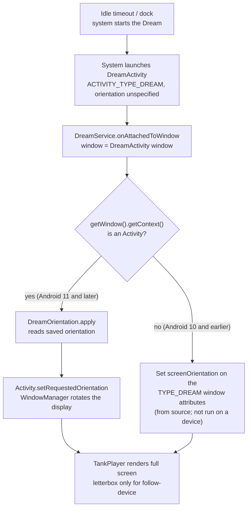
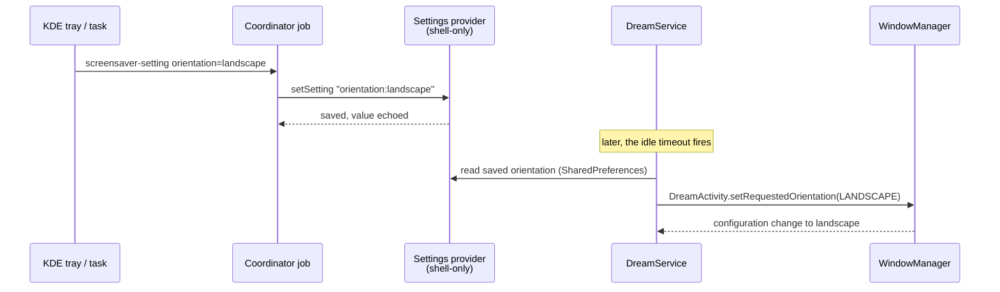
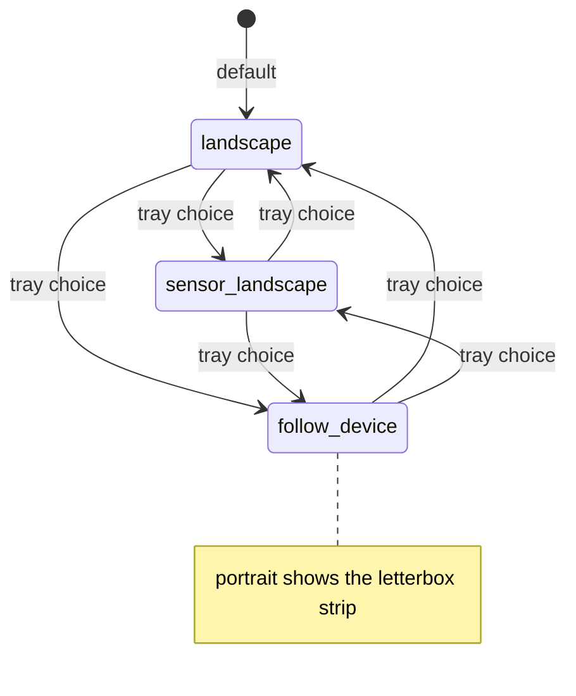
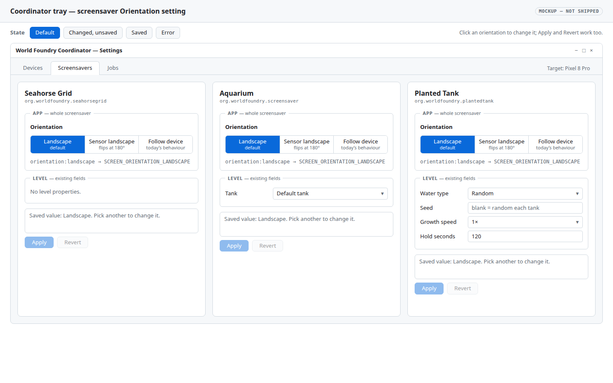
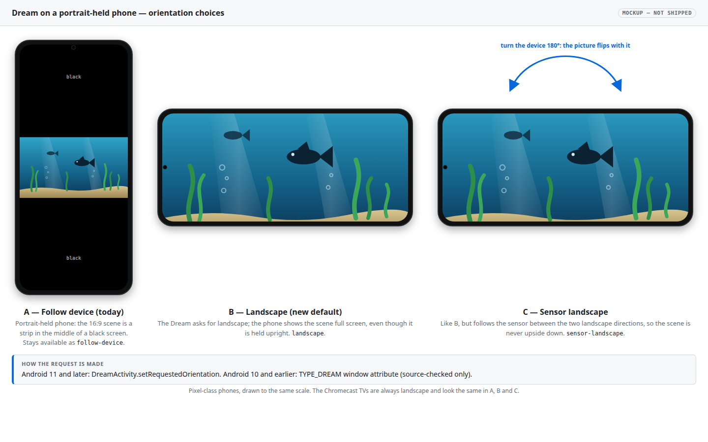

# Screensavers start in landscape, configurable per screensaver

## Context

The three screensavers (Seahorse Grid, Aquarium, Planted Tank) all show wide scenes composed for a
landscape display. On a portrait device (the Pixel&nbsp;8&nbsp;Pro, or any tablet or phone dock) the Dream
opens in portrait, and `TankPlayer` squeezes the scene into a 16:9 strip in the middle of a black screen
(`android/screensaver/src/main/java/org/worldfoundry/screensaver/TankPlayer.java:40`). Will wants them
to start in landscape, with the choice configurable per screensaver (Will, 2026‑10‑24: "these screensavers
show things which are wide and not tall. therefore, i want them to present in landscape mode").
The Chromecast TVs are always landscape and are unaffected.

None of the three has an orientation setting, and nothing outside the app can set one per Dream:

- The `<dream>` metadata (`android/screensaver/src/main/res/xml/dream.xml`) accepts only a settings activity,
  a preview image, a complications flag and a category.
- Android's own rotation preference (`Settings.System.USER_ROTATION` and the auto-rotate lock) is global. It
  would change every app on the phone, so it is not used.

**Spike evidence (2026‑10‑24, Pixel 8 Pro, real Dream started by the idle timeout while charging):**

| Spike | Change in `SeahorseGridDreamService` | Result |
|---|---|---|
| 1 | `getWindow().getAttributes().screenOrientation = LANDSCAPE` | Not landscape. |
| 2 | `((Activity) getWindow().getContext()).setRequestedOrientation(LANDSCAPE)` | **Landscape.** |

The result was observed by Will on the device. The coordinator's screenshot of the trigger job captured another
app rather than the Dream, so there is no image of it, and no `logcat` was read. The reason spike 1 failed and
spike 2 worked is in the Android source: since Android 11 a Dream's window is a real `DreamActivity` that the
system launches with `ACTIVITY_TYPE_DREAM` and `screenOrientation = UNSPECIFIED`
([`ActivityTaskManagerService`, Android 15](https://android.googlesource.com/platform/frameworks/base/+/refs/heads/android15-release/services/core/java/com/android/server/wm/ActivityTaskManagerService.java),
method `startDreamActivityInternal`). `DreamService` takes its window from that activity
(`mActivity = activity; onWindowCreated(activity.getWindow())` in
[`DreamService`](https://android.googlesource.com/platform/frameworks/base/+/refs/heads/android15-release/core/java/android/service/dreams/DreamService.java);
the same structure is in the Android 11, 12 and 14 branches). WindowManager rotates from the activity's requested
orientation, not from a window attribute. The Android version of the Pixel was not read during the spike, so
the version is to be confirmed in verification step 7.

## Approach

One shared helper, one saved setting per app, applied in every host.

**The setting.** `orientation`, a choice with three values, default `landscape` for all three screensavers:

| Value | Requests | Use |
|---|---|---|
| `landscape` | `SCREEN_ORIENTATION_LANDSCAPE` | Default. Fixed landscape. |
| `sensor-landscape` | `SCREEN_ORIENTATION_SENSOR_LANDSCAPE` | Landscape, flipping with the device when it is turned 180°. |
| `follow-device` | `SCREEN_ORIENTATION_UNSPECIFIED` | Today's behaviour, including the 16:9 letterbox in portrait. |

**The helper.** A new `DreamOrientation` class in `android/screensaver/src/main/java/org/worldfoundry/screensaver/`
holds the value list, parsing and the mapping to `ActivityInfo` constants, plus
`apply(DreamService dream, String value)`. It handles the two ways Android has hosted a Dream window:

| Android | Dream window | Orientation lever |
|---|---|---|
| 11 and later (checked in the `android11-release`, `12`, `14` and `15` sources) | a `DreamActivity` | `Activity.setRequestedOrientation` on `getWindow().getContext()`. Spike 2 verified this on the Pixel 8 Pro. |
| 10 and earlier (`android10-release`) | the service's own `PhoneWindow` of type `TYPE_DREAM`, with no activity | `getWindow().getAttributes().screenOrientation`. `DisplayContent.NonAppWindowContainers.getOrientation` reads `mAttrs.screenOrientation` from any visible window above the apps. **Not run on a device.** |

`apply` does `setRequestedOrientation` when the host is an `Activity`, and sets the window attribute otherwise.
On Android 11 and later the window attribute is ignored (spike 1), so it is only set in the non-activity branch.
Chromecasts on Android 12 take the activity branch; their displays are already landscape, so it changes nothing there.

**Where it applies.**

1. Each `DreamService.onAttachedToWindow`, before `setContentView`: `DreamOrientation.apply(getWindow().getContext(), saved)`
   (`SeahorseGridDreamService`, `AquariumDreamService`, `PlantedTankDreamService`).
2. Each launcher and preview `Activity` in `onCreate`: `setRequestedOrientation(...)`
   (`SeahorseGridActivity`, `AquariumActivity`, `PlantedTankActivity`, `ScreensaverPreviewActivity`). These are
   ordinary activities, so this is the same call without the guard.
3. `TankPlayer`'s portrait letterbox stays, used only when the value is `follow-device`.

**Where it is stored and set.** Each app already runs in its own package and process, so its own
`SharedPreferences` hold the value. The coordinator's shell-only settings contract is the "outside the app" control:

- **Aquarium** (`TankSettingsProvider`): add a second schema‑1 `choice` setting, `orientation`, to `getCapabilities`
  and accept `setSetting` with `orientation:<value>`, as it does for `tank:<id>`.
- **Planted Tank** (`PlantedSettingsProvider`, schema 2 generated from the level's catalog): the orientation is an
  app-level field, not a level property, so the provider's adapter adds it the way it already adds the `random`
  water policy. It must not enter the OAD-derived catalog.
- **Seahorse Grid**: has no settings provider today. Add `SeahorseSettingsProvider` with the authority
  `org.worldfoundry.seahorsegrid.settings`, declared in `android/screensaver/src/seahorse/AndroidManifest.xml`,
  with only the `orientation` setting.
- **Coordinator** (`~/chromecast-coordinator`, `scripts/wf_device/plugins/android/applications.json`): the Seahorse
  entry gets a `settings_authority`, and the generic Settings reader and tray show the new choice. The Aquarium
  and Planted entries already name their authority. This lands as its own coordinator change and deploy.

A changed value takes effect the next time the Dream starts, like the other settings.

**Rejected:** rotating the picture inside a portrait screen. It costs a custom transform and touch handling
for no benefit now that the system itself can rotate the Dream.

### Mechanism

## Mockups

The visible surfaces are the tray's Settings pane for a screensaver and the Dream on a portrait device.
Both are in this plan's bundle [`2026-10-24-screensaver-landscape-orientation/`](2026-10-24-screensaver-landscape-orientation/):

The Settings pane with the new Orientation choice, in four states (default, changed, saved, error); the
buttons at the top of the interactive version switch between them. Orientation sits in an "App" group, apart from
the level fields. [Open the interactive mockup](2026-10-24-screensaver-landscape-orientation/tray-orientation.html).

The Dream on a portrait-held phone: today's letterbox (`follow-device`), the new default (`landscape`) and
`sensor-landscape`. The placeholder text in the tray mockup (for example "Default tank") is illustrative.
[Open the interactive mockup](2026-10-24-screensaver-landscape-orientation/dream-orientation.html).

## Out of scope

- A reverse-landscape-only value. `sensor-landscape` covers both directions.
- Rotating the picture ourselves when the system will not rotate the Dream (for example an Android version
  that ignores the request). Revisit if the verification below fails on a device.
- Android 10 and earlier hardware testing, unless an enrolled device runs that version (verification step 7).
- Per-tank or per-level orientation. The setting belongs to the screensaver app.
- The Chromecast TVs, which are landscape already.

## Verification

1. Unit test for `DreamOrientation`: parse each value and reject an unknown one; map each value to its
   `ActivityInfo` constant; `apply` does nothing for a non-activity host. Run as a plain-Java test, as
   `PlantedConfigTest` does (`task test-planted-screensaver` pattern).
2. Build all three flavors: `./gradlew :screensaver:assembleSeahorseDebug :screensaver:assembleAquariumDebug :screensaver:assemblePlantedDebug --offline` from `android/`.
3. On the Pixel 8 Pro with auto-rotate off, held in portrait and charging: select each screensaver in turn with
   `screensaver-select`, run `task chromecast:screensaver-trigger DEVICE=phone-pixel-8-pro`, and confirm by eye that
   the Dream is landscape. Record which of the three were seen.
4. For each screensaver, set `follow-device` through the settings provider and repeat step 3; confirm the portrait
   letterbox returns.
5. Set `sensor-landscape`, turn the phone 180° during the Dream, and confirm it flips.
6. On a Chromecast HD and a Chromecast with Google TV (both Android 12; they take the activity branch): run
   `screensaver-trigger` and confirm the Dream starts and looks as before.
7. Android 10 or earlier (the window-attribute branch): needs a device on that version, which this workspace
   may not have. Read the Android version of each enrolled device first (`getprop ro.build.version.release`
   through the coordinator's device facts). If none is on 10 or earlier, record that this branch is
   source-checked only; do not claim it works.
8. `task chromecast:screensaver-setting` for each of the three: the value is saved, echoed back, and visible in
   the tray.
