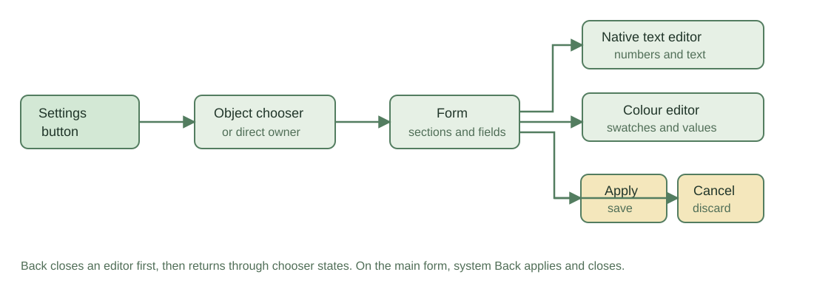
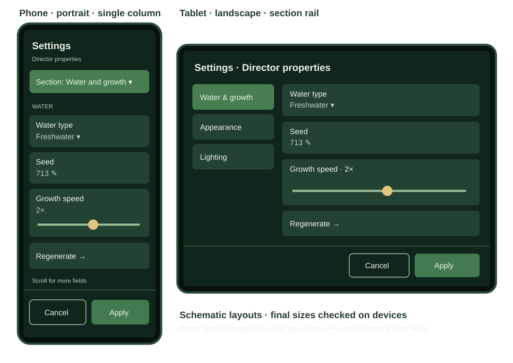
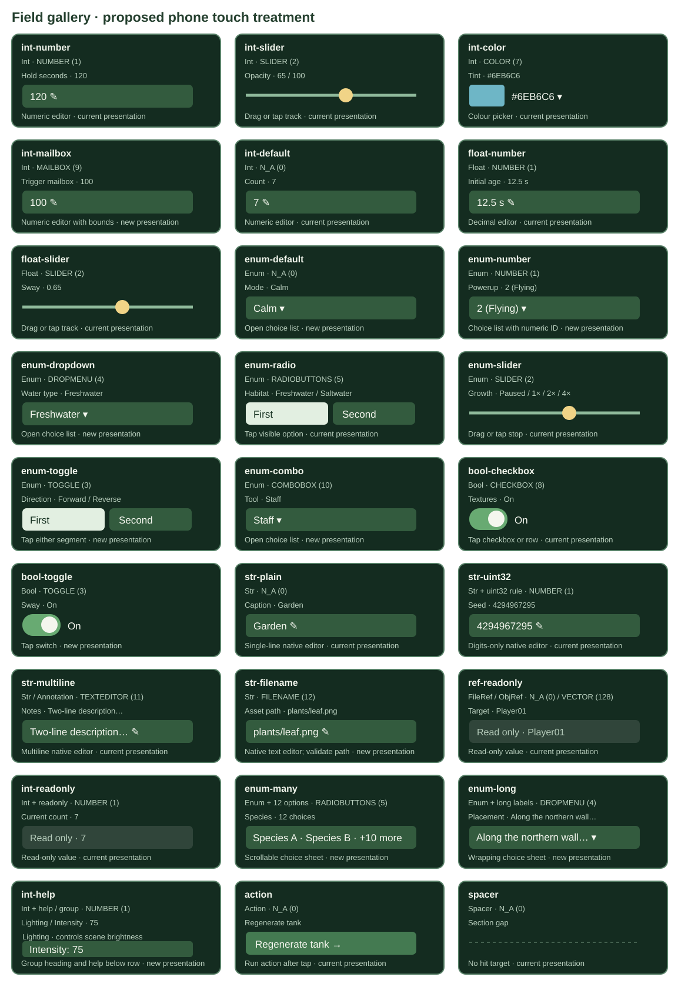

# Touch settings on phones and tablets

**Status:** Implemented after Will approved the engine changes. Host tests cover the 27 example cases. Pixel captures confirm row selection, opening Settings, and the larger rendered phone form; deeper editor and rotation checks remain.

## Goal

Make the in-game runtime settings usable directly by touch on Android phones and tablets. A person should be able to open settings, choose an object or section, edit every supported field, apply or cancel, and return to play without using the virtual D-pad or a physical controller. Make the settings text comfortably readable on a phone, including in portrait orientation.

## Current behavior and cause

- Android touch events in `wfsource/source/hal/android/native_app_entry.cc` feed `androidtouch::State` in `hal/android/touch_controls.h`. That state recognizes only the on-screen stick and A/B/C/D buttons. Touches on settings rows are ignored.
- `game/runtime_property_ui.cc` draws the form on a fixed 1920×1080 canvas with independent horizontal and vertical scaling. `game/runtime_settings_ui.cc` draws the object chooser and Pick in 3D. Neither exposes hit targets to the Android input path. `game/runtime_property_controls.h` and `engine/runtime_property_form.cpp` handle controller focus and field editing.
- The form uses a left section rail, right field list, and a footer at fixed canvas positions. Shrinking that whole design to a phone makes its 28/36/46-pixel source font, labels, and controls too small. A larger font alone would collide with rows and the footer.
- Android already has a native text editor bridge in `hal/android/property_text_input.h`; retain it for text and numeric entry. TV remote input and the connected phone editor remain supported.

## Proposed interaction

1. **Open settings:** Tap a level selector row to highlight it; a second tap on that row starts it. Highlighting Planted Tank exposes a visible Settings touch button, which opens the same host session as the existing hold-A gesture. Hide the button while settings are open.
2. **Object chooser:** Tap an object row to open it. Tap “Pick in 3D” to enter scene picking; tap a visible object target to select it, then choose from an overlap list if necessary. Provide a visible Back control at each stage.
3. **Form:** Tap a section to show its fields; tap a field to focus it and act on it. Boolean rows toggle, choice options select directly, sliders accept a tap or drag, and action rows run their named action. Read-only fields show their value but never change. A tap outside a control does nothing.
4. **Editors:** Tapping a text or number field opens Android's native editor with the current value. The colour picker exposes tappable swatches, spectrum, value control, RGB/hex entries, Use colour, and Cancel. Keep drafts until Apply; Cancel discards the draft through the existing host path. Show validation errors next to the active field and keep the form open.
5. **Navigation:** Keep visible **Apply** and **Cancel** controls on the phone form: Apply saves and closes settings; Cancel discards the draft and closes settings. A visible Back control and Android system Back dismiss a native editor or colour picker first, then return from Pick in 3D to the chooser. On the main form, system Back applies and closes, matching the current host behavior. Touch controls do not synthesize an A hold that could reopen settings or trigger gameplay after closure.

## Phone and tablet layout

These are schematic mockups, not device screenshots. The phone view shows the persistent exit controls, full-width rows, and larger text. The tablet view keeps the section rail with larger hit areas. The colour editor and object picker use the same responsive frame and exit bar.

- Use a separate responsive settings layout selected from **usable surface width in dp**, with a narrow one-column phone layout and a wider two-column tablet/TV layout. Account for system insets and the soft keyboard. Do not use Android version or device name as a proxy for screen size.
- On a phone, show a compact title and section selector, then full-width field cards. Let the field list scroll; keep Apply and Cancel reachable in a bottom action bar above the system inset. A tablet may retain the rail and field columns, with larger touch targets.
- Target at least **48 dp** for interactive hit areas, with spacing between adjacent actions. Use a readable phone body size of roughly **16–18 sp equivalent** and labels of at least **14 sp equivalent**, subject to checking actual rendered pixels and Android font scaling. Increase row height and wrap or ellipsize long labels deliberately; never clip values, errors, or the Apply controls.
- Keep the font atlas and visual style already used by `wfui`; choose sizes and layout together. If the existing atlas variants cannot meet the phone size after scaling, add appropriate variants through the existing font bake and bundle path. The Android native editor continues to use system text sizing.
- Verify both portrait and landscape phones, tablet widths, and large-text/font-scale settings. Avoid showing the virtual stick/action buttons over the modal or letting them intercept its taps.

## Field presentation examples

The gallery shows every sensible field type and `showAs` pairing in the current OAD vocabulary, plus cases where options, rules, or modifiers change the interaction. “Current visual pattern” means the engine already draws a distinct control for that case; **all direct touch interactions remain proposed**. “New visual pattern” means the current renderer generally shows a generic row or has no distinct touch treatment. Hidden fields (`showAs=6`) and section/group-end markers are intentionally absent from the form; a section heading, group help, action, and spacer are represented below. The `VECTOR (128)` reference remains read-only rather than becoming a vector editor.

<!-- examples-table:start -->
| Example | Type / modifier | `showAs` | Phone control | Presentation |
|---|---|---|---|---|
| `int-number` | Int | NUMBER (1) | Numeric editor | Current visual pattern |
| `int-slider` | Int | SLIDER (2) | Drag or tap track | Current visual pattern |
| `int-color` | Int | COLOR (7) | Colour picker | Current visual pattern |
| `int-mailbox` | Int | MAILBOX (9) | Numeric editor with bounds | New visual pattern |
| `int-default` | Int | N_A (0) | Numeric editor | Current visual pattern |
| `float-number` | Float | NUMBER (1) | Decimal editor | Current visual pattern |
| `float-slider` | Float | SLIDER (2) | Drag or tap track | Current visual pattern |
| `enum-default` | Enum | N_A (0) | Open choice list | New visual pattern |
| `enum-number` | Enum | NUMBER (1) | Choice list with numeric ID | New visual pattern |
| `enum-dropdown` | Enum | DROPMENU (4) | Open choice list | New visual pattern |
| `enum-radio` | Enum | RADIOBUTTONS (5) | Tap visible option | Current visual pattern |
| `enum-slider` | Enum | SLIDER (2) | Drag or tap stop | Current visual pattern |
| `enum-toggle` | Enum | TOGGLE (3) | Tap either segment | New visual pattern |
| `enum-combo` | Enum | COMBOBOX (10) | Open choice list | New visual pattern |
| `bool-checkbox` | Bool | CHECKBOX (8) | Tap checkbox or row | Current visual pattern |
| `bool-toggle` | Bool | TOGGLE (3) | Tap switch | New visual pattern |
| `str-plain` | Str | N_A (0) | Single-line native editor | Current visual pattern |
| `str-uint32` | Str + uint32 rule | NUMBER (1) | Digits-only native editor | Current visual pattern |
| `str-multiline` | Str / Annotation | TEXTEDITOR (11) | Multiline native editor | Current visual pattern |
| `str-filename` | Str | FILENAME (12) | Native text editor; validate path | New visual pattern |
| `ref-readonly` | FileRef / ObjRef | N_A (0) / VECTOR (128) | Read-only value | Current visual pattern |
| `int-readonly` | Int + readonly | NUMBER (1) | Read-only value | Current visual pattern |
| `enum-many` | Enum + 12 options | RADIOBUTTONS (5) | Scrollable choice sheet | New visual pattern |
| `enum-long` | Enum + long labels | DROPMENU (4) | Wrapping choice sheet | New visual pattern |
| `int-help` | Int + help / group | NUMBER (1) | Group heading and help below row | New visual pattern |
| `action` | Action | N_A (0) | Run action after tap | Current visual pattern |
| `spacer` | Spacer | N_A (0) | No hit target | Current visual pattern |
<!-- examples-table:end -->

The exact option labels come from OAD `choices`, not from this design: test two options, many options, long labels, a nonzero enum minimum, and slider choices with more than nine labels (the present renderer then omits tick labels). Also test read-only, group/help text, unsigned decimal validation, multiline input, and actions. Do not treat arbitrary combinations of all type and `showAs` numbers as valid; the table is the supported design inventory.

## Implementation boundaries (after approval)

| Area | Proposed change |
|---|---|
| Android input and HUD | Route pointer down/move/up/cancel with pointer ID and surface coordinates to the active settings UI before virtual game controls; keep multi-touch ownership separate; clear captures on close, pause, and surface recreation. Draw a Settings entry button only when the host is available. |
| Settings UI | Make form, chooser, Pick in 3D, and colour controls produce hit regions from the **same geometry used to draw them**. Use the actual surface/inset transform for hit testing. Implement phone/tablet layouts and scrolling without duplicating field semantics. |
| Property host and form | Expose narrow touch actions for selecting section/row/object and editing a field, reusing existing `Edit::set`, validation, apply, and cancel behavior. Keep controller navigation unchanged. |
| Font assets | Bake and ship larger variants only if screen measurements show they are needed. Recheck atlas size and layout at each supported scale. |
| Android orientation | Keep surface and touch geometry current after rotation. Each game flavor chooses an orientation through a manifest placeholder; Aquarium is fixed to landscape and other flavors follow the device. Confirm existing TV landscape behavior on a Chromecast. |

These areas are World Foundry engine code, including files under `wfsource/source/` and `engine/`. Will approved implementation in this conversation.

## Implementation and APK gate

- `runtime_property_touch.{h,cc}` draws and hit-tests the phone/tablet chooser, form, choice sheet, colour controls, and visible Apply/Cancel from shared geometry. Android routes pointers to this UI before virtual game controls and positions it inside the content insets. The Settings entry button appears when a runtime property host is available.
- Game flavors use `gameOrientation`: Aquarium is fixed to landscape because its tank scene does not frame well in portrait; other flavors follow the device. The touch layout uses the surface density and available width, while Android's native editor remains the text and number input path. EGL surface size is refreshed on resize and before each swap, and held touch state is cleared on resize. The screensaver module already has a separate reusable orientation preference.
- The level selector now accepts row taps using the same geometry as its drawing; one tap highlights a row and a second tap starts it. The Planted Tank row exposes Settings without a D-pad.
- The World Foundry native library now links with 16 KiB LOAD segment alignment. `scripts/check-apk-page-alignment.py` inspects every packaged `.so` in an APK, and each Android app `assemble<Variant>` task fails if a library has a LOAD segment below 16 KiB alignment or an incompatible file/virtual-address offset.
- The warning screenshot came from **Finding Your Way**, which packages a World Foundry runtime through its own scripts. Its main native APK packager and phone touch review packager now run the same 16 KiB check before freezing an APK. An archived Finding Your Way phone review APK fails it on three arm64 LOAD segments; a newly linked World Foundry Aquarium APK passes. The existing Finding Your Way runtime must be rebuilt from an engine source that includes the link fix before its next APK can pass.
- On the Pixel 8 Pro, the rebuilt Aquarium APK launched without the Android compatibility dialog in coordinator jobs J‑eb2a80a72f33 and J‑e8d03cf63aa0. Those checks verify the World Foundry base layer; they do not claim that the existing Finding Your Way APK has been repaired.

## Verification recorded so far

- `pytest -q tests/test_touch_settings_plan_examples.py tests/test_apk_page_alignment.py tests/test_object_properties.py`: 41 passed. The touch fixture exercises all 27 table/gallery examples, including choice lists, sliders, colour controls, text paths, read-only fields, Apply/Cancel, and inset geometry.
- `./gradlew :app:assembleAquariumDebug --offline`: succeeded and ran `verifyAquariumDebugApkPageAlignment` on the packaged APK.
- Finding Your Way `task test`: 25 JavaScript tests and 218 Python tests passed, with 3 Python tests skipped. Its new synthetic APK tests reject a 4 KiB arm64 library and accept 16 KiB libraries; the archived warning APK also fails the checker directly.
- Android TV menu regression check J‑10139ca40ba9 completed on cast1. Pixel phone launch checks J‑eb2a80a72f33 and J‑e8d03cf63aa0 completed without the 16 KiB warning for Aquarium. A touch-only settings walkthrough and actual phone text-size review are still outstanding.
- Pixel phone row tap J‑7da719beb484 selected Planted Tank and showed Settings; tap J‑65e9d8a28c64 opened the phone form. The captured form has readable field labels and visible Cancel/Apply. The final landscape Aquarium APK passed its build gate and launched in a 2244×1008 landscape capture, J‑de58e7e59f87. The coordinator's separate phone-input jobs relaunch the foreground activity during cleanup, so they cannot verify consecutive modal edits; that path still needs a manual walkthrough.
- `tests/test_level_menu.py` added portrait geometry and tap selection tests (2 passed). The broader level-menu run had 63 passed, 1 skipped, and 1 unrelated failure: the committed `wfsource/source/game/cd.iff` no longer matches a rebuild from current level inputs.

## Verification and acceptance

1. `tests/test_touch_settings_plan_examples.py` already checks that every case in `2026-10-29-touch-settings-examples.json` appears once in the table and gallery and that the sensible type/`showAs` matrix stays complete. When implementing, add a parameterized runtime fixture from this same inventory: assert each case's rendered control and touch action, including option value mapping for a nonzero enum minimum, long and 12-item lists, slider values and bounds, read-only rejection, group/help layout, unsigned decimal and multiline validation, actions, and a noninteractive spacer. Add geometry/input tests for hit target mapping, coordinate scaling, scrolling, pointer capture/cancel, and no gameplay input leakage. Test draft/apply/cancel through the existing property host, not a separate settings model.
2. Capture screenshots on a phone in portrait and landscape and on a tablet. Review text at actual device size, not only a desktop render: section names, long field labels and values, errors, picker tags, and footer must be legible and non-overlapping. Check large font scale and soft keyboard visibility.
3. On a physical phone/tablet, complete a touch-only path: open settings; choose an object; switch sections; toggle, choose, drag a slider, enter text/number, use colour controls; cancel and verify unchanged values; reopen, apply and verify persistence; use Back through nested states; repeat after pause/resume and rotation.
4. Run a controller regression on Android TV through `task chromecast:*`: hold/release A to open settings, directional navigation, apply/cancel, and held/released directions in gameplay. Record job evidence through the coordinator. Also verify non-modal phone game controls still work.

**Done when:** every visible settings action is reachable by touch on phone and tablet, the phone text is readable without zooming, touch and controller paths produce the same saved values, and no touch leaks into gameplay while the modal is open.
