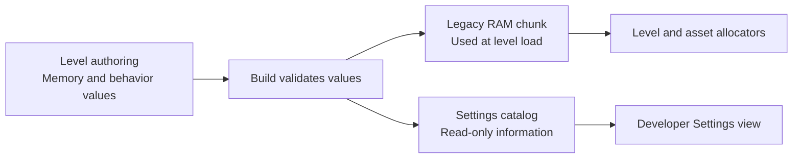

# Modernize authored level memory settings

[Open the visual plan and Settings mockup](2026-10-30-level-memory-settings-modernization.html).

**Implementation status:** the shared build tooling and baseline integration
are implemented. The baseline build, level verification and 20 focused tests
pass. The desktop runtime check could not open the host display. Cast1 check
J‑36131a45c778 loaded the level and showed the read-only memory page; see the
[device evidence](../diagnostics/level-memory-settings-2026-10-30/README.md).
The mockup illustrates the intended layout; it is not a device capture.

## Goal

Use the existing level settings authoring flow for the values consumed when a
level is loaded. Keep one authored configuration and project it into the legacy
RAM chunk that current and older engines already read. The runtime Settings UI
shows these values as read-only: changing the source and rebuilding affects the
next load; Apply cannot resize an allocator that already exists.

## Scope and design

1. Reuse the prepared `feat/ram-level-settings` work as a reference, adapting
   it to the current baseline settings fixture and its three settings owners.
   Use one versioned, validated source file for object heap bytes, permanent
   asset bytes, room asset bytes per slot, room slot count, and the two legacy
   behavior flags. Put allocator controls in **Level Memory** and the joystick
   and camera flags in **Level Behavior**. These are developer-facing fixtures,
   not a new player-facing page on unrelated levels.
2. Provide reusable build tooling in `scripts/level_memory_settings.py`, and
   generate OAS defaults, read-only RPRP bindings and the RAM fields from that
   same source. Validate complete integer values, slot bounds and combined
   asset-size overflow. Keep the RAM and RPRP values in sync for all three
   baseline owners. Preserve existing RAM layout, catalog locator, sector
   alignment and older level compatibility; reject malformed data.
3. Integrate the projection into the baseline build after the level is built
   and before the catalog is attached. Include the source configuration in the
   build receipt. Other levels opt in deliberately; no frozen fixture is
   rewritten by this change.
4. Test valid and invalid configurations, pre-existing and missing SLOT fields,
   catalog locator preservation, projection idempotence, generated OAS/OAD and
   RPRP read-only values. Build the baseline fixture and verify the cooked RAM
   values match its catalog source.

## Boundaries

The legacy RAM chunk remains the runtime authority. This implementation does
not add a catalog reader to the engine, change startup arenas, or promise live
or next-load user overrides. A later runtime-editable design needs a validated
load-time engine consumer, explicit precedence and compatibility tests, and
separate engine approval under `AGENTS.md`.

Existing launch overrides can alter even a read-only catalog value without
altering the RAM chunk. The fixture's help text therefore calls these catalog
values informational and explicitly warns that an override changes only the
display. A general guarantee that displayed values are the effective values
requires an engine change; it is not claimed by this build-time projection.
