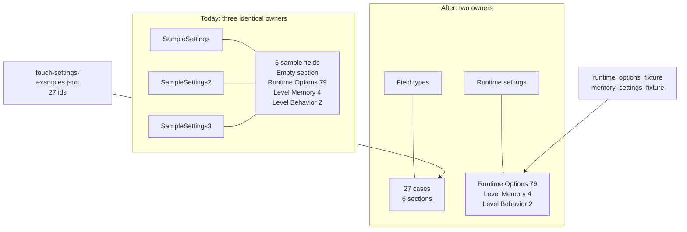
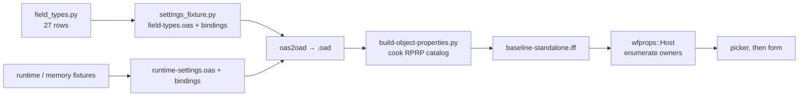
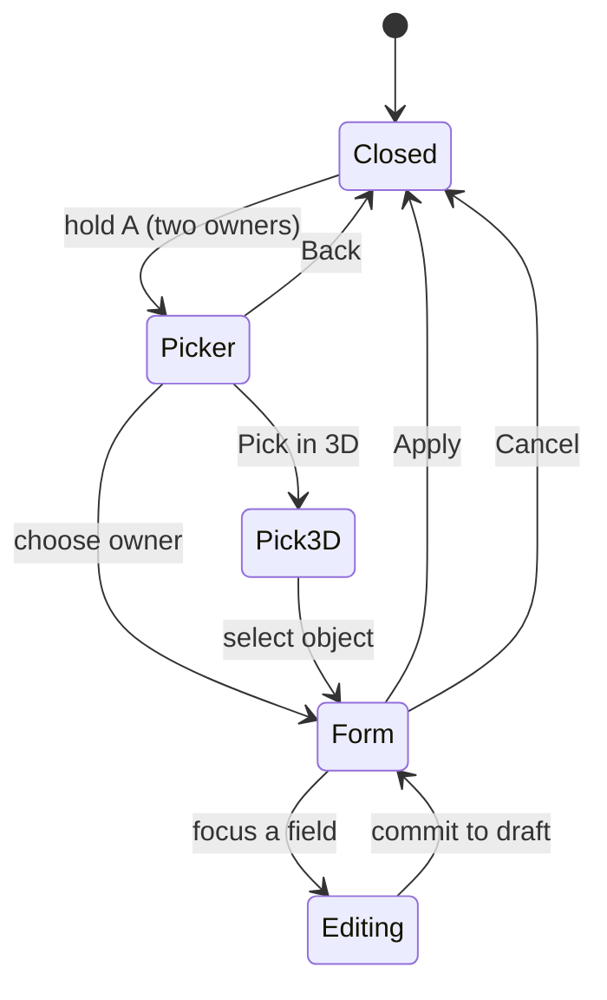
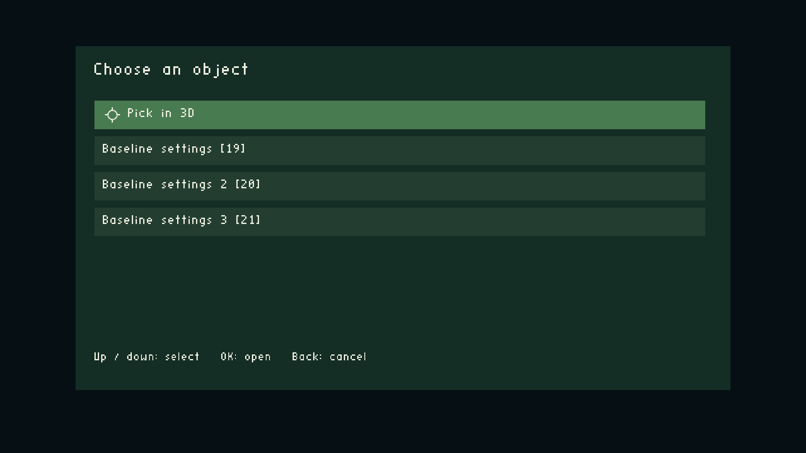
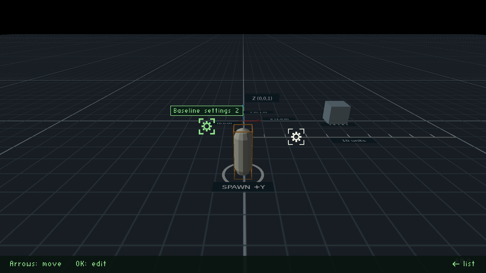
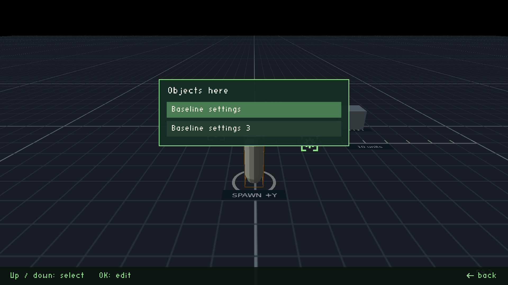
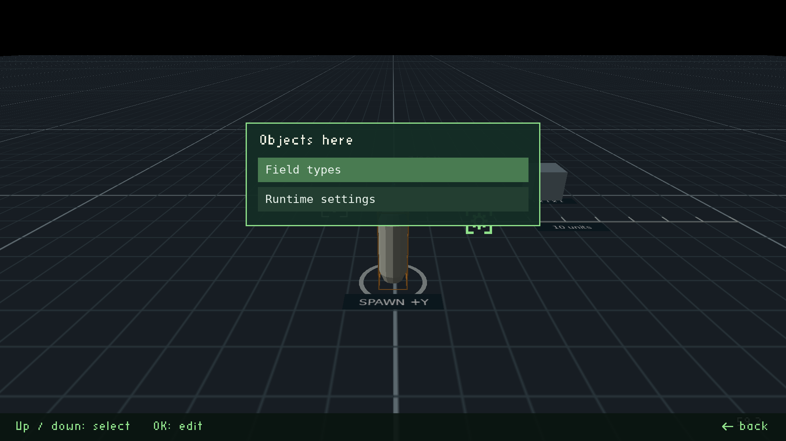
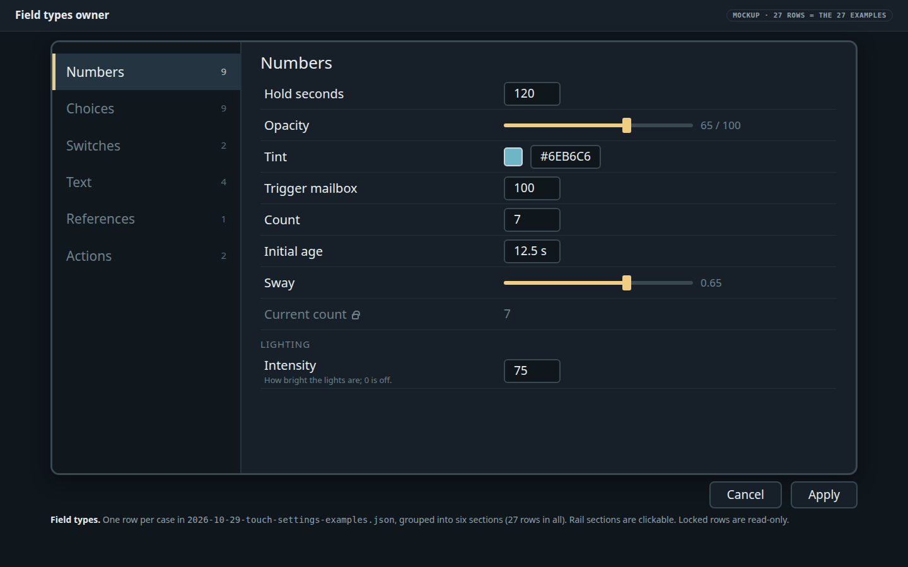
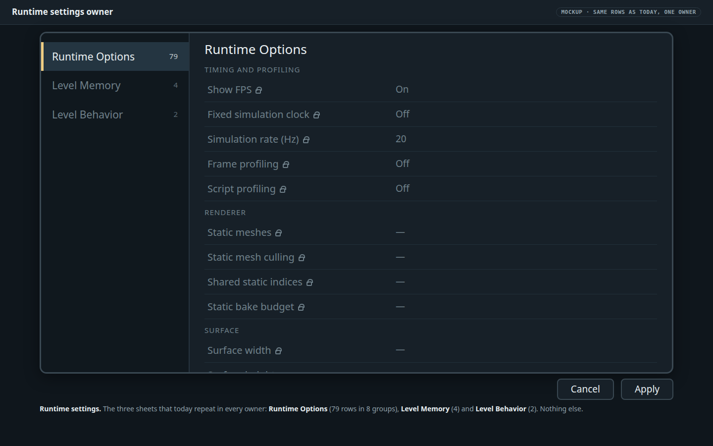

# Baseline settings: two owners and nothing else

**Status:** Built and verified on the host (2026‑10‑31): steps 1 to 6 pass, with the corrections recorded under each. Step 7 (device acceptance) is not run: it waits on the [validator patch](2026-10-31-baseline-settings-cleanup/validator-patch.diff) being deployed. Two findings changed the build, see **Implementation notes**: the Runtime settings owner authors one editable row (accepted by Will, 2026‑10‑31: "we totally want this option"), and Field types has its own schema. Rank **T4**: it changes what the level exports, the cooker bindings, the verifier, and the two device validators that live in the coordinator project.

## Context

Will asked (2026‑10‑31): the baseline level should have a settings with one of each type, and, after seeing what is there, "clean up settings from baseline level — we just need the one that has every combination, and one for the runtime settings."

The list of type × `showAs` permutations is in [Touch settings on phones and tablets](2026-10-29-touch-settings-phone-tablet.md), section **Field presentation examples**. It has **27 cases**, held in [2026-10-29-touch-settings-examples.json](2026-10-29-touch-settings-examples.json). `tests/test_touch_settings_plan_examples.py` keeps the table, the gallery and the JSON in sync. Sixteen are marked `existing` (the engine already draws a distinct control) and eleven `proposed`.

What the baseline exports today (read from `settings_fixture.py`, `settings.oas`, `settings-bindings.json`, `generate.py`, 2026‑10‑31):

| Piece | Today |
|---|---|
| Owners | **Three** `target` actors in `CONFIG`: `SampleSettings` (2, −4, 1), `SampleSettings2` (−1.5, −3, 1), `SampleSettings3` (2, −4, 1), actor ids 19–21 |
| Catalog on each owner | The **same** one, three times: a 5-field *Sample Settings* sheet, an *Empty section* (0 fields), **Runtime Options** (79 read-only rows in 8 groups), **Level Memory** (4) and **Level Behavior** (2). Only the title differs ("Baseline settings", "…2", "…3") |
| Gallery preset | `baseline:settings-gallery` builds 118 synthetic fields as another preset. It is not in the default level |
| Why three owners | They exercise *Pick in 3D*: `SampleSettings2` stands alone, and `SampleSettings` and `SampleSettings3` are **stacked on one spot on purpose**, so pointing there shows the "Objects here" list. cast1 captured all of it (assertions `three_candidates`, `two_brackets_in_view`, `same_spot_short_list`) |

Confirmed on the built binary: the cooked catalog in `wflevels/baseline-standalone.iff` holds **three objects of 90 fields each** (5 + 79 + 4 + 2). So the default has no field-types settings at all, and the runtime sheets are repeated in every owner.

## Approach

End state: **two owners** and no sample content.

| Owner | Carries | Rows |
|---|---|---|
| **Field types** | One field for each of the 27 cases, in six sections: Numbers 9, Choices 9, Switches 2, Text 4, References 1, Actions 2 | 27 |
| **Runtime settings** | Runtime Options (79 rows, 8 groups), Level Memory (4), Level Behavior (2), moved over unchanged | 85 |

1. **One source for the 27.** `field_types.py` holds a row per example `id` with its descriptor spelling. `settings_fixture.py` generates `field-types.oas` and its bindings from it. Types map as below. Labels and sample values are taken from the JSON, so the document, the touch test and the baseline cannot drift apart.

   | Examples | Descriptor |
   |---|---|
   | Int: N_A, NUMBER, SLIDER, COLOR, MAILBOX, read-only, help/group | `INT32` |
   | Float: NUMBER, SLIDER | `FIXED32`, scale 65 536 |
   | Enum: N_A, NUMBER, SLIDER, TOGGLE, DROPMENU, RADIOBUTTONS, COMBOBOX, 12 options, long labels | `INT32` with `choices` |
   | Bool: CHECKBOX, TOGGLE | `INT32` 0…1 |
   | Str: N_A, NUMBER with the uint32 rule, FILENAME | `STRING` |
   | Str / Annotation: TEXTEDITOR | `XDATA`, multiline |
   | FileRef / ObjRef, read-only | `OBJECT_REFERENCE`, read-only binding |
   | Action, Spacer | **No descriptor.** `bindings.json` `actions` (`kind` 9 and 10); the cooker already emits `spacer` as kind 10 |

2. **Runtime settings is a moved sheet, not a new one.** `runtime_options_fixture.py` and `memory_settings_fixture.py` already generate those sheets. They are emitted into the second owner's catalog only. Level Memory stays reusable by other levels through `scripts/level_memory_settings.py`.
3. **Remove from the level:** `SampleSettings`, `SampleSettings2`, `SampleSettings3`; the 5-field *Sample Settings* sheet; the *Empty section*; and the `settings-gallery` preset with its `baseline:settings-gallery` task.
4. **Keep as a test fixture, not a level preset:** the 118-field descriptor generator and `settings-coverage.json`. `verify.py` uses them to prove that every declared descriptor type is accounted for and that the compiled OAD framing is right. Deleting them would lose that guard, and it is unrelated to what the level shows.
5. **Placement: together.** Both owners stand at (2, −4, 1), the spot where two of today's three already share. Pointing at it in *Pick in 3D* shows the "Objects here" list with Field types and Runtime settings, so that list stays tested on the device. The one stand-alone owner goes away with `SampleSettings2`, so the picker keeps one bracket in view, not two. `verify.py`'s check "Pick in 3D fixture: one owner apart, two sharing a spot" changes to "the two owners share one spot".
6. **Docs updated in the same change:** `wflevels/baseline/README.md`, `docs/scene-contract.md` (which still says "CONFIG contains two Target actors", already stale), `docs/generic-settings-integration.md`, `wf-status.md`.

## Decisions

1. **Decided (Will, 2026‑10‑31): "the one that has every combination" is the 27 sensible cases.** "Yes, just the sensible ones." The 118-field exhaustive gallery (with its `HIDDEN` rows, narrow integer widths, vector groups and modifiers) is not an owner in the level. It stays only as the build-time test fixture in step 4 above.
2. **Decided (Will, 2026‑10‑31): the two settings objects stand together.** The reason is the one in the table above: the stack is there on purpose, to exercise the "Objects here" list on the device. Same spot, so every Pick in 3D shows that list.

## Diagrams

Where the catalogs come from, before and after:



From source to a form on the device:



The host has modes, so here they are:



## Mockups

**Pick in 3D: today, on the Chromecast.** Real cast1 captures (`docs/diagnostics/picker-3d/cast1-baseline-picker/`). The chooser lists three owners. In the scene each owner is a gear bracket: `Baseline settings 2` stands alone on the left (highlighted, with its name), and one white bracket on the right marks the **stacked pair**. Pointing at the stack opens the "Objects here" list.

| Chooser | Pick in 3D | Stacked pair |
|---|---|---|
| [](2026-10-31-baseline-settings-cleanup/today-chooser.png) | [](2026-10-31-baseline-settings-cleanup/today-pick-in-3d.png) | [](2026-10-31-baseline-settings-cleanup/today-objects-here.png) |

**After the cleanup.** The same screens, edited from those captures (the lettering is a stand-in for the device font; nothing else is changed). Two owners remain, both at the stacked spot, so there is one bracket in the scene and pointing at it shows the two-row list.

| Chooser | Pointing at the stacked spot |
|---|---|
| [![Chooser: Pick in 3D, Field types [19], Runtime settings [20]](2026-10-31-baseline-settings-cleanup/after-chooser.png)](2026-10-31-baseline-settings-cleanup/after-chooser.png) | [](2026-10-31-baseline-settings-cleanup/after-pick-in-3d-share-a-spot.png) |

**Field types.** One row per case; the rail sections are clickable. The locked row (padlock) is read-only; editable rows carry no marker.

[](2026-10-31-baseline-settings-cleanup/field-types.html)

[Open the interactive form](2026-10-31-baseline-settings-cleanup/field-types.html).

**Runtime settings.** The same three sheets as today, once. Every row is read-only. The mockup shows `—` for options whose value I did not read from the build.

[](2026-10-31-baseline-settings-cleanup/runtime-settings.html)

[Open the interactive form](2026-10-31-baseline-settings-cleanup/runtime-settings.html).

The phone and tablet layouts come from the host, not from this plan; their mockups are in the [touch settings plan](2026-10-29-touch-settings-phone-tablet.md).

## Risks and gates

| Risk | Why it matters | Gate |
|---|---|---|
| **Device validators assume three owners.** `baseline-settings` (20 assertions) and `baseline-picker` are in the coordinator project, deployed under `/opt/wf-device-coordinator` | After this change they would fail: the picker's recorded assertions `three_candidates` (now two) and `two_brackets_in_view` (now one) change, `same_spot_short_list` stays, and `baseline-settings` checks the five sample keys | **Patch written, not applied** (2026‑10‑31): [validator-patch.diff](2026-10-31-baseline-settings-cleanup/validator-patch.diff) changes `picker_checks.py`, `baseline_checks.py` and `test_baseline_picker.py`; it applies cleanly to the coordinator's HEAD, and the scripted picker tests pass with it. Both validators also check `properties.schema == 'BaselineSettings'`, which has been stale since the schema became `Settings` on 2026‑10‑22; the patch checks `FieldTypes`. **You deploy it.** Until then, device `check` jobs for baseline are expected to fail and are not a regression. `baseline-runtime-options` is a third validator with the same stale schema check and a `two_owners` assertion; it is not in the patch |
| ~~**Action row has no consumer.** Plant actions are callbacks registered per owner and key~~ | An unregistered action might be ignored, or might error | **Resolved: ignored** (step 3). `Host::apply` returns `false` before committing when the schema has no consumer and the action is not `apply` (`engine/runtime_property_host.cpp:40`). The form stays open with its draft, and nothing errors. The row ships inert and is recorded in `settings-coverage.json` (`implementation_gaps`, and `field_types` entry `action`). No engine change |
| ~~**Process-wide runtime values**~~ | `engine/runtime_options.hpp` synchronises them across owners; one owner now holds the sheets | **Resolved, with one authored change.** `registerRuntimeOptions` (`wfsource/source/game/runtime_options.cc:137`) and `install` (`engine/runtime_options.hpp:26,34`) only walk `registry.editableObjects()`, and the chooser lists only editable owners (`engine/runtime_property_host.cpp:15`). With every row authored read-only, Runtime settings is not editable, so the consumer would never install, the hold‑A picker would open Field types directly, and Pick in 3D would never appear. Shown with the real code in `tests/baseline_owners_test.cpp` (it fails on that catalog). The fix is data only: `runtime_show_fps` is authored editable (`settings_fixture.RUNTIME_INSTALL_TRIGGER`). After install, sync sets every runtime row's read-only flag from the backend, so the sheet behaves as it did with three owners. Values reach the single owner: see step 3 |
| **"Proposed" presentations** | Eleven of the 27 have no distinct control yet; they will draw as the nearest existing control | Each is recorded with the presentation actually observed. No acceptance is claimed beyond that |
| ~~**Actor ids shift**~~ | Removing `SampleSettings3` moves ids after 20 | Done after the [teapot ladder](2026-10-31-baseline-utah-teapots.md): FieldTypes 19, RuntimeSettings 20, teapots 21–29. Everything reads `actor-map.json` |

## Implementation notes

What was built (2026‑10‑31), and where it differs from the Approach above:

- `wflevels/baseline/field_types.py` is the single source: a row per example id, with its field id, section and descriptor spelling. Labels and values are parsed from the JSON's `sample`. `settings_fixture.py` writes `field-types.oas` and `field-types-bindings.json` from it, and `runtime-settings.oas` and `runtime-settings-bindings.json` from the existing runtime and memory fixtures. The retired `settings.oas`, `settings.oad` and `settings-bindings.json` are deleted.
- **Field types has its own schema, `FieldTypes`.** The runtime-options consumer is registered for schema `Settings`, and its `beforeCommit` rejects Apply while process globals differ from its snapshot. A separate schema keeps Field types' Apply and its action row out of that path. Rejected alternative: share `Settings`, which would route Field types' Apply through the runtime-options check.
- **One runtime row is authored editable** (`runtime_show_fps`). This is the only data change to the moved sheets; the reason is in **Risks**. Rejected alternative: change the engine so that the chooser and `registerRuntimeOptions` also consider read-only owners. That is an engine change, and a fully read-only owner staying out of the chooser is deliberate, tested behaviour (`tests/runtime_property_host_test.cpp`). **Accepted by Will (2026‑10‑31):** "The editable Show FPS row: accept it. we totally want this option." So the editable Show FPS row is wanted, not just tolerated.
- The reviewed `baseline.blend` was edited in place by `generate.py --settings-owners <blend>`. It removes the three SampleSettings actors and adds the two owners to the existing `CONFIG` collection, and it refuses to run twice. `build()` creates the same two owners in fresh generations.
- The 118-field gallery is generated and compiled as before, as a fixture. `verify.py` checks it, and the generic host tests (`test_runtime_options.py`, `test_runtime_property_host.py`) now cook it in place of the deleted sample sheet, keeping the same field ids (40, 64, 1000…).
- `bool-toggle` (INT32 0…1, `SHOW_AS_TOGGLE`) compiles to kind Int: the normalizer only makes `SHOW_AS_CHECKBOX` a Bool. This is recorded as a gap, and the engine has no distinct toggle yet ("proposed").

## Out of scope

- Drawing the eleven `proposed` controls. That belongs to the touch settings work.
- Making runtime options editable.
- The Planted Tank and Aquarium catalogs, which share the host but not this fixture.
- A new engine API for level scripts to open a chosen owner.
- Settings on the diagnostics preset.

## Verification

Run 2026‑10‑31 on the host, in the shared tree. Raw output under each step. Where output was filtered for length, the filter is part of the command shown.

1. `python3 -m pytest tests/test_baseline_field_types.py tests/test_touch_settings_plan_examples.py -q` passes. The new test asserts that the field ids equal the 27 example ids, that every type and `showAs` pair in the document appears, and that Field types carries no runtime sheet.

    ```
    $ python3 -m pytest tests/test_baseline_field_types.py tests/test_touch_settings_plan_examples.py -q 2>&1 | tail -3
    .......................................                                  [100%]
    39 passed in 31.81s
    ```

    **PASS.** The suite also checks the cooked level catalog, the engine registry (step 3), and two mutations: dropping a row, in the source or in the cooked bindings, fails it. Removing the `enum-many` row from `field_types.py` on disk failed 3 tests (`test_field_ids_are_the_27_examples`, `test_generated_sources_match_field_types_py`, `test_every_required_type_showas_pair_is_in_the_level`); the file was then restored.

2. `task baseline:build` succeeds; `build/scene-inventory.json` lists exactly two `target` actors in `CONFIG`, named `FieldTypes` and `RuntimeSettings`.

    ```
    $ task baseline:build; python3 -c '<print CONFIG target actors from build/scene-inventory.json>'
    task: [baseline:build] python3 wflevels/baseline/build.py
    Built: /home/will/WorldFoundry-wbniv/wflevels/baseline/build/default-standalone.iff sha256 257620abc4ea637e8da5f9beb1364cd0e20b095e1e578c1c8cf0e1318e070859
    [('FieldTypes', 'CONFIG', 'target.oad', [2.0, -4.0, 1.0]), ('RuntimeSettings', 'CONFIG', 'target.oad', [2.0, -4.0, 1.0])]
    ```

    **PASS.** The actor map is FieldTypes 19 and RuntimeSettings 20, with teapots at 21–29. A rebuild gives the same level SHA‑256.

3. Read how `Host::apply(action)` treats an unregistered key, and record the finding next to this step before relying on the action row.

    **Finding: an unregistered action is ignored, not an error.** `Form::input` and `Form::command` pass a kind‑9 row's key to `form.action` (`engine/runtime_property_form.cpp:36,49`). The host's callback closes on `cancel` and otherwise calls `Host::apply(key)` (`engine/runtime_property_host.cpp:28`). `Host::apply` looks up the consumer for the owner's schema, and `if(!consumer.committed&&action!="apply")return false;` (line 40) returns before `beforeCommit`, before `commit` and before `close`. Field types (schema `FieldTypes`) has no consumer, so pressing *Regenerate tank* does nothing: the draft stays and the form stays open. The row ships inert and is recorded as a gap. The same harness shows the runtime finding from **Risks**: both owners are editable, and the backend's values sync into the single Runtime settings owner.

    ```
    $ tests/baseline_owners_test.cpp on the RPRP payload of wflevels/baseline-standalone.iff (field lines shown for the two action rows only)
    object 19 FieldTypes fields=35 title=Field types
    object 20 Settings fields=116 title=Runtime settings
    editable 19 20
    runtime-sync 1000=0 1001=1 1002=30
    action-inert key=action committed=120 draft=8
    field-types-apply 1=8 runtime-applies=1
    Baseline owners: load, both editable, runtime sync on one owner, inert action, isolated Apply passed
    field 19 26 kind=9 show=0 readonly=0 key=action value=""
    field 19 27 kind=10 show=0 readonly=0 key=spacer value=""
    rc 0
    ```

    **PASS** (recorded before relying on the row). For comparison, the same harness on a catalog where every runtime row is authored read-only stops at `Assertion (r.editableObjects()==std::vector<uint32_t>{types,runtime}) failed` (exit 134).

4. Read the cooked catalog back out of the built level and count it. Today this prints three objects of 90 fields each (verified 2026‑10‑31 against the current `baseline-standalone.iff`); after the change it must print two objects with 27 and 85 fields.

    ```
    python3 - <<'EOF'
    import importlib.util
    from pathlib import Path
    def load(n, p):
        s = importlib.util.spec_from_file_location(n, p); m = importlib.util.module_from_spec(s); s.loader.exec_module(m); return m
    pc = load('pc', 'scripts/plant_settings_catalog.py'); cap = load('cap', 'scripts/gen-settings-capabilities.py')
    objs = cap.capabilities(pc.catalog_payload(Path('wflevels/baseline-standalone.iff').read_bytes()))['objects']
    print(len(objs), 'objects')
    for o in objs: print(o['title'], 'owner', o['owner'], 'fields', len(o['settings']))
    EOF
    ```

    ```
    $ python3 - <<'EOF' … (the snippet above)
    2 objects
    Field types owner 19 fields 25
    Runtime settings owner 20 fields 85
    ```

    The snippet counts what `scripts/gen-settings-capabilities.py` calls settings, and `_field()` drops kind 9 and 10 rows (actions and spacers). The 27 rows the form draws, counted by `verify.py`'s raw RP01 reader:

    ```
    $ python3 -c '<verify.catalog_rows on the level payload; rows by kind>'
    Field types owner 19 rows 27 by kind {0: 8, 1: 2, 2: 9, 3: 4, 4: 1, 8: 1, 9: 1, 10: 1} sheets ['Numbers', 'Choices', 'Switches', 'Text', 'References', 'Actions']
    Runtime settings owner 20 rows 85 by kind {0: 5, 3: 74, 4: 6} sheets ['Runtime Options', 'Level Memory', 'Level Behavior']
    ```

    **PASS, with the expected count corrected.** As written, the step expected 27 from the snippet. The snippet prints 25 because it leaves out the action and the spacer; the owner carries all 27 rows (kinds 9 and 10 are one each). Runtime settings prints 85 as expected.

5. `task baseline:verify` and `task baseline:check` pass, including a bridge read of one Runtime Options value through the single Runtime settings owner.

    ```
    $ task baseline:verify   # 118 lines 'compiled descriptor … True' omitted here
    task: [baseline:verify] python3 wflevels/baseline/verify.py
    configured floor and collision bounds True
    explicit player bounds True
    no imported adventure/scaffold content True
    default excludes diagnostics True
    two settings owners: FieldTypes and RuntimeSettings, target actors in CONFIG True
    Pick in 3D fixture: the two owners share one spot True
    default explicit runtime camera/room objects True
    teapot ladder: one teapot per rung with the formula face count True
    teapots are visual-only platform actors in TEAPOTS True
    teapots stand in one row at the configured spacing True
    teapot actor ids are appended after every existing actor True
    every declared descriptor type accounted for True
    all presentation codes accounted for True
    complete OAD framing True
    catalog contains the two owners True
    Field types: one row per touch-settings example True
    Field types carries no runtime sheet True
    Runtime settings carries exactly the three runtime sheets, 85 rows True
    standalone L4 and sector-aligned asset True
    verify exit=0
    ```

    ```
    $ task baseline:check 2>&1 | grep -v '^compiled descriptor' | tail -36; grep launch-override build/desktop/engine.log
    two settings owners: FieldTypes and RuntimeSettings, target actors in CONFIG True
    Pick in 3D fixture: the two owners share one spot True
    default explicit runtime camera/room objects True
    teapot ladder: one teapot per rung with the formula face count True
    teapots are visual-only platform actors in TEAPOTS True
    teapots stand in one row at the configured spacing True
    teapot actor ids are appended after every existing actor True
    every declared descriptor type accounted for True
    all presentation codes accounted for True
    complete OAD framing True
    catalog contains the two owners True
    Field types: one row per touch-settings example True
    Field types carries no runtime sheet True
    Runtime settings carries exactly the three runtime sheets, 85 rows True
    standalone L4 and sector-aligned asset True
    native script compilation succeeds True
    engine loads the settings catalog True
    engine registry holds both owners (launch-override probes rejected by name) True
    native player grounded at spawn True
    native held Up moves +Y True
    native release settles movement True
    B resets native player True
    native Up with zero heading moves +X True
    camera switches to first-person True
    camera switches back to follow True
    unit cube blocks native movement True
    quadrant floor support (-90, -90) True
    quadrant floor support (90, -90) True
    quadrant floor support (-90, 90) True
    quadrant floor support (90, 90) True
    fall reset restores spawn True
    remote Up+OK resets without jumping True
    runtime still running True
    check exit=0
    PROPERTIES launch-override rejected: FieldTypes.int-number=999999: Value is outside the field range
    PROPERTIES launch-override rejected: Settings.runtime_show_fps=7: Enter a valid value for this field
    ```

    **PASS for verify and check; the bridge read was NOT RUN, and other evidence stands in for it.** The desktop `wf_game` links `engine/stubs/debug_server.cc`, which has no property operation. The property snapshot server (`engine/runtime_diagnostics.cpp`) is only built with `WF_RUNTIME_DIAGNOSTICS` (`CMakeLists.txt:794`): `strings engine/wf_game | grep -c read-only-operation` prints `0`. So a bridge read is only possible on the device. Evidence used instead: (a) the desktop session now passes two out-of-range `--property=` overrides, and the engine rejects each by name, which it does only for a schema and field it has loaded. On the old three-owner level the `FieldTypes` probe prints nothing. (b) Step 3's harness runs the real `install`/sync on the cooked catalog: `runtime-sync 1000=0 1001=1 1002=30` lands in owner 20. The device read stays for step 7.

    **One failed run, cause not established.** An earlier `task baseline:check` the same afternoon failed `native player grounded at spawn` (exit 201). All catalog checks before it had passed. Its `verification.json` and `engine.log` were overwritten by the next run, so the recorded position is lost. Three immediate reruns, this recorded run, and the step 6 bundle run all passed, with the spawn at `[0.0, -5.0, 0.899994]`. No other `wf_game` process or port‑7785 listener was found afterwards. Missing evidence: the failing run's position and log.

6. `python3 wflevels/baseline/verify.py --desktop --bundle wfsource/source/game/cd.iff` passes after `task build-cd-iff`.

    ```
    $ task build-cd-iff 2>&1 | tail -14
    task: [build-cd-iff] cargo build --release --manifest-path wftools/cdpack-rs/Cargo.toml
    warning: function `pad_to_sector` is never used
       --> src/main.rs:123:4
        |
    123 | fn pad_to_sector(buf: &mut Vec<u8>) {
        |    ^^^^^^^^^^^^^
        |
        = note: `#[warn(dead_code)]` (part of `#[warn(unused)]`) on by default

    warning: `cdpack` (bin "cdpack") generated 1 warning
        Finished `release` profile [optimized] target(s) in 0.02s
    task: [build-cd-iff] python3 scripts/build-main-cd.py
    cdpack: wrote 5455872 bytes to /home/will/WorldFoundry-wbniv/wfsource/source/game/cd.iff
      SHEL: 98 bytes (sector 1)
      L0: 149504 bytes at sector 2 (smb_w1_1-standalone.iff)
      L1: 163840 bytes at sector 75 (smb_w1_2-standalone.iff)
      L2: 133120 bytes at sector 155 (smb_w1_3-standalone.iff)
      L3: 126976 bytes at sector 220 (smb_w1_4-standalone.iff)
      L4: 167936 bytes at sector 282 (snowgoons-standalone.iff)
      L5: 366592 bytes at sector 364 (qbert_practice-standalone.iff)
      L6: 272384 bytes at sector 543 (marble-madness-3d-astra-standalone.iff)
      L7: 1300480 bytes at sector 676 (baseline-standalone.iff)
      UIFT: 2770440 bytes at sector 1311 (/home/will/WorldFoundry-wbniv/wfsource/source/game/ui-font.wfga)
    main cd.iff: 8 levels from wflevels/main-cd.manifest
    build-cd-iff exit=0
    ```

    ```
    $ python3 wflevels/baseline/verify.py --desktop --bundle wfsource/source/game/cd.iff   # 118 'compiled descriptor … True' lines omitted; then grep launch-override build/desktop-cd/engine.log
    configured floor and collision bounds True
    explicit player bounds True
    no imported adventure/scaffold content True
    default excludes diagnostics True
    two settings owners: FieldTypes and RuntimeSettings, target actors in CONFIG True
    Pick in 3D fixture: the two owners share one spot True
    default explicit runtime camera/room objects True
    teapot ladder: one teapot per rung with the formula face count True
    teapots are visual-only platform actors in TEAPOTS True
    teapots stand in one row at the configured spacing True
    teapot actor ids are appended after every existing actor True
    every declared descriptor type accounted for True
    all presentation codes accounted for True
    complete OAD framing True
    catalog contains the two owners True
    Field types: one row per touch-settings example True
    Field types carries no runtime sheet True
    Runtime settings carries exactly the three runtime sheets, 85 rows True
    standalone L4 and sector-aligned asset True
    main CD GAME and TOC framing True
    main CD has the shell, every manifest level and the UI font True
    main CD preserves shell entry True
    main CD level 0 is smb_w1_1 True
    main CD level 1 is smb_w1_2 True
    main CD level 2 is smb_w1_3 True
    main CD level 3 is smb_w1_4 True
    main CD level 4 is snowgoons True
    main CD level 5 is qbert_practice True
    main CD level 6 is marble-madness-3d-astra True
    main CD level 7 is baseline True
    main CD ends with the UI font True
    native script compilation succeeds True
    engine loads the settings catalog True
    engine registry holds both owners (launch-override probes rejected by name) True
    native player grounded at spawn True
    native held Up moves +Y True
    native release settles movement True
    B resets native player True
    native Up with zero heading moves +X True
    camera switches to first-person True
    camera switches back to follow True
    unit cube blocks native movement True
    quadrant floor support (-90, -90) True
    quadrant floor support (90, -90) True
    quadrant floor support (-90, 90) True
    quadrant floor support (90, 90) True
    fall reset restores spawn True
    remote Up+OK resets without jumping True
    runtime still running True
    bundle verify exit=0
    PROPERTIES launch-override rejected: FieldTypes.int-number=999999: Value is outside the field range
    PROPERTIES launch-override rejected: Settings.runtime_show_fps=7: Enter a valid value for this field
    ```

    **PASS:** 167 checks (162 before this change). `tests/test_main_cd_manifest.py` passes with the rebuilt bundle.

7. On the Pixel and cast2 (once the validators are deployed): hold A opens the picker with two owners; Pick in 3D shows one bracket and, on OK, the "Objects here" list with both; each owner opens its form; Apply and Cancel behave; the captured Field types sections show the observed presentation for all 27 rows.

    **NOT RUN.** It needs the validator patch deployed under `/opt/wf-device-coordinator`, which is Will's to review and deploy. No device acceptance is claimed. The APK to test is `wflevels/baseline/build/baseline-eebab09d285f2939.apk` (SHA‑256 `eebab09d285f2939b829c0c3be579429818f2f30220427d568cabb599970635a`, frozen runtime `dd81405c…a815c`).
