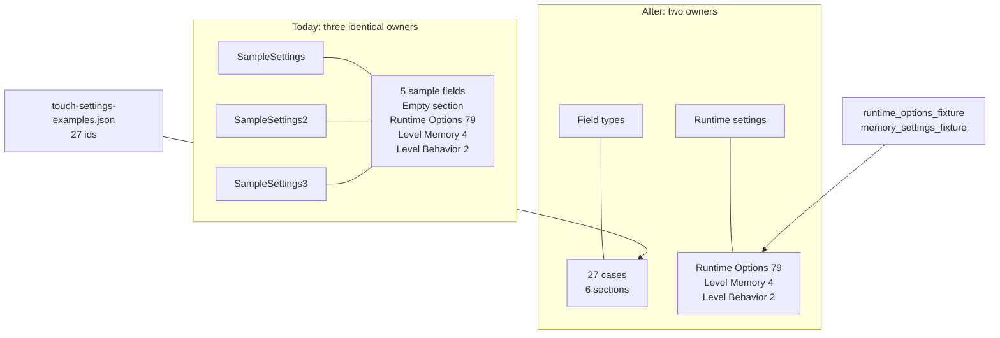
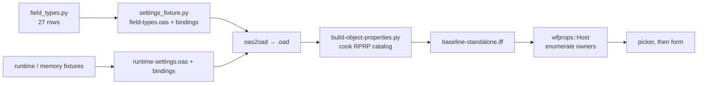
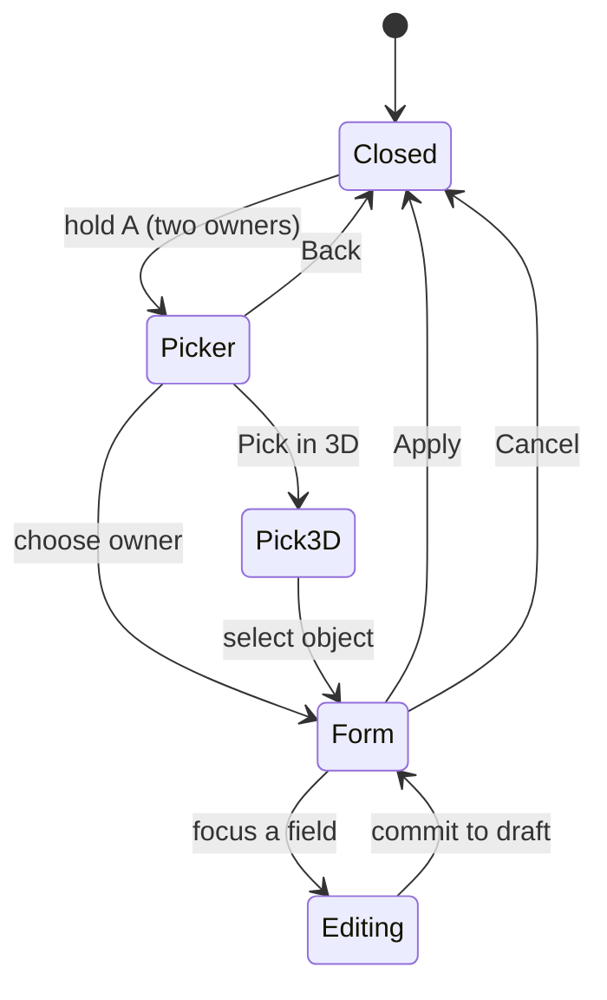

# Baseline settings: two owners and nothing else

**Status:** Plan for review (2026‑10‑31); both decisions settled. Rank **T4**: it changes what the level exports, the cooker bindings, the verifier, and the two device validators that live in the coordinator project. Nothing here is built yet.

## Context

Will asked (2026‑10‑31): the baseline level should have a settings with one of each type, and, after seeing what is there, "clean up settings from baseline level — we just need the one that has every combination, and one for the runtime settings."

The list of type × `showAs` permutations is in [Touch settings on phones and tablets](2026-10-29-touch-settings-phone-tablet.md), section **Field presentation examples**. It has **27 cases**, held in [2026-10-29-touch-settings-examples.json](2026-10-29-touch-settings-examples.json). `tests/test_touch_settings_plan_examples.py` keeps the table, the gallery and the JSON in sync. Sixteen are marked `existing` (the engine already draws a distinct control) and eleven `proposed`.

What the baseline exports today (read from `settings_fixture.py`, `settings.oas`, `settings-bindings.json`, `generate.py`, 2026‑10‑31):

| Piece | Today |
|---|---|
| Owners | **Three** `target` actors in `CONFIG`: `SampleSettings` (2, −4, 1), `SampleSettings2` (−1.5, −3, 1), `SampleSettings3` (2, −4, 1), actor ids 19–21 |
| Catalog on each owner | The **same** one, three times: a 5-field *Sample Settings* sheet, an *Empty section* (0 fields), **Runtime Options** (79 read-only rows in 8 groups), **Level Memory** (4) and **Level Behavior** (2). Only the title differs ("Baseline settings", "…2", "…3") |
| Gallery preset | `baseline:settings-gallery` builds 118 synthetic fields as another preset. It is not in the default level |
| Why three owners | They exercise *Pick in 3D*: `SampleSettings2` stands alone, and `SampleSettings` and `SampleSettings3` are **stacked on one spot on purpose**, so pointing there shows the "Objects here" list. cast1 captured all of it (assertions `three_candidates`, `two_brackets_in_view`, `same_spot_short_list`) |

Confirmed on the built binary: the cooked catalog in `wflevels/baseline-standalone.iff` holds **three objects of 90 fields each** (5 + 79 + 4 + 2). So the default has no field-types settings at all, and the runtime sheets are repeated in every owner.

## Approach

End state: **two owners** and no sample content.

| Owner | Carries | Rows |
|---|---|---|
| **Field types** | One field for each of the 27 cases, in six sections: Numbers 9, Choices 9, Switches 2, Text 4, References 1, Actions 2 | 27 |
| **Runtime settings** | Runtime Options (79 rows, 8 groups), Level Memory (4), Level Behavior (2), moved over unchanged | 85 |

1. **One source for the 27.** `field_types.py` holds a row per example `id` with its descriptor spelling. `settings_fixture.py` generates `field-types.oas` and its bindings from it. Types map as below. Labels and sample values are taken from the JSON, so the document, the touch test and the baseline cannot drift apart.

   | Examples | Descriptor |
   |---|---|
   | Int: N_A, NUMBER, SLIDER, COLOR, MAILBOX, read-only, help/group | `INT32` |
   | Float: NUMBER, SLIDER | `FIXED32`, scale 65 536 |
   | Enum: N_A, NUMBER, SLIDER, TOGGLE, DROPMENU, RADIOBUTTONS, COMBOBOX, 12 options, long labels | `INT32` with `choices` |
   | Bool: CHECKBOX, TOGGLE | `INT32` 0…1 |
   | Str: N_A, NUMBER with the uint32 rule, FILENAME | `STRING` |
   | Str / Annotation: TEXTEDITOR | `XDATA`, multiline |
   | FileRef / ObjRef, read-only | `OBJECT_REFERENCE`, read-only binding |
   | Action, Spacer | **No descriptor.** `bindings.json` `actions` (`kind` 9 and 10); the cooker already emits `spacer` as kind 10 |

2. **Runtime settings is a moved sheet, not a new one.** `runtime_options_fixture.py` and `memory_settings_fixture.py` already generate those sheets. They are emitted into the second owner's catalog only. Level Memory stays reusable by other levels through `scripts/level_memory_settings.py`.
3. **Remove from the level:** `SampleSettings`, `SampleSettings2`, `SampleSettings3`; the 5-field *Sample Settings* sheet; the *Empty section*; and the `settings-gallery` preset with its `baseline:settings-gallery` task.
4. **Keep as a test fixture, not a level preset:** the 118-field descriptor generator and `settings-coverage.json`. `verify.py` uses them to prove that every declared descriptor type is accounted for and that the compiled OAD framing is right. Deleting them would lose that guard, and it is unrelated to what the level shows.
5. **Placement: together.** Both owners stand at (2, −4, 1), the spot where two of today's three already share. Pointing at it in *Pick in 3D* shows the "Objects here" list with Field types and Runtime settings, so that list stays tested on the device. The one stand-alone owner goes away with `SampleSettings2`, so the picker keeps one bracket in view, not two. `verify.py`'s check "Pick in 3D fixture: one owner apart, two sharing a spot" changes to "the two owners share one spot".
6. **Docs updated in the same change:** `wflevels/baseline/README.md`, `docs/scene-contract.md` (which still says "CONFIG contains two Target actors", already stale), `docs/generic-settings-integration.md`, `wf-status.md`.

## Decisions

1. **Decided (Will, 2026‑10‑31): "the one that has every combination" is the 27 sensible cases.** "Yes, just the sensible ones." The 118-field exhaustive gallery (with its `HIDDEN` rows, narrow integer widths, vector groups and modifiers) is not an owner in the level. It stays only as the build-time test fixture in step 4 above.
2. **Decided (Will, 2026‑10‑31): the two settings objects stand together.** The reason is the one in the table above: the stack is there on purpose, to exercise the "Objects here" list on the device. Same spot, so every Pick in 3D shows that list.

## Diagrams

Where the catalogs come from, before and after:



From source to a form on the device:



The host has modes, so here they are:



## Mockups

**Pick in 3D: today, on the Chromecast.** Real cast1 captures (`docs/diagnostics/picker-3d/cast1-baseline-picker/`). The chooser lists three owners. In the scene each owner is a gear bracket: `Baseline settings 2` stands alone on the left (highlighted, with its name), and one white bracket on the right marks the **stacked pair**. Pointing at the stack opens the "Objects here" list.

| Chooser | Pick in 3D | Stacked pair |
|---|---|---|
| [](2026-10-31-baseline-settings-cleanup/today-chooser.png) | [](2026-10-31-baseline-settings-cleanup/today-pick-in-3d.png) | [](2026-10-31-baseline-settings-cleanup/today-objects-here.png) |

**After the cleanup.** The same screens, edited from those captures (the lettering is a stand-in for the device font; nothing else is changed). Two owners remain, both at the stacked spot, so there is one bracket in the scene and pointing at it shows the two-row list.

| Chooser | Pointing at the stacked spot |
|---|---|
| [![Chooser: Pick in 3D, Field types [19], Runtime settings [20]](2026-10-31-baseline-settings-cleanup/after-chooser.png)](2026-10-31-baseline-settings-cleanup/after-chooser.png) | [](2026-10-31-baseline-settings-cleanup/after-pick-in-3d-share-a-spot.png) |

**Field types.** One row per case; the rail sections are clickable. The locked row (padlock) is read-only; editable rows carry no marker.

[](2026-10-31-baseline-settings-cleanup/field-types.html)

[Open the interactive form](2026-10-31-baseline-settings-cleanup/field-types.html).

**Runtime settings.** The same three sheets as today, once. Every row is read-only. The mockup shows `—` for options whose value I did not read from the build.

[](2026-10-31-baseline-settings-cleanup/runtime-settings.html)

[Open the interactive form](2026-10-31-baseline-settings-cleanup/runtime-settings.html).

The phone and tablet layouts come from the host, not from this plan; their mockups are in the [touch settings plan](2026-10-29-touch-settings-phone-tablet.md).

## Risks and gates

| Risk | Why it matters | Gate |
|---|---|---|
| **Device validators assume three owners.** `baseline-settings` (20 assertions) and `baseline-picker` are in the coordinator project, deployed under `/opt/wf-device-coordinator` | After this change they would fail: the picker's recorded assertions `three_candidates` (now two) and `two_brackets_in_view` (now one) change, `same_spot_short_list` stays, and `baseline-settings` checks the five sample keys | The patch to both validators is part of this plan, but **you deploy it**, as you did for `baseline-picker` on 2026‑10‑17. Until then, device `check` jobs for baseline are expected to fail and are not a regression |
| **Action row has no consumer.** Plant actions are callbacks registered per owner and key | An unregistered action might be ignored, or might error | Step 3 reads `Host::apply(action)` first. If it ignores unknown keys, the row ships inert and is recorded as a gap in `settings-coverage.json`. If it errors, the plan stops there and asks for an engine change |
| **Process-wide runtime values** | `engine/runtime_options.hpp` synchronises them across owners; one owner now holds the sheets | Step 5 reads the values back through the bridge on the single owner |
| **"Proposed" presentations** | Eleven of the 27 have no distinct control yet; they will draw as the nearest existing control | Each is recorded with the presentation actually observed. No acceptance is claimed beyond that |
| **Actor ids shift** | Removing `SampleSettings3` moves ids after 20 | Land after the [teapot ladder](2026-10-31-baseline-utah-teapots.md); everything reads `actor-map.json` |

## Out of scope

- Drawing the eleven `proposed` controls. That belongs to the touch settings work.
- Making runtime options editable.
- The Planted Tank and Aquarium catalogs, which share the host but not this fixture.
- A new engine API for level scripts to open a chosen owner.
- Settings on the diagnostics preset.

## Verification

1. `python3 -m pytest tests/test_baseline_field_types.py tests/test_touch_settings_plan_examples.py -q` passes. The new test asserts that the field ids equal the 27 example ids, that every type and `showAs` pair in the document appears, and that Field types carries no runtime sheet.
2. `task baseline:build` succeeds; `build/scene-inventory.json` lists exactly two `target` actors in `CONFIG`, named `FieldTypes` and `RuntimeSettings`.
3. Read how `Host::apply(action)` treats an unregistered key, and record the finding next to this step before relying on the action row.
4. Read the cooked catalog back out of the built level and count it. Today this prints three objects of 90 fields each (verified 2026‑10‑31 against the current `baseline-standalone.iff`); after the change it must print two objects with 27 and 85 fields.

    ```
    python3 - <<'EOF'
    import importlib.util
    from pathlib import Path
    def load(n, p):
        s = importlib.util.spec_from_file_location(n, p); m = importlib.util.module_from_spec(s); s.loader.exec_module(m); return m
    pc = load('pc', 'scripts/plant_settings_catalog.py'); cap = load('cap', 'scripts/gen-settings-capabilities.py')
    objs = cap.capabilities(pc.catalog_payload(Path('wflevels/baseline-standalone.iff').read_bytes()))['objects']
    print(len(objs), 'objects')
    for o in objs: print(o['title'], 'owner', o['owner'], 'fields', len(o['settings']))
    EOF
    ```
5. `task baseline:verify` and `task baseline:check` pass, including a bridge read of one Runtime Options value through the single Runtime settings owner.
6. `python3 wflevels/baseline/verify.py --desktop --bundle wfsource/source/game/cd.iff` passes after `task build-cd-iff`.
7. On the Pixel and cast2 (once the validators are deployed): hold A opens the picker with two owners; Pick in 3D shows one bracket and, on OK, the "Objects here" list with both; each owner opens its form; Apply and Cancel behave; the captured Field types sections show the observed presentation for all 27 rows.
